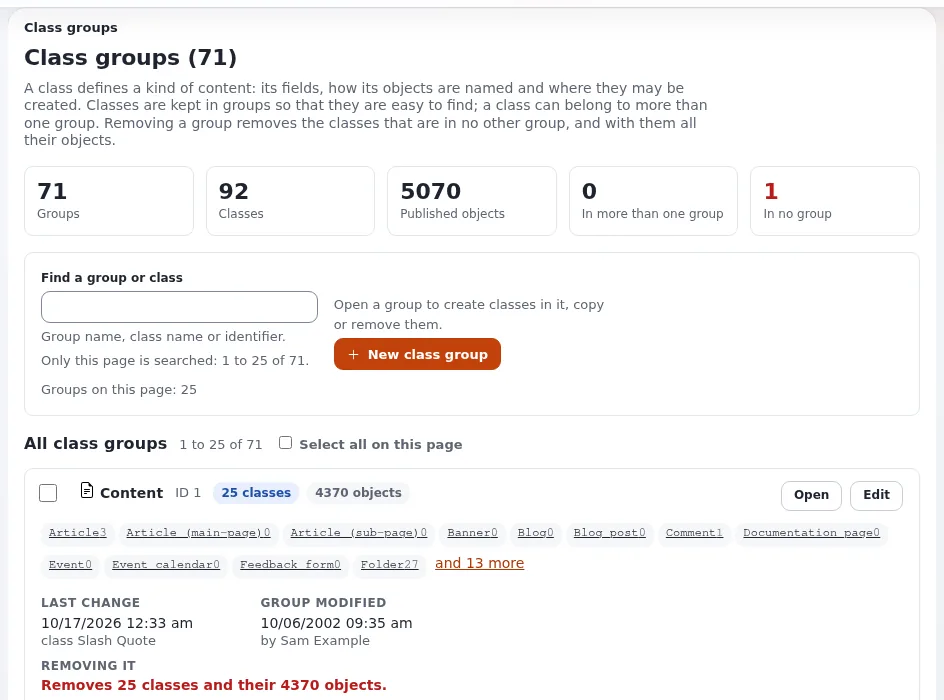

# Content classes for websites

This page is for website creators who create or adapt the content classes of a site in the administration. It covers
the class editor, the settings of a class and of each attribute, and which changes are safe once the site holds
content.

## Contents

1. [Where classes live](#where-classes-live)
2. [Create a class](#create-a-class)
3. [Class settings](#class-settings)
4. [Attribute settings](#attribute-settings)
5. [Changing a class on a live site](#changing-a-class-on-a-live-site)
6. [Moving classes between installations](#moving-classes-between-installations)

## Where classes live

**Setup > Classes** (`/class/grouplist`) lists the class groups (Content, Users, Media, Setup); each group lists its
classes ([Class groups](../../../guides/class-groups.md)). The classes of a new installation come from the site
package ([Site packages and the themes that ship](site-packages-and-shipped-themes.md)).

## Create a class

From [2. Create a class](../../../guides/content-model-and-editing.md#2-create-a-class):

1. Open **Setup > Classes**, the group **Content**, then **New class**.
2. Give a name (`Event`) and an identifier (`event`).
3. Set the object name pattern, for example `<title>`.
4. Add attributes: choose a datatype under **Add attribute**, press **Add**, give a name and an identifier.
5. Press **OK**. The class can now be created wherever policies allow.

## Class settings

| Setting | What it does |
|---|---|
| Name, identifier | what editors read; what templates and overrides use |
| Object name pattern | builds each object's name from attributes: `<title>`, `<first_name> <last_name>`, `<short_title\|title>` (the first that is not empty) |
| URL alias name pattern | builds the URL alias; empty means the object name |
| Container | the class may have children |
| Default sorting of children | the sort order new objects of this class give their children |
| Default object availability | whether an object is shown in languages it was not translated into ("always available") |

## Attribute settings

| Setting | Use |
|---|---|
| Required | the object cannot be published while it is empty |
| Searchable | the attribute's text goes into the search index |
| Translatable | each language has its own value; turn off for prices, dates, codes |
| Information collector | the attribute is filled in by visitors, not editors ([Forms with the information collector](forms-with-the-information-collector.md)) |
| Category | groups attributes into tabs of the edit form |
| Datatype options | depend on the datatype: maximum length, default value, allowed classes for relations, image size limit ... |

Two datatype options were added in Exponential 6 and are worth knowing for websites
([9. Required alternative text ...](../../../guides/content-model-and-editing.md#9-required-alternative-text-trimmed-text-lines-and-names-made-by-php)):
image fields can require an alternative text, and text lines can trim the stored value.

## Changing a class on a live site

| Change | Safe? | Note |
|---|---|---|
| Add an attribute | yes | existing objects get an empty value; check templates handle empty |
| Rename an attribute's name | yes | the identifier stays |
| Change an identifier | risky | every template and fetch using it must change at once |
| Make an attribute required | yes, but | existing objects stay as they are until edited |
| Remove an attribute | destructive | the data of that attribute is deleted from every object |
| Change a datatype | not possible in place | add a new attribute, migrate the data, remove the old one |
| Move an attribute up or down | yes | only the edit form order |

> **Warning**
> Large classes with many objects take a while to change, because every object gets the new attribute. Make class
> changes outside busy hours, and with a backup ([Backups and restores](backups-and-restores.md)).

## Moving classes between installations

Do not rebuild classes by hand on the production site. Export them from the development installation as a package
and import it ([Content packages (.ezpkg)](../app-creators/packages-and-ezpkg.md), [Packages](../../../guides/packages.md)).
Identifiers and remote IDs keep templates and overrides working on both sides.

## Related pages

- [Designing your content model](designing-your-content-model.md)
- [Choosing datatypes for your fields](choosing-datatypes.md)
- [The content model and editing](../../../guides/content-model-and-editing.md)
- [Free documentation](../../free-documentation.md): this page is free to copy, translate and improve under the GNU FDL 1.3.

<!-- exp-partner-block:start -->
**Become an Exponential Partner.** Partners share their information, provide funding, contribute back and
develop the products with us, and that is how Exponential grows. A partner website and dashboard are planned for
mid-2027: please become a partner today to speed up our growth rate and land new features faster. Start with
[Partners: start here](../../partners/partners-start-here.md) and [How to apply](../../partners/how-to-apply.md).
<!-- exp-partner-block:end -->
