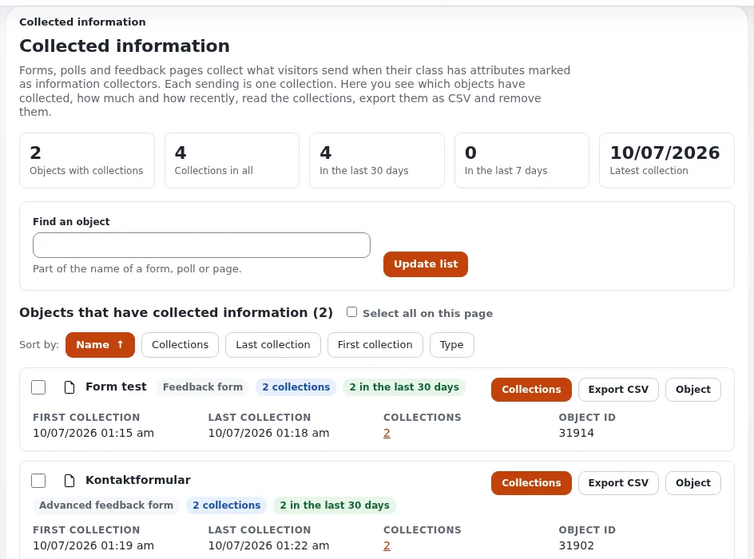

# Reading and exporting form submissions

This page is for website creators who hand forms over to the people who process them. Every submission of an
information collector form is stored as a **collection** and listed in **Setup > Collected information**
(`/infocollector/overview`). Full reference: [Collected information](../../../guides/collected-information.md).

## Contents

1. [The overview](#the-overview)
2. [One form's submissions](#one-forms-submissions)
3. [CSV export](#csv-export)
4. [Removing submissions](#removing-submissions)
5. [Who may see them](#who-may-see-them)
6. [Showing results on the site](#showing-results-on-the-site)

## The overview

The page shows figures (objects with collections, collections in total, in the last 30 and 7 days, the latest), a
search by name, sorting, and one card per form with **Collections**, **Export CSV** and **Object**. When nothing has
been collected yet, it lists the published objects that could collect, so you know the form is recognized.

## One form's submissions

**Collections** opens `infocollector/collectionlist/<object id>`: one row per submission; each opens
`infocollector/view/<collection id>` with every value.

## CSV export

**Export CSV** downloads `<name>-collected.csv` (UTF-8 with a byte order mark): collection ID, sent and changed time
(UTC), user ID, then one column per collector attribute. Values that a spreadsheet would read as a formula start with
an apostrophe. At most 50 000 rows, newest first. Every export is recorded in the audit trail, with the row count and
never the values ([Audit trail](../../../features/6.0/audit-trail.md)).

## Removing submissions

Tick forms on the overview (or submissions in one form's list) and **Remove selected**; the confirmation says how
many go. The forms themselves stay. Removals are recorded in the audit trail. Export first if the data is still needed.

## Who may see them

Everything needs `infocollector/read`. Give it to the people who process the forms, not to every editor
([Roles and policies](../../../guides/roles-and-policies.md)).

## Showing results on the site

Poll results are shown by the poll's result template (`content/collectedinfo/poll.tpl`). Other forms' submissions are
private by nature; do not publish them.

## Personal data checklist

- [ ] Only the fields you need are collected.
- [ ] Only the people who process them have `infocollector/read`.
- [ ] Exports are stored where personal data belongs, and deleted when done.
- [ ] Old submissions are removed on a schedule you can name.

## Related pages

- [Forms with the information collector](forms-with-the-information-collector.md)
- [Building a contact form, step by step](building-a-contact-form.md)
- [Security and audit](../../../guides/security-and-audit.md)
- [Free documentation](../../free-documentation.md): this page is free to copy, translate and improve under the GNU FDL 1.3.

<!-- exp-partner-block:start -->
**Become an Exponential Partner.** Partners share their information, provide funding, contribute back and
develop the products with us, and that is how Exponential grows. A partner website and dashboard are planned for
mid-2027: please become a partner today to speed up our growth rate and land new features faster. Start with
[Partners: start here](../../partners/partners-start-here.md) and [How to apply](../../partners/how-to-apply.md).
<!-- exp-partner-block:end -->
