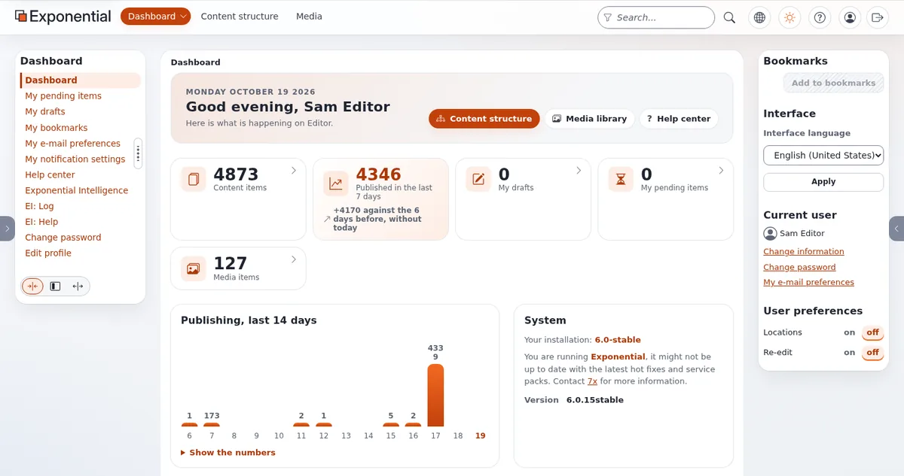

# Handing the site over to editors

This page is for website creators finishing a project. A site lives through its editors; a good handover decides
whether it stays good. Project managers find a handover template in [Project templates](../../leadership/project-templates.md).

## Contents

1. [Accounts and roles](#accounts-and-roles)
2. [The editor guide](#the-editor-guide)
3. [Training](#training)
4. [House rules for content](#house-rules-for-content)
5. [Support after launch](#support-after-launch)

## Accounts and roles

- One personal account per person; no shared logins.
- Roles by task: author, editor (publishes), layouts editor, form processor (`infocollector/read`), shop staff
  ([Roles and policies](../../../guides/roles-and-policies.md)).
- Limit each team to its subtree or section.
- Two-step login for everyone who can publish ([Two-factor login](../../../guides/two-factor-login.md)).

## The editor guide

Write a short guide specific to this site; link to the help for the general parts:

| Section | Content |
|---|---|
| The site's structure | where each kind of content lives |
| Classes | which class to use for what, and what each field becomes on the page |
| Images | sizes, alternative texts, where to upload |
| Landing pages | which layouts exist and who edits them |
| Publishing | drafts, review, publishing, versions ([Publishing and versions](../../publishing-and-versions.md)) |
| Forms and newsletters | who processes them and how |
| Who to ask | names of roles, not of people who may leave |

## Training

The in-admin help is the editors' manual: [Getting started](../../getting-started.md), [Editing content](../../editing-content.md),
[Media and uploads](../../media-and-uploads.md), [The layouts editor](../../layouts-editor.md),
[Keyboard shortcuts](../../keyboard-shortcuts.md), and [The admin tour](../../admin-tour.md). A training session
following the admin tour with the site's own content takes most editors from zero to working.

## House rules for content

- Titles short and clear; they become addresses.
- Every image with an alternative text.
- Link texts that say where they lead.
- Headings in order; no bold paragraphs as headings.
- Remove, do not hide forever; ask for a redirect when a page goes.

## Support after launch

- Agree who answers editors' questions and how fast.
- Collect questions in the first weeks; turn repeated ones into the guide.
- Show editors how to report a problem with the help's **Report an error** page
  ([When something goes wrong](../../when-something-goes-wrong.md)).

## Related pages

- [Working together](../../leadership/working-together.md)
- [Accessibility for site builders](accessibility-for-site-builders.md)
- [The launch checklist](launch-checklist.md)
- [Free documentation](../../free-documentation.md): this page is free to copy, translate and improve under the GNU FDL 1.3.

<!-- exp-partner-block:start -->
**Become an Exponential Partner.** Partners share their information, provide funding, contribute back and
develop the products with us, and that is how Exponential grows. A partner website and dashboard are planned for
mid-2027: please become a partner today to speed up our growth rate and land new features faster. Start with
[Partners: start here](../../partners/partners-start-here.md) and [How to apply](../../partners/how-to-apply.md).
<!-- exp-partner-block:end -->
