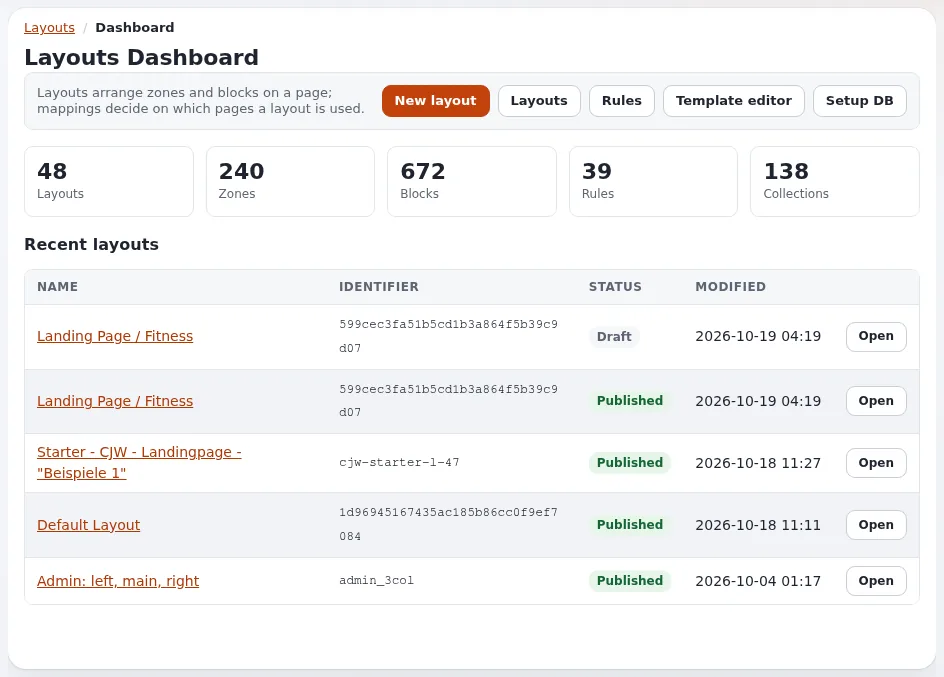

# Landing pages with the layouts editor

This page is for website creators who build landing pages, campaign pages and front pages. The layouts editor (the
`explayouts*` extensions) arranges blocks in zones of a layout and maps the layout to pages with rules, all in the
browser. Editors use it day to day ([The layouts editor](../../layouts-editor.md)); this page is the builder's view.
The complete reference is [Exponential Layouts](../../../bc/6.0/LAYOUTS.md).

## Contents

1. [The five ideas](#the-five-ideas)
2. [Where the editor is](#where-the-editor-is)
3. [A campaign page from scratch](#a-campaign-page-from-scratch)
4. [Drafts and publishing](#drafts-and-publishing)
5. [When to use layouts and when templates](#when-to-use-layouts-and-when-templates)
6. [Handing over to editors](#handing-over-to-editors)

## The five ideas

From [The five ideas you need](../../../bc/6.0/LAYOUTS.md#the-five-ideas-you-need):

| Idea | Meaning |
|---|---|
| **Layout** | a named arrangement based on a layout type, which fixes its zones; the type cannot be changed later |
| **Zone** | a named region of a layout (`main`, `sidebar`, `footer`); fill it, or link it to a shared layout |
| **Block** | one item in a zone: text, image, a list of articles, a hero; it has a definition, a view type and parameters |
| **Collection** | the content a listing block shows: manual (picked) or dynamic (a query) |
| **Rule** | decides which requests get which layout, by targets and conditions, highest priority first |

> A **rule** decides that this request gets that **layout**; the layout's **zones** hold **blocks**; a block may own a
> **collection** that supplies its content.

## Where the editor is

- The editor: `/explayouts_ui_api/app` in the administration.
- The form-based screens (rules, shared layouts, import, setup): `/explayouts_ui/dashboard`.
- Permissions: the `explayouts` module's policies; at least `explayouts/read`
  ([Permissions](../../../bc/6.0/LAYOUTS.md#permissions)).

## A campaign page from scratch

1. **Create the content page.** Create a landing page object (for example of class Landing page) where the campaign
   lives in the tree, say `/Autumn-campaign`.
2. **Create the layout.** In the editor, **Layouts > Create**: layout type `hero` (zones `top`, `left`, `main`,
   `right`), identifier `autumn_campaign`, name "Autumn campaign".
3. **Fill the zones.**
   - `top`: a `hero` block with title, text and a button.
   - `main`: a `list` block with view type `grid`, a dynamic collection "children of the Products folder", limit 6.
   - `left` and `right`: a `rich_text` block each, or a `card`.
4. **Map it.** In **Mappings**, a rule with target `node` (the landing page) and, for a time-limited campaign, a
   condition `time` with `from` and `to` ([Layout rules](layout-rules.md)).
5. **Preview**, then **Publish**.
6. **Check** the page on the site, logged out.

## Drafts and publishing

The editor always works on a draft; visitors only see published layouts. Changes are saved to the draft continuously;
**Publish** makes them live, **Discard draft** throws them away. Drafts are per layout, not per user: two people editing
the same layout overwrite each other ([Drafts, publishing and versions](../../../bc/6.0/LAYOUTS.md#drafts-publishing-and-versions)).

## When to use layouts and when templates

| Use the layouts editor for | Use templates for |
|---|---|
| front pages, landing and campaign pages that change often | the full view of each class |
| arranging existing content into sections | markup every page shares (the pagelayout) |
| pages editors must change without a developer | logic: forms, shop steps, member pages |
| a shared header and footer | |

A `full_view` block renders the current content item inside a layout, so a layout can frame normal content pages too.
A `tpl_block` renders a template a developer wrote, when no block type fits.

## Handing over to editors

- [ ] Give editors `explayouts` policies, and only the layouts they own.
- [ ] Name every block clearly; note why an item is pinned in its name.
- [ ] Show them [The layouts editor](../../layouts-editor.md) help page and the tour in the admin tour.
- [ ] Agree who publishes, and that one person edits a layout at a time.

## Related pages

- [Layout types, zones and blocks](layout-types-zones-and-blocks.md)
- [Layout rules: which page gets which layout](layout-rules.md)
- [Shared layouts: header, footer and prefooter](shared-header-and-footer.md)
- [explayouts_ui](../../../features/6.0/extensions/explayouts_ui.md)
- [Free documentation](../../free-documentation.md): this page is free to copy, translate and improve under the GNU FDL 1.3.

<!-- exp-partner-block:start -->
**Become an Exponential Partner.** Partners share their information, provide funding, contribute back and
develop the products with us, and that is how Exponential grows. A partner website and dashboard are planned for
mid-2027: please become a partner today to speed up our growth rate and land new features faster. Start with
[Partners: start here](../../partners/partners-start-here.md) and [How to apply](../../partners/how-to-apply.md).
<!-- exp-partner-block:end -->
