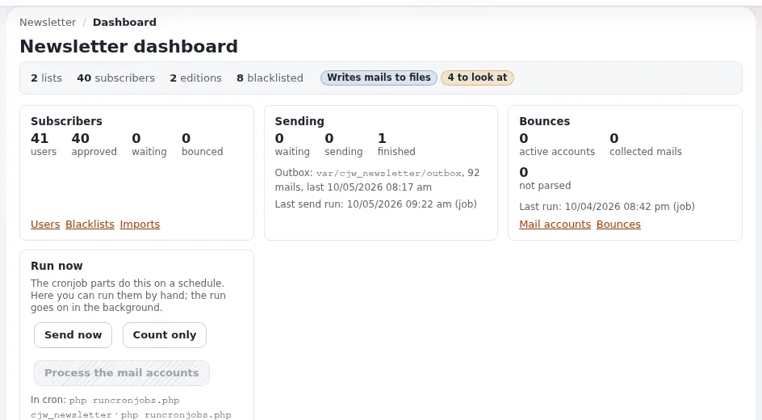

# Newsletter lists and subscriptions

This page is for website creators and editors who look after newsletter subscribers. It covers what the subscription
statuses mean, where subscribers are managed, importing and exporting, and keeping lists clean
([cjw_newsletter](../../../features/6.0/extensions/cjw_newsletter.md)).

## Contents

1. [Statuses](#statuses)
2. [Where subscribers are managed](#where-subscribers-are-managed)
3. [Importing and exporting](#importing-and-exporting)
4. [Bounces and the blacklist](#bounces-and-the-blacklist)
5. [Consent](#consent)

## Statuses

| Status | Meaning |
|---|---|
| Pending | subscribed, confirmation mail sent, not yet confirmed |
| Confirmed | the subscriber clicked the confirmation link |
| Approved | confirmed and, where the list requires it, approved by an administrator |
| Removed by user / by administrator | no longer receives mail |
| Soft or hard bounced | mail could not be delivered; after `BounceThresholdValue` bounces (default 3) the user stops receiving |

Only confirmed or approved subscribers receive editions.

## Where subscribers are managed

| View | Use |
|---|---|
| `newsletter/subscription_list` | subscriptions of a list |
| `newsletter/user_list`, `user_view`, `user_edit`, `user_create` | the newsletter users across lists |
| `newsletter/blacklist_item_list`, `blacklist_item_add`, `blacklist_item_remove` | addresses that never get mail |
| `newsletter/mailbox_list`, `mailbox_item_list` | bounce mailboxes and their messages |

## Importing and exporting

`newsletter/subscription_list_csvimport` imports subscribers from CSV (delimiter `DefaultCsvDelimiter`, `;` by default),
`subscription_list_csvexport` exports them. Import only people who agreed to receive the newsletter; record where the
consent came from.

## Bounces and the blacklist

Configure a bounce mailbox (`newsletter/mailbox_list`, `mailbox_edit`) and run the `cjw_newsletter_mailbox` cron part; bounces are
counted per subscriber. Put addresses that must never be mailed on the blacklist; it wins over every list.

## Consent

- [ ] Double opt-in for every public subscription.
- [ ] An unsubscribe link in every edition (the shipped `news` and `company` skins print one).
- [ ] The subscribe form says what subscribers get and how often.
- [ ] Exports kept only as long as needed.

## Related pages

- [Newsletters with cjw_newsletter](newsletters-with-cjw-newsletter.md)
- [Sending newsletters safely](sending-newsletters.md)
- [Free documentation](../../free-documentation.md): this page is free to copy, translate and improve under the GNU FDL 1.3.

<!-- exp-partner-block:start -->
**Become an Exponential Partner.** Partners share their information, provide funding, contribute back and
develop the products with us, and that is how Exponential grows. A partner website and dashboard are planned for
mid-2027: please become a partner today to speed up our growth rate and land new features faster. Start with
[Partners: start here](../../partners/partners-start-here.md) and [How to apply](../../partners/how-to-apply.md).
<!-- exp-partner-block:end -->
