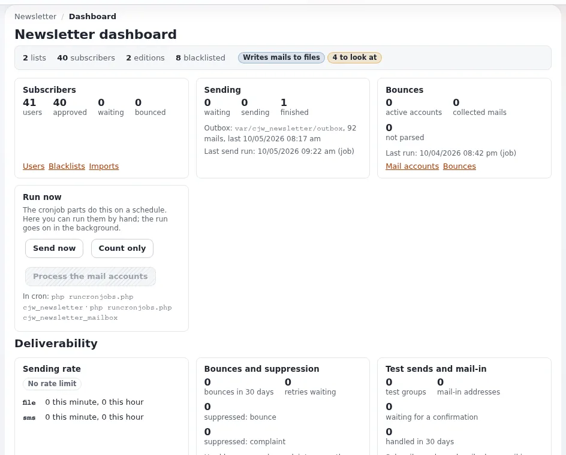

# Newsletters with cjw_newsletter

This page is for website creators who add a newsletter to a site. `cjw_newsletter` is a complete newsletter system:
editions are written as content, visitors subscribe to lists with a double opt-in, editions are sent by cron in the
background, bounces and a blacklist keep the lists clean, and every send is archived
([cjw_newsletter](../../../features/6.0/extensions/cjw_newsletter.md)). It is opened at **Newsletter** in the
administration (`/newsletter/index`).

## Contents

1. [The parts](#the-parts)
2. [Setting it up](#setting-it-up)
3. [Subscribe forms on the site](#subscribe-forms-on-the-site)
4. [Writing and sending an edition](#writing-and-sending-an-edition)
5. [Rehearsing without real mail](#rehearsing-without-real-mail)
6. [Checklist](#checklist)

## The parts

| Part | What it is |
|---|---|
| Newsletter system | content (class `cjw_newsletter_system`) that groups lists; below `[NewsletterSettings] RootFolderNodeId` |
| List | content (`cjw_newsletter_list`) visitors subscribe to |
| Edition | content (`cjw_newsletter_edition`) with articles (`cjw_newsletter_article`): one issue |
| Subscriptions | who is subscribed to what, with a status (pending, confirmed, approved, removed, bounced) |
| Public forms | `newsletter/subscribe`, `configure`, `unsubscribe`, `subscribe_infomail` |
| Sending | `newsletter/send` schedules; cron builds and processes the mail queue |



## Setting it up

1. Activate `cjw_newsletter` and install its class packages (they ship with the extension).
2. Create a folder for newsletters and set `[NewsletterSettings] RootFolderNodeId` to its node ID in
   `settings/override/cjw_newsletter.ini.append.php`.
3. Below it, create a newsletter system and a list.
4. Set the mail transports (file first, see below) and `EmailSubjectPrefix` if you want one.
5. Add the cron parts ([10.5 Newsletters](../../../install/10-after-installing.md#105-notifications-and-newsletters)):

   ```text
   */10 * * * *  cd /path/to/installation && php runcronjobs.php -q -s site cjw_newsletter
   25   * * * *  cd /path/to/installation && php runcronjobs.php -q -s site cjw_newsletter_mailbox
   ```

## Subscribe forms on the site

The public views (`newsletter/subscribe`, `newsletter/unsubscribe`, `newsletter/configure`) are pages of the site; link
them from your footer or a block. Anonymous visitors need the newsletter module's subscribe policies; the subscriber
confirms by mail (double opt-in) before the subscription counts. Skins for the newsletter mails are listed in
`AvailableSkinArray[]` and live in `design:newsletter/skin/<name>`; override them in your design.

## Writing and sending an edition

1. Create an edition under the list, with its articles; it is content, so it has drafts and preview.
2. Send a test to yourself (preview).
3. Schedule it with **Send**; cron queues and sends it (`cjw_newsletter_mailqueue_create`, `_process`).
4. Watch the send status; an edition can be aborted while it is being sent (`newsletter/send_abort`).

Details for editors: [Newsletter lists and subscriptions](newsletter-lists-and-subscriptions.md),
[Sending newsletters safely](sending-newsletters.md).

## Rehearsing without real mail

A fresh installation writes newsletter mail to files: `TransportMethodCronjob=file`,
`TransportMethodDirectly=file`, `FileTransportMailDir=var/log/mail`. Each recipient gets an `.eml` file. Rehearse
subscribing, confirming, sending and unsubscribing this way before switching to `smtp` or `sendmail`. The directory
must be writable by the web server user and the cron user.

## Checklist

- [ ] Classes installed and `RootFolderNodeId` set.
- [ ] Cron parts running.
- [ ] A full rehearsal with the file transport passed.
- [ ] Sender address and domain set up for real mail (SPF and DKIM at your mail provider).
- [ ] Unsubscribe link in every mail; privacy note on the subscribe form.

## Related pages

- [Newsletter lists and subscriptions](newsletter-lists-and-subscriptions.md)
- [Sending newsletters safely](sending-newsletters.md)
- [Mail preferences (administrators)](../../../guides/mail-preferences-administrator.md)
- [Free documentation](../../free-documentation.md): this page is free to copy, translate and improve under the GNU FDL 1.3.

<!-- exp-partner-block:start -->
**Become an Exponential Partner.** Partners share their information, provide funding, contribute back and
develop the products with us, and that is how Exponential grows. A partner website and dashboard are planned for
mid-2027: please become a partner today to speed up our growth rate and land new features faster. Start with
[Partners: start here](../../partners/partners-start-here.md) and [How to apply](../../partners/how-to-apply.md).
<!-- exp-partner-block:end -->
