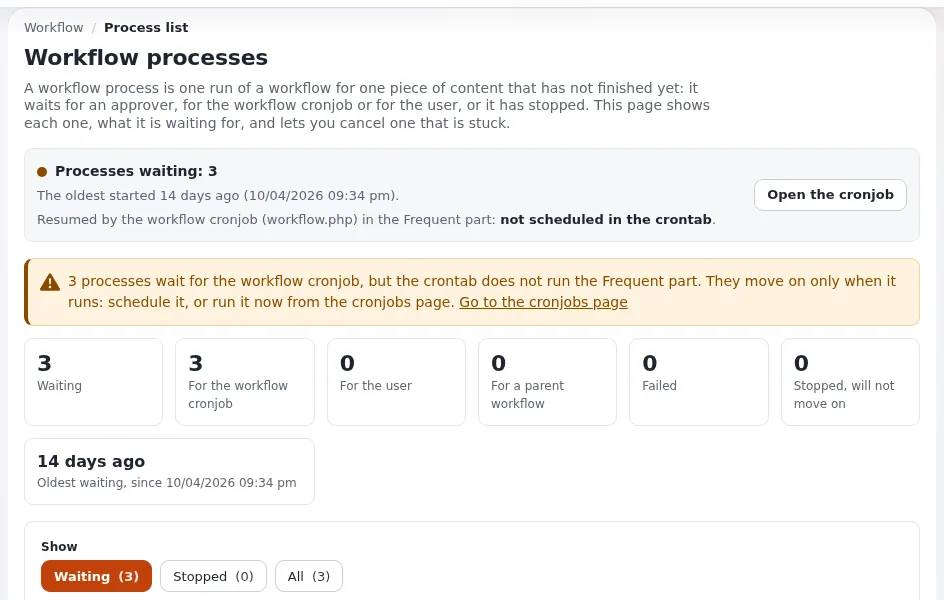

# Approvals and review

This page is for the owner and editor-in-chief who decide whether content must be checked before visitors see it.
Exponential can hold a version until an approver accepts it: an **approval workflow** connected to publishing. Your
administrator sets it up ([Workflows](../../../guides/workflows.md)); this page helps you decide how it should behave
and how to run it day to day.

## Contents

1. [Do you need it?](#do-you-need-it)
2. [The decisions you make](#the-decisions-you-make)
3. [What authors and approvers see](#what-authors-and-approvers-see)
4. [The one thing that must run](#the-one-thing-that-must-run)
5. [A daily routine for approvers](#a-daily-routine-for-approvers)
6. [Lighter alternatives](#lighter-alternatives)

## Do you need it?

| Situation | Approval worth it? |
|---|---|
| Legal, medical, financial or press statements | yes, for that section |
| New or junior writers, agencies, volunteers | yes, for them, until they know the rules |
| Translations by an external translator | yes, per language ([Translation routine](translation-routine.md)) |
| A small team of experienced editors | often not; versions let you undo ([Drafts, versions and undo](drafts-versions-and-undo.md)) |
| Corrections of typos by the editors who wrote the page | usually not; exclude their group |

## The decisions you make

The *Approve* event narrows who and what needs approval; content outside it is let through at once
([Workflows, 3.2 Set up the Approve event](../../../guides/workflows.md#32-set-up-the-approve-event)):

| Field | Your decision |
|---|---|
| Affected sections | which parts of the site need review (*All sections* or a list) |
| Affected languages | only versions whose initial language is one of these, for per-language review |
| Affected versions | all versions, only new objects, or only updates of existing objects |
| Users who approve content | named approvers |
| Groups who approve content | every member of these groups is an approver (prefer a group) |
| Excluded user groups | users in these groups publish without approval |

An approver never needs their own content approved: when the publisher is one of the approvers, the event lets the
version through (same source). One workflow runs per trigger; several approval rules are combined with a
*Multiplexer* event, which your administrator sets up.

## What authors and approvers see

- The **author** presses **Send for publishing**; the version becomes **pending** and appears in their *My pending
  items* ([Publishing, versions and the trash](../../publishing-and-versions.md)).
- The **approver** finds the request in **My account > Collaboration**, looks at the preview and presses **Approve**,
  or **Deny** with a comment for the author ([Workflows, 3.5 Try it](../../../guides/workflows.md#35-try-it)).
- Denied: the version is a draft for the author again. Approved: it is published at the next run of the workflow
  cronjob.

Content written by the writing assistant goes the same way: "Send for approval" runs the normal publish operation, so
the approval holds it ([Exponential Intelligence](../growth/exponential-intelligence.md)).

## The one thing that must run

> **Warning**
> Approved content is published by the **workflow cronjob** (`workflow.php`, in the *frequent* part). Without it,
> approved content is never published ([Workflows](../../../guides/workflows.md)). **Setup > Workflow processes**
> has a status bar that says whether the cronjob is scheduled and when it runs next. Ask your host or partner to
> confirm it is scheduled, and look at that bar after any server move.

## A daily routine for approvers

1. Open *My pending items* or the collaboration inbox once or twice a day, at fixed times the authors know.
2. Decide; when you deny, write a comment that says what to change.
3. Before a publication day in the [Content calendar](content-calendar.md), check nothing important is waiting.
4. Once a week, the editor-in-chief looks at **Setup > Workflow processes**: a process that waits for days usually
   means an approver left or the cronjob stopped ([Workflows](../../../guides/workflows.md)).

   

## Lighter alternatives

- **Preview before publishing**: the edit form's preview and version preview let a colleague look before the author
  publishes ([Preview before you publish](../../businesses/reliability/preview-before-you-publish.md)).
- **Object states** as review stages (draft, in review, approved) that roles can use
  ([Object states](../../../guides/object-states.md)).
- **After-the-fact review** with versions and the compare view
  ([Versions of an object](../../../guides/content-history.md)).

## Related pages

- [Workflows](../../../guides/workflows.md)
- [Approval workflows for intranets](../../businesses/intranets/approval-workflows.md)
- [Drafts, versions and undo](drafts-versions-and-undo.md)
- [Free documentation](../../free-documentation.md): this page is free to copy, translate and improve under the GNU FDL 1.3.

<!-- exp-partner-block:start -->
**Become an Exponential Partner.** Partners share their information, provide funding, contribute back and
develop the products with us, and that is how Exponential grows. A partner website and dashboard are planned for
mid-2027: please become a partner today to speed up our growth rate and land new features faster. Start with
[Partners: start here](../../partners/partners-start-here.md) and [How to apply](../../partners/how-to-apply.md).
<!-- exp-partner-block:end -->
