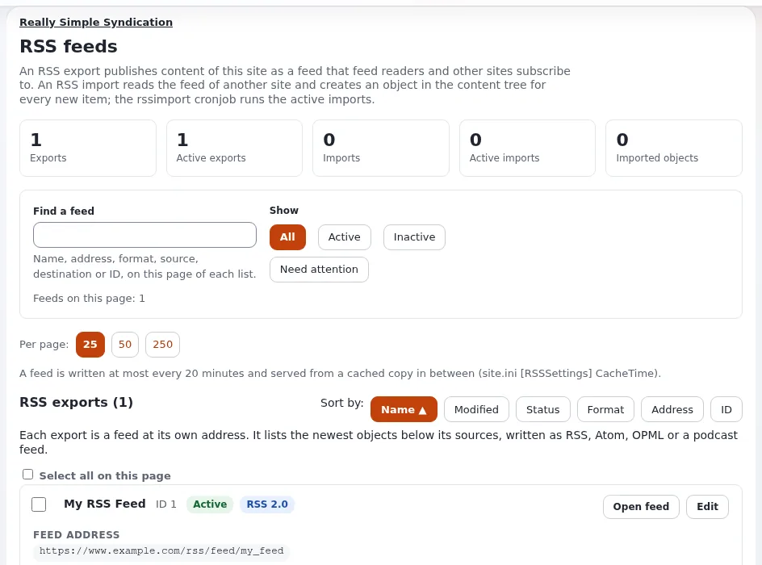

# RSS and podcast feeds

This page is for owners who want news, events or episodes to reach people through feed readers, partner sites and
podcast directories. Exponential publishes feeds from content and can read other sites' feeds into content
([RSS feeds](../../../guides/rss-feeds.md)). The administrator sets them up; you decide what each feed is for and keep
it alive.

## Contents

1. [What the site can publish and read](#what-the-site-can-publish-and-read)
2. [Decide per feed](#decide-per-feed)
3. [A podcast](#a-podcast)
4. [Importing other feeds](#importing-other-feeds)
5. [Keeping feeds working](#keeping-feeds-working)

## What the site can publish and read

From [RSS feeds](../../../guides/rss-feeds.md):

- An **export** is a feed this site publishes at `/rss/feed/<address>`. It lists the newest objects below its
  **sources** (locations, each with a class and optionally their sub-items), as RSS 1.0, RSS 2.0, Atom, OPML or an
  Apple Podcasts feed.
- An **import** reads the feed of another site and creates an item below its destination for every entry it has not
  seen before. The `rssimport` cronjob runs the active imports; nothing is read without it.
- The page in the administration (**Setup > RSS**) shows the exports and imports with an overview and a filter for
  those that need attention.

  

## Decide per feed

| Question | Example answer |
|---|---|
| What is the feed for? | "News for partner sites and readers" |
| Which part of the tree is its source, and which class? | the News folder, class Article |
| Which format? | RSS 2.0 for readers; Apple Podcasts for a show |
| Who owns it? | the news editor |
| Who uses it? | list partner sites that embed it, so you can tell them about changes |

> **Warning**
> Removing an export makes its address stop answering its readers
> ([RSS feeds](../../../guides/rss-feeds.md)). Before removing or renaming a feed, tell the sites and people who use
> it.

## A podcast

An export can be written as **Apple Podcasts (RSS 2.0 + iTunes)**, so a show published on the site can be submitted to
Apple without a hand-written feed ([RSS, podcast and the feed list](../../../features/6.0/rss-podcast-and-feed-list.md)).
In owner's terms:

| You provide | Why |
|---|---|
| An episode class with an audio file field | the feed's enclosure must name a media or file field holding the audio |
| Owner name and e-mail, artwork, category | required channel fields |
| Author, language, copyright, description | optional channel fields |
| A decision on explicit content | default off |
| One person who publishes episodes | each episode is a content item in the source folder |

When the show ends, the export can mark it as finished, or keep it out of the directory (same source). Agree with your
administrator which role address goes in the owner e-mail rather than a personal one.

## Importing other feeds

Imports are useful for a partner's news on your site, or a feed from another of your own sites. Before asking for one:

- Do you have the right to republish the content?
- Where should the items go, and who checks them?
- A removed import keeps the items it created ([RSS feeds](../../../guides/rss-feeds.md)); the feed list can clean up
  what an import created ([RSS, podcast and the feed list](../../../features/6.0/rss-podcast-and-feed-list.md)).

For two-way sharing between your own installations, see
[Feeds and syndication](../../businesses/mobile-and-headless/feeds-and-syndication.md).

## Keeping feeds working

Every quarter:

- [ ] Open each feed address you know is used: it answers and lists recent items.
- [ ] The feed addresses use the public site, not the administration
      ([RSS, podcast and the feed list](../../../features/6.0/rss-podcast-and-feed-list.md)).
- [ ] **Setup > RSS**, filter **Need attention**: fix or retire what is listed.
- [ ] Imports: the newest imported item is recent; if not, the `rssimport` cronjob may not run
      ([Cronjobs](../../../guides/cronjobs.md)).
- [ ] Podcast: the directory shows the newest episode.

## Related pages

- [RSS feeds](../../../guides/rss-feeds.md)
- [RSS feeds for your site](../../creators/website-creators/rss-feeds-for-your-site.md)
- [Feeds for new acquisitions](../../businesses/libraries/feeds-for-new-acquisitions.md)
- [Free documentation](../../free-documentation.md): this page is free to copy, translate and improve under the GNU FDL 1.3.

<!-- exp-partner-block:start -->
**Become an Exponential Partner.** Partners share their information, provide funding, contribute back and
develop the products with us, and that is how Exponential grows. A partner website and dashboard are planned for
mid-2027: please become a partner today to speed up our growth rate and land new features faster. Start with
[Partners: start here](../../partners/partners-start-here.md) and [How to apply](../../partners/how-to-apply.md).
<!-- exp-partner-block:end -->
