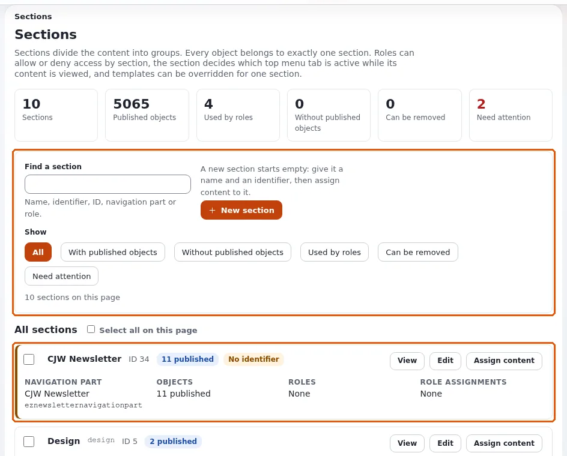
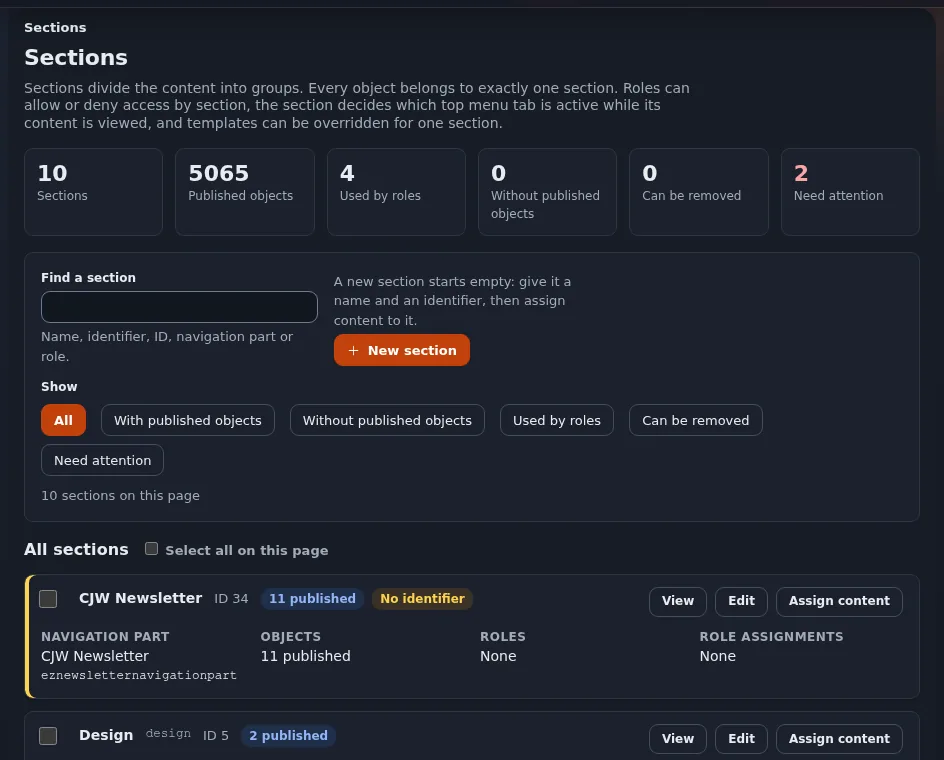

# admin4 components

This page is for designers and developers who build an administration page, in the kernel or in an extension. The
administration has a small component library: classes with the prefix `.a4-` in `design/admin4/stylesheets/components.css`
(identical copy in `design/admin`). The full reference is the "Components" section of
[Admin styling](../../../bc/6.0/admin4-styling.md); this page is the overview.

## Contents

1. [Use them first](#use-them-first)
2. [The main components](#the-main-components)
3. [A page built from them](#a-page-built-from-them)
4. [States and weight](#states-and-weight)

## Use them first

The rule for every admin template: reuse the shared classes before writing any CSS. They are already light and dark,
right-to-left aware, keyboard accessible, and loaded on every admin page. New CSS of your own is the exception
([admin4 module stylesheets](admin4-module-stylesheets.md)).

## The main components

| Need | Classes |
|---|---|
| A module page wrapper | `.a4-page` (reset, font, links, focus ring) |
| Page title and actions | `.a4-pagehead` with `.a4-pagehead-title`, `.a4-pagehead-actions` |
| Boxes | `.a4-card` (`.a4-card-head`, `.a4-card-title`, `.a4-card-body`, `.a4-card-foot`), `.a4-cards` |
| Buttons | `.a4-btn`, `.a4-btn-primary`, `.a4-btn-danger`, `.a4-btn-ghost`, `.a4-btn-small`, `.a4-btn-icon`; `.a4-actions` for a row |
| Action bars | `.a4-toolbar` (`.is-bottom`, `.is-sticky`) |
| Filters above a list | `.a4-filterbar` |
| Forms | `.a4-form`, `.a4-field`, `.a4-label`, `.a4-input`, `.a4-field-error`, `.a4-error-summary`, `.a4-check`, `.a4-radios` |
| Tables | `.a4-table-wrap` around `table.a4-table` |
| Labels | `.a4-tag`, `.a4-badge` (`.is-ok`, `.is-warn`, `.is-bad`, `.is-info`), `.a4-status` |
| Messages | `.a4-notice` (`.is-ok`, `.is-warn`, `.is-bad`, `.is-info`), `.a4-empty` for an empty list |
| Disclosure | `details.a4-fold`, `details.a4-confirm` |
| Paging, tabs | `.a4-pager`, `.a4-tabs` |
| Icons | `.a4-icon` with `.a4-bi-<name>` |
| Utilities | `.a4-sr-only`, `.a4-muted`, `.a4-meta`, `.a4-num`, `.a4-nowrap`, `.a4-code` |

## A page built from them

```tpl
<div class="a4-page">
    <div class="a4-pagehead">
        <div class="a4-pagehead-main"><h1 class="a4-pagehead-title">{'Reports'|i18n( 'design/admin/myext' )}</h1></div>
        <div class="a4-pagehead-actions"><a class="a4-btn a4-btn-primary" href={'/myext/new'|ezurl}>{'New report'|i18n( 'design/admin/myext' )}</a></div>
    </div>
    <div class="a4-card">
        <div class="a4-card-head"><h2 class="a4-card-title">{'Last runs'|i18n( 'design/admin/myext' )}</h2></div>
        <div class="a4-card-body">
            {if $runs|count}
            <div class="a4-table-wrap"><table class="a4-table">...</table></div>
            {else}
            <p class="a4-empty">{'No runs yet.'|i18n( 'design/admin/myext' )}</p>
            {/if}
        </div>
    </div>
</div>
```





No `<style>`, no `style=""`, every color from tokens through the classes.

## States and weight

States are `.is-*` classes on the component (`.a4-card.is-warn`). Each component is one class plus at most an element
or a state, so a module rule with one more class always wins, and components win over the old base element rules.

## Related pages

- [admin4 tokens](admin4-tokens.md)
- [admin4 module stylesheets](admin4-module-stylesheets.md)
- [Admin designs overview](admin-designs-overview.md)
- [Free documentation](../../free-documentation.md): this page is free to copy, translate and improve under the GNU FDL 1.3.

<!-- exp-partner-block:start -->
**Become an Exponential Partner.** Partners share their information, provide funding, contribute back and
develop the products with us, and that is how Exponential grows. A partner website and dashboard are planned for
mid-2027: please become a partner today to speed up our growth rate and land new features faster. Start with
[Partners: start here](../../partners/partners-start-here.md) and [How to apply](../../partners/how-to-apply.md).
<!-- exp-partner-block:end -->
