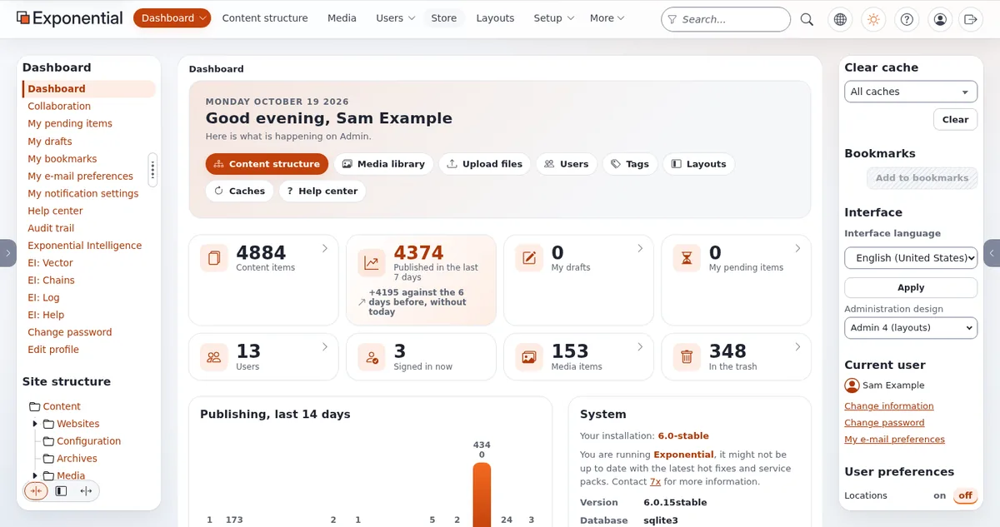
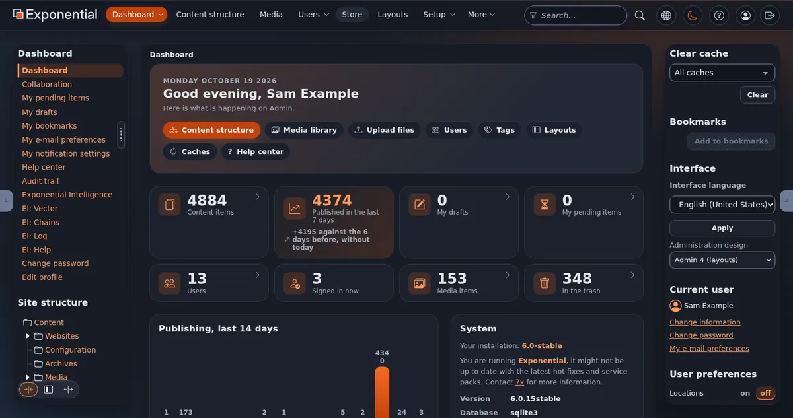

# Dark mode overview

This page is for designers who add a dark mode to a design, or style pages inside the administration, which has one.
It explains the model; the pages linked from each section show the code.

## Contents

1. [The model in four parts](#the-model-in-four-parts)
2. [Light, dark and system](#light-dark-and-system)
3. [How admin4 does it](#how-admin4-does-it)
4. [Two ways for a public design](#two-ways-for-a-public-design)
5. [What dark mode is not](#what-dark-mode-is-not)

## The model in four parts

1. **Tokens.** Every color is a CSS custom property (`--site-ink`, `--site-surface`), never a literal value in a rule
   ([Design tokens](design-tokens.md)).
2. **Two sets of values.** The tokens get light values on `:root` and dark values under a selector or media query.
3. **A switch on `<html>`.** An attribute such as `data-theme="dark"` selects the dark set, or the system setting does.
4. **No flash.** The attribute is set before the browser draws anything, by a tiny script file in the head
   ([The theme toggle and the pre-paint guard](theme-toggle-pre-paint-guard.md)).

## Light, dark and system

A good switch offers three choices: light, dark, and "system" (follow the operating system's setting, also when it
changes while the page is open). Without any choice, a public design can follow the system with
`prefers-color-scheme` alone ([Dark mode with prefers-color-scheme](dark-mode-with-prefers-color-scheme.md)).

## How admin4 does it

- **Tokens** `--a4-*` in `design/admin4/stylesheets/components.css`; every color token has a dark value under
  `html[data-a4-theme="dark"]` (the rule is enforced by a test: a color token without a dark value fails it).
- **The choice** is stored per user as the preference `admin_color_mode` (in the browser's `localStorage` on pages
  without a signed-in user) and applied by `design/admin4/javascript/a4_head.js`, loaded as a file in the head
  before the stylesheets. It sets `data-a4-theme` (`light` or `dark`, what the stylesheets read) and
  `data-a4-theme-choice` (`light`, `dark` or `system`, what the switch shows).
- **The switch** in the header (`#a4-theme-toggle`) steps light, dark, system; a status region announces each change
  to screen readers.
- **Print** uses the light tokens: the script sets light before printing and restores the choice afterwards.
- `color-scheme: dark` in the dark block makes form controls and scrollbars dark too.
- A frame that has no dark design says `data-a4-modes="light"` on `<html>` and stays light.

## Two ways for a public design

| Approach | Effort | Result |
|---|---|---|
| Follow the system only (`@media (prefers-color-scheme: dark)`) | one block of dark token values | automatic, no switch, no script |
| A switch with light, dark, system | tokens, an attribute, one small head script and a button | visitors choose; the choice is remembered |

Start with the first; add the switch when visitors ask for it. [Tutorial: add dark mode](tutorial-add-dark-mode.md)
does both, step by step.

## What dark mode is not

- Not `filter: invert()`: images and brand colors come out wrong.
- Not just a black background: surfaces need several levels (page, card, raised), borders need their own token, and
  every pair must keep its contrast ([Color contrast](color-contrast.md)).
- Not optional for new tokens in the admin: every new color token needs its dark value in the same change.

## Related pages

- [Design tokens](design-tokens.md)
- [admin4 tokens](admin4-tokens.md)
- [Checklist: dark mode](checklist-dark-mode.md)
- [Free documentation](../../free-documentation.md): this page is free to copy, translate and improve under the GNU FDL 1.3.

<!-- exp-partner-block:start -->
**Become an Exponential Partner.** Partners share their information, provide funding, contribute back and
develop the products with us, and that is how Exponential grows. A partner website and dashboard are planned for
mid-2027: please become a partner today to speed up our growth rate and land new features faster. Start with
[Partners: start here](../../partners/partners-start-here.md) and [How to apply](../../partners/how-to-apply.md).
<!-- exp-partner-block:end -->
