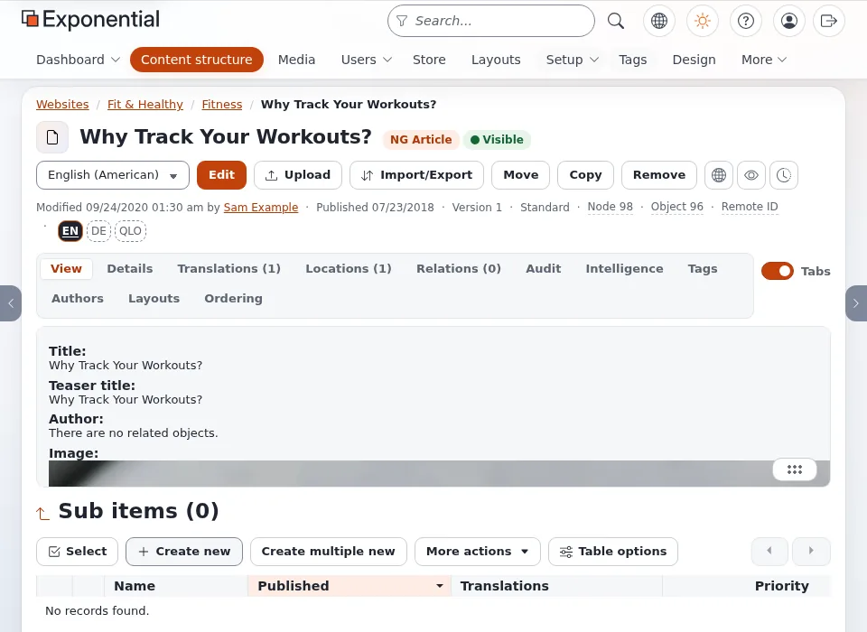

# Testing at zoom levels

This page is for designers who test a design. Many visitors read with browser zoom; some at 200% all the time. The page
answers: what zoom does, how to test it quickly, and what usually breaks.

## Contents

1. [What zoom does](#what-zoom-does)
2. [How to test](#how-to-test)
3. [What usually breaks](#what-usually-breaks)
4. [A worked example: the media design](#a-worked-example-the-media-design)
5. [Checklist](#checklist)

## What zoom does

Browser zoom makes every CSS pixel bigger, so the **viewport shrinks in CSS pixels**: a 1920 px wide window at 200%
zoom is a 960 px viewport, at 150% a 1280 px one. Media queries see the smaller width. A zoomed desktop visitor therefore
gets your tablet or phone layout, with a mouse and a keyboard.

The Web Content Accessibility Guidelines ask that content can be zoomed to 200% without loss of content or function,
and reflow without horizontal scrolling at 320 CSS pixels wide.

## How to test

- **Real zoom:** press Ctrl and + (Cmd and + on a Mac) to 200% in a 1920 px wide window.
- **Device emulation:** in the browser's developer tools, a responsive viewport of 960 x 1080 with device pixel ratio 2
  looks like a 1920 px screen at 200%.
- **Automated:** the project's browser checks use 1440 px at scale 1, 960 px at scale 2 and 375 px at scale 2.

## What usually breaks

- **Controls hidden "for phones".** A rule that hides a search preview or slider arrows below a breakpoint also hides
  them from zoomed desktop users, who have a mouse and expect them.
- **Fixed heights.** Text grows, boxes do not: text overflows or is clipped.
- **Sticky headers.** A header that takes 100 px at 100% takes a large share of a zoomed viewport; make it shorter or
  not sticky below a height (`@media (max-height: ...)`).
- **Horizontal scroll** from fixed widths, wide tables or long words; use `max-width: 100%`, scroll containers for
  tables, and `overflow-wrap: anywhere` for long strings.

## A worked example: the media design

The media design's `stylesheets/zoom-support.css` starts with this explanation: browser zoom shrinks the viewport in
CSS pixels, the original theme treated every narrow viewport as a touch phone and hid the search previews and the slider
controls, and the file gives them back. Its `exp-mobile-layout.css` adds tap-target, input-size and image fixes for
phones, tablets and 200% zoom. Both are loaded after the theme's build output, so they win without editing it.

## Checklist

- [ ] 960 px at scale 2: every function of the 1440 px page is there and usable with a mouse.
- [ ] No horizontal scroll of the page at 960 px and 375 px.
- [ ] Text not clipped in buttons, cards, tabs.
- [ ] Sticky elements leave enough room for content.
- [ ] Light and dark mode both checked at 200%.

## Related pages

- [Responsive design](responsive-design.md)
- [Breakpoints and container widths](breakpoints-and-container-widths.md)
- [Checklist: accessibility](checklist-accessibility.md)
- [Free documentation](../../free-documentation.md): this page is free to copy, translate and improve under the GNU FDL 1.3.

<!-- exp-partner-block:start -->
**Become an Exponential Partner.** Partners share their information, provide funding, contribute back and
develop the products with us, and that is how Exponential grows. A partner website and dashboard are planned for
mid-2027: please become a partner today to speed up our growth rate and land new features faster. Start with
[Partners: start here](../../partners/partners-start-here.md) and [How to apply](../../partners/how-to-apply.md).
<!-- exp-partner-block:end -->
