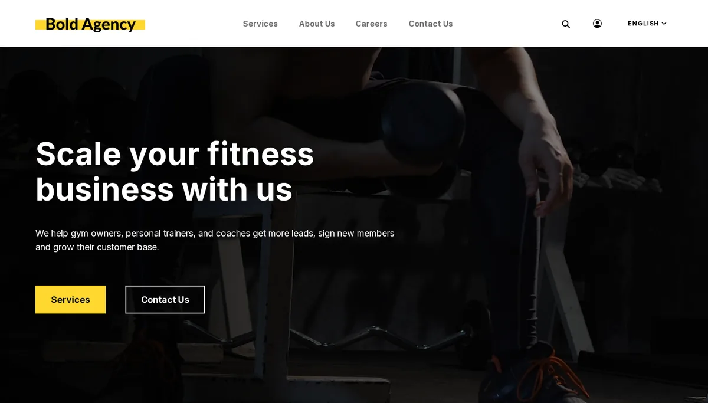

# The themes that ship with Exponential

This page is for designers who want to see what already exists before they start. It lists the designs that come with
the Exponential root package (its `composer.json`), the designs in the kernel's `design/` folder, and where each one is
used. Use it to find a template to learn from, or a design to build on.

## Contents

1. [Public site themes](#public-site-themes)
2. [Administration designs](#administration-designs)
3. [Kernel base designs](#kernel-base-designs)
4. [Where each is used on the demonstration installation](#where-each-is-used-on-the-demonstration-installation)
5. [How to look at one](#how-to-look-at-one)

## Public site themes

| Extension (Composer package) | Design(s) | In one line | Read more |
|---|---|---|---|
| `sevenx_themes_media` (`se7enxweb/sevenx-themes-media`) | `media` | the media site look: hundreds of templates, block templates for the layouts editor, self-hosted fonts, packed CSS and JS | [The media theme](media-theme-tour.md) |
| `sevenx_themes_simple` (`se7enxweb/sevenx_themes_simple`) | `simple` | the light, responsive default public design, built on the ezwebin classes | [The simple theme](simple-theme-tour.md) |
| `cjw_themes_jumper` (`se7enxweb/cjw_themes_jumper`) | `starter`, `standard` | the CJW starter look, drawn with layouts, with its own image aliases and a map tile proxy | [The starter theme](starter-theme-tour.md) |
| `ezwebin` (`se7enxweb/ezwebin`) | `ezwebin` | the classic website interface design and its content classes | [The ezwebin design as a base](ezwebin-as-a-base.md) |
| `ezdemo` (`se7enxweb/ezdemo`) | `ezdemo`, `admin` | the classic demo website design | [ezdemo](../../../features/6.0/extensions/ezdemo.md) |
| `ezflow` (`se7enxweb/ezflow`) | `ezflow`, `standard`, `admin`, `iphone` | the classic page builder (page datatype with zones and blocks) | [ezflow](../../../features/6.0/extensions/ezflow.md) |

The demonstration installation also has `sevenx_themes_super`, a small design created with the design extension
wizard ([The super theme](super-theme-tour.md)). It is not part of the root package.

## Administration designs

| Design | Where | Notes |
|---|---|---|
| `admin` | `design/admin` | the classic administration design |
| `admin2`, `admin3` | `design/admin2`, `design/admin3` | later administration designs, still in the fallback chain of admin4 |
| `admin4` | `design/admin4` | the current administration design: tokens, components, dark mode |
| `admin4l` | `design/admin4l` | a small design on top of admin4, the `SiteDesign` of the `admin` siteaccess here |
| `editor` | `design/editor` | the editor siteaccess, on top of the admin designs |
| `adminui` | `extension/exp_adminui/design/adminui` | the AdminUI administration |

See [Admin designs overview](admin-designs-overview.md).

## Kernel base designs

| Design | Role |
|---|---|
| `standard` | the default `StandardDesign`: a template for everything the kernel and its modules can ask for. Every chain ends here. |
| `base` | a small design several public chains list after `standard` (it has `templates`, `override`, `stylesheets`, `images`) |
| `plain` | a minimal design in `design/plain` |

## Where each is used on the demonstration installation

| Siteaccess | Design chain |
|---|---|
| `site` | `media` > `ezwebin` > `standard` > `base` |
| `bold` | `media` > `simple` > `ezwebin` > `standard` > `base` |
| `starter`, `starter_ger` | `starter` > `standard` |
| `portaljq` | `expportal_jquery` > `standard` > `base` |
| `admin` | `admin4l` > `admin4` > `admin3` > `admin2` > `admin` > `standard` |
| `editor` | `editor` > `admin4l` > `admin4` > `admin3` > `admin2` > `admin` > `standard` |
| `adminui` | `adminui` > `admin4l` > `admin4` > `admin3` > `admin2` > `admin` > `standard` |

(Read from `settings/siteaccess/*/site.ini.append.php`; `standard` is added last by `StandardDesign`.)

## How to look at one

- **In the file tree.** Each extension's `design/<design>/templates/` is plain text: open `pagelayout.tpl` first, then
  the folders it includes.
- **In the browser.** Open a siteaccess that uses the design and turn on template path comments on a test siteaccess
  ([Debugging a design](debugging-a-design.md)).
- **In the administration.** **Design > Template Editor** (`/visual/templatelist`) lists the templates of a
  siteaccess and their overrides, and creates new overrides ([Template editor overrides](../../../features/6.0/template-editor-overrides.md)).

## Related pages

- [Choosing a starting theme](choosing-a-starting-theme.md)
- [Designs and siteaccesses](designs-and-siteaccesses.md)
- [Free documentation](../../free-documentation.md): this page is free to copy, translate and improve under the GNU FDL 1.3.

<!-- exp-partner-block:start -->
**Become an Exponential Partner.** Partners share their information, provide funding, contribute back and
develop the products with us, and that is how Exponential grows. A partner website and dashboard are planned for
mid-2027: please become a partner today to speed up our growth rate and land new features faster. Start with
[Partners: start here](../../partners/partners-start-here.md) and [How to apply](../../partners/how-to-apply.md).
<!-- exp-partner-block:end -->
