# Creating and editing content

This page is for editors. It explains how to create a new item, how to change an existing one, what the parts of the
edit form do, and how to move, copy or change many items at once. Publishing, drafts and versions have a page of
their own: [Publishing, versions and the trash](publishing-and-versions.md).

## Create a new item

1. Open the place where the new item belongs, for example a folder (see [Searching](searching.md) or the tree in the
   left column).
2. Under **Sub items**, press **Create new**. A list of the content types you may create here opens, in groups.
3. Choose the type, for example **Article** or **Folder**. The edit form opens with an empty draft.
4. Fill in the fields and press **Send for publishing**.

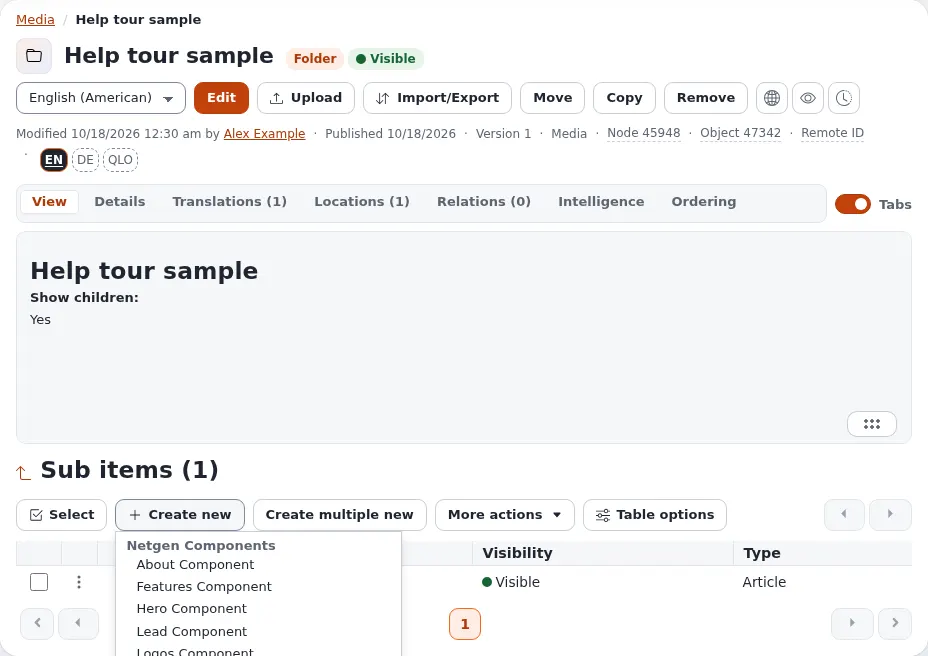

Other ways to the same result:

- The menu of an item in the tree (click the icon in front of its name) has **Create here**, with the same list.
- **Create multiple new** opens one form in which you fill in several new items below the same place at once.

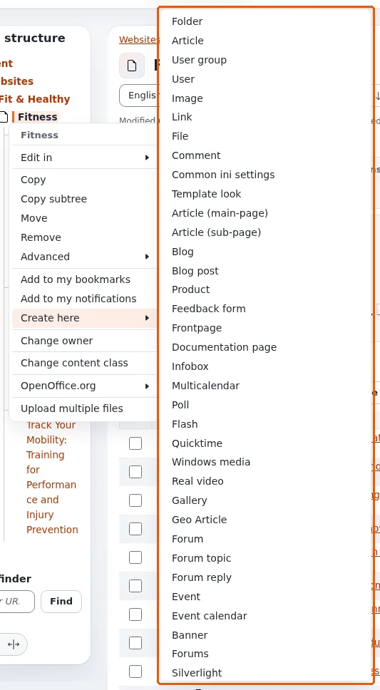

If you leave the form with **Discard draft**, the new item is not created at all.

## Edit an item

1. Open the item.
2. If the item exists in more than one language, choose the language in the list next to **Edit** first.
3. Press **Edit**. The edit form opens with a new draft, a copy of the published version.
4. Change what you need and press **Send for publishing**.

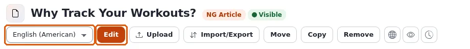

You can also choose **Edit in** from the item's menu in the tree, or tick items in a list and choose
**Edit selected** (see [Many items at once](#many-items-at-once)).

### When someone else is editing

If you or someone else already has a draft of the item, the page **Possible edit conflict** appears first. It lists
the drafts with their creator and time. You can continue one of **your** drafts (select it and press
**Edit selected**), start a **New draft** from the published version, or **Cancel**. A draft of someone else cannot be
edited; talk to that person, or make a new draft.

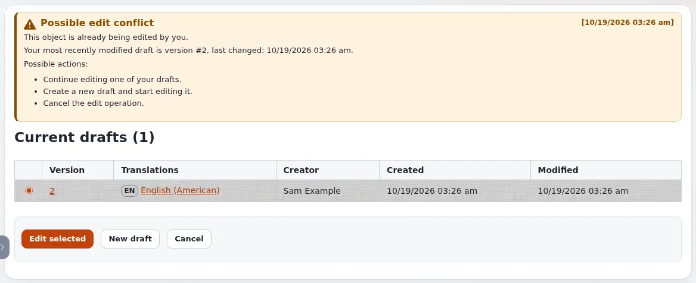

## The edit form

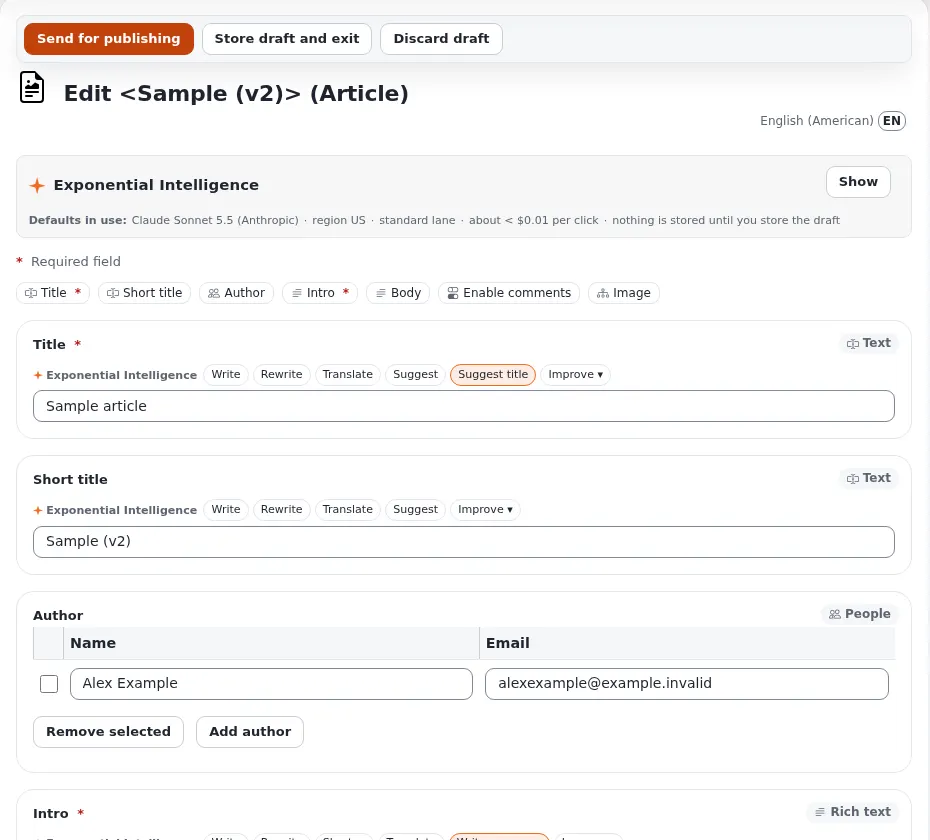

- **The buttons at the top**: **Send for publishing** publishes the draft; **Store draft and exit** keeps the draft
  and leaves the form; **Discard draft** throws the draft away (after you confirm) and keeps the published version as
  it was. Some sites also offer **Publish without notification**, which publishes without e-mailing the people who
  follow that part of the site.
- **The title line** names the item and its type, and the language you are editing, for example *English
  (American)*.
- **The field bar**: one button per field (*Title*, *Short title*, *Intro* ...); a click jumps to that field. A red
  `*` marks a **required** field: the draft cannot be published while it is empty.
- **The fields** follow, each with its type in the corner (*Text*, *Rich text*, *People*, *Relation* ...). If a
  field is wrong when you publish, the form comes back with a message at the top and at the field.
- **The left column** shows the item's numbers and dates, the draft you are working on, **Manage versions** and
  **Preview** (see the draft as it will look), the existing translations, and the **section** the item belongs to.

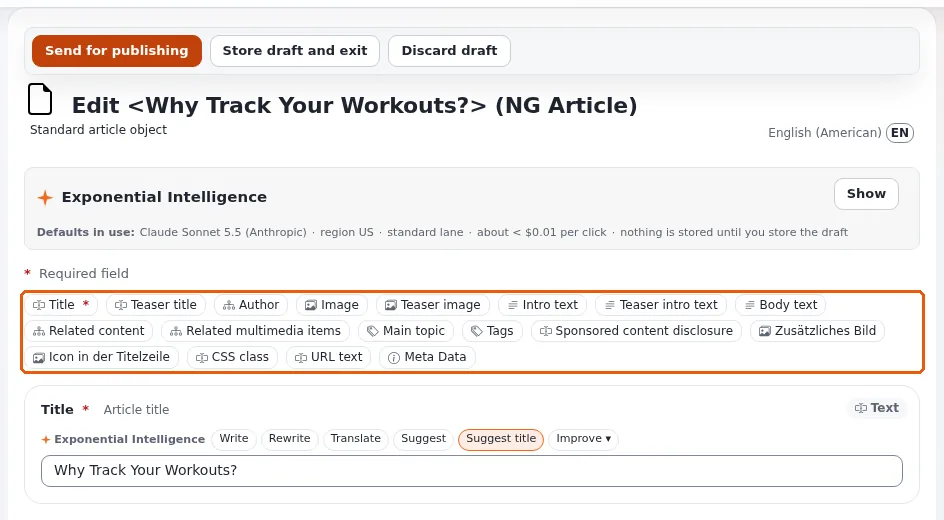

The draft is saved automatically every few minutes while you work, so a closed browser tab costs little. Pressing
Enter in a one-line field is the same as pressing **Send for publishing**.

### Rich text

Rich text fields (such as *Intro* and *Body*) have an editor with a toolbar: paragraph styles, bold, italic, lists,
links, tables, special characters, **Embed object** (an image or another item inside the text), **Fullscreen** and
**Source code**. Under the field you can switch between the editors your site offers, for example **TinyMCE 8** and
**Tiptap**. The **Help** button of TinyMCE lists its keyboard shortcuts.

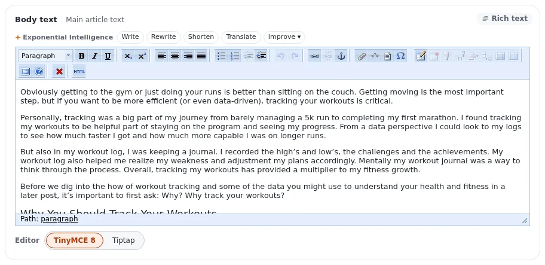

### Relations and images

A field of the type *Relation* (such as *Image* of an article) links to other items. Its buttons:

- **Add existing** (or **Add an existing object**) opens a browser in which you pick an item that is already there;
- **Upload new** (or **Upload a file**) uploads a file from your computer, creates an item from it, and links it.

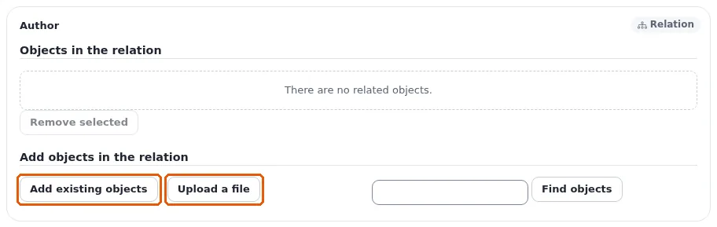

Images need an **alternative text**, a short description for people who cannot see the image. Where the site
requires it, the image field is marked **Alternative image text (required)** and the upload dialogs ask for it.

### Exponential Intelligence

If your site has the writing assistant switched on, each text field shows **Exponential Intelligence** with buttons
such as **Write**, **Rewrite**, **Translate**, **Suggest** and **Improve**. Its suggestions change nothing until you
accept them and store the draft. The box at the top of the form says which service it uses and what a click costs.

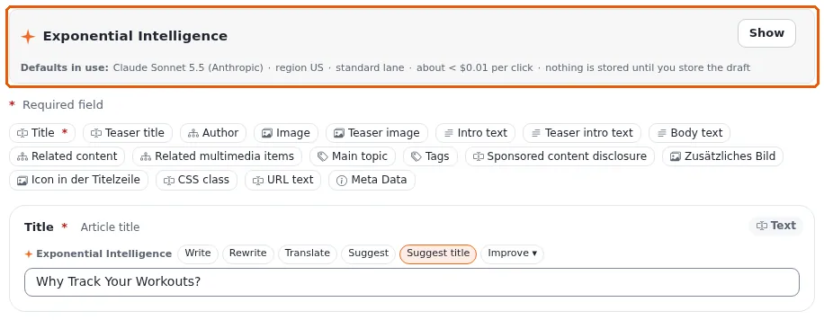

## Move, copy and remove

On the item's page:

- **Move** places the item somewhere else: choose the new parent in the browser that opens.
- **Copy** makes a copy of the item in a place you choose. The item's menu in the tree also has **Copy subtree**,
  which copies the item with everything below it.
- **Remove** moves the item to the trash, after a confirmation. See
  [Publishing, versions and the trash](publishing-and-versions.md#remove-and-restore).

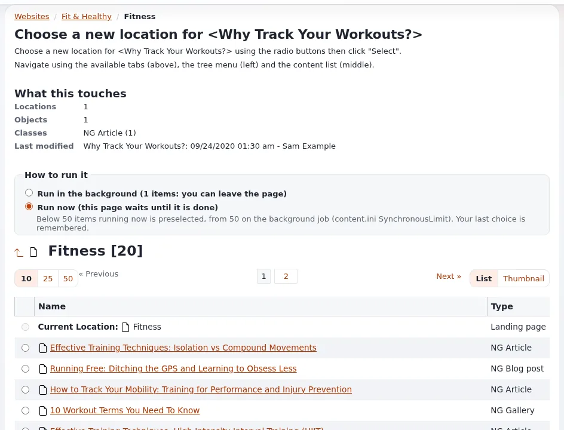

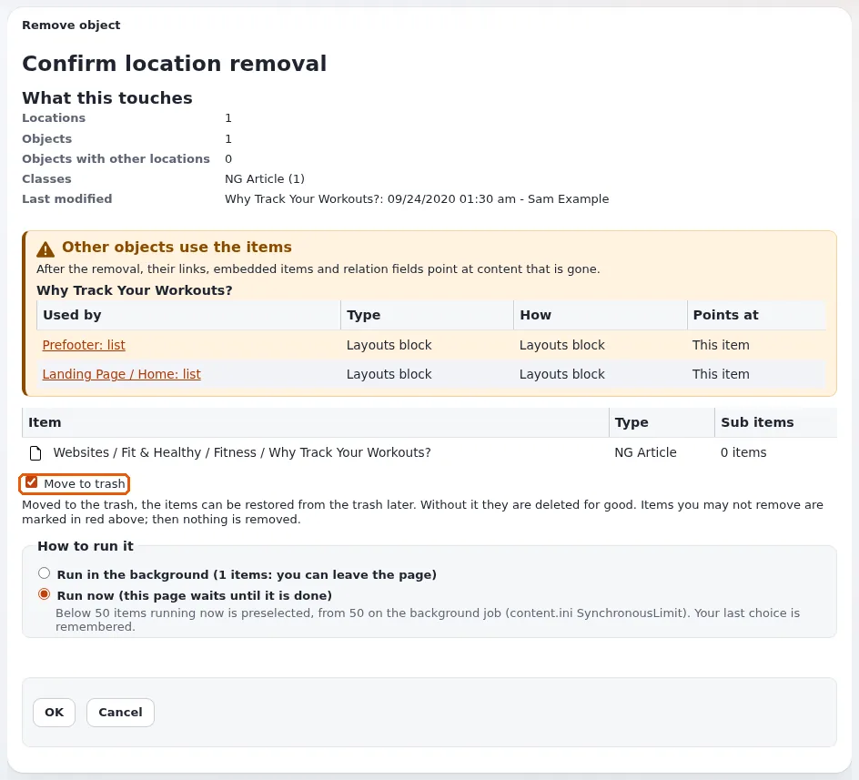

A button you may not use is grayed out; pointing at it says why.

## Many items at once

In the **Sub items** list of a folder, tick the items with the checkboxes (or use **Select** to select all, none or
the opposite), then open **More actions**:

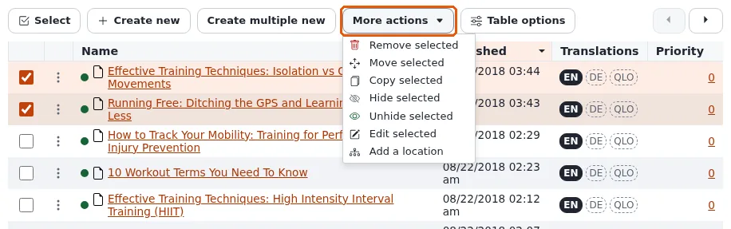

- **Edit selected**: one form with all the selected items; publish them together;
- **Remove selected**, **Move selected**, **Copy selected**;
- **Hide selected** and **Unhide selected**;
- **Add a location**: the items also appear in another place, without being copied.

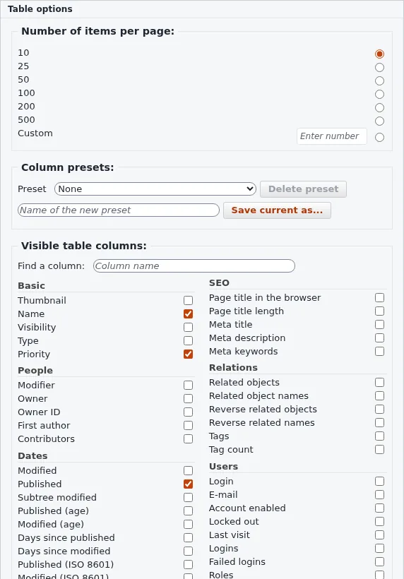

**Table options** chooses, orders and saves the columns of the list, sets how many rows a page shows (10, 25, 50
or 100) and exports the visible columns as a CSV file. When the list is sorted by
priority, the grip at the start of each row changes the order by dragging (or with the keyboard, see
[Keyboard shortcuts](keyboard-shortcuts.md#lists-of-sub-items)).

## Learn more

- [The content model and editing content](../guides/content-model-and-editing.md), the full guide for editors and
  site builders.
- [Publishing, versions and the trash](publishing-and-versions.md)
- [Images, media and uploads](media-and-uploads.md)
- [Languages](languages.md), for translating an item.

<!-- exp-partner-block:start -->
**Become an Exponential Partner.** Partners share their information, provide funding, contribute back and
develop the products with us, and that is how Exponential grows. A partner website and dashboard are planned for
mid-2027: please become a partner today to speed up our growth rate and land new features faster. Start with
[Partners: start here](partners/partners-start-here.md) and [How to apply](partners/how-to-apply.md).
<!-- exp-partner-block:end -->
