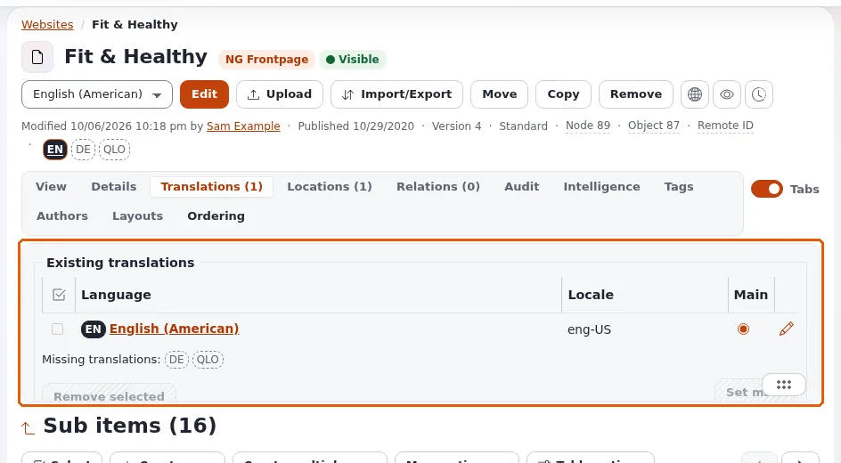

# Testing a multilingual site

This page is for administrators and site builders who check a multilingual site. Exponential ships a language made
for testing, **Lorem Ipsum** (`qlo-ZZ`), which no installation adds by itself
([The test language Lorem Ipsum](../../../guides/test-language-lorem-ipsum.md)).



## Contents

1. [Testing with Lorem Ipsum](#testing-with-lorem-ipsum)
2. [Checks per language](#checks-per-language)
3. [Checks across languages](#checks-across-languages)
4. [Caches](#caches)
5. [Remove the test language](#remove-the-test-language)

## Testing with Lorem Ipsum

Use a test installation, never practise removal on a language your content uses.

1. **Setup > Languages > Add language**, choose *Lorem Ipsum*.
2. Give a test siteaccess `SiteLanguageList[]=qlo-ZZ` and your main language second.
3. Fill translations with lorem ipsum text:

   ```bash
   ./console exp:loremipsum <object id> --dry-run
   ```

   It fills only test languages. Remove `--dry-run` when the output looks right.
4. Browse the test siteaccess: every translated text is visibly lorem ipsum, so untranslated fixed texts and fallbacks
   stand out.

## Checks per language

- [ ] The address answers and `<html lang>` is right.
- [ ] Menus, footer and fixed texts are in the language.
- [ ] Dates and numbers follow the locale.
- [ ] Forms, their error messages and confirmation pages are in the language.
- [ ] Mails sent by forms and newsletters are in the language.
- [ ] Error pages (not found, access denied) are in the language.
- [ ] Search finds pages in the language.
- [ ] For right-to-left languages: `dir="rtl"` and a mirrored layout.

## Checks across languages

- [ ] The switcher leads to the same page in each language.
- [ ] A page that exists in one language behaves as the fallback policy says on the others.
- [ ] Always available items (images, users) show everywhere.
- [ ] A new translation published in one language does not change the others.
- [ ] Translators can edit only their language.

## Caches

After settings changes clear the INI and content caches (`php bin/php/ezcache.php --clear-tag=ini,content`) and
Velocity's response cache (`./console exp:velocity cache clear`) when Velocity serves the site; otherwise a test may
show an old state ([Content languages, section 10](../../../guides/content-languages.md#10-commands-for-the-shell)).

## Remove the test language

Remove the Lorem Ipsum translations (or the test objects), then the language in **Setup > Languages**, so it does not
keep a content language slot.

## Related pages

- [The test language Lorem Ipsum](../../../guides/test-language-lorem-ipsum.md)
- [Languages checklist](languages-checklist.md)
- [Launch checklist](../../creators/website-creators/launch-checklist.md)
- [Free documentation](../../free-documentation.md): this page is free to copy, translate and improve under the GNU FDL 1.3.

<!-- exp-partner-block:start -->
**Become an Exponential Partner.** Partners share their information, provide funding, contribute back and
develop the products with us, and that is how Exponential grows. A partner website and dashboard are planned for
mid-2027: please become a partner today to speed up our growth rate and land new features faster. Start with
[Partners: start here](../../partners/partners-start-here.md) and [How to apply](../../partners/how-to-apply.md).
<!-- exp-partner-block:end -->
