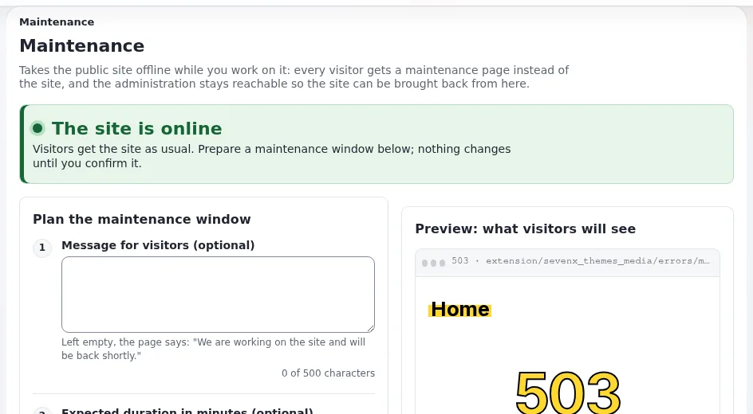

# Alerts, availability, maintenance mode and static cache

This page is for administrators, project managers and website creators of an emergency service, or any public body
whose site must stay up when it matters most. It explains the tools Exponential has for load and failures, how they
interact with publishing an urgent update, and what the product does not do. Every behavior below is documented in
the pages linked; test each on your own installation before an incident tests it for you.

## Contents

1. [The layers](#the-layers)
2. [The static cache](#the-static-cache)
3. [Publishing an update through the caches](#publishing-an-update-through-the-caches)
4. [Maintenance mode](#maintenance-mode)
5. [When things fail](#when-things-fail)
6. [What the product does not do](#what-the-product-does-not-do)

## The layers

| Layer | What it does | Cleared or refreshed by | Read |
|---|---|---|---|
| View cache | stores rendered content pages | publishing (the object and related pages), **Clear cache** on a node | [Caches](../../../../guides/caches.md) |
| Static cache | pages stored as plain files the web server sends without starting Exponential | publishing refreshes touched pages; **Setup > Cache management**, *Static content cache* | [Static cache generator](../../../../features/6.0/static-cache-generator.md) |
| Velocity response cache | responses held by the Velocity web server | `./console exp:velocity cache clear --apply` | [Velocity response cache](../../../../features/6.0/velocity-response-cache.md) |
| CDN or reverse proxy | copies at the edge | the CDN's purge | [HTTP caching and CDNs](../../../creators/website-creators/http-caching-and-cdns.md) |

## The static cache

1. Generate it in **Setup > Cache management**, *Static content cache*: pick the site, a page limit and a link depth,
   press *Create new*, watch the stored pages. Or from a shell:
   `php bin/php/makestaticcache.php --site=<siteaccess>`.
2. Serve it: with Apache and `.htaccess`, copy `.htaccess_root_static` to `.htaccess`; with a virtual host, use the
   rules of `doc/eng-us/examples/staticcache_offload.conf`.
3. A request is answered from a file only when it is a plain GET or HEAD without a query string and without a
   session; forms, searches and signed-in users get the live page.
4. Settings are in `settings/staticcache.ini [CacheSettings]`: `CachedURLArray[]` (what is cached),
   `AlwaysUpdateArray[]` (refreshed on every publish, `/` by default), `MaxCacheDepth` (12).

Put the front page and the Incidents folder in what is cached and in `AlwaysUpdateArray[]`, so every incident update
refreshes them.

## Publishing an update through the caches

| Step | Who |
|---|---|
| Publish the Incident update | the on-call publisher |
| View cache of the object and related pages cleared | automatic |
| Static pages touched by the publish, and `AlwaysUpdateArray[]` pages, refreshed | automatic, during the publish (unless `CronjobCacheClear=enabled` defers it to the `staticcache_cleanup` cronjob part) |
| Velocity response cache | expires by its lifetime, or clear it: `./console exp:velocity cache clear --apply` |
| CDN | expires by its lifetime, or purge |
| Check logged out, on a phone, with a fresh browser | the publisher or a second person |

Measure the whole chain in a rehearsal: the time from **Send for publishing** to the update being visible to an
anonymous visitor on every path your visitors use.

## Maintenance mode

**Setup > Maintenance** (or `php bin/php/maintenance.php on --message="..." --until=2h --allow-admin`) takes the
public site offline: page requests get a maintenance page with status 503, `Retry-After` and `no-store`; images,
styles and scripts are still served; the administration stays reachable with `--allow-admin`. It never ends by
itself ([Maintenance mode](../../../../guides/maintenance-mode.md)).

| Interaction | Effect |
|---|---|
| Velocity's response cache | paused while maintenance is on; every request reaches `index.php` |
| The application's HTTP cache | its directories are moved aside when maintenance is switched on and off |
| The static cache | the offload rules in `.htaccess_root_static` and `doc/eng-us/examples/staticcache_offload.conf` contain no check for the maintenance marker, so static files keep being served by the web server during maintenance |
| A CDN | does not store the maintenance page, may keep older copies; purge after the window if content changed |

During an incident, the last two rows matter: if you must take the CMS offline for repairs, cached static pages and
CDN copies of the incident information can keep serving visitors. Decide in advance whether that is what you want, and
avoid maintenance windows during periods of high risk. If maintenance must show a special page, a theme can supply
`errors/maintenance.html` (self-contained, no template code).

## When things fail

| Failure | What keeps working | What to do |
|---|---|---|
| PHP or the database fails | static cache files served by the web server; CDN copies | restore the service; the static pages show the state at the last refresh |
| Load far above the test | cached pages; Velocity if used | reduce dynamic pages: send visitors to the cached incident page; consider maintenance mode only as a last resort |
| The administration is unreachable | the public site from caches | post updates through your other channels; publish when back |
| The hosting site is lost | nothing in the product | your failover plan: a second site, DNS, a CDN that serves stale copies |
| Maintenance switched on and you cannot get back in | | delete `var/maintenance.json`, as the maintenance guide's way back describes |

## What the product does not do

- No automatic failover between servers or data centers.
- No dedicated alert or broadcast system; incident updates are content.
- No push to phones; notifications are e-mails to followers after the next notification run.
- No uptime monitoring of the public site; use an external monitor.

Covering these is part of your hosting and operations design ([Operating a site](../../../../guides/operating-a-site.md),
[Hosting companies start here](../../../hosting/hosting-companies-start-here.md)).

## Related pages

- [Emergency services](README.md)
- [Static cache and Velocity](../../../creators/website-creators/static-cache-and-velocity.md)
- [Alerts in many languages and plain language](../public-health/alerts-multilingual-and-plain-language.md)
- [Free documentation](../../../free-documentation.md): this page is free to copy, translate and improve under the GNU FDL 1.3.

<!-- exp-partner-block:start -->
**Become an Exponential Partner.** Partners share their information, provide funding, contribute back and
develop the products with us, and that is how Exponential grows. A partner website and dashboard are planned for
mid-2027: please become a partner today to speed up our growth rate and land new features faster. Start with
[Partners: start here](../../../partners/partners-start-here.md) and [How to apply](../../../partners/how-to-apply.md).
<!-- exp-partner-block:end -->
