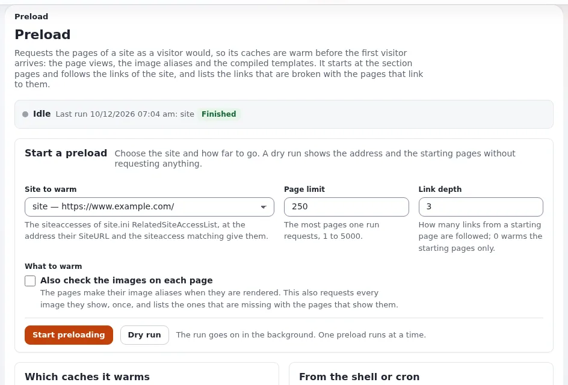

# Cache warming after changes

This page is for operations teams in public bodies who clear caches after a deploy, a restore or an urgent correction,
and who do not want the first visitors (or a surge after a press release) to meet a slow site. It answers how to warm
the caches again with the tools Exponential provides. The references are [Preloading caches](../../../../guides/preloading-caches.md),
[Operating a site](../../../../guides/operating-a-site.md) and the hosting page
[Cache clearing and warming](../../../hosting/performance/cache-clearing-and-warming.md).



## Contents

1. [Why warm](#why-warm)
2. [The tools](#the-tools)
3. [Warming after a deploy](#warming-after-a-deploy)
4. [Warming before an announcement](#warming-before-an-announcement)
5. [Checklist](#checklist)

## Why warm

"After a clear or a deploy the first visitor pays for the render" ([Operating a site](../../../../guides/operating-a-site.md)).
Rendered pages are fast once they are cached; the first request of each page after a clear is the slow one. On a
public-sector site a clear is often followed by a peak: a deploy in the evening, then everyone opens the site in the
morning; or a correction published right before a press release.

## The tools

| Tool | What it does |
|---|---|
| `php bin/php/preload.php --siteaccess=site --allow-root-user` | requests the section pages first, then follows the links of the site; one preload runs at a time, every run listed on **Setup > Preload Sites** |
| `php bin/php/warm.php --allow-root-user` | warms every published page; suits a cron entry every few minutes |
| **Setup > Preload Sites** | the same in the browser: choose the site, a page limit (default 250) and a link depth (default 3) |
| `[DeploySettings] WarmUpURL[]` | pages `exp:velocity deploy` requests in the background as its last step |

Use the name of your own public siteaccess for `--siteaccess`. Details: [Preloading caches](../../../../guides/preloading-caches.md)
and [Preload Sites view](../../../../features/6.0/preload-sites-view.md).

## Warming after a deploy

`exp:velocity deploy` clears the caches that hold finished pages last, after the new code runs, and then requests the
warm-up URLs so the first visitor finds the caches built ([Deploying](../../../../guides/deploying.md)). Put your most
visited pages into the list:

```bash
./console exp:velocity config get DeploySettings WarmUpURL --allow-root-user
```

After a restore, or when you cleared everything by hand, run a preload:

```bash
php bin/php/ezcache.php --clear-all --allow-root-user
php bin/php/preload.php --siteaccess=site --allow-root-user
```

To keep every published page warm, a cron line such as the one in the guide:

```bash
php bin/php/warm.php --allow-root-user >> var/log/cache-warm.log 2>&1
```

With several web servers, warm each node; their caches in front of PHP are local.

## Warming before an announcement

When communications plans a release that will bring many visitors to a few pages:

1. Publish the pages early enough for the caches to expire and refill, or clear only what changed.
2. Request the announced pages and their parents once, for example with the Preload Sites view limited to a small depth.
3. Check that the pages are served from the cache (`curl -sI` shows `X-Cache` under Velocity).
4. Avoid deploys and full cache clears in the hours before the announcement; book them in a change freeze.

## Checklist

- [ ] `WarmUpURL[]` lists your most visited pages.
- [ ] Runbooks for restores and full clears include a preload.
- [ ] Each node is warmed when there are several.
- [ ] Announcements are coordinated with operations, with no full clear just before them.

## Related pages

- [Availability](README.md) index of this folder
- [Velocity response cache and HTTP cache](velocity-response-cache-and-http-cache.md)
- [Capacity planning](capacity-planning.md)
- [Free documentation](../../../free-documentation.md): this page is free to copy, translate and improve under the GNU FDL 1.3.

<!-- exp-partner-block:start -->
**Become an Exponential Partner.** Partners share their information, provide funding, contribute back and
develop the products with us, and that is how Exponential grows. A partner website and dashboard are planned for
mid-2027: please become a partner today to speed up our growth rate and land new features faster. Start with
[Partners: start here](../../../partners/partners-start-here.md) and [How to apply](../../../partners/how-to-apply.md).
<!-- exp-partner-block:end -->
