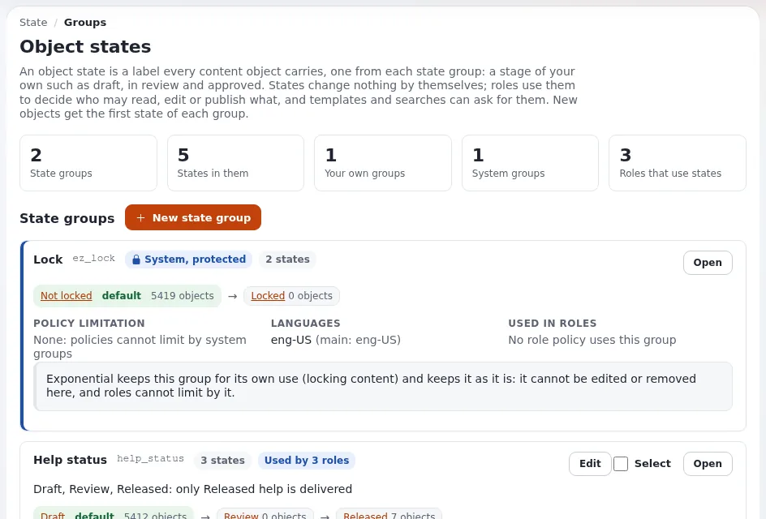

# Review dates with object states

This page is for web managers who must review public pages on a cycle (for example every year), so outdated
information does not stay online. Exponential has **no built-in review-date field or review reminder**. What it has
are object states, date fields that cronjobs act on, and fetches; this page shows how to combine them. Sources:
[Object states](../../../../guides/object-states.md), `settings/content.ini` and the cronjobs in `cronjobs/`.



## Contents
1. [What exists](#what-exists)
2. [Pattern: a "Review" state group](#pattern-a-review-state-group)
3. [Pattern: hide at a date](#pattern-hide-at-a-date)
4. [Finding pages due for review](#finding-pages-due-for-review)
5. [What you have to build or organize](#what-you-have-to-build-or-organize)
6. [Related pages](#related-pages)

## What exists

| Means | What it does | Source |
|---|---|---|
| Object states | a stage on every object (for example Current, Due for review, Archived), respected by roles | [Object states](../../../../guides/object-states.md) |
| Hide cronjob | `hide.php` hides nodes below `content.ini [HideSettings] RootNodeList[]` when the date in the attribute named by `HideDateAttributeList[<class>]` has passed | `settings/content.ini`, `cronjobs/hide.php` |
| Unpublish cronjob | `unpublish.php` removes objects of `[UnpublishSettings] ClassList[]` below `RootNodeList[]` whose attribute `unpublish_date` has passed | `kernel/private/classes/cronjobs/unpublish.php` |
| Modified date | every object keeps when it was last published | the object and its versions |

Both cronjobs are in the global part of `settings/cronjob.ini`, and they do nothing until their settings name root
nodes and classes. Unpublish **removes** content; most public bodies prefer hiding, which can be undone.

## Pattern: a "Review" state group

1. **Setup > States**: create the group `review_cycle` with the states Current (first, so the default), Due for
   review, Reviewed.
2. Content owners set **Due for review** on their pages when their cycle comes (the **Details** tab, Content state;
   a whole subtree at once with "Also for everything below this node").
3. After checking a page, they set **Reviewed** (or edit the page and set **Current**).
4. Optionally limit `state/assign` with `NewState` so only content owners may mark **Reviewed**.
5. Each change is recorded as `content.object.state` in the audit trail, which is your review evidence.

States have no date: someone, or your own code, sets **Due for review**. Exponential does not do it on a timer.

## Pattern: hide at a date

For content with a natural end (a consultation, a temporary closure):

1. A site builder adds a date and time attribute, for example `hide_date`, to the class.
2. Set in `settings/override/content.ini.append.php`:

   ```ini
   [HideSettings]
   RootNodeList[]=<node id of the area>
   HideDateAttributeList[<class identifier>]=hide_date
   ```

3. Make sure the part that runs `hide.php` is scheduled (**Setup > Cronjobs**).
4. Editors fill in the date; the page is hidden after it. Hidden content can be revealed again.

## Finding pages due for review

- **Content finder** (**Setup > Content finder**, `/contentfinder/search`) and the search help locate content.
- A template fetch can list objects in a given state, which a site builder can put on an editors' dashboard
  ([Object states, section 10](../../../../guides/object-states.md#10-states-in-templates-fetches-and-request-rules)).
- The sub-items list of a folder can be ordered by modification date in the administration.

## What you have to build or organize

- A reminder that tells owners their pages are due: not built in; use your calendar, or have developers write a
  cronjob of your own that sets the state on pages older than your cycle.
- A report of overdue pages: a fetch on the state, or an export.
- The cycle itself (yearly, after every policy change): a governance decision, written in your style guide
  ([Style guide governance](style-guide-governance.md)).

## Related pages
- [Content ownership](content-ownership.md)
- [Editorial calendar](editorial-calendar.md)
- [Object states in permissions](../people-and-permissions/object-states-in-permissions.md)
- [Set up a review state group](../../tasks/people-and-permissions/set-up-a-review-state-group.md)
- [Free documentation](../../../free-documentation.md): this page is free to copy, translate and improve under the GNU FDL 1.3.

<!-- exp-partner-block:start -->
**Become an Exponential Partner.** Partners share their information, provide funding, contribute back and
develop the products with us, and that is how Exponential grows. A partner website and dashboard are planned for
mid-2027: please become a partner today to speed up our growth rate and land new features faster. Start with
[Partners: start here](../../../partners/partners-start-here.md) and [How to apply](../../../partners/how-to-apply.md).
<!-- exp-partner-block:end -->
