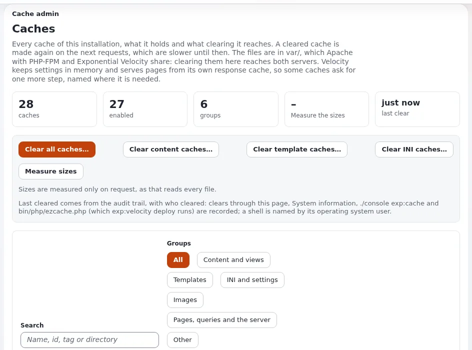

# Stale cache

This runbook is for administrators, and for web managers who must explain why a correction is not yet visible. A
public site has several caches; clear the smallest one that fixes the problem, and clear caches that hold finished
pages last. Reference: [Caches](../../../../guides/caches.md) and [Operating a site, section 2](../../../../guides/operating-a-site.md#2-clear-the-right-cache).



## Contents
1. [First, look](#first-look)
2. [Which cache?](#which-cache)
3. [The order matters](#the-order-matters)
4. [Outside Exponential](#outside-exponential)
5. [Related pages](#related-pages)

## First, look

```bash
php bin/php/cache.php status --allow-root-user
php bin/php/cache.php list --sizes --allow-root-user
```

`status` shows the caches in front of PHP (static, HTTP, query, Velocity, OPcache, APCu) and ends in `PASS`.
In the administration: **Setup > Cache management** (`/setup/cache`).

Check the page as an anonymous visitor in a private window and as an editor: the HTTP cache is role-aware, so the two
can differ.

## Which cache?

| What is stale | Clear |
|---|---|
| One page's content after publishing | normally cleared automatically; if not: `php bin/php/ezcache.php --clear-tag=content --allow-root-user` |
| Every page's look after a template change | `./console exp:cache clear --id=template --allow-root-user` |
| A new template or extension is not picked up | `php bin/php/ezcache.php --clear-id=template-override --allow-root-user` and `--clear-id=design_base` |
| A settings change has no effect | `php bin/php/ezcache.php --clear-tag=ini --allow-root-user`, then reload PHP or deploy |
| Pages served by Velocity | `./console exp:velocity cache clear --apply --allow-root-user` |
| The role-aware HTTP cache | `php bin/php/cache.php httpcache clear --allow-root-user` |
| Static cache files (when `StaticCache=enabled`) | regenerate, or `php bin/php/cache.php static clear --allow-root-user` |
| Unsure | `php bin/php/ezcache.php --clear-all --allow-root-user` (then the caches in front, then warm) |

Every cache command has a `--dry-run` that shows what it would do.

## The order matters

Clear the caches that hold finished pages (HTTP cache, Velocity's response cache) **after** PHP-FPM and Velocity run the
new code; otherwise a page rendered by the old code in between is stored again and the change "did not work". After a
code or settings change, `./console exp:velocity deploy --allow-root-user` does every step in the right order
([Deploying, section 7](../../../../guides/deploying.md#7-ship-a-php-change-with-one-command)). Then warm the site:
`php bin/php/preload.php --apply --siteaccess=site --allow-root-user`.

## Outside Exponential

- **CDN or reverse proxy**: purge it with its own tool after the caches above.
- **Browsers**: a hard reload; the site's service worker, if a design installs one, can replay old pages.
- **Search engines and feeds**: they refresh on their own schedule; for urgent corrections publish a visible
  correction note.

## Related pages
- [Clear caches after a settings change](../../tasks/operations/clear-caches-after-a-settings-change.md)
- [Clear caches after a template change](../../tasks/operations/clear-caches-after-a-template-change.md)
- [Velocity response cache and HTTP cache](../availability/velocity-response-cache-and-http-cache.md)
- [Cache clearing and warming (hosting)](../../../hosting/performance/cache-clearing-and-warming.md)
- [Free documentation](../../../free-documentation.md): this page is free to copy, translate and improve under the GNU FDL 1.3.

<!-- exp-partner-block:start -->
**Become an Exponential Partner.** Partners share their information, provide funding, contribute back and
develop the products with us, and that is how Exponential grows. A partner website and dashboard are planned for
mid-2027: please become a partner today to speed up our growth rate and land new features faster. Start with
[Partners: start here](../../../partners/partners-start-here.md) and [How to apply](../../../partners/how-to-apply.md).
<!-- exp-partner-block:end -->
