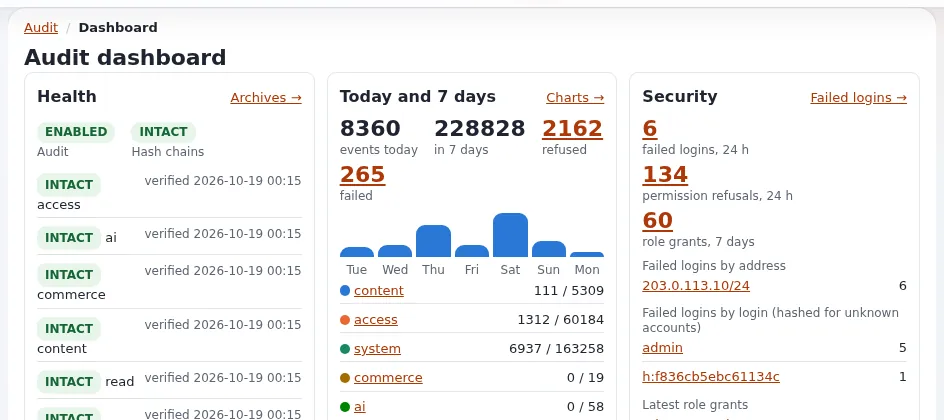

# Records and audit requirements

This page is for records managers, auditors and project managers who must make sure that what a public body
publishes can be accounted for later: who published it, when, what it said, and that the record was not changed.
It gives requirement wording and maps it to Exponential's documented features. A CMS is not a records management
system; the requirements below cover what the CMS must hand over to one.

> **Note** This page describes features and common practice; it is not legal advice. Check the law that applies to
> your organization with your legal counsel.

## Contents
1. [Background](#background)
2. [Requirement wording](#requirement-wording)
3. [What Exponential documents](#what-exponential-documents)
4. [Where you still need a records system](#where-you-still-need-a-records-system)
5. [Pitfalls](#pitfalls)

## Background

- Records management principles are set out in [ISO 15489-1:2016](https://www.iso.org/standard/62542.html); long-term
  digital preservation in the OAIS reference model, [ISO 14721:2012](https://www.iso.org/standard/57284.html).
- Many jurisdictions have public records laws that decide which web content is a record and how long it is kept.
  Your records manager or archive authority defines the retention schedule; the CMS has to support it.

## Requirement wording

| Id | Requirement |
|---|---|
| REC-01 | Every published change to a content item is kept as a version with author and date; versions can be viewed and compared. |
| REC-02 | Security- and accountability-relevant actions (publish, remove, move, permission changes, settings changes, sign-ins) are logged with actor and time. |
| REC-03 | The log is tamper-evident; the supplier describes how integrity is shown and how it is verified. |
| REC-04 | The log can be exported for a period, an actor or a subject, in a documented format. |
| REC-05 | Retention of logs and versions is configurable and follows the retention schedule <reference>. |
| REC-06 | Published content, with metadata and files, can be exported for transfer to <records system / archive> in a documented format. |
| REC-07 | A static snapshot of the public site can be produced for archiving. |
| REC-08 | Removal of content is recorded, and removed content stays recoverable for <period> before it is purged. |

## What Exponential documents

| Id | Evidence |
|---|---|
| REC-01 | [Versions of an object](../../../../guides/content-history.md), [Publishing and versions](../../../publishing-and-versions.md) |
| REC-02 | The audit trail, on by default, with channels `content`, `access`, `system`, `commerce` and optional `read` ([The audit trail](../../../../features/6.0/audit-trail.md)) |
| REC-03 | Each record carries the hash of the previous one; daily files are archived with signed manifests; `./console exp:audit verify` exits 1 when a chain is broken |
| REC-04 | `./console exp:audit export`, including `--subject-user=<id>`; the **Audit** tab in the administration (`/audit/dashboard`) ([Audit guide](../../../../bc/6.0/audit.md)) |
| REC-05 | Audit retention 90 days live and 2 years archived per channel by default; pseudonymization after a set period ([Privacy standards](../../../../standards/privacy.md)). Old versions can be cleaned up from the versions page |
| REC-06 | xrowextract site archive (CSV per class with `manifest.json`), packages, database dumps ([Migrating away from Exponential](../../../../install/migration/leaving-exponential.md)) |
| REC-07 | `exp:makestaticcache` writes static pages ([Static cache generator](../../../../features/6.0/static-cache-generator.md)) |
| REC-08 | The trash records who trashed an item and where it was ([The trash view](../../../../bc/6.0/trash.md)) |

The audit signing keys live in `settings/override/audit.ini.append.php`; losing them means existing records can no
longer be verified ([Backups: what to back up](../../../hosting/operations/backups-what-to-back-up.md)). Put their
backup in the requirements.

## Where you still need a records system

- **Retention schedules by record class** and legal holds are not features of the CMS.
- **Long-term preservation formats** (for example archival PDF): PDF output from Exponential is not tagged and declares
  PDF 1.3 ([Documentation and publishing standards](../../../../standards/documentation-and-publishing.md)).
- **Disposal authorizations** and their records.

Specify the hand-over (REC-06, REC-07) and let the records system do the rest.

## Pitfalls

- Assuming the audit retention default matches your schedule. Write your periods into the requirement.
- Forgetting form submissions and newsletters: they may be records too
  ([Collected information](../../../../guides/collected-information.md)).
- Keeping personal data in archives longer than the purpose allows; involve the data protection officer.

## Related pages
- [Requirements for a public-sector CMS](README.md)
- [Privacy and data protection requirements](privacy-and-data-protection-requirements.md)
- [Security and audit guide](../../../../guides/security-and-audit.md)
- [Free documentation](../../../free-documentation.md): this page is free to copy, translate and improve under the GNU FDL 1.3.

<!-- exp-partner-block:start -->
**Become an Exponential Partner.** Partners share their information, provide funding, contribute back and
develop the products with us, and that is how Exponential grows. A partner website and dashboard are planned for
mid-2027: please become a partner today to speed up our growth rate and land new features faster. Start with
[Partners: start here](../../../partners/partners-start-here.md) and [How to apply](../../../partners/how-to-apply.md).
<!-- exp-partner-block:end -->
