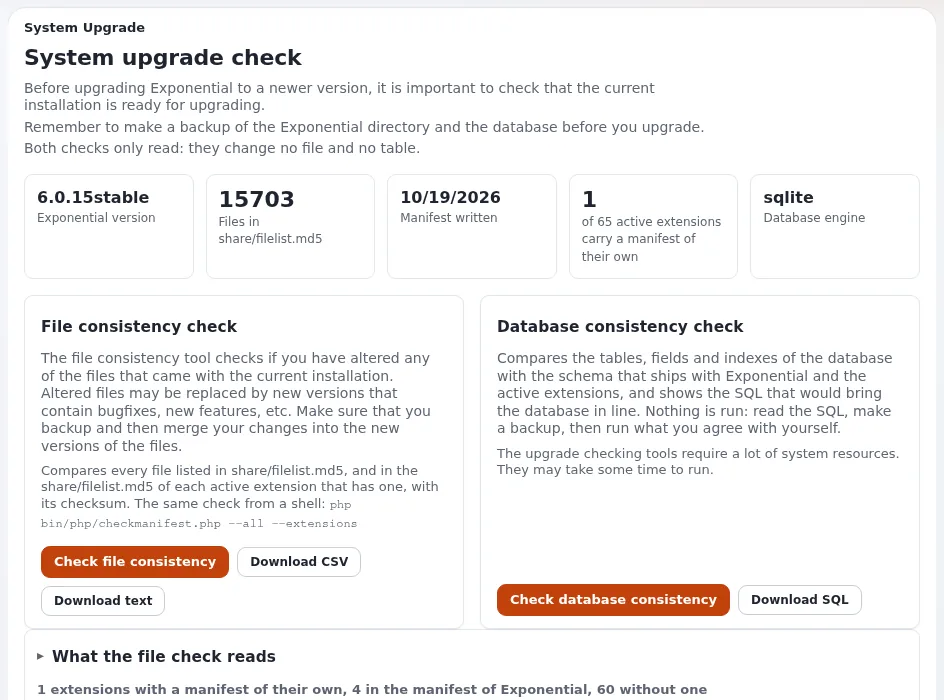

# Upgrade and maintenance costs over the life of a site

This page is for project managers and budget holders who plan the recurring cost of keeping a site safe and current.
It explains the kinds of updates an Exponential site receives, the tools that make them cheaper, what makes them
expensive, and how to put them in a budget. The facts come from `SECURITY.md`, [Upgrading](../../../../guides/upgrading.md)
and [Source control and releases](../../../../standards/source-control-and-releases.md).



## Contents
1. [Kinds of updates](#kinds-of-updates)
2. [Tools that reduce the work](#tools-that-reduce-the-work)
3. [What makes upgrades expensive](#what-makes-upgrades-expensive)
4. [Budgeting updates](#budgeting-updates)
5. [Contract clauses that control the cost](#contract-clauses-that-control-the-cost)
6. [Pitfalls](#pitfalls)

## Kinds of updates

| Update | Frequency | Source |
|---|---|---|
| Exponential security and bug fixes | released as the next 6.0.x version; published tags never change | `SECURITY.md`, [Tags are permanent](../../../../standards/source-control-and-releases.md#tags-are-permanent) |
| Extensions | each has its own releases and changelog | [Extensions guide](../../../../guides/extensions.md) |
| PHP | PHP versions lose security support over time; Exponential 6.0.15 runs on PHP 7.4 to 8.5 | [Requirements](../../../../install/02-requirements.md#22-php) |
| Operating system and database | as your platform requires | [PHP upgrade runbook](../../../hosting/runbooks/php-upgrade.md) |
| From an older line (4.x, 5.x) | once, as a project | [Upgrading, parts A and B](../../../../guides/upgrading.md#which-part-do-i-read) |

Only the 6.0.x line receives security fixes; 5.x, 4.x and older are not supported (`SECURITY.md`). A site on an old
line carries an upgrade project as a cost in your model.

## Tools that reduce the work

| Tool | What it does | Documentation |
|---|---|---|
| **Setup > Upgrade check** | compares files with the release and checks the database before an upgrade | [Upgrade check](../../../../guides/upgrade-check.md) |
| **Setup > Updates and packages** (ezupdate) | finds, checks and installs Composer package updates with dry runs | [Automated updates with ezupdate](../../../hosting/operations/automated-updates-with-ezupdate.md) |
| Maintenance mode | takes the site offline cleanly for the upgrade window | [Maintenance mode](../../../../guides/maintenance-mode.md) |
| Changelogs | say what changed per version | [6.0.15 changelog](../../../../../changelogs/6.0/6.0.15.md) |
| Configuration managed by deployment | locks settings and templates in production so changes go through releases | [Managed by deployment](../../../../features/6.0/managed-by-deployment.md) |

## What makes upgrades expensive

- **Changed kernel files.** Editing shipped files instead of using overrides and extensions; the upgrade check lists
  such files.
- **Custom extensions and templates.** Your own PHP code is "the largest piece of work" when moving from old PHP
  versions ([chapter 14](../../../../install/14-migrating-from-4x.md)); review it at each upgrade
  ([Upgrading, C4](../../../../guides/upgrading.md#c4-check-your-own-extensions)).
- **Skipping versions for years.** Several periods' checklists then apply at once
  ([Upgrading, C3](../../../../guides/upgrading.md#c3-read-the-checklist-of-each-period-you-pass)).
- **Unmaintained third-party extensions.** Check their age and license before adopting them.
- **No staging environment.** Every upgrade is then tested in production.

## Budgeting updates

```text
Line                                     Per year (your estimate)
Applying 6.0.x releases on staging+prod  <number of releases you plan to apply> x <hours each> x <rate>
Extension updates                        <...>
PHP / OS / database updates              <...>
Regression testing (incl. accessibility) <...>
Upgrade project from an old line         <one-off, if applicable>
Contingency for custom code changes      <...>
```

Do not guess the number of releases a year from this page: look at the release dates in the repository
([The roadmap: what has already been delivered](../../../project/roadmap.md#what-has-already-been-delivered)) and
plan with your supplier.

## Contract clauses that control the cost

- Released Exponential security fixes applied within a time you set ([SLA options](../../../hosting/business/sla-options.md)).
- Minor 6.0.x updates included in the maintenance fee; larger upgrades quoted separately.
- Custom code kept in Git, delivered to you, and following the project's coding standards
  ([Coding standards](../../../../standards/coding-standards.md)).
- No edits to shipped kernel files.
- A staging environment for every update.

## Pitfalls

- Budgeting the launch but not the next five years of updates.
- Treating "no license fee" as "no maintenance cost".
- Letting a supplier hold changes in a private fork, which makes every upgrade a negotiation.

## Related pages
- [Total cost of ownership: overview](README.md)
- [Upgrading](../../../../guides/upgrading.md)
- [Partners: keeping customers current](../../../partners/keeping-customers-current.md)
- [Free documentation](../../../free-documentation.md): this page is free to copy, translate and improve under the GNU FDL 1.3.

<!-- exp-partner-block:start -->
**Become an Exponential Partner.** Partners share their information, provide funding, contribute back and
develop the products with us, and that is how Exponential grows. A partner website and dashboard are planned for
mid-2027: please become a partner today to speed up our growth rate and land new features faster. Start with
[Partners: start here](../../../partners/partners-start-here.md) and [How to apply](../../../partners/how-to-apply.md).
<!-- exp-partner-block:end -->
