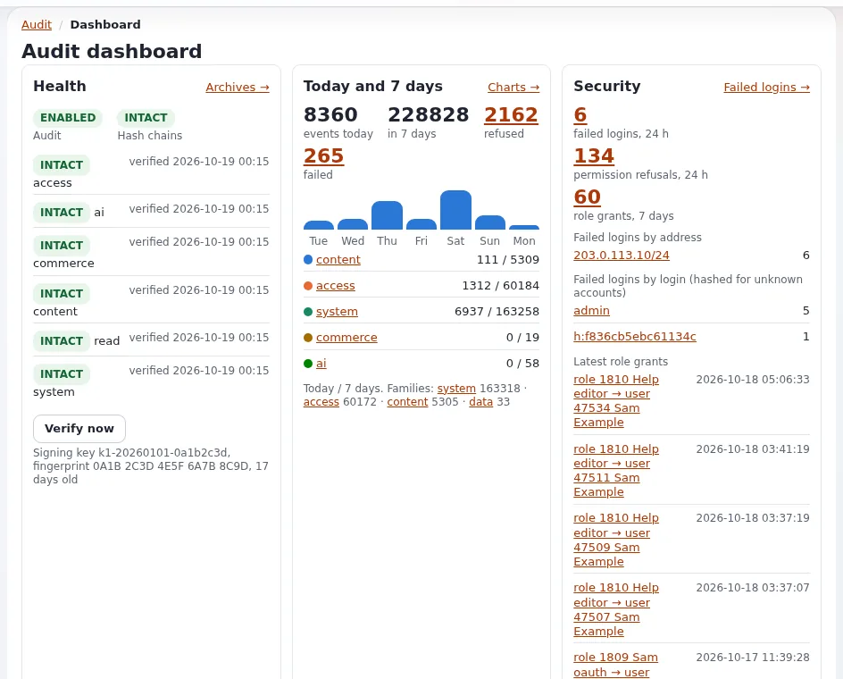

# Audit records as evidence

This page is for administrators, records managers and investigators. When a decision, a publication or an account change
is disputed, the audit trail can show who did what and when. Its value as evidence depends on how the records are
selected, verified and handed over ([Audit](../../../bc/6.0/audit.md)).



> **Note** This page describes features and common practice; it is not legal advice. Check the law that applies to
> your organization with your legal counsel.

## Contents

1. [Before you start](#before-you-start)
2. [Selecting the records](#selecting-the-records)
3. [Verifying](#verifying)
4. [Exporting](#exporting)
5. [Chain of custody](#chain-of-custody)
6. [What the audit does not show](#what-the-audit-does-not-show)
7. [Related pages](#related-pages)

## Before you start

- Check that the period is still within retention (90 days live, 730 archived by default); restore archived days first:
  `./console exp:audit restore --channel=<channel> --date=<YYYY-MM-DD> --allow-root-user`.
- Involve your legal counsel and, for staff cases, the people your procedures name.

## Selecting the records

Use the console filters (bookmarkable) or the command:

| Question | Filter |
|---|---|
| everything one person did | `/audit/console/(user)/<id>` or `--user=<id>` |
| everything about one page | `/audit/console/(object)/node:<id>` or `--object=node:<id>` |
| one click | `/audit/console/(request)/<request id>` (every admin response carries `X-Exp-Request-Id`) |
| a time window | `(from)/<time>/(to)/<time>`; on the command line times without an offset are UTC |

## Verifying

```bash
./console exp:audit verify --allow-root-user
./console exp:audit verify --archives --allow-root-user
```

Keep the output with the evidence. A **broken** chain is itself a finding: do not edit anything, and compare with the
copies that left the server ([Audit guide 4.4](../../../bc/6.0/audit.md#44-verify-and-restore)).

## Exporting

```bash
./console exp:audit export --user=<id> --from=<YYYY-MM-DD> --to=<YYYY-MM-DD> --format=bundle --out=var/tmp/<case>/audit-bundle --allow-root-user
./console exp:audit export --object=node:<id> --format=jsonl --out=var/tmp/<case>/node.jsonl --allow-root-user
```

- `jsonl` keeps the lines as written, so their hashes can be checked again.
- `bundle` is a signed bundle.
- The export prints the file's sha256; each export is recorded as `system.audit.export` with that hash.
- The Audit tab's **Export** page offers CSV, JSON lines and JSON for the current filter.

## Chain of custody

Record: who exported, when, the command or filter, the sha256 printed, where the file was stored, and every hand-over.
Store the file on read-only media or a system your counsel accepts. Give the recipient the verify output and, where
needed, the public description of the hash chain ([5.3](../../../bc/6.0/audit.md#53-the-hash-chain-and-what-verification-finds)).

## What the audit does not show

- Events off by default (for example `content.object.publish`, reads) are not there unless they were enabled at the time.
- Content values are never recorded: for what a page said, use its versions.
- Addresses are truncated by default; sessions hashed.
- Actions outside Exponential (server logins, database changes by hand) need the server's own logs.

## Related pages

- [Audit](../../../bc/6.0/audit.md)
- [Long-term audit retention](long-term-audit-retention.md)
- [Versions and content history](versions-and-content-history.md)
- [Free documentation](../../free-documentation.md): this page is free to copy, translate and improve under the GNU FDL 1.3.

<!-- exp-partner-block:start -->
**Become an Exponential Partner.** Partners share their information, provide funding, contribute back and
develop the products with us, and that is how Exponential grows. A partner website and dashboard are planned for
mid-2027: please become a partner today to speed up our growth rate and land new features faster. Start with
[Partners: start here](../../partners/partners-start-here.md) and [How to apply](../../partners/how-to-apply.md).
<!-- exp-partner-block:end -->
