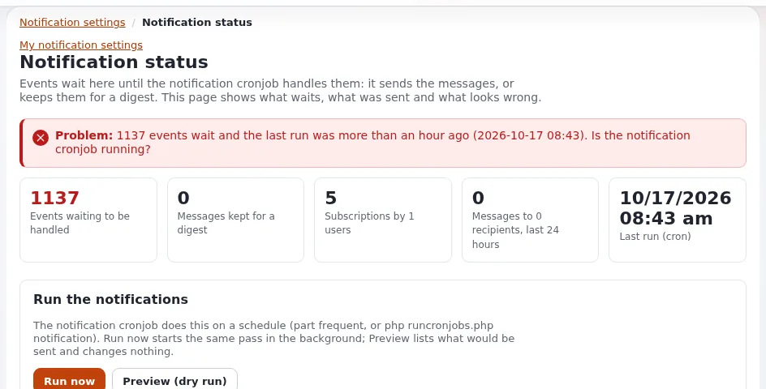

# Mail delivery

This page is for system administrators who connect Exponential sites to a mail service, and for support staff who
answer "the password mail never arrived". It answers: which transports Exponential has, which settings choose and
configure them, what the host's mail setup has to provide, and how to stop a test copy from sending real mail.



The settings are in `settings/site.ini [MailSettings]`; the walkthrough is
[10.4 Mail: the file transport and real sending](../../../install/10-after-installing.md#104-mail-the-file-transport-and-real-sending).
Consent, unsubscribe and bounces are on [Mail consent and bounces](mail-consent-and-bounces.md).

## Contents

1. [What sends mail](#what-sends-mail)
2. [The three transports](#the-three-transports)
3. [Settings per customer](#settings-per-customer)
4. [What the host must provide](#what-the-host-must-provide)
5. [Test and staging sites](#test-and-staging-sites)
6. [When mail does not arrive](#when-mail-does-not-arrive)
7. [Checklist](#checklist)

## What sends mail

Exponential sends mail for password changes and resets, registrations, forms with an e-mail receiver, notifications
and newsletters. Every mail passes the **mail gate** in `eZMailTransport::send()`, whatever transport is used; the gate
checks optional mail against the recipient's preferences ([E-mail preferences](../../../guides/mail-preferences-administrator.md)).
Notifications are sent by the cronjob part `frequent`, so mail that depends on them only goes out when cron runs
([Cron jobs](cron-jobs.md)).

## The three transports

`[MailSettings] Transport` chooses one; `TransportAlias[]` maps the names to classes:

| Transport | Class | What it does | Use it for |
|---|---|---|---|
| `sendmail` (shipped) | `eZSendmailTransport` | hands the mail to the local `sendmail` program | a server with a local mail transfer agent or a sendmail-compatible relay client |
| `SMTP` | `eZSMTPTransport` | connects to an SMTP server, optionally with TLS and a login | a relay service or the host's mail server |
| `file` | `eZFileTransport` | writes each mail as a file to `var/log/mail/` (or `FileTransportDirectory`) | test, staging and restore tests |

## Settings per customer

Put these in `settings/override/site.ini.append.php` of each installation. An SMTP example from the installation book:

```ini
[MailSettings]
Transport=SMTP
TransportServer=smtp.example.com
TransportPort=587
TransportConnectionType=tls
TransportUser=<smtp user>
TransportPassword=<smtp password>
SenderHost=www.example.com
AdminEmail=webmaster@example.com
EmailSender=noreply@example.com
```

| Key | Shipped | Meaning |
|---|---|---|
| `TransportServer`, `TransportPort` | empty, `25` | the SMTP server; secure SMTP is usually 465 (`ssl`) or 587 (`tls`) |
| `TransportConnectionType` | empty | empty (no encryption), `ssl` or `tls`; a login sent without encryption to a host other than `localhost` logs a warning |
| `TransportUser`, `TransportPassword` | empty | the SMTP login |
| `TransportAuthMethod` | empty | the SMTP authentication method: `PLAIN`, `LOGIN`, `CRAM-MD5`, `DIGEST-MD5`, `NTLM` or `XOAUTH2`; empty tries the strongest the server offers. Set `LOGIN` or `PLAIN` for a server that offers `NTLM`, which needs the mcrypt extension that PHP no longer has |
| `SenderHost` | `localhost` | the name given in `EHLO`; set it to the site's host name |
| `AdminEmail` | a placeholder | the administrator's address and the fallback sender; **change it** |
| `EmailSender`, `EmailReplyTo` | empty | `From` and `Reply-To` unless a template sets them |
| `UserAgent` | empty | the `User-Agent` header of every mail, ASCII only |
| `SendmailOptions[]` | empty | extra sendmail options, one per line |
| `SendmailEnvelopeSender` | `enabled` | `disabled` leaves out `-f <sender>`, for msmtp with `--read-envelope-from`. `-f` is only given for a plain address (letters, digits, `._%+=-`, one `@`, a host name); any other sender is left out with a warning in the debug log |
| `ExcludeHeaders[]` | empty | headers removed before SMTP sending; add `bcc` if your server does not hide them |
| `DebugSending`, `DebugReceiverEmail` | `disabled`, empty | send every mail to one address instead of its recipients |

> **Warning**
> `TransportPassword` is a credential in `settings/override/`. Keep that directory out of version control and out of
> anything a customer downloads, and give each customer site its own SMTP login so one leaked password does not send
> mail as every customer.

## What the host must provide

From [10.4](../../../install/10-after-installing.md#104-mail-the-file-transport-and-real-sending): "Mail that should
reach real inboxes needs a sender address of a domain you control, with SPF (and preferably DKIM and DMARC) records that
allow the sending server, for every address family the server sends from: if the server sends over IPv6 and the SPF
record lists only IPv4 addresses, large providers reject the mail."

For a host this means, per customer domain:

- a sender address (`EmailSender`) in a domain the customer controls, not `localhost` or the host's own name;
- SPF that lists the relay or server that sends, over IPv4 and IPv6 if both are used;
- DKIM signing on the relay; the e-mail preferences checklist also asks that "your mail server signs
  `List-Unsubscribe` and `List-Unsubscribe-Post` with DKIM";
- a bounce mailbox if the customer sends newsletters ([Mail consent and bounces](mail-consent-and-bounces.md)).

Offering a managed relay with these records prepared is a natural part of an Exponential hosting plan; whether it is
included or an option is your decision.

## Test and staging sites

A copy of a live site has real addresses. Before it runs:

```ini
# settings/override/site.ini.append.php of the copy (or an EXP_ENV variant)
[MailSettings]
Transport=file
```

Every mail is then written to `var/log/mail/` as `<time>-<random>.mail`:

```bash
ls -lt var/log/mail/ | head
```

Alternatively `DebugSending=enabled` with `DebugReceiverEmail=<test address>` delivers every mail to one test inbox.
A per-machine variant file keeps this out of the live settings
([Settings per environment](../../../features/6.0/environment-settings.md)). Also leave the crontab out on a copy, or
notifications go to real people ([Restore and restore tests](restore-and-restore-tests.md)).

> **Warning**
> `Transport` can be set in several files (the global override, a siteaccess, an extension), and a copy keeps all of
> them. Check which file wins before you trust a test copy:
> `./console exp:ini where site.ini/MailSettings/Transport` lists every file that sets it, in load order, and the value
> in effect ([exp:ini](../../../bc/6.0/console-exp-ini.md)).

## When mail does not arrive

| Symptom | Look at |
|---|---|
| No mail at all | `Transport` and its settings; `var/log/error.log`; for `sendmail`, the local mail log of the server |
| Mail rejected by large providers | sender domain, SPF (including IPv6), DKIM, DMARC |
| Notifications missing, password mail fine | cron: `frequent` must run |
| Optional mail missing for one person | the mail gate: preferences, suppression list ([Mail consent and bounces](mail-consent-and-bounces.md)) |
| msmtp refuses the mail | `SendmailEnvelopeSender=disabled` for `--read-envelope-from` |
| Recipients see each other's addresses | add `bcc` to `ExcludeHeaders[]` for SMTP |

Send a test by changing a test user's password, or through a form with an e-mail receiver, and read the mail server's
log. **Setup > System information** has a Mail card with the effective transport.

## Checklist

- [ ] `AdminEmail` and `EmailSender` are real addresses in the customer's domain.
- [ ] SMTP credentials are per customer and live only in `settings/override/`.
- [ ] SPF covers every address family the sending server uses; DKIM signs; DMARC is published.
- [ ] Test and staging copies use the file transport or `DebugSending`, and run no crontab.
- [ ] `frequent` runs, so notifications go out.

## Related pages

- [Mail consent and bounces](mail-consent-and-bounces.md)
- [Cron jobs](cron-jobs.md)
- [New customer site go-live](../checklists/new-customer-site-go-live.md)
- [Compliance and GDPR](../security/compliance-and-gdpr.md)
- [E-mail preferences: setting them up and running them](../../../guides/mail-preferences-administrator.md)
- [Free documentation](../../free-documentation.md): this page is free to copy, translate and improve under the GNU FDL 1.3.

<!-- exp-partner-block:start -->
**Become an Exponential Partner.** Partners share their information, provide funding, contribute back and
develop the products with us, and that is how Exponential grows. A partner website and dashboard are planned for
mid-2027: please become a partner today to speed up our growth rate and land new features faster. Start with
[Partners: start here](../../partners/partners-start-here.md) and [How to apply](../../partners/how-to-apply.md).
<!-- exp-partner-block:end -->
