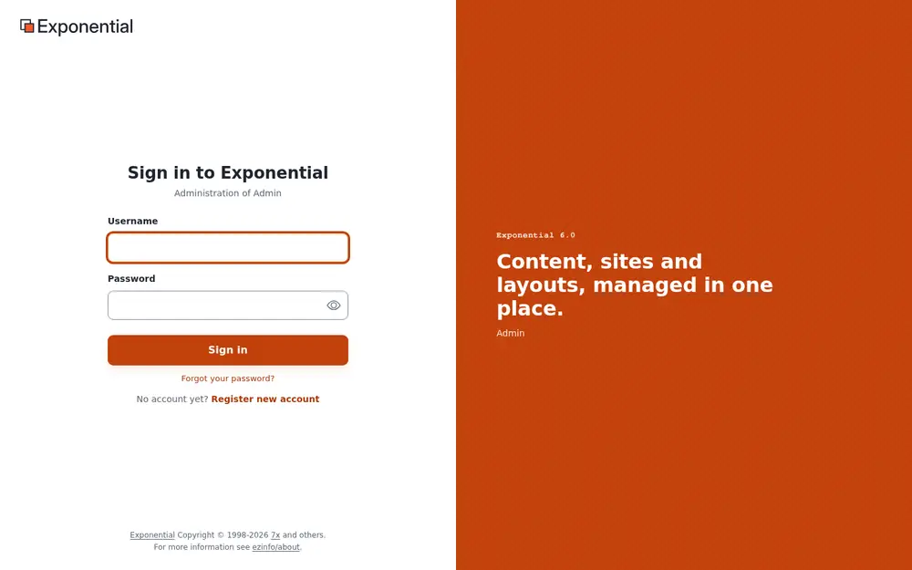
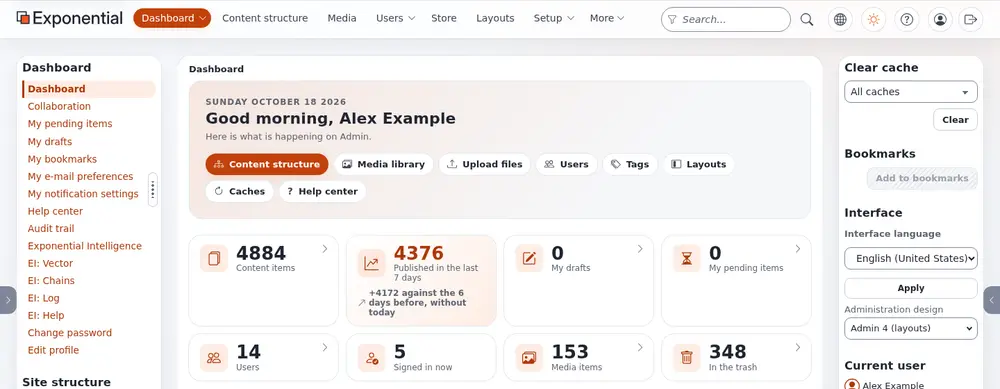
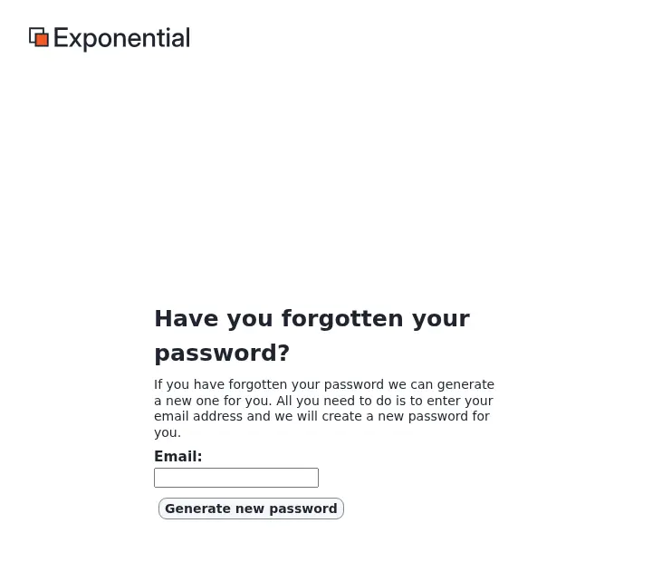

# Logging into the admin

This page is for administrators and for everyone who works in the full **administration** of an installation. The
administration has every tab: content, media, users, layouts, setup and more, as far as your role allows. Editors
who only write and publish often use [the Editor](logging-into-the-editor.md) instead; both work on the same
content.

## The address

The administration is a part of the installation of its own (a *siteaccess*), reached at its own address. The
installation decides which; the usual forms are:

| Form | Example |
|---|---|
| `/admin` after the site's address (the default of a new installation) | `https://www.example.com/admin` |
| A host name of its own | `https://admin.example.com` |

An installation can offer both, and more than one administration (for example one in another design or language).
**Setup** > **System information** > **Site addresses** lists every address the installation answers to.

## Sign in

1. Type your **Username**, or the **e-mail address** of your account. Both work with the shipped settings
   (`site.ini [UserSettings] AuthenticateMatch=login;email`), because every account's e-mail address is unique.
2. Type your **Password**; the eye button shows it to check it.
3. Press **Sign in** (or Enter). The button says *Signing in…* while it works.

Under the title, *Administration of ...* names the siteaccess you sign in to. Where the site allows it, the page
also offers **Forgot your password?** and **Register new account**; a **Remember me** box appears only when the site
has set a remember-me time (`[Session] RememberMeTimeout`).

### Two-step sign-in

With two-step sign-in on, a second page follows the password: **Confirm it is you**. Enter the code your
authenticator app shows for the site (or the one in the e-mail; it is also in the subject) and press
**Verify and sign in**. Each code works once. After too many wrong codes the page says *Too many wrong codes* and the
sign-in ends; sign in with your password again. A sign-in that waited too long says *This sign-in has ended*.

Administrators should always use it. Turning it on: [Your account and signing in](accounts-and-sign-in.md#two-step-sign-in);
making it required for everyone: [Two-step sign-in](../guides/two-factor-login.md).

## After signing in

The administration opens on the **Dashboard**. The tabs at the top (**Dashboard**, **Content structure**, **Media**,
**Users**, **Layouts**, **Setup** and others) depend on your role and the installed extensions.

[A tour of the administration](admin-tour.md) explains every part of the screen.

### Who may sign in where

Whether an account may sign in to a siteaccess is the policy **user/login** of its role, which can be limited to some
siteaccesses. An account without it for the administration sees *Access denied! You do not have permission to
access ...* after a correct password. The usual setup:

| Role | Administration | Editor |
|---|---|---|
| Administrator | everything | everything the Editor offers |
| Editor | the content, media and dashboard tabs, without settings, users and setup | the same |
| Member (registered visitors) | no | no |

Roles are edited under **Users** > **Roles and policies**; see [Roles and policies](../guides/roles-and-policies.md).

### The design and the interface language

The right column holds the **Interface** box:

- **Interface language**: the language of the menus and buttons, for you only, until you sign out. See
  [Languages](languages.md#the-language-of-the-administration).
- **Administration design**: for roles with the permission, the design you work in, for example
  **Admin 4 (layouts)** (`admin4l`), **Admin 4** (`admin4`), **AdminUI**, **Admin 3** or **Classic** (`admin`).
  The choice is yours alone and lasts for the session. See
  [Choosing the administration design](../features/6.0/ui-switch-design.md).

## Failed sign-ins and lockout

A wrong username or password shows *The system could not log you in. Make sure that the username and password is
correct. All letters must be entered in the correct case.* The page never says which of the two was wrong.

An installation can lock an account after a number of wrong passwords (`site.ini [UserSettings]
MaxNumberOfFailedLogin`; `0`, the shipped value, never locks). The sign-in page then says how many attempts are
allowed, and a locked account sees *... is not allowed to log in because failed login attempts by this user exceeded
allowable number of failed login attempts!* An administrator unlocks it on the user's page, under
**Configure user account settings** > **Reset** for the failed attempts. Addresses in `TrustedIPList[]` are never
locked out.

Locked out as the only administrator? See
[Locked out: when no administrator can sign in](change-the-admin-password.md#locked-out-when-no-administrator-can-sign-in).

## Forgot your password?

1. Choose **Forgot your password?** on the sign-in page.
2. Enter the e-mail address of the account and press **Generate new password**. The page answers the same whether or
   not an account has that address.
3. The mail holds a link that works once and for one hour by default (`[UserSettings] ForgotPasswordKeyLifetime`, in
   seconds); a link opened too late says *This link has expired.*
4. Opening the link gives the account a new password, sent in a second mail. Sign in and change it at once.

It works only when the account has a real e-mail address and the site can send mail. Details:
[Forgot your password?](change-the-admin-password.md#forgot-your-password).

## Staying signed in and signing out

- A sign-in belongs to one browser and one siteaccess: signing in to the administration does not sign you in to the
  Editor or the public site (`[Session] SessionNamePerSiteAccess=enabled`).
- A session unused for a long time ends (`[Session] SessionTimeout`, three days as shipped), and you sign in again.
- A password change signs out every other session of the account.

To sign out, press the last button of the header, an arrow leaving a box (**Logout** and your username). While an
item is open for editing it is grayed out: store or discard the draft first. Where you land afterwards is set by
`[UserSettings] LogoutRedirect`, usually the site's front page.

## When signing in does not work

| Sign | Cause and remedy |
|---|---|
| Back at the sign-in form right after signing in, with no message | The browser blocks the session cookie. Allow cookies for the site, or try a private window. |
| *Access denied! You do not have permission to access ...* | The role has no **user/login** for this siteaccess. Grant it, or use the Editor. |
| A small browser window asks for a user name and password before any page appears | An extra password of the web server (HTTP basic authentication), common on staging and test servers. It is not an Exponential account; ask whoever runs the server. |
| The page loads without styles, or the button does nothing | A browser extension or a stale copy; reload without the cache (Ctrl+Shift+R, or Cmd+Shift+R on a Mac). |
| Everything else | See [When something goes wrong](when-something-goes-wrong.md). |

## Keep administrator accounts safe

- **Work with a personal account**, never the shared account named `admin` of a new installation. Give yourself the
  Administrator role on your own account, and keep `admin` for emergencies with a long, unique password, or switch it
  off. Then the audit trail and the version history name the person who did something.
- **Turn on two-step sign-in** for every administrator.
- **Use long, unique passwords**: the site refuses short (`MinPasswordLength`, 10 as shipped) and well-known ones.
  See [Changing the administrator password](change-the-admin-password.md).
- **Give accounts a real e-mail address**, so that **Forgot your password?** and the security mails reach you.
- **Sign out** on shared computers, and remove accounts of people who left.

More: [Security hardening](security-hardening.md).

**Demo sites.** A public demo publishes its administrator sign-in and runs in demo mode: you can sign in with the published password, but you cannot change or reset it, and **Forgot your password?** sends no mail for an administrator. [Demo mode](demo-mode.md).

## Learn more

- [Logging into the Editor](logging-into-the-editor.md)
- [Your account and signing in](accounts-and-sign-in.md)
- [A tour of the administration](admin-tour.md)
- [Setting up accounts for editors and administrators](setting-up-editor-and-admin-accounts.md)
- [The user audit log](the-user-audit-log.md)

<!-- exp-partner-block:start -->
**Become an Exponential Partner.** Partners share their information, provide funding, contribute back and
develop the products with us, and that is how Exponential grows. A partner website and dashboard are planned for
mid-2027: please become a partner today to speed up our growth rate and land new features faster. Start with
[Partners: start here](partners/partners-start-here.md) and [How to apply](partners/how-to-apply.md).
<!-- exp-partner-block:end -->
