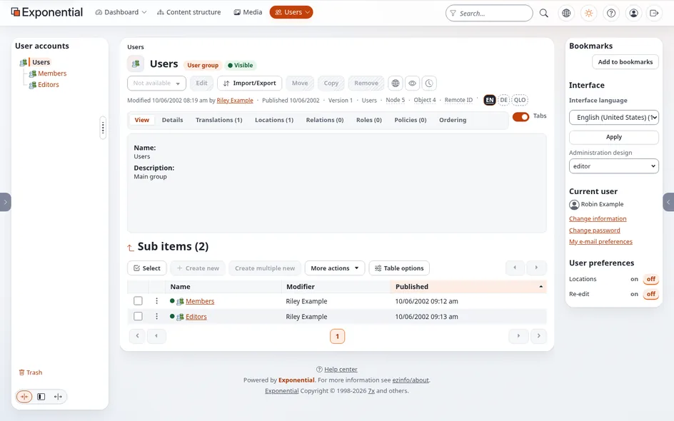
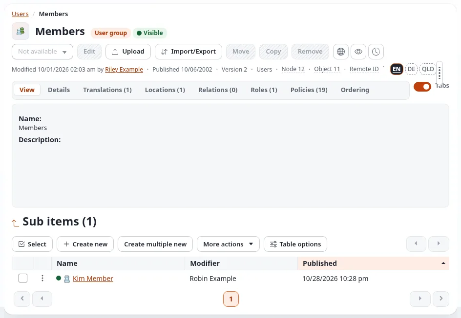
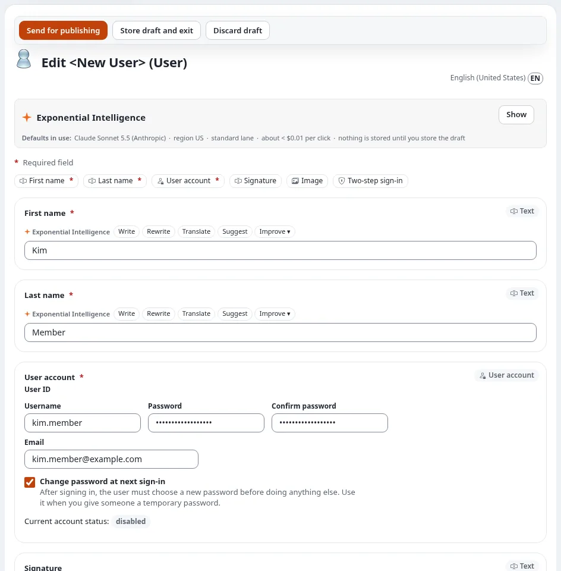
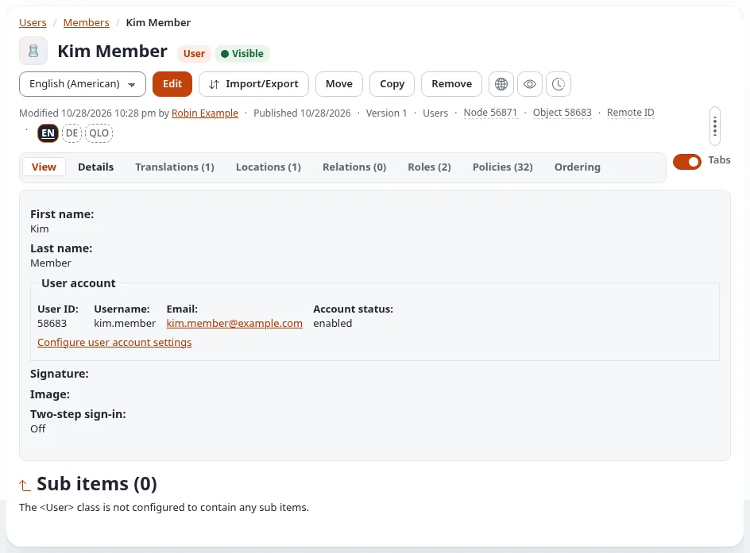
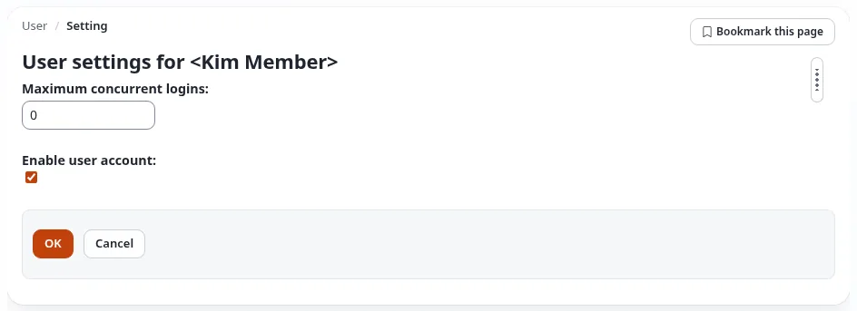
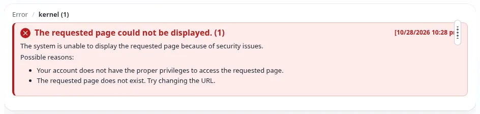

# Managing members

**Members** are the people with an account on the public site: they register, sign in to read restricted pages,
write comments or take part in the forums. Editors look after these accounts. The role **Member management**, which
every account in the Editors group has, lets an editor do everything a member's account needs, limited to the
**Members** group:

- create a member, or a group of members inside Members;
- edit a member: name, e-mail address, username, password;
- enable and disable a member's account;
- move a member to another group inside Members;
- remove a member;
- read the versions of a member's account.

The accounts of **administrators** and of other **editors** stay out of reach, and so do roles: an editor never
assigns or changes a role. Every action, and every refused attempt, is recorded in the
[user audit log](the-user-audit-log.md).

## Find the members

Click **Users** in the top menu. An editor sees the groups **Members** and **Editors** (the latter only to ask for a
new colleague's account); the other groups of the installation are not shown.

Click **Members**. The group lists its members under **Sub items**; **Select**, the table options and the search
in the header work as for any other list.

## Create a member

1. In **Members** (or a group inside it), press **Create new** and choose **User**.
2. Fill in **First name**, **Last name**, and under **User account** the **Username**, **Email**, **Password** and
   **Confirm password**. Leave **Change password at next sign-in** ticked when you give the member a temporary
   password: they then choose their own at their first sign-in.
3. Press **Send for publishing**. If the site asks **Verify it's you**, enter your own password and press
   **Confirm** ([Verify it's you](../guides/verify-its-you.md)).

Pass the temporary password on by another channel than the e-mail with the username, as described in
[Setting up accounts for editors and administrators](setting-up-editor-and-admin-accounts.md#8-hand-over-the-sign-in).
A member who forgot the password can always set a new one with **Forgot your password?** on the sign-in page.

## Edit a member

Open the member and press **Edit**. You can change the name, the e-mail address, the username and the password, and
tick **Change password at next sign-in**. Publish as above.

## Enable or disable a member

1. Open the member and click **Configure user account settings** under **User account**.
2. Tick or untick **Enable user account**. **Maximum concurrent logins** limits how many sessions the member may
   have at once (`0` means no limit).
3. Press **OK**.

A disabled member cannot sign in; everything they wrote stays. Disable rather than remove when you are not sure.

## Move or remove a member

- **Move**: open the member, press **Move** and choose another group inside Members. A group outside Members (such as
  Editors or Administrator users) is refused.
- **Remove**: open the member, press **Remove** and confirm. Before that, check on the **Relations** tab whether
  content refers to the account; when in doubt, disable it instead.

## What is refused, and why

An editor cannot open, edit, move, disable or remove the account of an administrator or of another editor, cannot
move a member into Editors or Administrator users, and cannot rename, move or remove the Members group itself. Such
an attempt ends on an error page:

That is intended. A member who should become an editor: ask an administrator, or create a new account in Editors,
which an administrator then approves ([Approving new editor accounts](../guides/approving-new-editor-accounts.md)).

## Everything is recorded

The site records each of these actions with who did it, when, from which interface and what changed (the e-mail
address hashed, never a password), and each refused attempt as well. Administrators read it in the
[user audit log](the-user-audit-log.md) and in the audit trail. Act only on accounts you were asked to change.

**Data protection:** member accounts hold personal data. Change only what the member or your organization asked
for, keep passwords out of e-mail, and remove the accounts of members who asked to be deleted
([Data export and erasure](customers/commerce/data-export-and-erasure.md)).

## For administrators

The role *Member management* is made from `settings/membermanagement.ini`: which groups manage which other groups,
which groups are protected (by default Administrator users and Editors) and which permissions a manager gets. On an
installation that exists, `php bin/php/addmembermanagement.php --dry-run` shows what it would add. Details, and how
to let another group manage members (a support desk, for example): [Member management](../bc/6.0/member-management.md).

## Related pages

- [What the Editor role allows](what-the-editor-role-allows.md)
- [Setting up accounts for editors and administrators](setting-up-editor-and-admin-accounts.md)
- [The user audit log](the-user-audit-log.md)
- [How do I set up a members-only area?](manual/how-do-i-set-up-a-members-only-area.md)
- [How do I disable or unlock a user account?](manual/how-do-i-disable-or-unlock-a-user-account.md)
- [Free documentation](free-documentation.md): this page is free to copy, translate and improve under the GNU FDL 1.3.

<!-- exp-partner-block:start -->
**Become an Exponential Partner.** Partners share their information, provide funding, contribute back and
develop the products with us, and that is how Exponential grows. A partner website and dashboard are planned for
mid-2027: please become a partner today to speed up our growth rate and land new features faster. Start with
[Partners: start here](partners/partners-start-here.md) and [How to apply](partners/how-to-apply.md).
<!-- exp-partner-block:end -->
