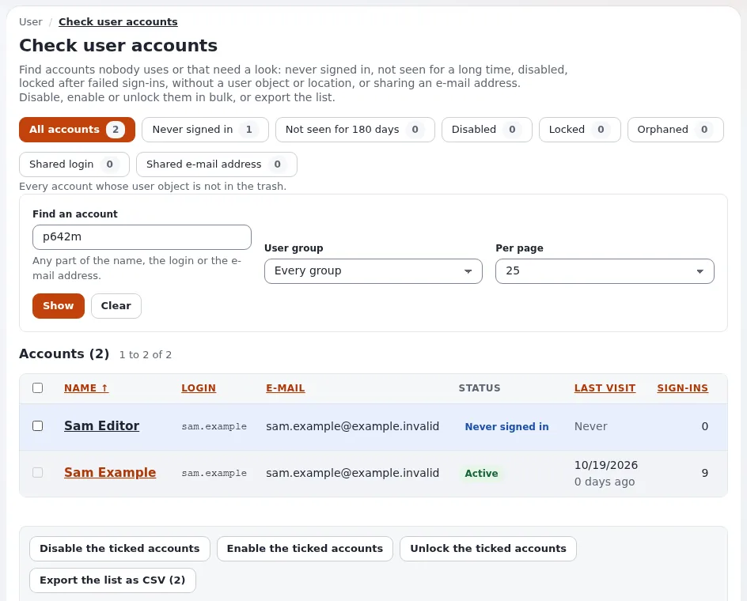

# How do I disable or unlock a user account?

A disabled account cannot sign in, but keeps its content and history. A locked account has had too many failed
sign-ins and is unlocked by an administrator.

## Who can do this

Users whose role has `user/hygiene` (the page **Check user accounts**), or who may edit the user (the account
settings of one user). The anonymous user, the administrator account and your own account are never changed there.

## Steps

1. Open **Setup** > **Check user accounts**.
   The page lists every account with its state (**Active**, **Disabled**, **Locked**, **Not activated**) and last
   visit.
2. Under **Narrow the list**, find the accounts: by name, login or e-mail address, by group, or by state such as
   **Never signed in**. Click **Show**.
3. Tick the accounts.
4. Click **Disable the ticked accounts**, **Enable the ticked accounts** or **Unlock the ticked accounts**, and
   confirm.
5. For one user, open the user's page and click **Configure user account settings**: untick or tick **Enable user
   account**, and click **Reset** for the failed sign-ins.

## What can go wrong

- **The user is still signed in after you disabled the account.** Open sessions end at their next request. To end
  them at once, use **Setup** > **Sessions**.
- **Unlocked, but locked again soon.** Someone keeps trying a wrong password, perhaps an old script or an attack. Look
  at the sign-in events in the audit trail.
- **You want to remove a person who left.** Disable first; remove the account only when their content has a new owner.

## Related pages

- [Check user accounts](../../features/6.0/user-hygiene.md)
- [Offboarding staff](../customers/day-to-day/offboarding-staff.md)
- [Change the administrator password](../change-the-admin-password.md)
- [Sessions](../../guides/sessions.md)
- [User manual](README.md)

<!-- exp-partner-block:start -->
**Become an Exponential Partner.** Partners share their information, provide funding, contribute back and
develop the products with us, and that is how Exponential grows. A partner website and dashboard are planned for
mid-2027: please become a partner today to speed up our growth rate and land new features faster. Start with
[Partners: start here](../partners/partners-start-here.md) and [How to apply](../partners/how-to-apply.md).
<!-- exp-partner-block:end -->
