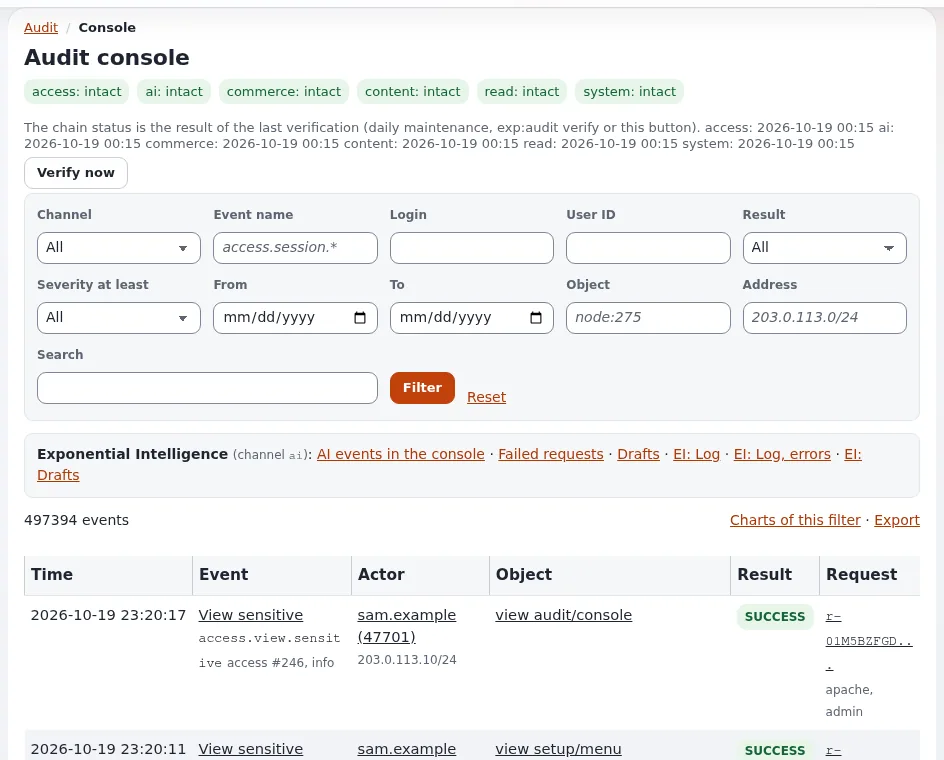

# How do I find out who changed what, and when?

Every change in the system is written to the audit trail: who did it, to which object, when, from which address and
with which result. The **Audit console** finds the events you need.

## Who can do this

Users whose role has the policy `audit/read`. It can be limited to channels (for example, `content` but not
`access`), so you see only the events your role allows.

## Steps

1. Click **Audit** in the top menu (or **More** > **Audit**).
   The **Audit dashboard** opens with health, today's and the week's figures, security events and alerts.
2. Click **Console** in the **Audit** menu on the left.
3. Narrow the list:
   - **Login** or **User ID**: one person's actions.
   - **Object**: one object or node, for example `node:275`.
   - **Event name**: a kind of event, for example `content.*` for content changes.
   - **From** and **To**: a period.
   - **Channel**, **Result**, **Severity at least**, **Address**, **Search** for the rest.
4. Click **Filter**.
   Each row shows **Time**, **Event**, **Actor**, **Object**, **Result** and **Request**.
5. Click an event to see all its details.
6. To keep the result, click **Export**.
7. To check that nobody has changed the record, click **Verify now**. Each channel should show "intact".

## What can go wrong

- **No events for a change you know happened.** Your role may not read that channel, or the period is wrong. Clear
  the filter with **Reset** and try a wider period.
- **A channel shows something other than "intact" after Verify now.** The stored record does not match its hash
  chain. Do not change anything; tell the person responsible for security at once.
- **The actor is "anonymous".** The change came from a cronjob or a script on the server, not from a signed-in user.
  The **Request** column says which.

## Related pages

- [The audit trail](../../features/6.0/audit-trail.md)
- [Security and audit](../../guides/security-and-audit.md)
- [Content history](../../guides/content-history.md)
- [User manual](README.md)

<!-- exp-partner-block:start -->
**Become an Exponential Partner.** Partners share their information, provide funding, contribute back and
develop the products with us, and that is how Exponential grows. A partner website and dashboard are planned for
mid-2027: please become a partner today to speed up our growth rate and land new features faster. Start with
[Partners: start here](../partners/partners-start-here.md) and [How to apply](../partners/how-to-apply.md).
<!-- exp-partner-block:end -->
