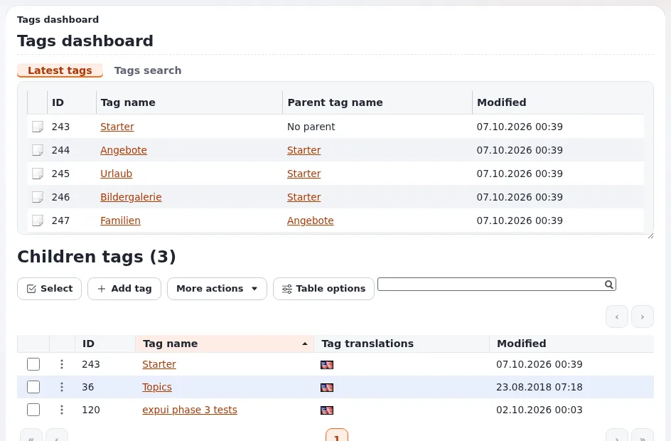

# How do I keep the tag tree tidy?

The **Tags** tab holds the shared tag tree. A tidy tree has one tag per meaning, in the right place, in every
language of the site.

## Who can do this

Users whose role has the tags policies: `tags/add`, `tags/edit`, `tags/delete`, `tags/merge`, `tags/makesynonym` and
`tags/addsynonym` as needed. Editors usually only tag content; one or two people keep the tree.

## Steps

1. Click **Tags** in the top menu (or **More** > **Tags**).
   The **Tags dashboard** shows the top level tags.
2. To add a tag, open the parent tag and click **Add tag**. Enter the name and save.
3. To change a tag, open it and use **More actions**: edit, translate, move, delete, make it a synonym of another tag,
   or merge it into another tag.
4. To find a tag, use **Tags search**. **Latest tags** shows what was added recently, often by editors in a hurry.
5. Translate tags into every language the site shows: open the tag and add the translation.

## What can go wrong

- **Attention: deleting a tag removes it from all content.** Merge it into the right tag instead, so the content keeps
  a tag.
- **A tag shows in English on the German site.** It has no German translation. Translate it.

## Related pages

- [How do I tag content?](how-do-i-tag-content.md)
- [Tagging with eztags](../creators/website-creators/tagging-with-eztags.md)
- [eztags](../../features/6.0/extensions/eztags.md)
- [User manual](README.md)

<!-- exp-partner-block:start -->
**Become an Exponential Partner.** Partners share their information, provide funding, contribute back and
develop the products with us, and that is how Exponential grows. A partner website and dashboard are planned for
mid-2027: please become a partner today to speed up our growth rate and land new features faster. Start with
[Partners: start here](../partners/partners-start-here.md) and [How to apply](../partners/how-to-apply.md).
<!-- exp-partner-block:end -->
