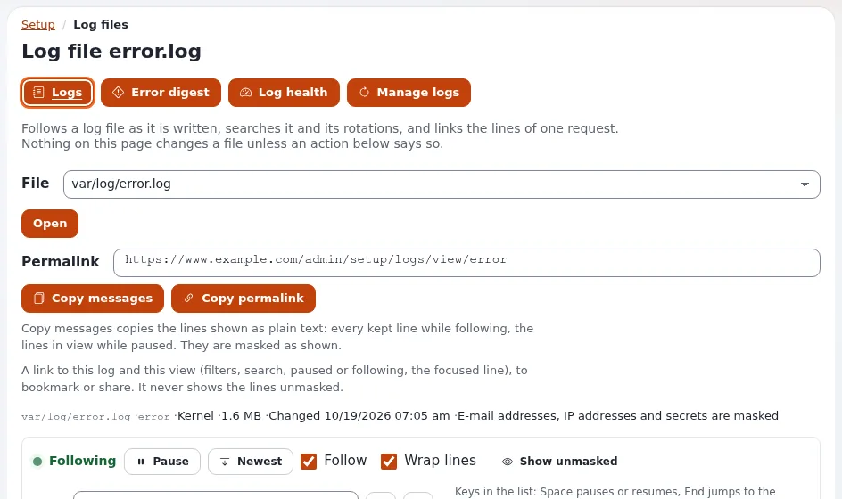

# How do I read the log files?

The log viewer shows the log files of the installation in the browser, so you can see what went wrong without access
to the server.

## Who can do this

Users whose role has `setup/logs`. **Show unmasked** (IP addresses and other personal data in clear) needs
`setup/unmasklogs`; **Manage logs** (rotate, remove) needs `setup/managelogs`.

## Steps

1. Open **Setup** > **Log files**.
2. Under **File**, choose the log, for example `var/log/error.log`, and click **Open**.
   The newest lines are shown and new ones appear as they are written (**Following**). **Pause** stops the scrolling;
   **Newest** jumps back to the end.
3. Use the **Controls** to filter by level or search for a word, for example an error reference from an error page.
4. Click a line to see the whole **Entry**. **Copy permalink** gives a link to that line for a colleague; **Copy
   messages** copies the lines.
5. For an overview, click **Error digest** (the errors grouped by kind) or **Log health** (sizes and growth).

## What can go wrong

- **Addresses and names show as masked.** That is the default to protect personal data. Ask for `setup/unmasklogs`
  only if you need it.
- **A log is empty.** That kind of event has not happened, or logging for it is turned off.
- **An error page shows a reference like `k1-...`.** Search for it in the log: see
  [Finding an error by its reference](../../guides/finding-an-error-by-its-reference.md).

## Related pages

- [The log viewer](../../features/6.0/log-viewer.md)
- [Log rotation and pruning](../../features/6.0/log-rotation.md)
- [Logs for owners](../customers/healthy/logs-for-owners.md)
- [User manual](README.md)

<!-- exp-partner-block:start -->
**Become an Exponential Partner.** Partners share their information, provide funding, contribute back and
develop the products with us, and that is how Exponential grows. A partner website and dashboard are planned for
mid-2027: please become a partner today to speed up our growth rate and land new features faster. Start with
[Partners: start here](../partners/partners-start-here.md) and [How to apply](../partners/how-to-apply.md).
<!-- exp-partner-block:end -->
