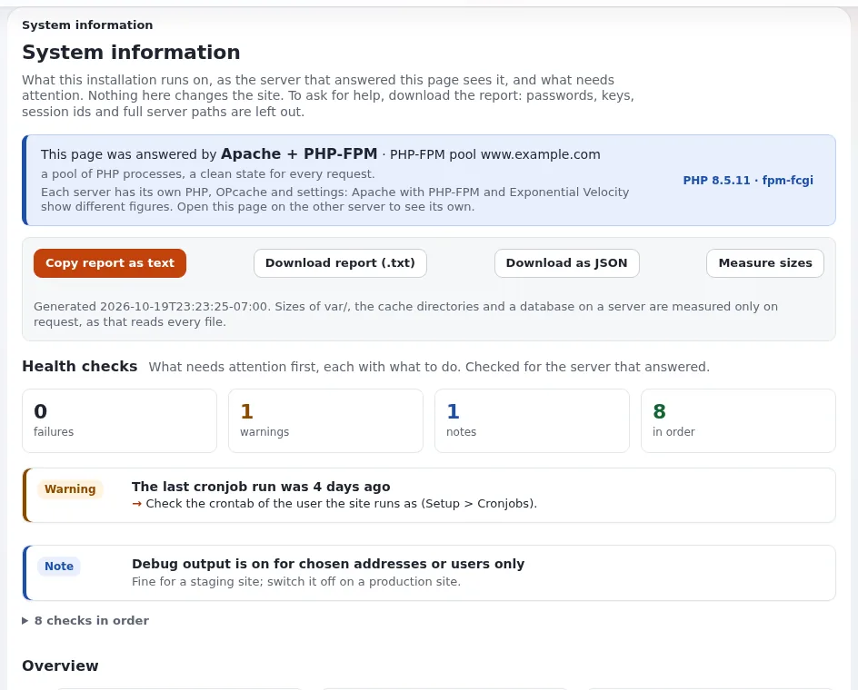

# How do I see the active extensions and the system information?

Two pages answer "what is installed and how is it running": **Extensions** and **System information**. Support asks
for them first.

## Who can do this

**Extensions** needs `setup/setup`; activating or deactivating also needs it. **System information** needs
`setup/system_info`.

## Steps

1. Open **Setup** > **Extensions**.
   The **Overview** counts active and inactive extensions; **All extensions** lists each with its version, license and
   whether it is a git checkout.
2. Use **Find extensions** to search by name, description or license, or show only **Active** or **Inactive** ones.
   Click an extension's name for its **Details**.
3. Open **Setup** > **System information**.
   **Health checks** come first, then **Overview**, and sections for **Active extensions**, **PHP extensions and
   settings**, **Siteaccesses**, **Database connection** and more.
4. For support, open **Report for support** and click **Copy report as text** or **Download report (.txt)**.

## What can go wrong

- **Attention: deactivating an extension can break the site.** Pages and content that need it stop working. Change
  extensions only after reading the warnings, and on a test copy first.
- **A health check is red.** Each check says what is wrong and what to do; pass it on to the person who runs the server.
- **The report contains server details.** Send it only to your support partner, not in public.

## Related pages

- [Extensions page](../../guides/extensions-page.md)
- [System information](../../guides/system-information.md)
- [Setup > Extensions: loading order and safe saving](../../features/6.0/extension-loading-order.md)
- [User manual](README.md)

<!-- exp-partner-block:start -->
**Become an Exponential Partner.** Partners share their information, provide funding, contribute back and
develop the products with us, and that is how Exponential grows. A partner website and dashboard are planned for
mid-2027: please become a partner today to speed up our growth rate and land new features faster. Start with
[Partners: start here](../partners/partners-start-here.md) and [How to apply](../partners/how-to-apply.md).
<!-- exp-partner-block:end -->
