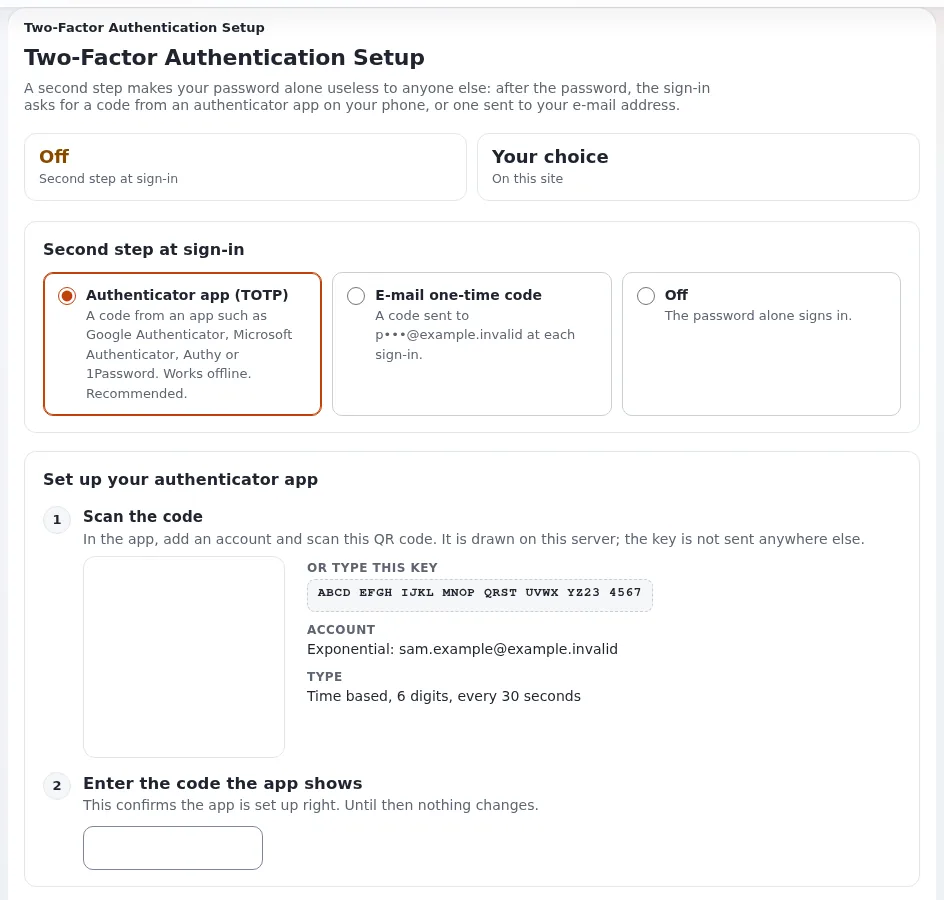

# How do I turn on two-step sign-in for my account?

With two-step sign-in, your password alone is not enough: after it, the sign-in asks for a code from an app on your
phone or from an e-mail. Turn it on for every account that can publish or change settings.

## Who can do this

Every signed-in user whose role has `user2fa/setup`, on a site where the two-step sign-in extension is active (it is
in a new installation). Have an authenticator app on your phone, such as an open source one or the one your
organization uses.

## Steps

1. Open **My account** (click **Change information** in the right toolbar).
2. Under **Two-step sign-in**, click **Turn on**.
   The page **Two-Factor Authentication Setup** opens.
3. Under **Second step at sign-in**, choose **Authenticator app (TOTP)**.
4. Under **Scan the code**, add an account in your app and scan the QR code, or type the key shown next to it.
5. Under **Enter the code the app shows**, type the 6-digit code from the app.
6. Click **Save settings**.
   From your next sign-in, the code is asked after your password.

## What can go wrong

- **"The code is wrong."** The phone's time is off. Turn on automatic time on the phone and try a new code.
- **No phone at hand.** Choose **E-mail one-time code** instead: the code is then sent to your e-mail address at each
  sign-in.
- **You lost the phone.** You cannot sign in alone. Ask an administrator: see
  [A user lost their phone: how do they sign in again?](a-user-lost-their-phone-how-do-they-sign-in.md)
- **Changing or turning it off asks for a code.** That is on purpose, so that nobody at an unattended computer can
  weaken your account.

## Related pages

- [Two-step sign-in](../../guides/two-factor-login.md)
- [Accounts, passwords and two-factor](../customers/day-to-day/accounts-passwords-and-two-factor.md)
- [What can I do on my account page?](what-is-on-my-account-page.md)
- [User manual](README.md)

<!-- exp-partner-block:start -->
**Become an Exponential Partner.** Partners share their information, provide funding, contribute back and
develop the products with us, and that is how Exponential grows. A partner website and dashboard are planned for
mid-2027: please become a partner today to speed up our growth rate and land new features faster. Start with
[Partners: start here](../partners/partners-start-here.md) and [How to apply](../partners/how-to-apply.md).
<!-- exp-partner-block:end -->
