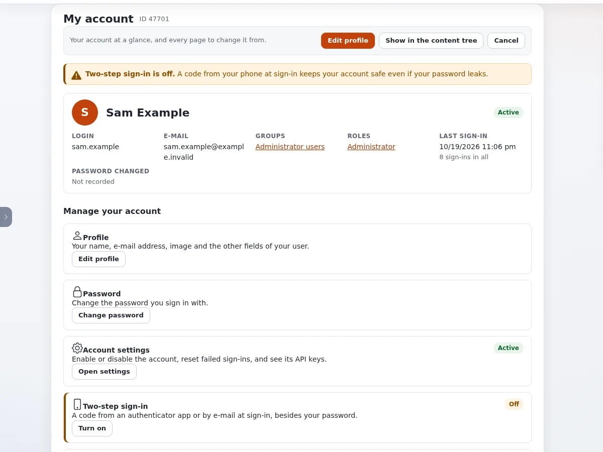

# What can I do on my account page?

**My account** shows your account at a glance and links to every page that changes something about you.

## Who can do this

Every signed-in user. Changing your own profile needs `user/selfedit` or `content/edit` on your user object; most roles
have it.

## Steps

1. Click **Change information** under **Current user** in the right toolbar, or the person icon in the top bar.
   **My account** opens.
2. Read the summary: **Login**, **E-mail**, **Groups**, **Roles**, **Last sign-in** and when your password was last
   changed.
3. Under **Manage your account**, choose what to change:
   - **Profile**: **Edit profile** for your name, e-mail address and image.
   - **Password**: **Change password**.
   - **Two-step sign-in**: **Turn on** or **Manage**.
   - **API keys**: **Manage my API keys**, for your own scripts.
   - **Bookmarks**: **Open bookmarks**.
   - **Notifications**: **Notification settings**, the content you follow.
   - **E-mail preferences**: which e-mail you get.

## What can go wrong

- **A warning "Two-step sign-in is off".** Your account is protected by your password alone. Turn it on: see
  [How do I turn on two-step sign-in?](how-do-i-turn-on-two-step-sign-in.md)
- **Edit profile is missing or refused.** Your role may not edit your own user object. Ask an administrator.
- **API keys is missing.** The site does not offer personal API keys, or your role may not create them.

## Related pages

- [How do I find and finish my drafts?](how-do-i-find-and-finish-my-drafts.md)
- [Where do I see my items waiting for approval?](where-do-i-see-my-pending-items.md)
- [How do I choose which notifications I get?](how-do-i-choose-which-notifications-i-get.md)
- [Change the administrator password](../change-the-admin-password.md)
- [Accounts and sign-in](../accounts-and-sign-in.md)
- [User manual](README.md)

<!-- exp-partner-block:start -->
**Become an Exponential Partner.** Partners share their information, provide funding, contribute back and
develop the products with us, and that is how Exponential grows. A partner website and dashboard are planned for
mid-2027: please become a partner today to speed up our growth rate and land new features faster. Start with
[Partners: start here](../partners/partners-start-here.md) and [How to apply](../partners/how-to-apply.md).
<!-- exp-partner-block:end -->
