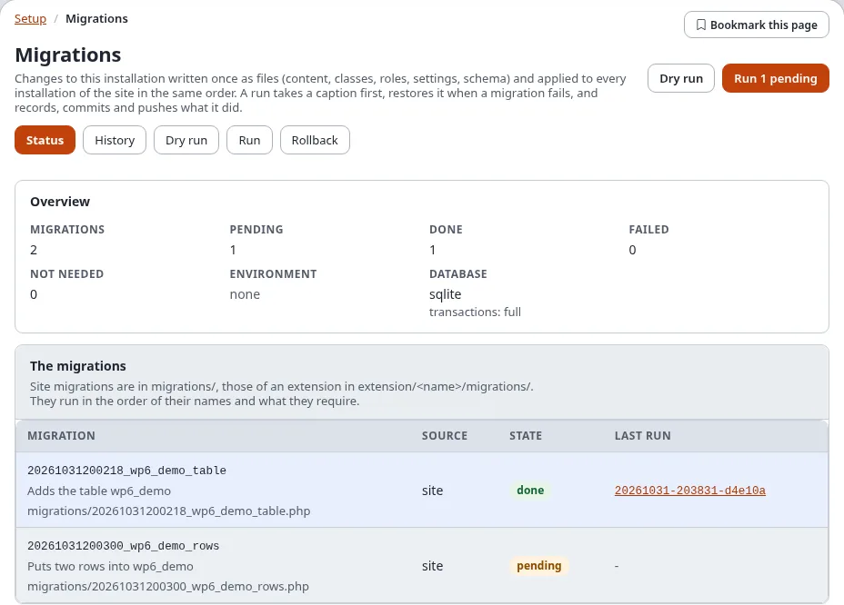
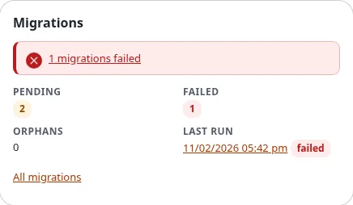

# Migrations: a tour of Setup > Migrations

Everything you do with migrations in the administration happens in **Setup > Migrations**. This page walks through
its screens once, so you know where each task lives; each screen has its own page with the steps in detail.

## Contents

1. [Opening the migrations pages](#opening-the-migrations-pages)
2. [The tabs](#the-tabs)
3. [Which page for which task](#which-page-for-which-task)
4. [The dashboard block](#the-dashboard-block)
5. [The Recording bar](#the-recording-bar)
6. [The website sidebar](#the-website-sidebar)
7. [Who sees what](#who-sees-what)
8. [Related pages](#related-pages)

## Opening the migrations pages

1. Sign in to the administration.
2. Choose **Setup** in the top menu.
3. In the left column, group **System**, choose **Migrations**. The status page opens (`/migration/status`).

The **?** button in the header opens the help page of the screen you are on, from every tab.

## The tabs

Every screen of Setup > Migrations has the same row of tabs:

| Tab | Address | What it is for | Help |
|---|---|---|---|
| **Status** | `/migration/status` | every migration with its state (done, pending, failed, not needed), the lock, the latest runs | [The status](status-and-history.md#the-status) |
| **History** | `/migration/history` | every run with its captions, commit, tag and push; resume and roll back | [The history](status-and-history.md#the-history) |
| **Dry run** | `/migration/dryrun` | what a run would change now, without changing anything; **Simulate** | [Dry run](run-dry-run-and-rollback.md#dry-run) |
| **Run** | `/migration/run` | run the pending migrations, with the long-run fields and the safeguards | [Run](run-dry-run-and-rollback.md#run) |
| **Rollback** | `/migration/rollback` | take a run, one migration or an earlier caption back | [Roll back](run-dry-run-and-rollback.md#roll-back) |
| **Recording** | `/migration/recording` | record your changes, or every change in a time window, and generate a migration from them | [Recording changes](recording.md) |
| **Remotes** | `/migration/remotes` | the other installations (dev, stage, production ...) migrations are deployed to; **New remote** | [Add a remote step by step](add-a-remote-step-by-step.md) |
| **Deploys** | `/migration/deploy` | send the migrations to remotes and run them there, all at once or stage by stage; the history | [Deploy step by step](deploy-step-by-step.md) |
| **Editor** | `/migration/editor` | write a new YAML migration with forms, check it and save it | [The migration editor](the-migration-editor.md) |

A tab you have no policy for is not shown: **Run** needs `migration/run`, **Rollback** `migration/rollback`,
**Recording** and **Editor** `migration/edit`.

## Which page for which task

| I want to ... | Open | Steps |
|---|---|---|
| see whether something is pending or failed | **Status** | [The status](status-and-history.md#the-status) |
| know what a run would change | **Dry run** | [Dry run](run-dry-run-and-rollback.md#dry-run) |
| apply the pending migrations | **Run** | [Run](run-dry-run-and-rollback.md#run) |
| split a long run, or run it at a lower priority | **Run**, card **A long run in parts** | [A long run in parts](run-dry-run-and-rollback.md#a-long-run-in-parts) |
| see why a run failed, and resume it | **History**, the run's page | [When a migration fails](when-a-migration-fails.md) |
| go back to how the site was before a run | **Rollback** | [Roll back](run-dry-run-and-rollback.md#roll-back) |
| turn changes I make by hand into a migration | **Recording** | [Recording changes](recording.md) |
| write a migration without a shell | **Editor** | [The migration editor](the-migration-editor.md) |
| make a migration of a class, a role or a section that exists | the console | [Generating migrations](generating-migrations.md) |
| add staging or production as a target | **Remotes**, **New remote** | [Add a remote step by step](add-a-remote-step-by-step.md) |
| put the migrations on staging and production | **Deploys** | [Deploy step by step](deploy-step-by-step.md) |
| approve the next stage of a deploy | the deploy's page, **Approve** | [Staged deploys and the gate](deploy-step-by-step.md#staged-deploys-and-the-gate) |

## The dashboard block

The dashboard of the administration shows a **Migrations** block with the number of pending and failed migrations,
the orphans and the last run, and links to the status:

## The Recording bar

While a recording of your changes runs, or a site-wide window is open, a red **Recording…** bar shows at the top of
every page of the administration, with **Show** (the recording) and **Stop recording**:

## The website sidebar

On the site's own pages, the website sidebar has a **Migrations** panel: the failed and pending migrations, the last
run, the latest deploys and **Record my changes** ([Migrations in the website sidebar](expwt-panel.md)).

## Who sees what

| Policy | Shows |
|---|---|
| `migration/read` | Status, History, Dry run, Remotes, Deploys, a deploy's page, the dashboard block, the sidebar panel |
| `migration/run` | Run, Resume, Simulate |
| `migration/rollback` | Rollback |
| `migration/edit` | Recording, Editor, Generate migration |
| `migration/remotes` | New remote, Edit, Remove, Test connection |
| `migration/deploy` | Preflight, Deploy, Approve, roll a deploy back |

Only the Administrator role has them in a new installation. Every action that changes something asks
["Verify it's you"](../../guides/verify-its-you.md) first ([Policies, views and events](policies-views-and-events.md)).

## Related pages

- [Migrations: the hub](README.md), [In the administration](in-the-administration.md),
  [Frequently asked questions](faq.md)
- [The status and the history](status-and-history.md), [Run, dry run and rollback](run-dry-run-and-rollback.md),
  [Recording changes](recording.md), [The migration editor](the-migration-editor.md),
  [Generating migrations](generating-migrations.md)
- [Add a remote step by step](add-a-remote-step-by-step.md), [Deploy step by step](deploy-step-by-step.md),
  [Remotes and deploys](remotes-and-deploys.md)
- [Migrations in the website sidebar](expwt-panel.md), [When a migration fails](when-a-migration-fails.md)
