# Migrations: add a remote step by step

A **remote** is another installation of the same site that this installation deploys its migrations to: a dev
server, a staging server, production, a second production node. You add each one once in **Setup > Migrations >
Remotes**; afterwards a deploy only needs to tick it ([Deploy step by step](deploy-step-by-step.md)).

**Who may do this:** users with the policy `migration/remotes` (Administrator in a new installation). Saving and
removing a remote ask ["Verify it's you"](../../guides/verify-its-you.md). The list is visible with `migration/read`.

## Contents

1. [Before you start](#before-you-start)
2. [The list of remotes](#the-list-of-remotes)
3. [Step 1: the remote](#step-1-the-remote)
4. [Step 2: the connection](#step-2-the-connection)
5. [Step 3: the credential](#step-3-the-credential)
6. [Step 4: the host key](#step-4-the-host-key)
7. [Step 5: test, review and save](#step-5-test-review-and-save)
8. [Edit or remove a remote](#edit-or-remove-a-remote)
9. [FTP-only hosts and the trigger](#ftp-only-hosts-and-the-trigger)
10. [Self-healing](#self-healing)
11. [When something goes wrong](#when-something-goes-wrong)
12. [Related pages](#related-pages)

## Before you start

Have these ready for the host you add:

- **The installation there**: the same site, on the same kernel version, with its migrations tables (`./console
  exp:upgrade --apply` there) and captions switched on (`migration.ini [CaptionSettings]`), so a failed deploy can be
  taken back.
- **How to reach it**: the host name, the port, the user, the path of the installation, and the PHP command line
  there (for example `/opt/plesk/php/8.4/bin/php`).
- **The credential as a secret**: an SSH private key or a password, stored in **Setup > Secrets** under a name such as
  `deploy_production1` (or an environment variable of the server process). The remote's settings only ever hold that
  name. For an SSH key, put its public key into `~/.ssh/authorized_keys` of the user there.
- **Optionally the host key fingerprint**: on the remote, `ssh-keygen -l -E sha256 -f /etc/ssh/ssh_host_ed25519_key.pub`
  prints `SHA256:...`.

## The list of remotes

Open **Setup > Migrations** and choose the tab **Remotes** (`/migration/remotes`).

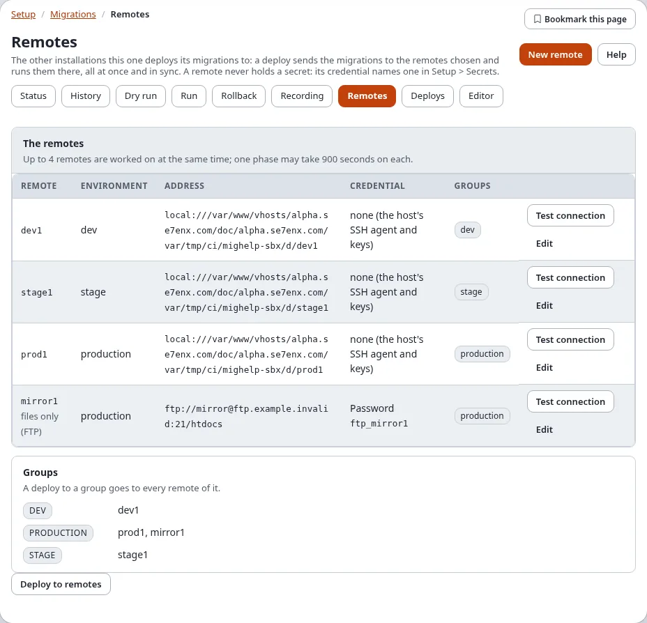

| Column | Shows |
|---|---|
| **Remote** | its id; **files only (FTP)** for an FTP remote without the trigger; **settings to fix** with what is wrong |
| **Environment** | dev, stage, production ...; a staged deploy goes through them in this order |
| **Address** | `transport://user@host:port/path` |
| **Credential** | the kind and the name of the secret, never a value |
| **Groups** | the groups it belongs to; **Groups** below lists every group with its remotes |

Each row has **Test connection** and **Edit**. **Test connection** reaches the remote once and changes nothing; the
answer shows at the top of the page: the kernel version there, how many migrations are done, pending and failed, and
whether a run holds its lock.

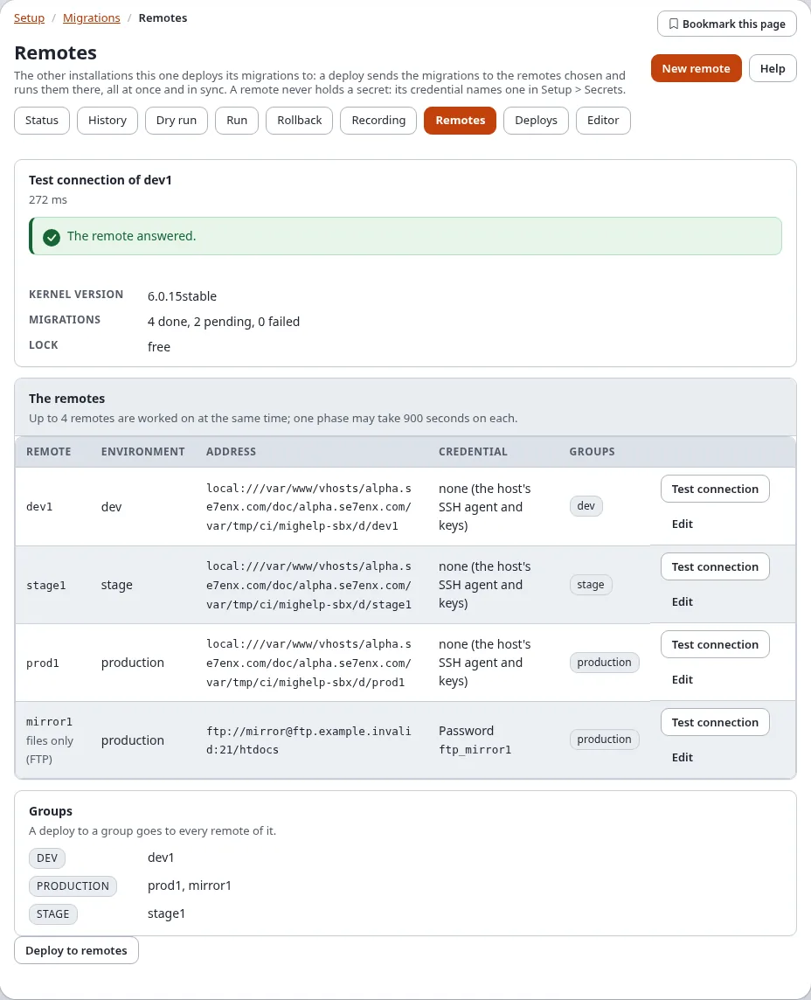

Press **New remote** (top right) to start the wizard. The wizard is one page with five steps; the whole page:

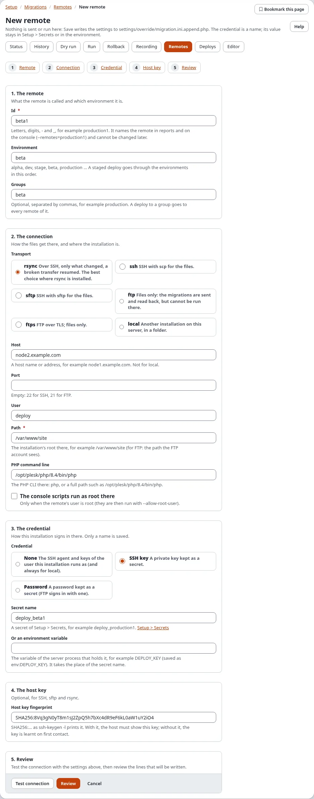

## Step 1: the remote

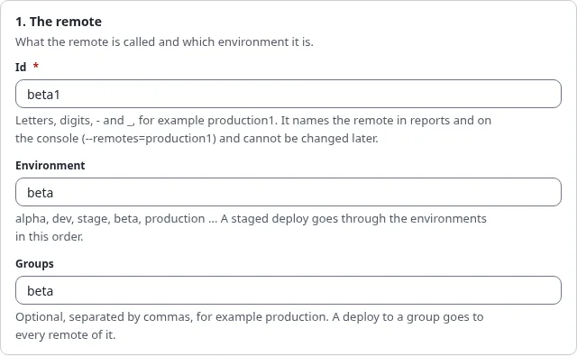

1. **Remote**: the id, letters, digits, `-` and `_`, for example `production1`. It names the remote in reports and on
   the console (`--remotes=production1`) and cannot be changed later.
2. **Environment**: `alpha`, `dev`, `stage`, `beta`, `production` ... A staged deploy goes through the environments in
   the order of `[RemoteSettings] StageOrder[]`.
3. **Groups** (optional): names separated by commas, for example `production`. A deploy to a group goes to every
   remote of it.

## Step 2: the connection

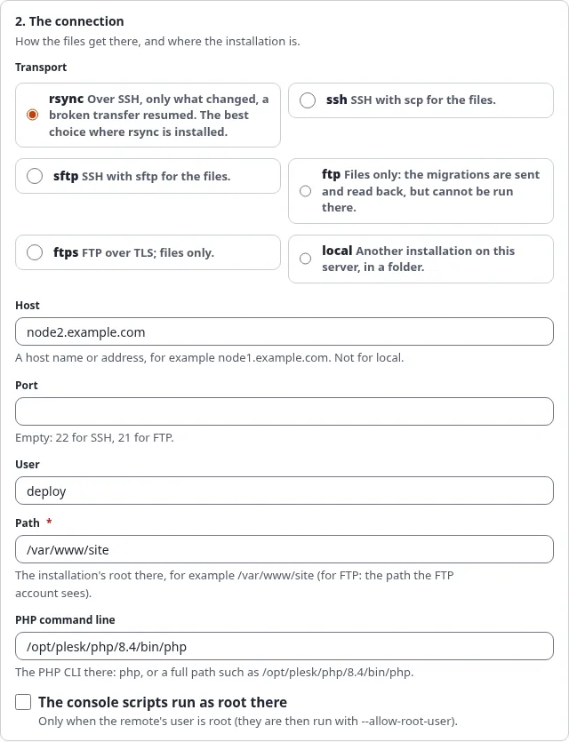

1. **Transport**, how the files get there:

   | Choice | Use it when |
   |---|---|
   | **rsync** | the remote has rsync: over SSH, only what changed, a broken transfer resumed. The best choice |
   | **ssh** | SSH with scp for the files |
   | **sftp** | SSH with sftp for the files |
   | **ftp** | files only: the migrations are sent and read back, but cannot be run there (unless the trigger is set up) |
   | **ftps** | FTP over TLS; files only |
   | **local** | another installation on this server, in a folder |

2. **Host**: a host name or address (not for local). **Port**: empty means 22 for SSH, 21 for FTP. **User**: the
   account there.
3. **Path**: the installation's root there, for example `/var/www/site` (for FTP: the path the FTP account sees).
4. **PHP command line**: `php`, or a full path.
5. **The console scripts run as root there**: tick only when the user there is root (the scripts then run with
   `--allow-root-user`).

## Step 3: the credential

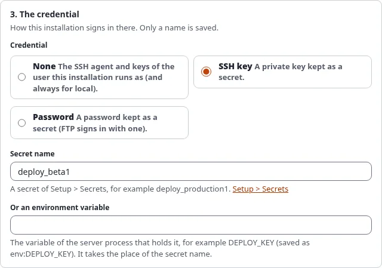

1. Choose the kind:
   - **None**: the SSH agent and keys of the user this installation runs as (and always for local).
   - **SSH key**: a private key kept as a secret.
   - **Password**: a password kept as a secret (FTP signs in with one).
2. Type the **Secret name** as it is in **Setup > Secrets** (the link opens it), or **Or an environment variable**:
   the variable of the server process (saved as `env:VARIABLE`).

Only the name is saved. A password or key typed anywhere in the form is never written.

## Step 4: the host key

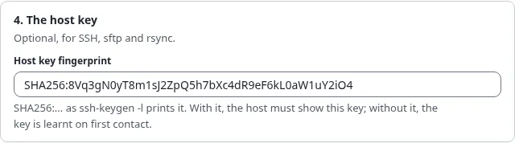

Optional, for SSH, sftp and rsync: paste the **Host key fingerprint** (`SHA256:...`). With it the host must show this
key; without it the key is learnt on first contact.

## Step 5: test, review and save

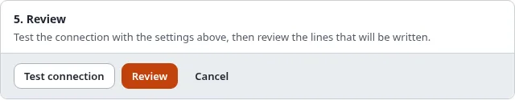

1. Press **Test connection**. The settings are tried as entered, not saved yet, and the answer shows above the form:

   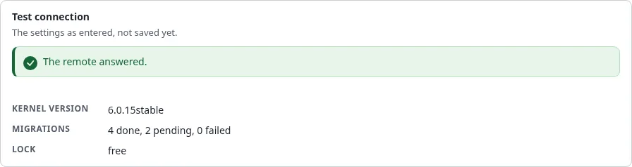

2. Press **Review**. The settings are checked and the lines that will be written to
   `settings/override/migration.ini.append.php` are shown as a difference:

   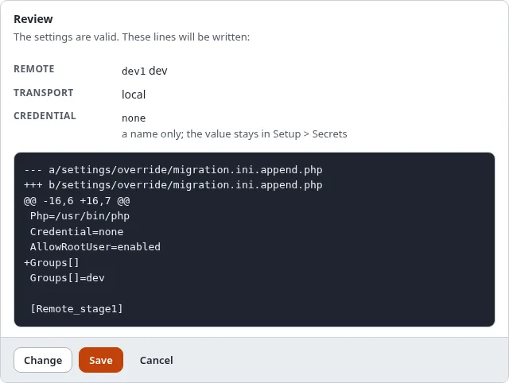

3. Press **Save** (or **Change** to go back to the form, **Cancel** to leave). Confirm "Verify it's you". The lines
   are written, a backup of the file is kept, the change is audited as `system.migration.remote`, and the list of
   remotes opens with the new remote.

The remote can now be chosen on the Deploys page. Press **Test connection** in the list once more to see it from
there.

## Edit or remove a remote

- **Edit** in the list opens the same wizard with the remote's settings (the id cannot be changed). Change what you
  need, **Review**, **Save**. Settings the wizard does not show (`Trigger`, `TriggerSecret`) are kept.
- **Remove this remote**, at the bottom of the wizard of an existing remote: tick **Yes, remove this remote** and press
  **Remove** (Verify it's you). Its settings are taken out of the override file. Nothing changes on the remote, and its
  deploys stay in the history.

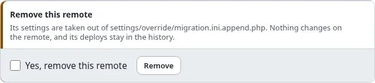

## FTP-only hosts and the trigger

A host reached only by FTP cannot run commands, so a deploy can only send the files there (**Transfer only**). When
the installation there offers the signed HTTP trigger, it is deployed like any other remote. Set up, in
`settings/override/migration.ini.append.php`:

On the **remote** (the FTP host):

```ini
[TriggerSettings]
Trigger=enabled
Secret=migration_trigger
AllowedAddresses[]
AllowedAddresses[]=203.0.113.10
Php=/usr/bin/php8.4
```

On **this installation**, in the remote's section (after saving it with the wizard):

```ini
[Remote_webspace]
Trigger=https://www.example.com/migration/trigger
TriggerSecret=migration_trigger
```

Both secrets name the same value (at least 16 characters), stored in Setup > Secrets on each side. Test connection
then reads the remote's migration status through the trigger. Details and every answer of the trigger:
[FTP remotes with the HTTP trigger](../../guides/migrations-remote-deploy.md#ftp-remotes-with-the-http-trigger).

## Self-healing

A deploy can fix small problems on a remote by itself, each only when listed in `[RemoteSettings] SelfHeal[]` of this
installation:

| Fix | What it does |
|---|---|
| `stale-lock` | removes a run lock whose process has ended (older than `StaleLockAge`, 7200 seconds) |
| `paths` | makes a missing migrations folder |
| `modes` | adds missing file permissions on the migration folders |
| `caches` | clears the ini and template override caches there after the run |

```ini
[RemoteSettings]
SelfHeal[]
SelfHeal[]=stale-lock
SelfHeal[]=paths
SelfHeal[]=caches
```

Every fix made is listed under the remote on the deploy's page ("heal caches: cleared the caches tagged ini").
PHP or extension versions that differ are never fixed, only reported.

## When something goes wrong

| What you see | Why, and what to do |
|---|---|
| **settings to fix** in the list | the remote's section is incomplete or has a value the wizard refuses; **Edit** it and **Review** |
| "the secret ... is not set" | the secret name has no value in Setup > Secrets on this installation; add it there |
| Test connection: `not reachable or no migration status (exit 255)` | SSH could not connect or sign in: host, port, user, key, or `authorized_keys` there |
| `Permission denied (publickey)` | the public key is not in `authorized_keys` of the user there |
| `the host key ... does not have the fingerprint` | the fingerprint does not match; check it on the remote |
| `an FTP remote cannot run the migrations` | deploy with **Transfer only**, or set up the trigger |
| Test connection with `"status":403` or `401` | the trigger refused: the address is not in `AllowedAddresses[]`, the secrets differ, or the clocks differ by more than `Lifetime` |
| **New remote** is missing | you do not have `migration/remotes` |

More: [Troubleshooting](../../guides/migrations-remote-deploy.md#troubleshooting).

## Related pages

- [Deploy step by step](deploy-step-by-step.md), [Remotes and deploys](remotes-and-deploys.md)
- [Migrations: deploying to remote installations](../../guides/migrations-remote-deploy.md)
- [A tour of Setup > Migrations](a-tour-of-setup-migrations.md), [Settings](settings.md)
