# Migrations: deploy step by step

A **deploy** sends this installation's migrations to the remotes you choose and runs them there, all at once and in
sync: every remote is checked first, and when one fails, every remote that applied is taken back. You start it in
**Setup > Migrations > Deploys**; the remotes must be set up first ([Add a remote step by step](add-a-remote-step-by-step.md)).

**Who may do this:** users with the policy `migration/deploy` (Administrator in a new installation). Deploy, Approve
and Roll back ask ["Verify it's you"](../../guides/verify-its-you.md); Preflight only does not. The pages are visible
with `migration/read`.

## Contents

1. [Before you deploy](#before-you-deploy)
2. [The Deploys page](#the-deploys-page)
3. [Choose the remotes](#choose-the-remotes)
4. [Choose how](#choose-how)
5. [Preflight only](#preflight-only)
6. [Deploy and follow it live](#deploy-and-follow-it-live)
7. [The report](#the-report)
8. [Staged deploys and the gate](#staged-deploys-and-the-gate)
9. [Roll a deploy back](#roll-a-deploy-back)
10. [The history](#the-history)
11. [The notice mails](#the-notice-mails)
12. [In sync and out of sync](#in-sync-and-out-of-sync)
13. [When something goes wrong](#when-something-goes-wrong)
14. [Related pages](#related-pages)

## Before you deploy

1. On this installation, the migrations you want to deploy have run and passed (**Status**: no failed migration you
   mean to send).
2. Every remote you choose answers **Test connection** on the Remotes page.
3. No run is going on (the Deploys page says **A run is going on** otherwise).

## The Deploys page

Open **Setup > Migrations** and choose the tab **Deploys** (`/migration/deploy`). The form is on top, the history
below.

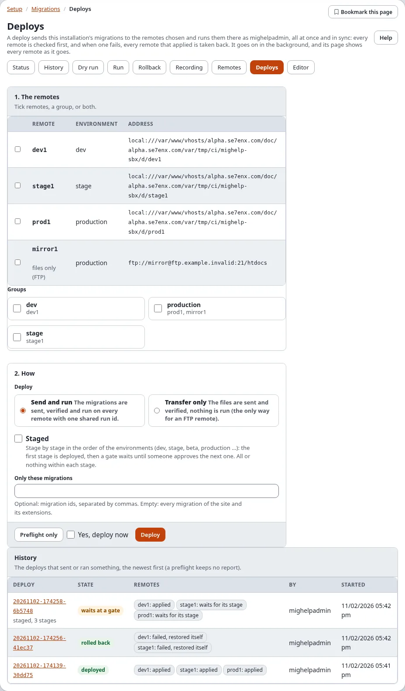

## Choose the remotes

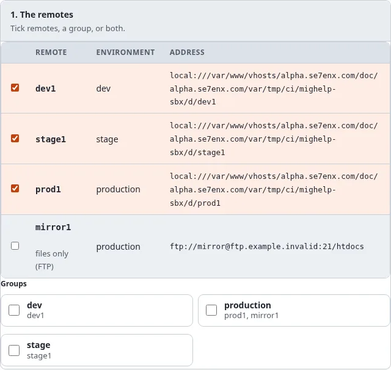

1. Tick **Deploy to it** for each remote, or tick a group (every remote of it), or both.
2. A remote marked **settings to fix** cannot be chosen until its settings are fixed. A remote marked **files only
   (FTP)** can only be used with **Transfer only** (unless it has the trigger).

## Choose how

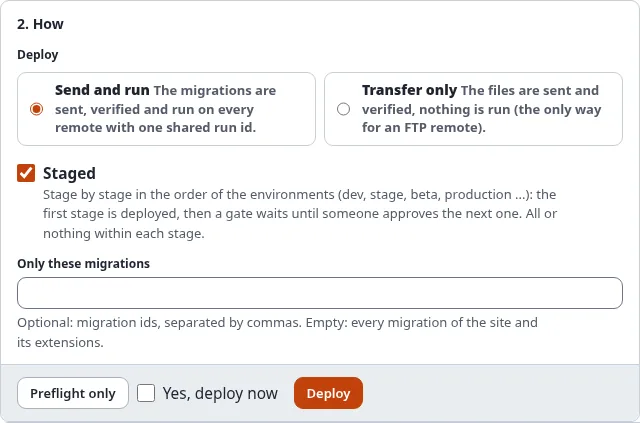

| Choice | What happens |
|---|---|
| **Send and run** | the migrations are sent, verified and run on every remote with one shared run id |
| **Transfer only** | the files are sent and verified; nothing is run (the only way for an FTP remote without the trigger) |
| **Staged** | stage by stage in the order of the environments (dev, stage, beta, production ...): the first stage is deployed, then a gate waits until someone approves the next. All or nothing within each stage |
| **Only these migrations** | optional: migration ids separated by commas. Empty: every migration of the site and its extensions |

## Preflight only

Press **Preflight only** to check without changing anything. Every remote is checked: reachable, its lock free,
nothing failed there, the same kernel version, enough disk space, the PHP and extension versions, no migration
changed after it was applied there; and the files to send are planned. Nothing is sent, and no report is kept.

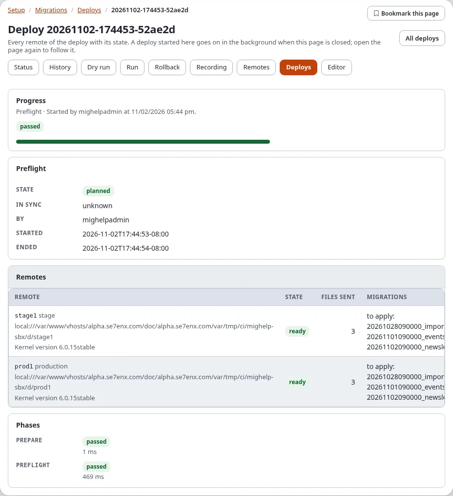

Each remote is **ready**, or names the problem that would stop the deploy.

## Deploy and follow it live

1. Tick **Yes, deploy now**.
2. Press **Deploy** and confirm "Verify it's you".
3. The deploy's page opens (`/migration/deployment/<deploy id>`) and follows the deploy: the phase (checking the
   settings and the credentials, the preflight, sending the migration files, verifying what arrived, running the
   migrations on every remote) and a row for every remote that changes as the remote does (selected, ready, files
   sent, verified, applied).

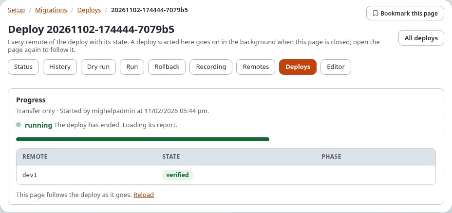

The deploy runs in the background as you. Closing the page does not stop it; open it again from the history to
follow it again. Only one run or deploy started in the administration goes on at a time.

## The report

When the deploy has ended, its page shows the report:

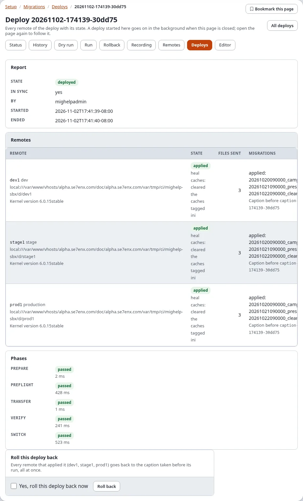

| Part | Shows |
|---|---|
| **Report** | the state of the deploy, **In sync**, who started it, when it started and ended, and the warnings |
| **Remotes** | for every remote: its stage, its state and any problem or fix, the files sent, the migrations applied (or to apply), the caption taken before its run, the kernel version |
| **Phases** | each phase with passed or failed and its time |

| State of the deploy | Meaning |
|---|---|
| planned | a preflight: nothing was sent |
| transferred | Transfer only: the files are there, nothing ran |
| deployed | every remote applied |
| waits at a gate | a staged deploy: the stages so far are deployed, the next waits for approval |
| rolled back | a remote failed; every remote that applied was taken back to its caption |
| out of sync | a remote failed and not every remote could be taken back |
| failed, refused | the transfer or the verification failed, or a remote could not be used; no remote was switched |

A **Transfer only** deploy ends as **transferred**:

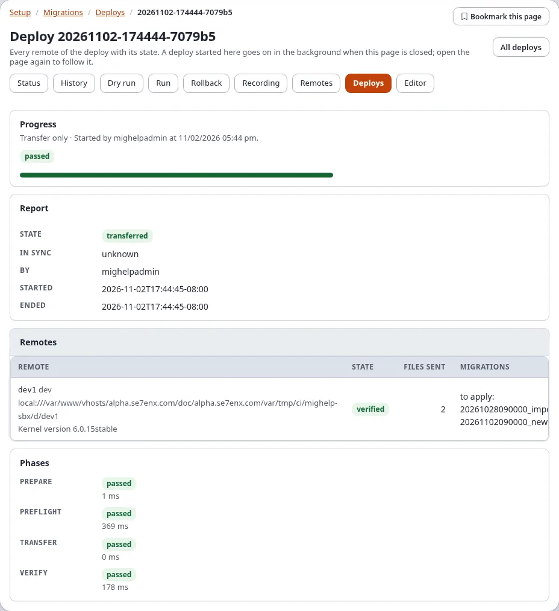

## Staged deploys and the gate

With **Staged** ticked, the preflight still checks every remote first. Then the first stage (for example dev) is sent,
verified and run, and the deploy **waits at a gate**. A notice mail goes out ([The notice mails](#the-notice-mails)).

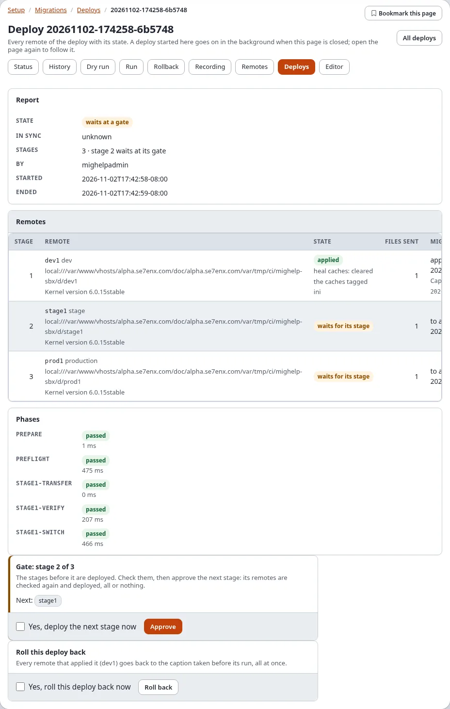

To deploy the next stage:

1. Check the stage that was deployed (the site on dev, for example).
2. Open the deploy's page (from the history or the link in the notice mail). **Gate: stage 2 of 3** names the next
   stage's remotes.
3. Tick **Yes, deploy the next stage now** and press **Approve**; confirm "Verify it's you".
4. The next stage is checked again and deployed, all or nothing, and the deploy waits at the next gate, until the last
   stage. Who approved each gate, and when, is in the report.

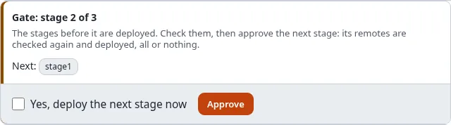

On the console: `./console exp:migration:deploy --continue=<deploy id> --apply`.

When a later stage fails, that stage is taken back; the stages before it stay deployed and the report says the
remotes are not in sync. Roll the deploy back to take those back too, or fix the problem and deploy again.

The same page in the dark mode:

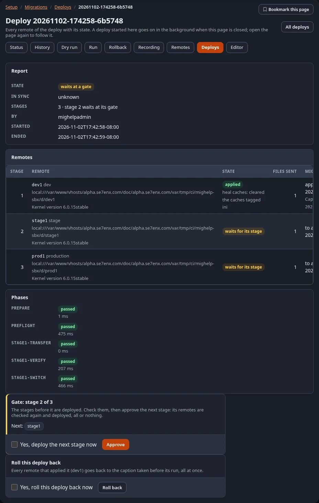

## Roll a deploy back

A deploy that some remotes applied shows **Roll this deploy back**: every remote that applied it goes back to the
caption taken before its run, all at once.

1. Open the deploy's page.
2. Tick **Yes, roll this deploy back now** and press **Roll back**; confirm "Verify it's you".
3. The page follows the rollback; the state becomes **rolled back**.

A deploy where a remote failed is taken back by itself:

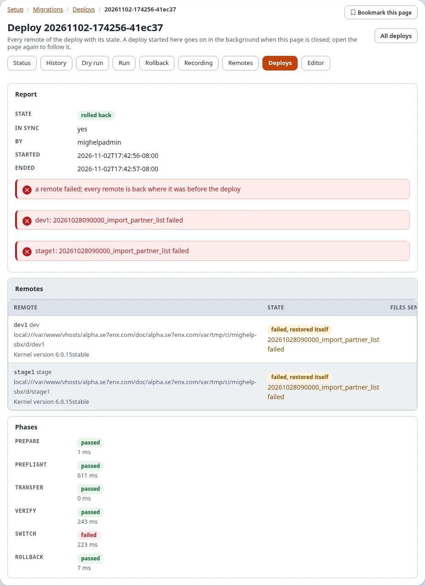

A remote that cannot be taken back is reported, and the deploy is marked **out of sync** with every remote's state.

## The history

Below the form, **History** lists every deploy that sent or ran something, newest first: its id (a link to its page),
its state, every remote with its state, who started it and when. A preflight keeps no report and is not listed.

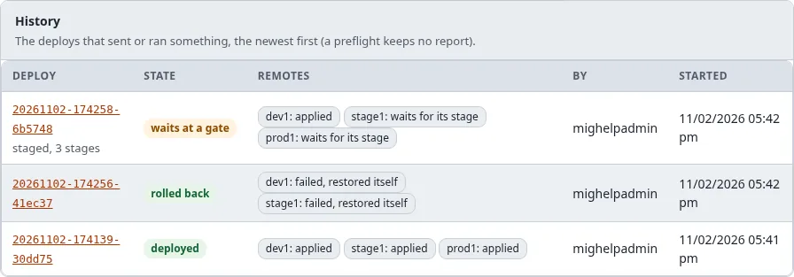

Reports are kept in `var/<site>/migration/deploy/reports/<deploy id>.json` and, once the upgrade step
`6.0.15-migration-deploy-tables` has run, in the tables `exp_migration_deploy` and `exp_migration_deploy_host`. The
website sidebar's Migrations panel lists the latest deploys too ([Migrations in the website sidebar](expwt-panel.md)).

## The notice mails

A deploy that fails (refused, failed, rolled back, out of sync) and a staged deploy that waits at a gate send a notice
by e-mail:

- to `migration.ini [RemoteSettings] NotifyEmail` (empty: the administrator's address of site.ini);
- for the kinds in `Notify[]`: `failure`, `gate` and `success` (the default is the first two);
- as plain text: the deploy, its result, every remote with its state and problems, and the address of the deploy's
  page, where a gate is approved.

## In sync and out of sync

**In sync: yes** means every remote of the deploy ended in the same migration state: all applied, or all back where
they were. **Out of sync** means a remote failed and not every remote could be taken back, or a later stage failed
while earlier stages stay deployed: the remotes now differ. Read every remote's state in the report, then:

1. fix what failed (the remote's problem is named in its row);
2. roll the deploy back, or deploy again once the problem is fixed;
3. on a remote that still cannot be taken back, restore its caption there with `./console exp:migration:rollback`.

## When something goes wrong

| What you see | Why, and what to do |
|---|---|
| **refused**: "the secret ... is not set" | add the secret in Setup > Secrets |
| **refused**: "an FTP remote cannot run the migrations" | use **Transfer only**, or give the remote the trigger ([FTP-only hosts](add-a-remote-step-by-step.md#ftp-only-hosts-and-the-trigger)) |
| "a migration run holds the lock there" | a run is going on there, or a crashed run left its lock; the self-healing fix `stale-lock` can remove a stale one |
| "the kernel version there is ..." | upgrade the remote first |
| "was applied there from a file that differs" | the migration was changed after it ran there; make the files equal |
| **rolled back**: "... failed" | the migration failed on the remote; read the remote's row and the remote's run log, fix the migration in a new one |
| "has the migration ..., which this installation does not have" (a warning) | the remote ran a migration this installation does not ship (or that **Only these migrations** left out) |
| **A run is going on** | wait for it, or follow it |

More: [Troubleshooting](../../guides/migrations-remote-deploy.md#troubleshooting),
[When a migration fails](when-a-migration-fails.md).

## Related pages

- [Add a remote step by step](add-a-remote-step-by-step.md), [Remotes and deploys](remotes-and-deploys.md)
- [Migrations: deploying to remote installations](../../guides/migrations-remote-deploy.md)
- [Recipe: deploying with migrations](recipes/deploying-with-migrations.md)
- [A tour of Setup > Migrations](a-tour-of-setup-migrations.md)
