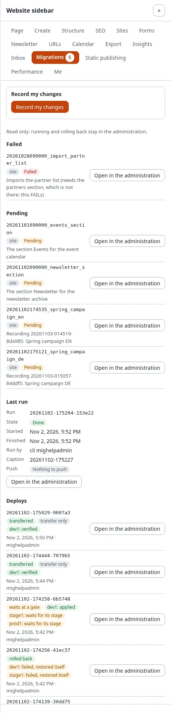

# Migrations in the website sidebar

The website sidebar (the extension expwt) has a **Migrations** panel: the state of the installation's migrations on
every page of the site, without going to the administration. Running, resuming, rolling back and deploying stay in
**Setup > Migrations** ([Run, dry run and rollback](run-dry-run-and-rollback.md),
[Deploy step by step](deploy-step-by-step.md)); the only thing the panel starts is a recording of your own changes.

**Who sees the panel:** users who may use the sidebar (`expwt/use`) and have `migration/read`. Without that policy,
or on a kernel without migrations, there is no Migrations tab.

## Open the panel

1. Sign in and open any page of the site.
2. Open the website sidebar and choose the tab **Migrations**. The number on the tab counts the pending, failed and
   recorded-without-file migrations.
3. **Open in the administration** next to an item opens its page in Setup > Migrations.

## Record your changes from the sidebar

With `migration/edit`, the panel starts with **Record my changes**. Press it, make your changes on the site (with the
sidebar's editing tools or in the administration), then press **Stop recording** in the panel. While it runs, the
panel says "Your changes are recorded for a migration."; when a site-wide window is open it says "A site-wide recording
is open: every change is recorded.". Generate the migration from the recording in the administration
([Recording changes](recording.md#generate-the-migration)).

## What the panel shows

- **A run that is active now**: the installation lock, what it does, who started it and since when;
- the **failed** migrations, each with its source and description;
- the **pending** migrations (id, source, description; the first 50, the rest counted);
- the migrations **recorded, but whose file is gone** (the orphans of the status);
- the **last run**: its state, when it started and finished, who ran it, its caption, tag and push state, and the
  message of a failed run;
- the **deploys**: the latest deploys to remotes, each with its state (deployed, transferred, waits at a gate, rolled
  back ...), every remote with its state, when and by whom; **Open in the administration** opens the deploy's page,
  where a gate is approved ([Deploy step by step](deploy-step-by-step.md)).

Each item has **Open in the administration**: the status, or the page of its run
([The status and the history](status-and-history.md)).

The number of pending, failed and recorded-without-file migrations is a badge on the panel's tab, counted at most
once a minute.

## Related pages

- [Migrations: the hub](README.md), [All recipes](recipes/README.md), [Frequently asked questions](faq.md)
- [The guide](../../guides/migrations.md), [the tutorial](../../guides/migrations-tutorial.md),
  [PHP migrations](../../guides/migrations-php.md),
  [Rollback and captions](../../guides/migrations-rollback-and-captions.md),
  [The migrations repository](../../guides/migrations-repositories.md)
- [In the administration](in-the-administration.md), [Commands](commands.md), [Settings](settings.md),
  [Policies, views and events](policies-views-and-events.md)
- [The file format](../../specifications/6.0/migration-file-format.md),
  [The feature](../../features/6.0/migrations.md)
- [When a migration fails](when-a-migration-fails.md),
  [Troubleshooting messages](../../guides/migrations-troubleshooting.md)
- [Migrations versus migrating a site](migrations-versus-migrating-a-site.md)
- [The status and the history](status-and-history.md)
- [The website sidebar](../../features/6.0/website-sidebar.md)
