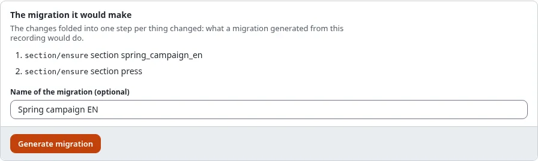
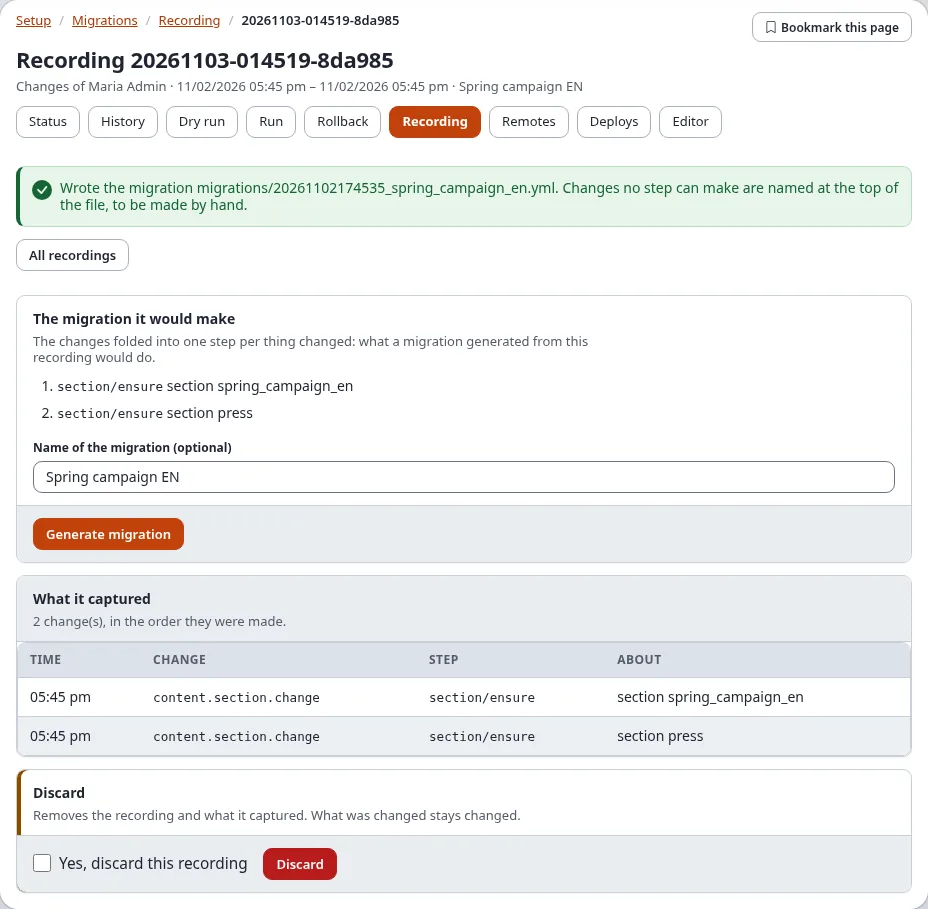

# Migrations: generating migrations

A migration does not have to be written by hand. This page lists every way to get one, which of them work in the
administration and which on the console, and what to do with the file afterwards. The options in full are in the
guide [Migrations: generators and recording changes](../../guides/migrations-generators-and-recording.md).

| Source | Where | Best for |
|---|---|---|
| A recording of changes made by hand | administration (**Recording**) and console | changes made in the administration, to repeat them elsewhere |
| Forms of the step types | administration (**Editor**) | a short migration of a few steps, without a shell |
| What is there now (content, classes, roles, sections, settings) | console | copying a class, a role or a subtree to another installation |
| The difference to a caption, a dump or another installation | console | everything changed since a known state, when no recording ran |
| A skeleton | console | a PHP, YAML, INI or SQL migration to fill in |

## Contents

1. [From a recording](#from-a-recording)
2. [In the editor](#in-the-editor)
3. [From what is there](#from-what-is-there)
4. [From a difference](#from-a-difference)
5. [Skeletons](#skeletons)
6. [After generating](#after-generating)
7. [Related pages](#related-pages)

## From a recording

1. Record the changes ([Recording changes](recording.md)) and stop the recording.
2. Open the recording (**Setup > Migrations > Recording**, then the recording in **Recordings**).
3. Check **The migration it would make**: one step per thing changed.
4. Type a **Name of the migration** (optional; the recording's label is used otherwise).
5. Press **Generate migration**. The page names the file it wrote, `migrations/<time>_<name>.yml`.





On the console: `./console exp:migration:generate --from-recording=<recording id> --apply`.

## In the editor

**Setup > Migrations > Editor** builds a migration step by step with forms, checks it and saves it:
[The migration editor](the-migration-editor.md).

## From what is there

`exp:migration:generate` writes a migration of what this installation has now. Run it on the installation that has
the change, then copy or deploy the file to the others. Without `--apply` it only lists what it would write.

```text
$ ./console exp:migration:generate --from-class=news_article --from-role="News editor" --from-section=news news_setup --apply
```

| Option | Generates |
|---|---|
| `--from-content=<node>[,...]` | the objects of the nodes (`2`, `remote:<remote id>`, `path:<url path>`); `--depth=<n>` adds levels below, `--max-objects=<n>` stops after that many (default 500) |
| `--from-class=<identifier>[,...]` | content classes with their attributes |
| `--from-role=<name>[,...]` | roles with their policies and limitations |
| `--from-section=<identifier>[,...]` | sections |
| `--from-settings=<file>[,...]` | the settings of `settings/override/<file>.append.php` (with `--siteaccess=<name>` that siteaccess's) |

The steps use the mode `ensure`, so the migration also runs where some of it exists already. Users are named by
secrets, never by their login or e-mail address, and secret settings are left out.

## From a difference

`--from-diff` compares the installation now with a saved state and writes a migration of what changed. Run on the
saved state, the migration makes it like this installation.

| `--from-diff=` | The saved state |
|---|---|
| a caption id, for example `20261102-101500` | a caption (Sicherungspunkt) of this installation: its database dump and its copy of `settings/override`. `./console exp:migration:caption --list` lists them; the Rollback page of Setup > Migrations shows them too |
| a file, for example `var/backup/before.sqlite` | a database dump of the same schema (SQLite, or an SQL dump of this installation's engine) |
| an address, for example `https://staging.example.com` | another installation, read once through its REST snapshot (an API key with the scope `migration:read`, named by `--token=<secret name>`) |

`--compare` chooses what is compared: `classes`, `roles`, `sections`, `states`, `languages`, `settings` (the
default: everything but content) and `content` with `--subtree=<node>`.

```text
$ ./console exp:migration:generate --from-diff=20261102-101500 --compare=classes,roles,sections news_changes --apply
```

Without differences nothing is written ("no differences: nothing to generate").

## Skeletons

`./console exp:migration:generate --skeleton <name> --type=<type> --apply` writes an empty migration to fill in:
`php` (the default, a class with `plan()`, `up()` and `down()`), `yml`, `graphql`, `ini` or `sql` (with
`--engine=<engine>` for one database engine).

## After generating

Whatever made it, a generated migration is a file like any other:

1. Read it. The top names what could not be generated and must be done by hand (a swap of two locations, a
   workflow trigger, a secret setting).
2. Open **Setup > Migrations > Status**: it is listed as **pending**. Or run `./console exp:migration:check`.
3. Open **Dry run** to see what it would change here, then **Run** it where it is needed
   ([Run, dry run and rollback](run-dry-run-and-rollback.md)). On the installation where the change was made by hand,
   the migration finds everything in place (mode `ensure`).
4. Commit it with the site, or deploy it to the remotes ([Deploy step by step](deploy-step-by-step.md)).

## Related pages

- [Migrations: generators and recording changes](../../guides/migrations-generators-and-recording.md) (every option)
- [Recording changes](recording.md), [The migration editor](the-migration-editor.md)
- [Rollback and captions](../../guides/migrations-rollback-and-captions.md), [Commands](commands.md)
- [Recipe: seed content for a new site](recipes/seed-content-for-a-new-site.md),
  [Recipe: create or change a content class](recipes/create-or-change-a-content-class.md)
