# Migrations: recording changes

**Setup > Migrations > Recording** keeps what you change in the administration as the steps of a migration: content
you publish, classes you store, roles you assign, sections, settings you write. When you are done, stop the
recording, look at what it captured, and generate a migration that makes the same changes on staging and production.
How the recording works, its commands and the steps it records are in the guide
[Migrations: generators and recording changes](../../guides/migrations-generators-and-recording.md).

**Who may use this page:** users with the policy `migration/edit`. In a new installation only the Administrator role
has it. Opening the site-wide window asks ["Verify it's you"](../../guides/verify-its-you.md) first.

## Contents

1. [The Recording page](#the-recording-page)
2. [Record your own changes](#record-your-own-changes)
3. [The Recording bar](#the-recording-bar)
4. [The site-wide window](#the-site-wide-window)
5. [What a recording captured](#what-a-recording-captured)
6. [Generate the migration](#generate-the-migration)
7. [Discard a recording](#discard-a-recording)
8. [On the console](#on-the-console)
9. [What is never recorded](#what-is-never-recorded)
10. [When something goes wrong](#when-something-goes-wrong)
11. [Related pages](#related-pages)

## The Recording page

Open **Setup > Migrations** and choose the tab **Recording** (`/migration/recording`). It has two cards, **My
changes** and **Site-wide window**, and the list **Recordings** below.

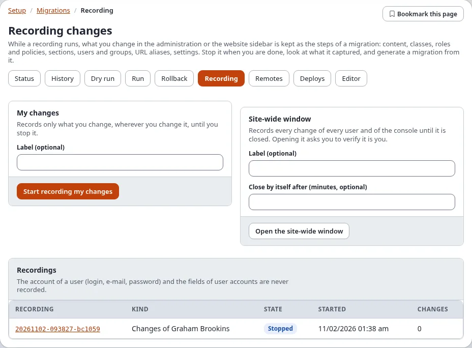

## Record your own changes

The card **My changes** records only what you change, wherever you change it (in the administration, in the website
sidebar, or in a command run as you), until you stop it.

1. In **Label (optional)**, say what the recording is for, for example `Spring campaign`. It becomes the name of the
   generated migration.

   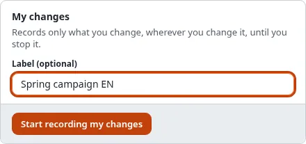

2. Press **Start recording my changes**. The card now says **Recording since ..., N change(s) so far**, with **Show
   what it captured** and **Stop recording**:

   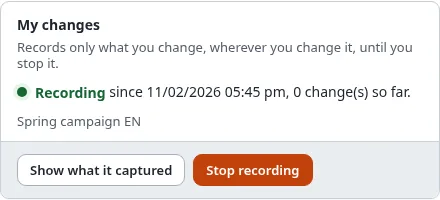

3. Make your changes as usual: create the section, change the class, assign the role.
4. Press **Stop recording** in the Recording bar, in the card, or on the recording's page.

You can look at a recording while it runs (**Show what it captured**); its page then has **Stop recording** at the top.

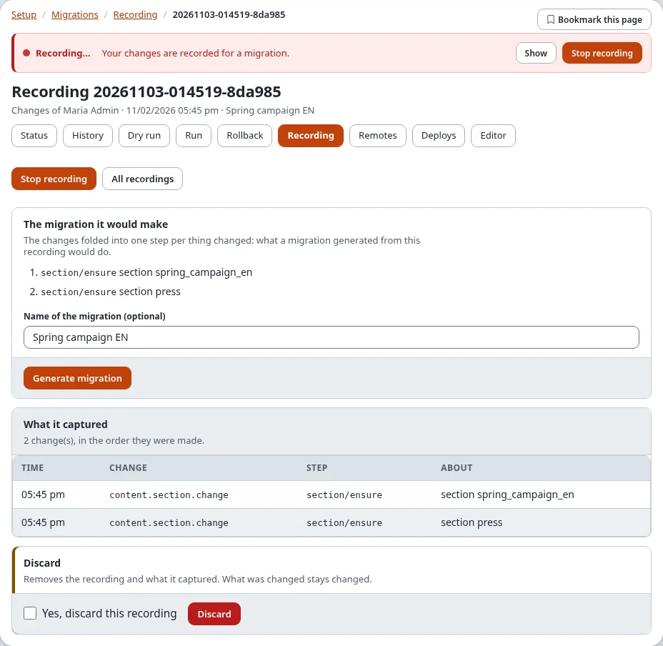

## The Recording bar

While a recording of yours runs, or a site-wide window is open, a red **Recording…** bar is shown at the top of every
page of the administration:

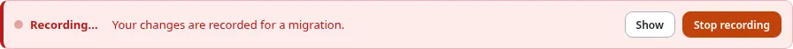

- **Show** opens the recording.
- **Stop recording** stops it and brings you back to the page you were on.

The website sidebar shows the same with its **Record my changes** and **Stop recording** buttons
([Migrations in the website sidebar](expwt-panel.md)).

## The site-wide window

The card **Site-wide window** records every change of every user, and of the console, until it is closed. Use it when
several people prepare a release together.

1. Type a **Label (optional)**, for example `Release 6.1 preparation`.
2. In **Close by itself after (minutes, optional)**, type how long the window stays open, for example `60`. Empty: it
   stays open until someone closes it. A window is at most 31 days long.

   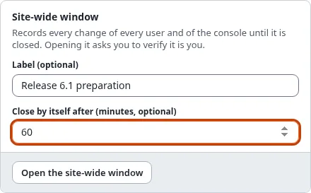

3. Press **Open the site-wide window** and confirm "Verify it's you".
4. The card says **Open** and **It closes by itself at <time>**. Every user of the administration now sees the
   Recording bar, because their changes are recorded too.

   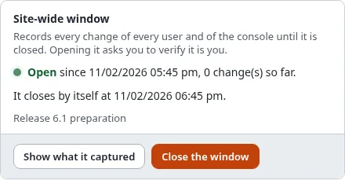

5. Close it earlier with **Close the window** (holders of `migration/edit`, here or in the bar). At its end it closes
   by itself: nothing is recorded after the end, and its end stays the time it stopped.

Only one site-wide window and one recording of your own changes can run at a time. A change made while both run is in
both.

The list **Recordings** shows every recording: its kind (**Site-wide** or **Changes of** a user), its state
(**Recording** or **Stopped**), when it started and how many changes it has. Click one to open it.

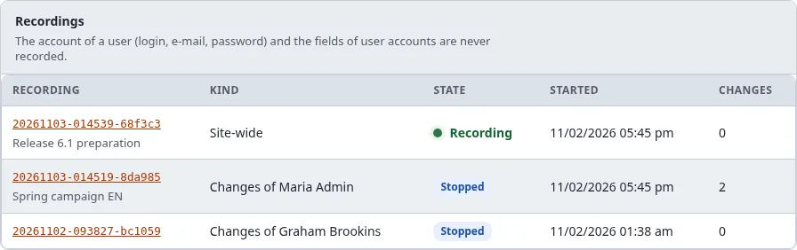

## What a recording captured

Open a recording from the list, from **Show** in the bar, or with **Show what it captured**.

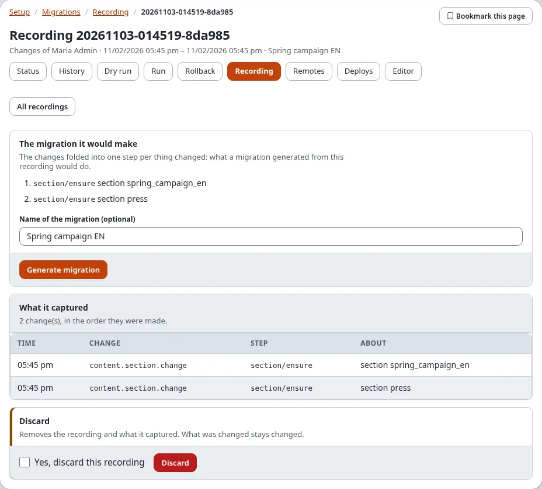

- **The migration it would make**: one step per thing changed, in the order they were first changed. A thing created
  and changed is one step that creates it with its last values; a thing created and removed again is left out.
  **Left out on purpose** names what a migration must not carry (accounts, secrets).
- **What it captured**: every change in the order it was made: the time, the change (the audit event, for example
  `content.section.change`), the step it stands for and what it is about, by remote id or identifier, never by a
  number that differs between installations. The page lists the first 1000.

  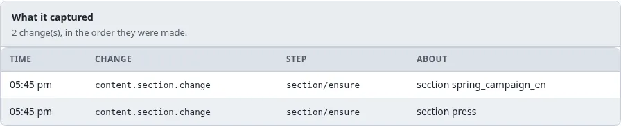

## Generate the migration

1. Stop the recording.
2. In **The migration it would make**, type a **Name of the migration (optional)** (the label is the default).
3. Press **Generate migration**. The message names the file written into the site's migrations directory,
   `migrations/<time>_<name>.yml`, and that changes no step can make are named at the top of the file, to be made by
   hand (a swap of two locations, a workflow trigger, a secret setting).

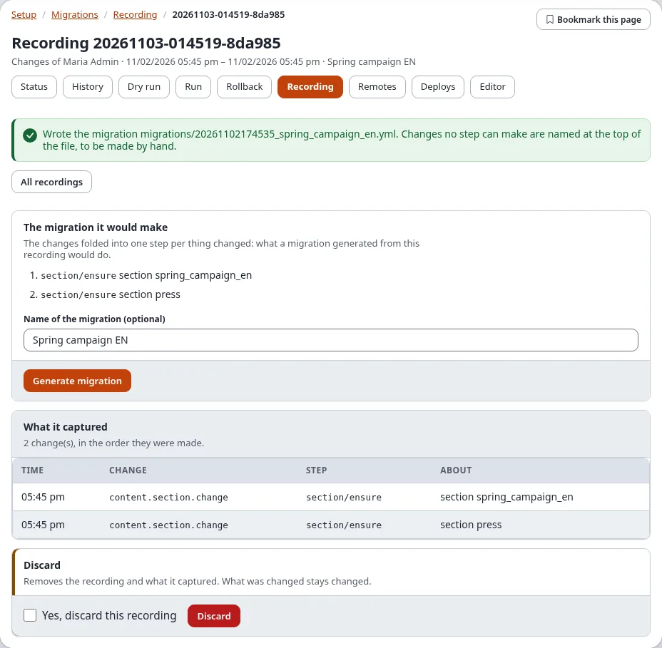

The new migration is **pending** on the status page. Check it with **Dry run**, then commit or deploy it; on the
installation where it was recorded the migration finds everything in place (mode `ensure`). When an extension that
gives a step type the migration needs is not active, a note names the step types instead of the button. More ways to
get a migration: [Generating migrations](generating-migrations.md).

## Discard a recording

At the bottom of a recording's page: tick **Yes, discard this recording** and press **Discard**. The recording and
what it captured are removed. What was changed stays changed.

## On the console

| Command | Does |
|---|---|
| `./console exp:migration:record:start --label="news section" --apply` | starts a recording of your changes (`--user=<login>` for another user) |
| `./console exp:migration:record:start --site-wide --for=120 --apply` | opens a site-wide window for 120 minutes |
| `./console exp:migration:record:start --site-wide --until="2026-11-20 18:00" --apply` | opens a site-wide window until that time |
| `./console exp:migration:record:status` | what is recording now |
| `./console exp:migration:record:stop --apply` | stops your recording (`--site-wide` closes the window, `<id>` stops that recording) |
| `./console exp:migration:record:show <id>` | every change of a recording |
| `./console exp:migration:generate --from-recording=<id> --apply` | generates the migration |
| `./console exp:migration:record:discard <id> --apply` | discards it |

`--for` and `--until` work for a recording of your own changes too.

## What is never recorded

- The account of a user (login, e-mail address, password) and the fields of user accounts: a recording keeps only
  that a user was created or changed, its groups and whether it is enabled. "Left out on purpose" names what was
  left out.
- The value of a setting whose name says it is a secret.
- Who made a change, in the migration: a generated migration names nobody. A user it creates is named by secrets
  (Setup > Secrets) for the login, the e-mail address and the password, set on each installation before the run.
- Reading, searching, signing in and clearing caches: they change nothing.
- The changes a migration run makes: they are a migration already.

## When something goes wrong

| What you see | Why, and what to do |
|---|---|
| "The recording tables do not exist yet" | The installation has not run the upgrade that makes them: `./console exp:upgrade --apply` (step `6.0.15-migration-recording-tables`). |
| "Recording is switched off in migration.ini" | `[RecordingSettings] Recording=disabled`; switch it on in `settings/override/migration.ini.append.php`. |
| "A recording of this kind is running already" | You are recording already, or a site-wide window is open. Stop it first. |
| The bar shows on a page but no recording is listed | The file of running recordings in `var/` is out of date: `./console exp:migration:record:status` writes it again. |
| A recording says it stopped adding at a number of events | `[RecordingSettings] MaxEvents` was reached. Stop it and start a new one. |
| The site-wide window closed before you were done | Its minutes ran out. Open a new window; generate a migration from each recording. |
| "Nothing was recorded." | No change was made while it ran, or only changes that are never recorded. |
| The Recording tab is missing | You do not have `migration/edit`. |

## Related pages

- [A tour of Setup > Migrations](a-tour-of-setup-migrations.md), [Generating migrations](generating-migrations.md)
- [Migrations: generators and recording changes](../../guides/migrations-generators-and-recording.md)
- [A recording window of time](../../guides/migrations-packages-deploy-and-long-runs.md#a-recording-window-of-time)
- [Recipe: record an administrator session](../../examples/cookbook/migrations-record-an-admin-session.md)
- [The view migration/recording](../../examples/module-views/migration/recording.md) and [the policies of the migration module](../../examples/policies/migration.md)
- [Migrations in the administration](in-the-administration.md)
