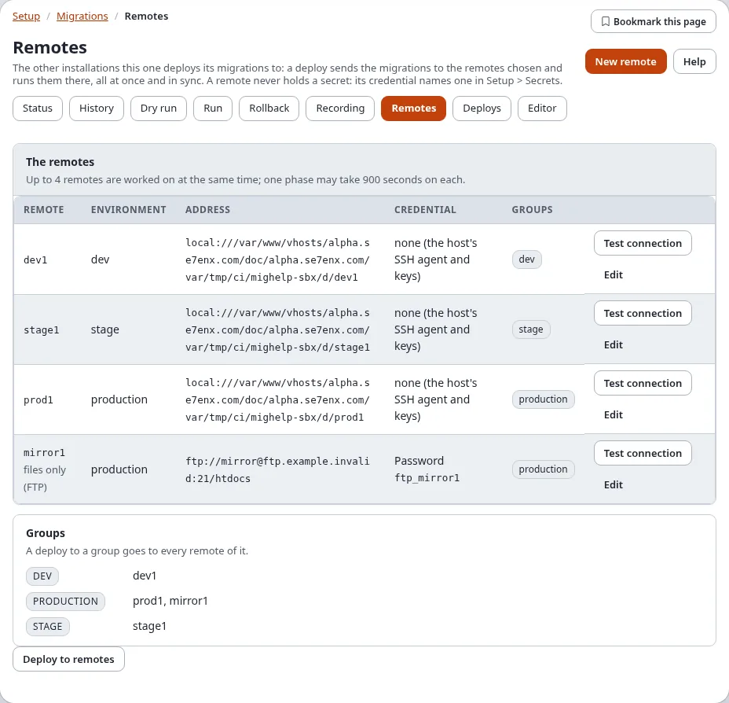
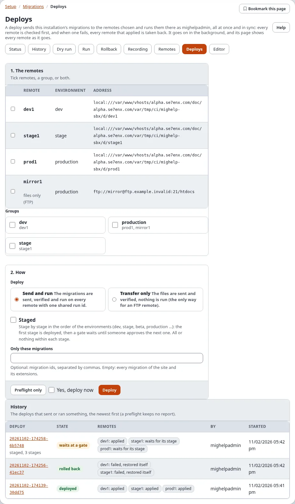

# Migrations: remotes and deploys

A **remote** is another installation of the same site (dev, stage, beta, production ...) that this installation sends
its migrations to. A **deploy** sends the migrations to the remotes you choose and runs them there, all at once and in
sync: every remote ends in the same migration state, or none changes. The pages are **Setup > Migrations > Remotes**
and **Setup > Migrations > Deploys**; the console does the same with `exp:migration:deploy` (see
[Remote deploy](../../guides/migrations-remote-deploy.md), which also explains every phase in detail).

This page is the reference. The same with numbered steps and a screenshot of every screen:
[Add a remote step by step](add-a-remote-step-by-step.md) and [Deploy step by step](deploy-step-by-step.md).

## Remotes

**Remotes** lists every remote of `migration.ini [RemoteSettings] RemoteList[]` with its environment, its address
(`transport://user@host:port/path`), its credential (the kind and the name of a secret, never a value) and its groups.
A remote whose settings are wrong is marked **settings to fix**, with what is wrong.

**Test connection** reaches the remote once and changes nothing: for SSH, sftp, rsync and local it reads the remote's
migration status (its kernel version, how many migrations are done, pending and failed, whether a run holds its lock);
for FTP it signs in and reads `index.php` back, because the migration status of an FTP remote cannot be read (an
FTP remote with the HTTP trigger is read like an SSH one). The trigger (`Trigger`, `TriggerSecret`) is set in
`settings/override/migration.ini.append.php`; the wizard keeps it when it saves the remote. See the guide
[Migrations: deploying to remote installations](../../guides/migrations-remote-deploy.md), "FTP remotes with the HTTP
trigger".

### The wizard

**New remote** (or **Edit** on a remote) opens the wizard, in five steps on one page:

| Step | What you enter |
|---|---|
| 1. The remote | its **id** (letters, digits, `-` and `_`; it cannot be changed later), its **environment** (alpha, dev, stage, beta, production ...) and optional **groups** separated by commas |
| 2. The connection | the **transport** (rsync, ssh with scp, sftp, ftp, ftps, local), the **host**, **port** (empty: 22 for SSH, 21 for FTP), **user**, the **path** of the installation there, the **PHP command line** there, and whether its console scripts run as root |
| 3. The credential | **None** (the SSH agent and keys of the user this installation runs as), an **SSH key** or a **password**, as the name of a secret in **Setup > Secrets**, or as an environment variable (saved as `env:VARIABLE`) |
| 4. The host key | optional: the fingerprint (`SHA256:...`) the host must show; without it the key is learnt on first contact |
| 5. Review | **Test connection** tries the settings as entered without saving them; **Review** checks them and shows the lines that will be written |

**Save** writes the lines to `settings/override/migration.ini.append.php` (a backup of the file is kept, the change is
audited as `system.migration.remote`) and asks **Verify it's you**. A secret is never written: a password or key typed
anywhere in the form is not kept. **Remove this remote** takes its settings out of the override again (tick
"Yes, remove this remote"; also with Verify it's you); nothing changes on the remote, and its deploys stay in the history.

## Deploys

**Deploys** has the form that starts a deploy and, below it, the **history**: every deploy that sent or ran something,
the newest first, with its state, every remote's state, who started it and when.

1. **The remotes**: tick remotes one by one, a group (every remote of it), or both.
2. **How**:
   - **Send and run**: the migrations are sent, verified and run on every remote with one shared run id.
   - **Transfer only**: the files are sent and verified, nothing is run (the only way for an FTP remote without the
     HTTP trigger).
   The fixes of `[RemoteSettings] SelfHeal[]` (a stale run lock, missing folders, file modes, caches) are made on each
   remote as part of it, and the deploy's page lists them under the remote.
   - **Staged**: stage by stage, see below.
   - **Only these migrations**: optional migration ids; empty means every migration of the site and its extensions.

**Preflight only** starts a dry run: every remote is checked (reachable, its lock free, nothing failed there, the same
kernel version, no migration changed after it was applied) and the files to send are planned; nothing is sent or
changed, and no report is kept. **Deploy** (tick "Yes, deploy now") starts the deploy and asks **Verify it's you**.

Both run in the background as you, and open the deploy's page. Only one run or deploy started in the administration
goes on at a time.

### A deploy's page

While the deploy goes on, its page shows the phase (checking the settings, the preflight, sending, verifying, running)
and a row for every remote that changes as the remote does: selected, ready, files sent, verified, applied. The page
can be closed: the deploy goes on, and opening the page again follows it again.

When it has ended, the page shows the **report**: the state of the deploy, whether the remotes are **in sync**, and for
every remote its stage, its state with any problem, the number of files sent, the migrations applied (or still to
apply) and the caption taken before its run; below, the phases with their times.

| State of the deploy | Meaning |
|---|---|
| planned | a preflight: nothing was sent |
| transferred | Transfer only: the files are there, nothing ran |
| deployed | every remote applied |
| waits at a gate | a staged deploy: the stages so far are deployed, the next waits for approval |
| rolled back | a remote failed; every remote that applied was taken back to its caption |
| out of sync | a remote failed and not every remote could be taken back: the report lists every remote's state |
| failed, refused | the transfer or the verification failed, or a remote could not be used; no remote was switched |

### Staged deploys and gates

With **Staged**, the remotes are put in stages by their environment, in the order of `[RemoteSettings] StageOrder[]`
(alpha, dev, test, stage, beta, production, post, arch; an environment that is not listed comes last). The preflight
still runs on every remote first, so a problem anywhere stops the deploy before anything changes. Then the first stage
is sent, verified and run, all or nothing within the stage, and the deploy **waits at a gate**.

Check the stage that was deployed. Then, on the deploy's page, **Gate: stage 2 of 3** names the next stage's remotes:
tick "Yes, deploy the next stage now" and **Approve** (Verify it's you). The next stage is checked again and deployed
the same way, until the last one; who approved each gate, and when, is in the report.

When a later stage fails, it is taken back; the stages before it stay deployed, and the report says the remotes are
not in sync. Roll the deploy back (below) to take those back too, or fix the problem and deploy again.

### Rolling a deploy back

A deploy that some remotes applied shows **Roll this deploy back**: every remote that applied it goes back to the
caption taken before its run, all at once (tick "Yes, roll this deploy back now", **Roll back**, Verify it's you). A
remote that cannot be taken back is reported, and the deploy is marked out of sync with every remote's state.

## Notices by e-mail

A deploy that fails (refused, failed, rolled back, out of sync) and a staged deploy that waits at a gate send a notice
by e-mail to `[RemoteSettings] NotifyEmail` (empty: the administrator's address of site.ini). `Notify[]` names the
kinds: `failure`, `gate` and `success` (the default is the first two). The notice is plain text: the deploy, its
result, every remote with its state and problems, and the address of the deploy's page.

## Who may do what

| Policy | Allows |
|---|---|
| `migration/read` | the Remotes and Deploys pages, a deploy's page and its report |
| `migration/remotes` | add, change and remove remotes, Test connection |
| `migration/deploy` | Preflight, Deploy, Approve a gate, Roll a deploy back |

Saving and removing a remote, a deploy, approving a gate and rolling a deploy back ask **Verify it's you**; the lists,
Test connection and the preflight never do. Only Administrator has the policies in a new installation.

## The record

Every deploy that sends or runs something keeps its report in `var/<site>/migration/deploy/reports/<deploy id>.json`,
and, once the upgrade step `6.0.15-migration-deploy-tables` has run, a row in `exp_migration_deploy` with a row per
remote in `exp_migration_deploy_host`. The audit log has `system.migration.deploy`, `system.migration.deploy.rollback`
and `system.migration.remote`.

## Related pages

- [Remote deploy](../../guides/migrations-remote-deploy.md): the settings, the transports, every phase, the console
- [Migrations in the administration](in-the-administration.md)
- [Run, dry run and rollback](run-dry-run-and-rollback.md): the same on this installation
- [When a migration fails](when-a-migration-fails.md)
