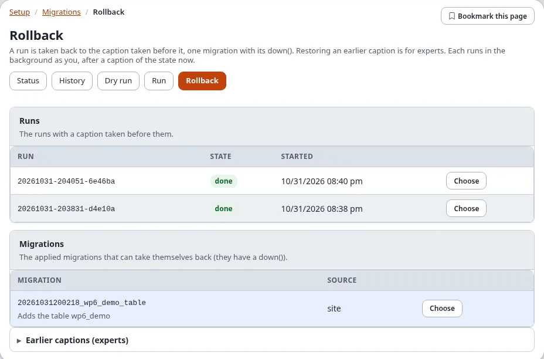
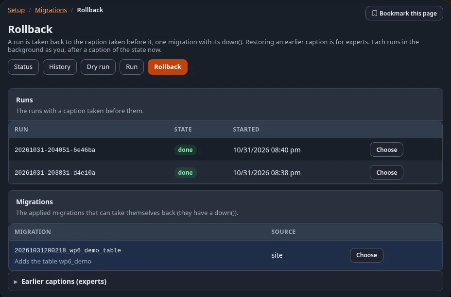

# Migrations: run, dry run and rollback

The pages of **Setup > Migrations** that change something: the dry run (which changes nothing, but can simulate a
run), the run, resuming a failed run, and the rollback. They do what the console commands do
(`exp:migration:dry-run`, `exp:migration:migrate --apply`, `exp:migration:resume --apply`,
`exp:migration:rollback --apply`) and have the same safeguards. Looking at migrations and runs is explained on
[The status and the history](status-and-history.md).

**Who may do what:**

| Page | Policy | "Verify it's you" |
|---|---|---|
| **Dry run** | `migration/read` | only for **Simulate** |
| **Run**, **Resume** | `migration/run` (also needed for **Simulate**) | yes |
| **Rollback** | `migration/rollback` | yes |

In a new installation only the Administrator role has these policies. "Verify it's you" asks for your password (or
a passkey) again before the action, and not again for some minutes; see [Verify it's you](../../guides/verify-its-you.md).
The rules are in `site.ini [ReauthGroup_system]`.

## Contents

1. [Dry run](#dry-run)
2. [Run](#run)
3. [Resume a failed run](#resume-a-failed-run)
4. [Roll back](#roll-back)
5. [How a run started here goes on](#how-a-run-started-here-goes-on)
6. [When a run cannot start](#when-a-run-cannot-start)
7. [Related pages](#related-pages)

## Dry run

**Dry run** (`/migration/dryrun`) shows what a run would do now and changes nothing:

- **The migrations**: each pending migration with what its plan says it would change;
- **Before and after the run**: whether a caption is taken before the run (**Caption before**) and after it
  (**Caption after**), and what would be committed, tagged and pushed.

**Simulate** (with `migration/run`) goes further: the pending migrations really run, in a transaction that is rolled
back afterwards, and the page lists what each one changed in the database. Nothing is kept. A simulation needs
PostgreSQL or SQLite, whose schema changes can be rolled back; on MySQL/MariaDB, Oracle and MongoDB the page shows
the plan instead and says so. While a run is going on, wait for it to end before you simulate.

## Run

**Run** (`/migration/run`, or **Run N pending** on the status) is a form:

1. **Pending migrations**: every pending or failed migration, all ticked, in the order they run. Untick one to leave
   it, and the ones that require it, for a later run. A migration that **Switches maintenance mode on while it runs**
   says so.
2. **Changed after they were applied** (only when there are some): migrations whose file is not the one that was
   applied. The run refuses them unless you tick **Accept the changes** and write **Why** (at most 500 characters).
   They are not run again; the new checksum is recorded and the reason kept in the audit log.
3. **Before and after the run**: the defaults are the safe ones. Each box leaves a step out:

   | Box | Leaves out |
   |---|---|
   | **No caption** | the captions before and after the run; a failure cannot be restored automatically |
   | **No restore** | the restore of the caption after a failure |
   | **Keep changes that are not committed** | the refusal of uncommitted changes in settings, extensions and designs (they go into the caption) |
   | **No commit** | the commit of the status file and the run log (no tag and no push either) |
   | **No push** | the push (commit and tag still happen) |
   | **No tag** | the tag (commit and push still happen) |

4. Tick **Yes, run these migrations now** and press **Run**. After "Verify it's you", the run starts and its page
   opens, where you follow it ([The page of a run](status-and-history.md#the-page-of-a-run)).

The run takes a caption of the installation first. When a migration fails the run stops and the caption is
restored. A run that passed takes a caption after it and commits, tags and pushes its record. **Dry run first**
opens the dry run.

## Resume a failed run

A run that failed or was interrupted can be resumed: **Resume** in the history, or **Resume this run** on the run's
page. It is a new run of what the failed one left pending (`exp:migration:resume`) and starts in the same way, with
"Verify it's you".

## Roll back

**Rollback** (`/migration/rollback`) lists what can be taken back:

| Section | What **Choose** takes back |
|---|---|
| **Runs** | a run with a caption taken before it: that caption is restored |
| **Migrations** | one applied migration that has a `down()`: its `down()` runs |
| **Earlier captions (experts)** | any earlier caption, restored |

**Choose** opens the confirmation (`/migration/rollback/<run, migration or caption id>`; **Roll back** in the history
and **Roll back this run** on a run's page open it too):

- **A run**: choose the **Parts to restore** (**The database**, **The storage files (var/)**, **The settings
  (settings/override)**; the defaults come from `migration.ini [CaptionSettings] RestoreParts`), tick
  **Yes, take it back** and press **Roll back**.
- **One migration**: tick **Yes, take it back** and press **Roll back**.
- **An earlier caption**: choose the parts, tick **I know what this restores** and type the caption's id again.

A caption of the state now is taken first, so a rollback can itself be taken back. Restoring the database takes it
back to the time of the caption, the sessions included: you may be asked to sign in again afterwards, and everything
changed since then is lost. A run without a caption before it cannot be taken back as a whole: take its migrations
back one by one, or restore an earlier caption.

The rollback runs in the background like a run, and its page opens. It is listed under **Started here** in the
history.

## How a run started here goes on

A run, a resume or a rollback started on these pages runs on the server as a console process of its own, as the
signed-in user, so a long run never holds the page open:

- it goes on when the page is closed; open its page again to follow it;
- one at a time: while one is going on, or while another run or an upgrade holds the installation lock, a new one is
  refused with the reason;
- its files are in `var/<site>/migration/jobs/`: the job, its progress, what the command printed and its process id.
  The newest 50 jobs keep their files (`migration.ini [AdminSettings] JobHistory`); a job that is still running is
  always kept;
- it uses the PHP command line binary: `migration.ini [AdminSettings] PhpCliPath`, else
  `cronjob.ini [AdminSettings] PhpCliPath`, else the usual places.

The console commands behind it are the ones you can run yourself. The administration passes the run's id with
`--run-id` and a progress file with `--progress`, so the run, its record and its log share one id.

## When a run cannot start

| Message | What to do |
|---|---|
| **A run started here is still going on** | wait for it to end; follow it from the status |
| **Another run holds the lock of the installation** | an upgrade or a console run is going on; wait for it |
| **No php command line binary was found** | set `migration.ini [AdminSettings] PhpCliPath` to the full path of the PHP command line binary (never the php-fpm binary) |
| **proc_open is disabled, so a run cannot be started here** | PHP of the web server cannot start processes: run `./console exp:migration:migrate --apply` on the server |
| **The folder of the runs cannot be written** | let the web server write `var/<site>/migration/jobs/` |
| **The run was started but did not report its process id** | look at the job's `.err` file in that folder |
| **A migration changed after it was applied** | put the file back, or tick **Accept the changes** and give the reason |

More on errors of the runner: [Troubleshooting migrations](../../guides/migrations-troubleshooting.md).

## Related pages

- [Migrations in the administration](README.md)
- [The status and the history](status-and-history.md)
- [Rollback and captions](../../guides/migrations-rollback-and-captions.md)
- [Migrations: the guide](../../guides/migrations.md)
- [migration.ini [AdminSettings]](../../examples/ini-settings/migration/AdminSettings.md)
- [The views of the module migration](../../examples/module-views/migration/README.md) and
  [its policies](../../examples/policies/migration.md)
