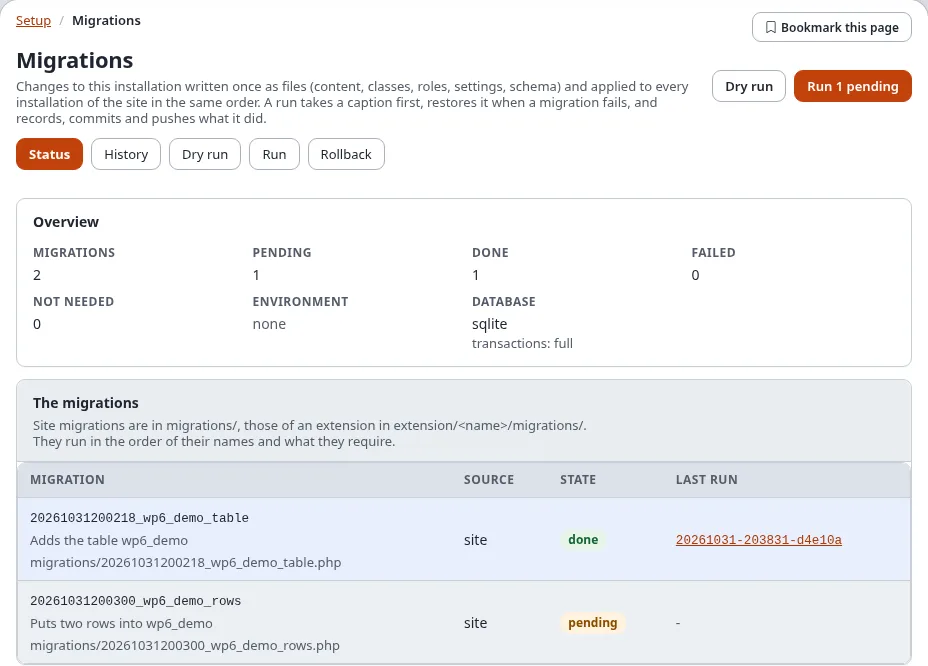
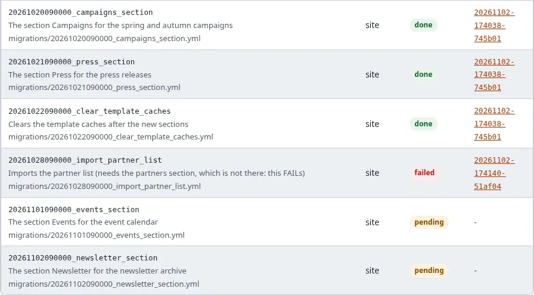
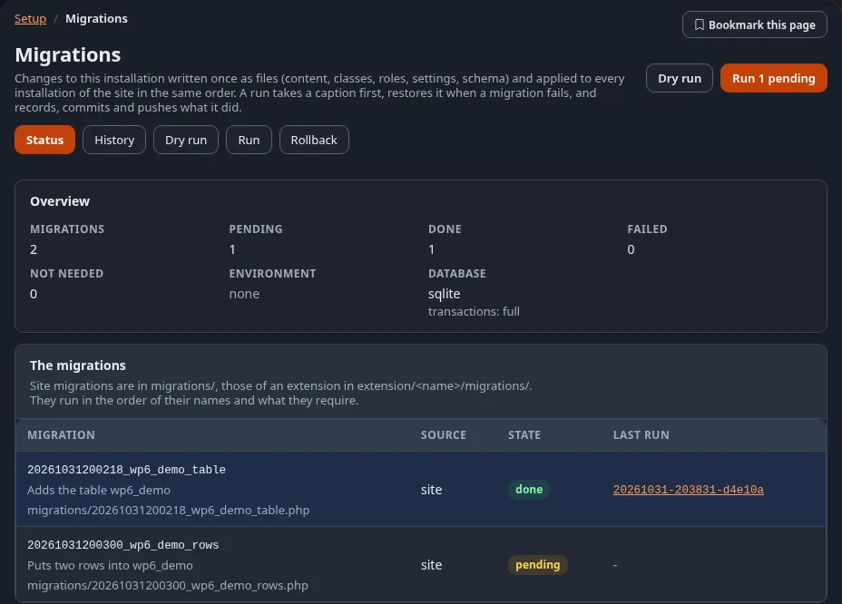
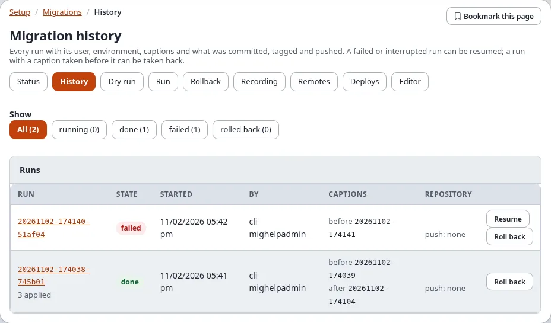
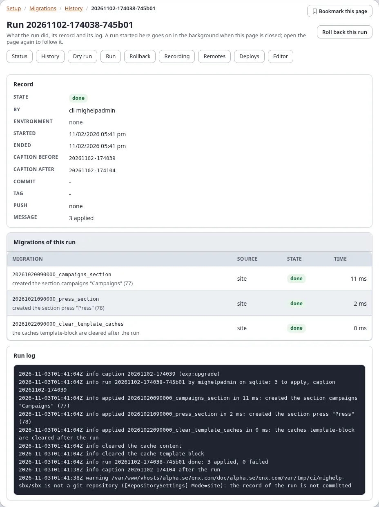
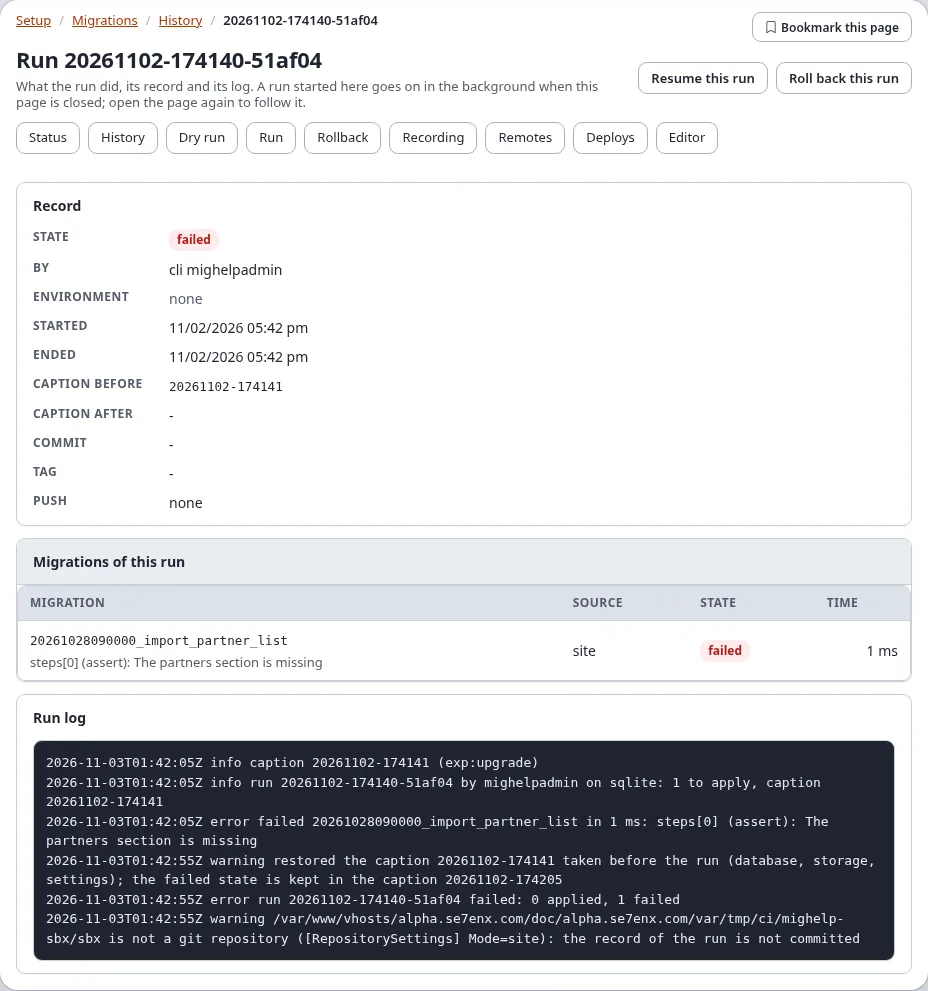
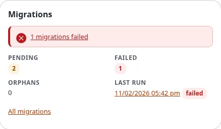

# Migrations: the status and the history

**Setup > Migrations** shows the migrations of the installation: what is done, what is pending, every run with its
captions and its record, and the log of each run. This page explains the three pages that only show (status,
history, the page of a run) and the dashboard block. Running, the dry run and the rollback are on
[Run, dry run and rollback](run-dry-run-and-rollback.md).

What a migration is, and how they are written, is explained in the guide [Migrations](../../guides/migrations.md).

**Who may see these pages:** users with the policy `migration/read`. In a new installation only the Administrator
role has it (its policy on every module). Seeing never asks for "Verify it's you".

## Contents

1. [Opening the migrations](#opening-the-migrations)
2. [The status](#the-status)
3. [The history](#the-history)
4. [The page of a run](#the-page-of-a-run)
5. [The dashboard block](#the-dashboard-block)
6. [When something is wrong](#when-something-is-wrong)
7. [Related pages](#related-pages)

## Opening the migrations

Open **Setup** in the top menu and choose **Migrations** in the left column (group **System**). The address is
`/migration/status`. The **?** button in the header opens this page from any of the three pages.

1. Choose **Setup** in the top menu.
2. Choose **Migrations** in the left column. The status opens.
3. Use the tabs to move between the pages.

Each page of Setup > Migrations has the same row of tabs: **Status**, **History**, **Dry run**, **Remotes** and
**Deploys**, and, for users with the policies, **Run** (`migration/run`), **Rollback** (`migration/rollback`),
**Recording** and **Editor** (`migration/edit`). A tour of all of them:
[A tour of Setup > Migrations](a-tour-of-setup-migrations.md).

## The status

From the top:

| Part | What it shows |
|---|---|
| The heading | **Dry run**, and **Run N pending** when migrations are pending and you have `migration/run` |
| A run going on | **A run is going on**: what was started (run, resume or rollback), by whom and when, with **Follow it** to its page |
| The lock | **The installation is locked**: another run holds the lock, an upgrade or a run on the console, with who holds it |
| Errors and warnings | what `exp:migration:status` reports: an id found twice, a missing requirement, a file changed after it was applied, migrations recorded whose file is gone (orphans), pushes that wait |
| **Overview** | the number of migrations, pending, done, failed, not needed; the environment; the database and how much of a failed migration its transactions undo (`full`, `data`, `none`) |
| **The migrations** | every migration with its id, description and file, its source (`site`, `extension:<name>`, `package:<name>`), its state and the run that applied it (a link to that run's page). A migration whose file changed after it was applied says **The file changed after it was applied.** |
| **The latest runs** | the five newest runs with their state, start and user; **Every run** opens the history |

The states are those of the console: **done**, **pending**, **not needed** (not for this environment or database
engine), **failed** and **unknown**.

The kernel's upgrade steps come first in the list (source `kernel`); the site's own migrations follow, here three
done, one failed and two pending, each with the run that applied it or tried to:

**To check the state of an installation, step by step:**

1. Open the status. Read **Overview**: **Pending** and **Failed** should be 0 after a deploy.
2. A **failed** migration: click its last run and read the report ([When a migration fails](when-a-migration-fails.md)).
3. **Pending** migrations: open **Dry run** to see what they would change, then **Run** them
   ([Run, dry run and rollback](run-dry-run-and-rollback.md)).
4. A warning such as "The file changed after it was applied." needs a decision before the next run
   ([Run](run-dry-run-and-rollback.md#run)).

When the tables of the migrations do not exist yet, the page says so: `./console exp:upgrade --apply` makes them.

The page shows the same as `./console exp:migration:status`; the dark mode shows the same page:

## The history

**History** (`/migration/history`) lists the runs, newest first (at most 200).

- **Show** filters them: **All**, **running**, **done**, **failed**, **rolled back**, each with its number. The filter
  is part of the address (`/migration/history/(state)/failed`), so a filtered list can be bookmarked.
- **Runs**: each run with its id (a link to its page), its environment and message, its state, when it started, who
  ran it, its **Captions** (before and after) and its **Repository** columns (the commit, the tag and the push state).
- The buttons of a run: **Resume** for a failed or interrupted run (with `migration/run`, while no run is going on)
  and **Roll back** for a run with a caption taken before it (with `migration/rollback`). Both lead to
  [Run, dry run and rollback](run-dry-run-and-rollback.md).
- **Started here**: the runs, resumes and rollbacks started on these pages, with who started them and their result.
  A rollback has no run of its own, so it is listed only here.

## The page of a run

Click a run's id anywhere in Setup > Migrations to open its page, `/migration/log/<run id>`.

| Part | What it shows |
|---|---|
| **Progress** | for a run started in the administration: who started it and when, its phase (**Checking the code and taking a caption before the run**, **Running ... (n of m)**, the caption after the run, the commit, tag and push, or **Restoring the caption**), and a bar of the migrations done |
| **Report** | when it has ended: each migration with its result and time, and what the run printed as errors |
| **Record** | the run's row: state, user, environment, start and end, the captions before and after, commit, tag, push, message |
| **Migrations of this run** | the migrations the run recorded, with their source, state and time |
| **Run log** | the end of the run log (`migrations/runs/<run id>.log`); only the last 256 KB are shown, as set by `migration.ini [AdminSettings] LogBytes` |

A run that passed: its record with the captions before and after, the migrations of the run and the run log.

A run that failed: the migration that failed, its message, the caption that was restored, and **Resume this run**.

While a run goes on, the page follows it as it goes: the progress, the bar and the log grow without a reload, and
the page reloads itself with the report when the run has ended. Without JavaScript, **Reload** shows how far it is.

A run started here is a process of its own on the server. Closing the page, or signing out, does not stop it: open
the page again (from the dashboard, the status or the history) to follow it.

The heading has **Resume this run** (a failed or interrupted run, with `migration/run`) and **Roll back this run** (a
run with a caption before it, with `migration/rollback`).

## The dashboard block

The dashboard of the administration has a **Migrations** block for users with `migration/read`. It shows:

- **Pending**, **Failed** and **Orphans** (migrations recorded whose file is gone), as numbers;
- **Last run**: when it started, as a link to its page, with its state;
- a note when migrations failed, when a run is going on (with a link to follow it) or when the installation is
  locked;
- **All migrations**, a link to the status.

Users without the policy do not see the block. Its place and policy are settings:
[dashboard.ini [DashboardBlock_migrations]](../../examples/ini-settings/dashboard/DashboardBlock_migrations.md).

## When something is wrong

| You see | What to do |
|---|---|
| **The tables of the migrations do not exist yet** | run `./console exp:upgrade --apply` on the server |
| **The installation is locked** | another run or an upgrade is going on; wait for it. A lock left by a process that has ended is taken over by the next run ([Troubleshooting](../../guides/migrations-troubleshooting.md)) |
| a migration **failed** | open the run's page and read its report and log; fix the migration and **Resume** the run |
| **The file changed after it was applied** | put the file back, or accept the change when you run ([Run, dry run and rollback](run-dry-run-and-rollback.md#run)) |
| the page of a run stops following it | reload the page; the run goes on regardless |

## Related pages

- [Migrations: the hub](README.md), [All recipes](recipes/README.md), [Frequently asked questions](faq.md)
- [The guide](../../guides/migrations.md), [the tutorial](../../guides/migrations-tutorial.md),
  [PHP migrations](../../guides/migrations-php.md),
  [Rollback and captions](../../guides/migrations-rollback-and-captions.md),
  [The migrations repository](../../guides/migrations-repositories.md)
- [In the administration](in-the-administration.md), [Commands](commands.md), [Settings](settings.md),
  [Policies, views and events](policies-views-and-events.md)
- [The file format](../../specifications/6.0/migration-file-format.md),
  [The feature](../../features/6.0/migrations.md)
- [When a migration fails](when-a-migration-fails.md),
  [Troubleshooting messages](../../guides/migrations-troubleshooting.md)
- [Migrations versus migrating a site](migrations-versus-migrating-a-site.md)
- [Run, dry run and rollback](run-dry-run-and-rollback.md)
- [Migrations in the website sidebar](expwt-panel.md)
- [The views of the module migration](../../examples/module-views/migration/README.md) and
  [its policies](../../examples/policies/migration.md)
