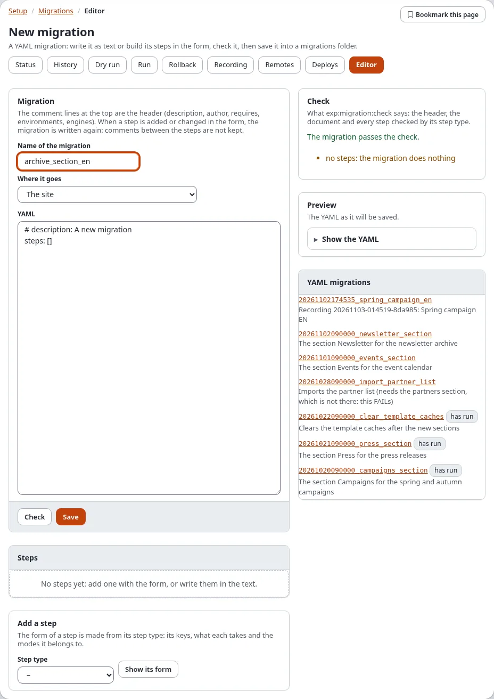
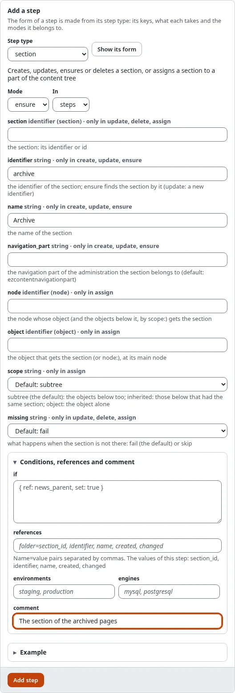
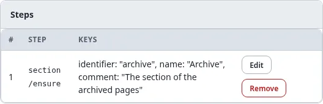
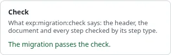
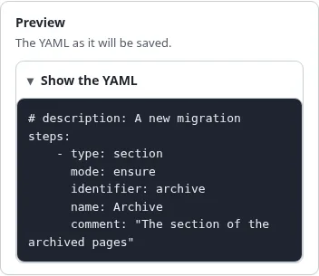
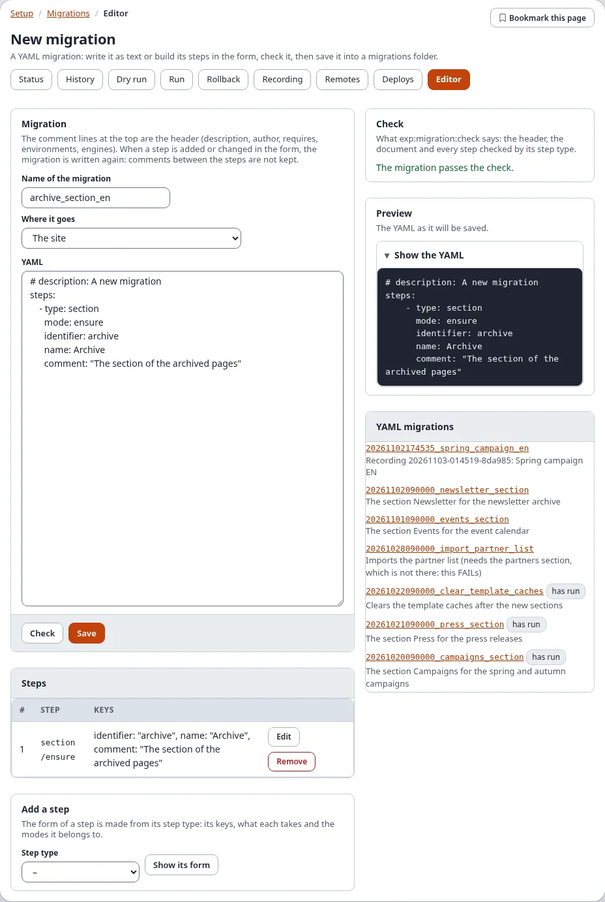
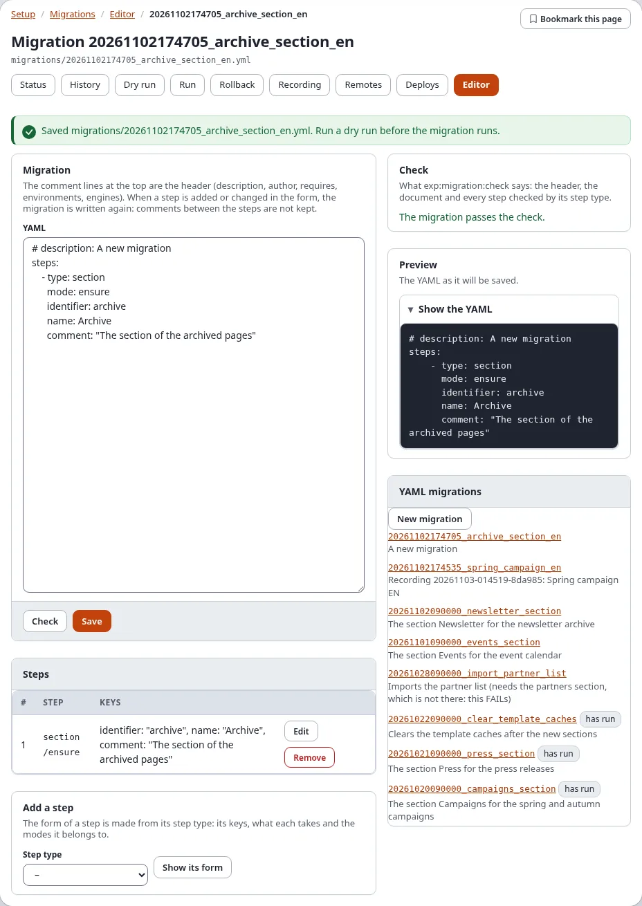
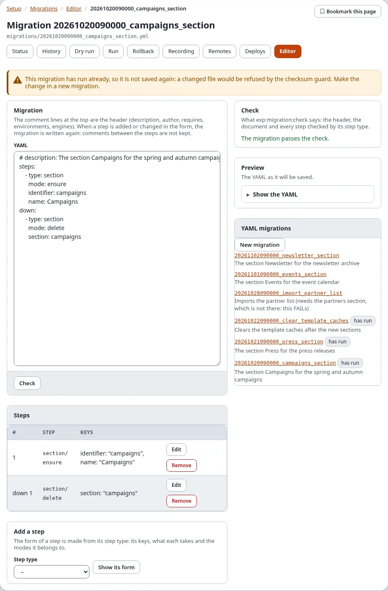

# Migrations: the migration editor

**Setup > Migrations > Editor** writes YAML migrations in the browser: you build the steps with forms made from each
step type, check the migration as `exp:migration:check` would, look at the YAML and save it into a migrations folder.
The saved file is an ordinary migration: it shows as pending on the status page and is run, deployed and committed
like a migration written by hand.

**Who may use the editor:** users with the policy `migration/edit` (only Administrator in a new installation). The
file is written by the web server, so the migrations folder must be writable for it.

## Contents

1. [Create a new migration](#create-a-new-migration)
2. [The form of a step](#the-form-of-a-step)
3. [The list of steps](#the-list-of-steps)
4. [Check and preview](#check-and-preview)
5. [Save](#save)
6. [Change a migration](#change-a-migration)
7. [A migration that has run](#a-migration-that-has-run)
8. [When something goes wrong](#when-something-goes-wrong)
9. [Related pages](#related-pages)

## Create a new migration

1. Open **Setup > Migrations** and choose the tab **Editor** (`/migration/editor`). The page **New migration** opens.
2. Type the **Name of the migration**: letters, digits and `_`, for example `archive_section`. The file will be
   `<date and time>_<name>.yml`, so migrations run in the order they were made.
3. Choose **Where it goes**: **The site** (the site's `migrations/` folder) or an active extension that has a
   migrations folder.
4. Optionally change the header lines at the top of **YAML**: `# description:` is what the status page shows next to
   the migration; `# requires:`, `# environments:` and `# engines:` are explained in
   [the file format](../../specifications/6.0/migration-file-format.md).
5. Add the steps, with the form below the list ([The form of a step](#the-form-of-a-step)) or typed into **YAML**.
6. **Check**, then **Save**.

The column on the right lists **YAML migrations**: every YAML migration of the searched folders, newest first, with
**has run** next to those that ran. Click one to open it in the editor.

## The form of a step

1. In **Add a step**, choose the **Step type** (for example `section`, `content_class`, `role`, `settings`, `cache`)
   and press **Show its form**.
2. The form is made from the step type's own description. Choose the **Mode** (`create`, `update`, `ensure`, `delete`
   ... as the type offers; `ensure` creates what is missing and changes what differs) and **In** (`steps`, or `down`
   for the steps that undo the migration).
3. Fill in the keys. Each field names the key, its kind (text, a whole number, true or false, a node or object
   identifier, a list or map written as YAML), the modes it belongs to ("only in update, delete, assign"), its
   default, and what it does. Fields of other modes can stay empty.
4. **Conditions, references and comment** (fold it open) holds `if` (a condition), `references` (name=value pairs, with
   the values the step gives listed), `environments`, `engines` and a `comment`.
5. **Example** shows a complete step of the type.
6. Press **Add step**. The step is added at the end of `steps` (or `down`), and the YAML text is written again.

Loops (`foreach`) and steps of a type this installation does not have cannot be built in the form: write them in the
YAML text. The reference of every step type is in [the migration steps](../../examples/migration-steps/README.md).

## The list of steps

**Steps** lists every step with its number, its type and mode, and its keys:

| Button | What it does |
|---|---|
| **Edit** | loads the step into the form; change it and press **Change step** to put it back in its place |
| **Move up**, **Move down** | change the order (shown when there is more than one step) |
| **Remove** | takes the step out |

When a step is added or changed through the form, the YAML text is written again from the parsed migration: the
header lines stay, comments between the steps do not.

## Check and preview

- **Check** runs what `./console exp:migration:check` runs: the header, the document and every step through its step
  type. The card **Check** says **The migration passes the check.**, or lists every problem with the step it is in.
  A warning (such as "no steps: the migration does nothing") does not stop a save.
- **Preview** shows the YAML exactly as it will be saved (**Show the YAML**).

The whole editor after a check:

## Save

Press **Save**. When "Verify it's you" asks for your password, give it. The editor writes the file and opens it:

- A new migration is written as `<now>_<name>.yml` into the site's migrations folder (the first
  `[MigrationSettings] DirectoryList` entry) or the extension's migrations folder. An existing file is never
  overwritten by a new one.
- A text that does not pass the check is not saved; the problems are listed instead.
- The editor writes nothing outside the migration folders.

**What next:** the migration is now **pending** on the status page. Open **Dry run** to see what it will change, then
**Run** ([Run, dry run and rollback](run-dry-run-and-rollback.md)). Commit the file with the rest of the site so the
other installations get it, or deploy it ([Deploy step by step](deploy-step-by-step.md)).

## Change a migration

1. Choose the migration in **YAML migrations** on the right, or open `/migration/editor/<migration id>`.
2. Change the text, or the steps with **Edit**, **Move up**, **Move down** and **Remove**.
3. **Check**, then **Save**: the file is written in place.

## A migration that has run

A migration that has run is shown, but not saved again:

The notice says: "This migration has run already, so it is not saved again: a changed file would be refused by the
checksum guard. Make the change in a new migration." Every installation that applied it keeps the checksum of the
file it ran; a changed file would stop the next run there. Write the change as a new migration instead (it may
undo or extend the old one).

## When something goes wrong

| What you see | Why, and what to do |
|---|---|
| "The file cannot be written by the web server." | The migrations folder is not writable for the user PHP runs as. Fix the folder's permissions, or write the migration on the console. |
| The check lists a problem | Fix the key named in the problem; the step type's page in [the migration steps](../../examples/migration-steps/README.md) has every key. |
| "The step has keys its type does not know" | The step was written for another version of the step type. The keys named are left out when the step is changed in the form; change it in the text to keep them. |
| A step type is missing in the list | The extension that gives it is not active. |
| The Editor tab is missing | You do not have `migration/edit`. |

## Related pages

- [A tour of Setup > Migrations](a-tour-of-setup-migrations.md), [Generating migrations](generating-migrations.md)
- [The YAML steps](../../guides/migrations-yaml-steps.md), [the migration steps](../../examples/migration-steps/README.md),
  [the file format](../../specifications/6.0/migration-file-format.md)
- [Migrations: generators and recording changes](../../guides/migrations-generators-and-recording.md#the-editor-in-the-administration)
- [Run, dry run and rollback](run-dry-run-and-rollback.md), [Recipe: reviewing a migration](recipes/reviewing-a-migration.md)
