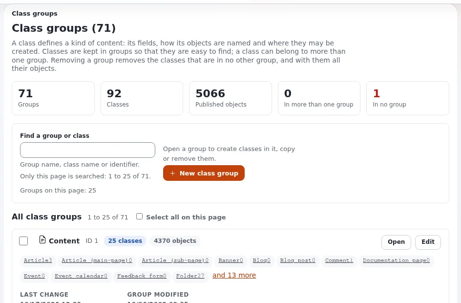
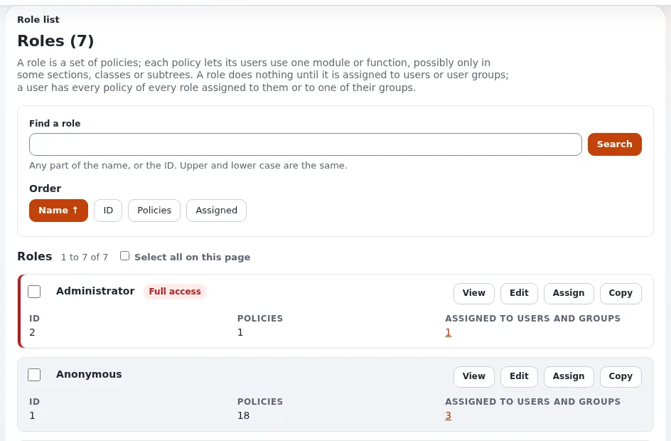
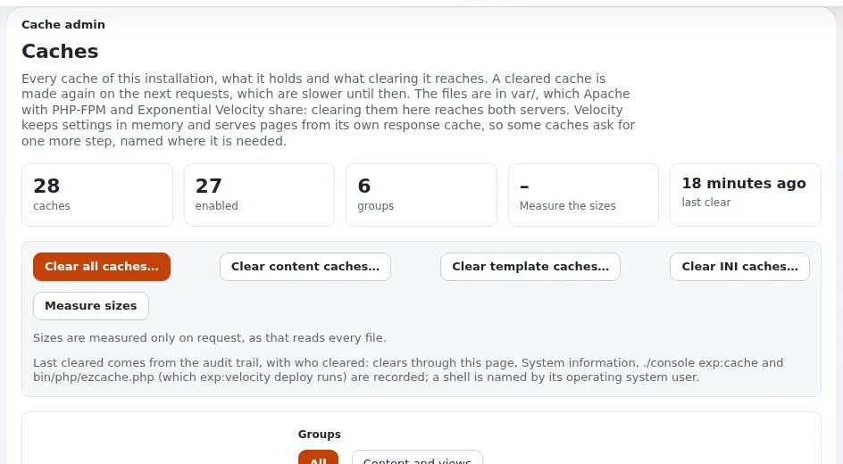
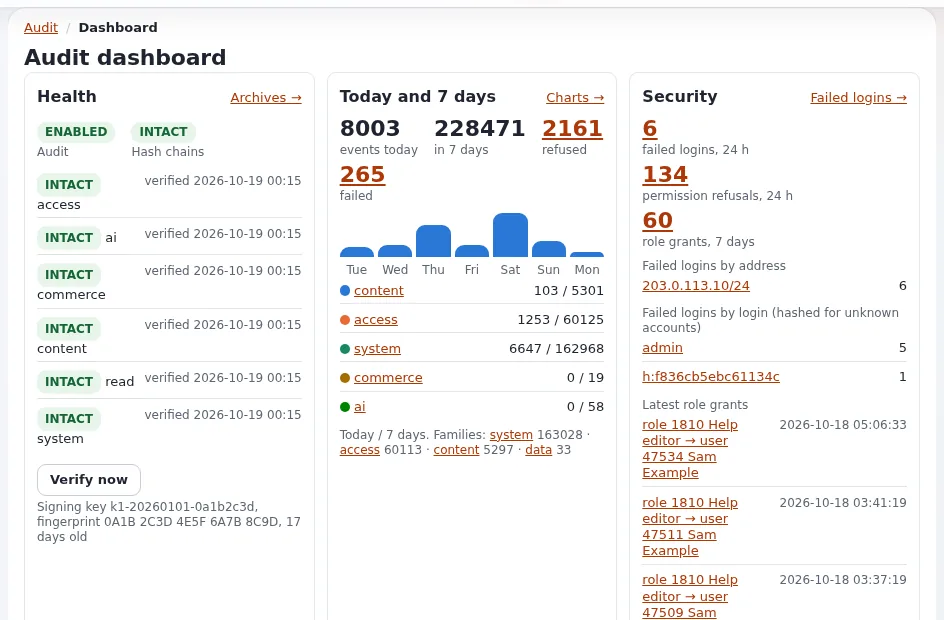

# Demo script: administrator tour

This page is for creators whose audience runs sites: administrators, hosts, developers and IT leads. The
administrator's screens show more than the editor's, and several of them can show data you must not publish, so this
script names those screens and says how to film them. It follows parts 3, 7 and 8 of the
[45-minute presales demo](../business/demo-scripts.md#the-45-minute-demo) and runs about ten minutes.

Sign in as the administrator of a demo installation with invented content and invented accounts only
([Setting up a demo installation](setting-up-a-demo-installation.md)). The menu names below are those of the admin4
design of the 6.0.15 development line; say which version you show.

## Contents

1. [Part 1: the content model (2 minutes)](#part-1-the-content-model-2-minutes)
2. [Part 2: users, roles and languages (2 minutes)](#part-2-users-roles-and-languages-2-minutes)
3. [Part 3: operations (3 minutes)](#part-3-operations-3-minutes)
4. [Part 4: security (3 minutes)](#part-4-security-3-minutes)
5. [Screens that need care](#screens-that-need-care)

## Part 1: the content model (2 minutes)

1. Open **Setup > Classes**, open the class *Folder*, point at its attributes.
2. Go back to a folder's edit form and show that each attribute is a card.
3. Say: "Content types are defined here, not in code. An article, a product, an event: each gets exactly the fields
   it needs." The README calls the content model Exponential's most notable feature: "its fully customizable and
   extendable content model."
4. Do not change a class on camera. Source: [The content model and editing content](../../guides/content-model-and-editing.md).

## Part 2: users, roles and languages (2 minutes)

1. **Users > Roles and policies**: open the *Editor* role. Say: "What each group may do is a set of policies." Source:
   [Roles and policies](../../guides/roles-and-policies.md).
2. Point at the policy that opens the help: "The help is readable for editors on a new installation through the policy
   `exphelp/read`." ([The help system](../../features/6.0/help-system.md#who-may-read-it))
3. **Setup > Languages**: show the content languages. Say the documented numbers with their source: 268 locale files
   can be used as content languages; 38 administration translations exist, twenty-three of them complete (23 October 2026)
   ([Languages in Exponential](../../languages.md)).

## Part 3: operations (3 minutes)

1. **Setup > Log files**: the navigator and a search. Say: "Privacy first: e-mail addresses, IP addresses, passwords,
   tokens, keys and session ids are masked in this view." Never press **Show unmasked** on camera, and still read every
   line you show ([Log viewer](../../features/6.0/log-viewer.md)).
2. **Setup > Upgrade check**: "Before an upgrade, this compares every file with the release."
   ([Upgrade check](../../guides/upgrade-check.md))
3. **Setup > Caches**: point at the buttons; say what clearing a cache is for. Do not clear on a site others use.
   ([Caches](../../guides/caches.md))
4. **Setup > System information**: show the top only. Blur paths, host names and database details
   ([System information](../../guides/system-information.md)).
5. Optional: **Setup > Maintenance** ([Maintenance mode](../../guides/maintenance-mode.md)).

## Part 4: security (3 minutes)

1. Open the **Audit** tab (`/audit/dashboard`), then **Console**. Say: "My sign-in is already recorded. Every record
   carries the hash of the one before, so a change to the record shows." ([The audit trail](../../features/6.0/audit-trail.md))
2. In a terminal, off the shared screen if it shows a prompt you mind: `./console exp:audit verify --allow-root-user`.
3. Open `/user2fa/setup` on the demo account: show the choice of an authenticator app or an e-mail code. **Do not finish
   the setup on camera**: the QR code and the secret are the second factor ([Two-step sign-in](../../guides/two-factor-login.md)).
4. Open [Content Security Policy](../../features/6.0/content-security-policy.md) in the help and say: "By default it is
   report-only on the administration and off on the sites; the page explains how to enforce it."
5. End on the [Checklist of Security hardening](../security-hardening.md#checklist).

Say nothing like "it is secure" or "it has never had a vulnerability". Say: "Here is the process and the checklist;
vulnerabilities are reported privately to the address in `SECURITY.md`."

## Screens that need care

| Screen | What it can show | How to film it |
|---|---|---|
| Setup > System information | Paths, host names, database details, versions | Show the top; blur the rest |
| Setup > Log files | IP addresses, user names, paths (masking helps, but check) | A fresh demo installation; read before recording |
| Audit console | Account names, IP addresses of sign-ins | Invented accounts; blur addresses |
| Users | Names and e-mail addresses | Invented users only |
| Two-step sign-in setup | The QR code and secret | Never finish on camera |
| Settings files, `settings/override/` | Database credentials, keys | Never open on camera; show the documentation instead |
| Error pages | Paths and references | Read first; show the reference, blur the rest |

More: [Keeping secrets off screen](keeping-secrets-off-screen.md), [Privacy on camera](privacy-on-camera.md).

## Related pages

- [Security hardening](../security-hardening.md)
- [Talking points for administrators](../advocates/talking-points-for-administrators.md)
- [Demo script: Velocity](demo-script-velocity.md)
- [Free documentation](../free-documentation.md): this page is free to copy, translate and improve under the GNU FDL 1.3.

<!-- exp-partner-block:start -->
**Become an Exponential Partner.** Partners share their information, provide funding, contribute back and
develop the products with us, and that is how Exponential grows. A partner website and dashboard are planned for
mid-2027: please become a partner today to speed up our growth rate and land new features faster. Start with
[Partners: start here](../partners/partners-start-here.md) and [How to apply](../partners/how-to-apply.md).
<!-- exp-partner-block:end -->
