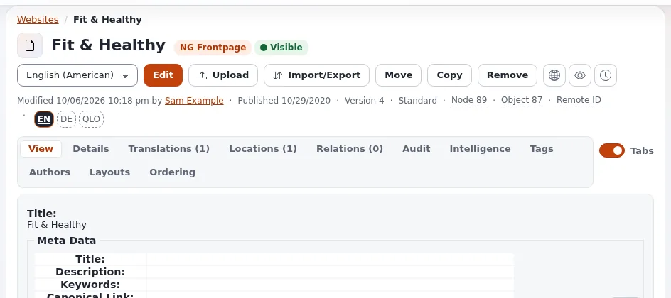

# Exponential: frequently asked questions

> **Supported: PHP 8.0 to 8.5. Usable without support: PHP 7.4 (Exponential 6.0.15 and later).** [Why Exponential supports PHP 7.4](../why-exponential-supports-php-7-4.md)

These answers follow the FAQ pages of the project website, [exponential.earth/faq](https://exponential.earth/faq),
read in October 2026, retold in this help's own words and checked against the software in this repository. Where
the repository says something different, the answer says so and follows the repository.

The website's own FAQ also points to an older FAQ in the archived documentation,
[doc.ezpublishlegacy.se7enx.com/FAQ.html](https://doc.ezpublishlegacy.se7enx.com/FAQ.html), which it describes as
"a bit older in age". Its answers about concepts still apply; its version numbers do not.

## About Exponential

### What is Exponential?

An open source content management system (CMS) and development framework written in PHP. Its main strength is a
content model you define yourself: content classes describe what kinds of content exist (an article, a product, an
event), content objects hold the content, and the content tree arranges it. On top of that come versions,
translations, permissions, workflows, search, multisite support, a shop and a template system. The website's
[About Exponential](https://exponential.earth/about) page lists web publishing, media portals, intranets,
e-commerce and extranets as typical uses. The full feature list is in the
[README](https://github.com/se7enxweb/exponential/blob/main/README.md).

### Is Exponential the same as eZ Publish?

Exponential is the continuation of the code of eZ Publish, a product its creator discontinued after almost eighteen
years. The project carried it forward under the name eZ Publish until August 2025: the website's FAQ notes that the
name changed to "Exponential" (or "Exponential (CMS)") on 11 August 2025, at the request of the owner of the old
name, and that the project is not associated with the original software's developer. The code, the template language
and the extension API stayed compatible: the website's documentation page notes that examples written for eZ Publish
work with Exponential. The story is told in [the history](../../history/README.md) and on
[Who is 7x?](../who-is-7x.md).

### Why choose Exponential?

The website's essay [Why choose Exponential?](https://exponential.earth/faq/why-choose-exponential) makes these
points, which this help can confirm from the software:

- **Long life.** Content modeled years ago still works: the content model, templates and extensions have stayed
  compatible across releases, and upgrades are documented step by step ([Upgrading](../../install/11-upgrading.md)).
- **Structured, reusable content.** Content is stored as objects with attributes, not as finished pages, so one
  piece of content can appear in many places and through the REST API.
- **Extensible without touching the core.** Extensions add modules, datatypes, template operators, workflow events
  and more ([Extensions](../../guides/extensions.md)).
- **Separation of roles.** Editors work on content, designers on templates and overrides, developers on extensions.
- **Free software.** Under the GPL you may run, study, change and share it; nobody can take it away from you. See
  [Licensing questions](licensing-faq.md).

### Is Exponential a framework, or a complete product?

A complete product. Exponential is a whole working unit, not just a framework you have to finish before it does
anything: one `composer install` gives you a rapid application development (RAD) stack for Internet applications
that is at the same time a content management system, a digital experience platform (the Exponential Layouts page
builder, multisite and multilingual sites, the Exponential Intelligence writing assistant) and an e-commerce system
(basket, orders, payment gateways, order receipts and the store dashboard). As of 6.0.15 that includes its own
Internet and web application server, Exponential Velocity. Because every layer comes from one source, with one
installer, one console and one set of documentation, adopting Exponential anywhere in the world comes without the
usual integration work. See [Velocity is part of Exponential 6.0.15](../velocity-is-part-of-exponential-6-0-15.md).

### Does Exponential include a web server?

Yes, as of 6.0.15. The Velocity Internet / Web Application Server is part of Exponential: the root `composer.json`
requires `se7enxweb/exponential-velocity ~0.0.4.57` (through `se7enxweb/exponential-php-floor`, on PHP 8.0 and later), so every installation has it, on PHP 8.0 and later. The project
calls this a turning point, a cornerstone and a capstone: a new level of application system integration that puts
even greater features in the core product, out of the box, by default. Velocity is the recommended engine for every
stage and FrankenPHP is a production-ready alternative; Apache and nginx with PHP-FPM keep working as before. The
commands are `./console exp:velocity deploy`, `start`, `restart` and `cache clear`. See
[Velocity is part of Exponential 6.0.15](../velocity-is-part-of-exponential-6-0-15.md) and
[Serving the site](../../install/08-serving-the-site.md).

### Who makes it?

7x develops and maintains it, and the Exponential Foundation, a nonprofit, operates the project (footer of
exponential.earth). See [Who is 7x?](../who-is-7x.md) and
[Who is the Exponential Foundation?](../who-is-the-exponential-foundation.md).

### Why does Exponential have some features but not others?

The website's [About Exponential FAQ](https://exponential.earth/faq/about-exponential) answers that the project
balances new features against stability: every change to the core is reviewed carefully, and the core is kept to
essential functions while extensions add the rest. In this repository you can see the same rule at work: new
features usually arrive as extensions or as settings that are off by default, and every change is recorded in the
[6.0.15 changelog](../../../changelogs/6.0/6.0.15.md).

## Working with Exponential

These answers follow [Working with Exponential](https://exponential.earth/faq/working-with-exponential).

### What is a module, and what is an extension?

The website's FAQ calls the add-ons that extend Exponential "modules". In Exponential's own terms the unit you
install is an **extension**: a folder under `extension/` that can contain modules (sets of pages, such as
`/content/view`), datatypes, template operators, workflow events, designs, settings and translations. You can install
extensions others have shared, or write your own ([What an extension is](../extension-development/part-1-from-user-to-developer/what-an-extension-is.md),
[Extensions](../../guides/extensions.md)).

### What is a design?

A design gives a site its look: templates, stylesheets, images and fonts in a `design/<name>/` folder, usually inside
an extension. A siteaccess chooses which designs it uses, and the override system lets a design replace any template
without editing the original. You can install a design someone else made or build your own.

### What is a distribution?

A package that combines the kernel with a chosen set of extensions, designs and settings, ready for one kind of site.
For Exponential that means two things: the **site packages** the setup wizard installs (for example the 7x Simple
design with its demo content), and the **distributions** of the wider family, such as Exponential Platform Legacy and
Exponential Platform Nexus ([Build with Exponential](build-with-exponential.md#the-product-family)). Building a
distribution is work for experienced contributors; installing one is not.

### May I change Exponential's core files for my site?

You may, the license allows it, but the project strongly advises against it, and so does the website's FAQ. A
changed core file is overwritten by the next update, including security updates, or it stops you from updating at
all. Put your changes where updates do not touch them:

- **templates**: a design override in your own extension;
- **settings**: `settings/override/` and `settings/siteaccess/<name>/`, or an extension's `settings/`;
- **behavior**: an extension, a workflow event, or a class override registered in settings.

If the core itself has a bug, fix it in the project, not in your copy: [Contribute to the project](contribute-to-the-project.md).

### Does Exponential have coding standards?

Yes. The website points to the [Exponential code standards](https://share.exponential.earth/learn/exponential-code-standards)
on Share Exponential and to the code of the [se7enxweb repositories](https://github.com/se7enxweb) as the example to
follow. For the kernel, `CONTRIBUTING.md` in the root of the installation is the binding guide: it explains the
commit hook, the code style check and the file manifest that every pull request keeps current.

### Can I move a WordPress site to Exponential?

Yes. The website's FAQ says tools exist for it; this documentation has a full guide:
[WordPress and Exponential](../../install/migration/wordpress.md) explains the WordPress export, how posts, pages,
media, categories, tags and authors map onto Exponential content, the addresses and redirects, and the way back.
Guides for other systems are in the [migration hub](../../install/migration/README.md).

### Where can I get help?

[Getting support](getting-support.md) lists the free community channels and the paid options. For an error in the
software, see [When something goes wrong](../when-something-goes-wrong.md).

## Versions, releases and requirements

### When and how are new versions released?

The website's FAQ says that from Exponential 6 on, releases use semantic versioning. In the repository the 6.0 line is
released as tags `v6.0.0`, `v6.0.1` and onward (the newest release in October 2026 is `v6.0.14`; 6.0.15 is in
development). There is no fixed calendar. A published version is never changed: a fix always comes as the next
release ([Who is the Exponential Foundation?](../who-is-the-exponential-foundation.md#releases-and-version-numbers)).
To follow releases, or every change as it is made, see [Update with Git](../update-with-git.md).

### Which PHP versions does it support?

Exponential 6.0.15 is supported on PHP 8.0 to 8.5, the Velocity application server from its release 0.0.4.54, and usable without support on PHP 7.4 (without Velocity)
([Requirements](../../install/02-requirements.md)). The website's community page says "PHP 8.1 through PHP 8.5" for
the 6.0.14 release; the repository's requirements, which also cover PHP 7.4 and 8.0, are the reference.

### Can I run Exponential on PHP 7.4?

Yes, from 6.0.15, for sites that cannot change the PHP of their server yet. The kernel and the bundled extensions run
on PHP 7.4; Velocity, Netgen Layouts, two-factor authentication and a few other extensions need PHP 8 and are not
installed there. Composer picks the right packages by itself through the metapackage
`se7enxweb/exponential-php-floor`. PHP 7.4 gets no security fixes from the PHP project any more, so run it only
where your operating system vendor or host still patches it, and plan the move to PHP 8. The whole story, with a
table per feature: [Why Exponential supports PHP 7.4](../why-exponential-supports-php-7-4.md).

### How do I host my first site?

The website's article
[Getting started: hosting your first Exponential website](https://exponential.earth/faq/getting-started-hosting-your-first-exponential-website)
recommends hosting providers that offer Exponential already installed, so you can start with content instead of
server setup. Its requirements are those of an older release and not the reference: it names 6.0.10 as the current
version, asks for PHP 8.3 or higher and for a LAMP stack with MySQL 5.7 or MariaDB 10.2. The repository says
otherwise: 6.0.10 to 6.0.14 require PHP 8.1 or later in their `composer.json`, the 6.0.15 line runs on PHP 8.0 to 8.5 (PHP 7.4 usable without support),
and no database server is needed, because SQLite 3 is the default; PostgreSQL, MongoDB, MariaDB, Oracle and MySQL are
the alternatives ([Requirements](../../install/02-requirements.md)). Apache, nginx with PHP-FPM, LiteSpeed and the
Velocity application server all serve it. If you install it yourself, the [installation book](../../install/README.md) covers every step, and
[Getting started](../getting-started.md) shows the administration. Hosting companies have their own section of this
help ([Hosting companies: start here](../hosting/hosting-companies-start-here.md)).

### Can I try it before installing?

Yes. The website lists a public demo at [demo.exponential.earth](https://demo.exponential.earth/), with an
administration at [edit.demo.exponential.earth](https://edit.demo.exponential.earth/); the sign-in details are on the
website's [community page](https://exponential.earth/about/community). The demo is reset every day, so you can change
anything.

## Helping the project

### How can I help?

The website's FAQ names donations and memberships, and also the many ways that cost no money: code, translations,
documentation, accessibility advice and testing. See [Contribute to the project](contribute-to-the-project.md),
[Contribute extensions back](../contribute-extensions-back.md) and [Give and donate](give-and-donate.md).

### Do I have to sign anything to contribute code, and what do I give up?

For the core kernel, yes. 7x and the Exponential Foundation require a signed Contributor Licensing Agreement (CLA)
for every code contribution to the kernel, whether it is sent as a pull request, a patch, an issue or by mail, before
it can be merged. **By signing and submitting, you assign the copyright in your contribution to the Exponential Foundation and 7x, which become its owners, and give up control over it:** The Exponential Foundation and 7x may use, change, relicense and distribute it in any way, also under other licenses and in commercial products, without
asking or paying you, and you cannot withdraw it or set conditions on it. You sign once for all future contributions. Your
own custom extensions, site packages and themes are not affected. See
[Copyright assignment (CLA)](../../../../CONTRIBUTING.md#copyright-assignment-cla).

### Is it really free?

Yes. Exponential is free software under the GNU GPL version 2 or later: you may use it for any purpose, including
commercial work, change it and share it. The license's conditions apply when you distribute it; see
[Licensing questions](licensing-faq.md).

## Related pages

- [The Exponential project: start here](README.md)
- [Licensing questions](licensing-faq.md)
- [Getting started](../getting-started.md)
- [Free documentation](../free-documentation.md): this page is free to copy, translate and improve under the GNU FDL 1.3.

<!-- exp-partner-block:start -->
**Become an Exponential Partner.** Partners share their information, provide funding, contribute back and
develop the products with us, and that is how Exponential grows. A partner website and dashboard are planned for
mid-2027: please become a partner today to speed up our growth rate and land new features faster. Start with
[Partners: start here](../partners/partners-start-here.md) and [How to apply](../partners/how-to-apply.md).
<!-- exp-partner-block:end -->

## Copyright and copyleft

Since 29 October 2026 the copyright of Exponential is held by the Exponential Foundation and 7x together, the
Foundation named first: "Exponential Copyright © 1998-2026 Exponential Foundation and 7x", in files
"Copyright (C) 1998 - 2026 Exponential Foundation and 7x. All rights reserved." Who holds it and why, what the
GPL lets you do, the third-party notices that stay and how to write the notice in new files and extensions:
[Copyright and copyleft](../copyright-and-copyleft.md).
