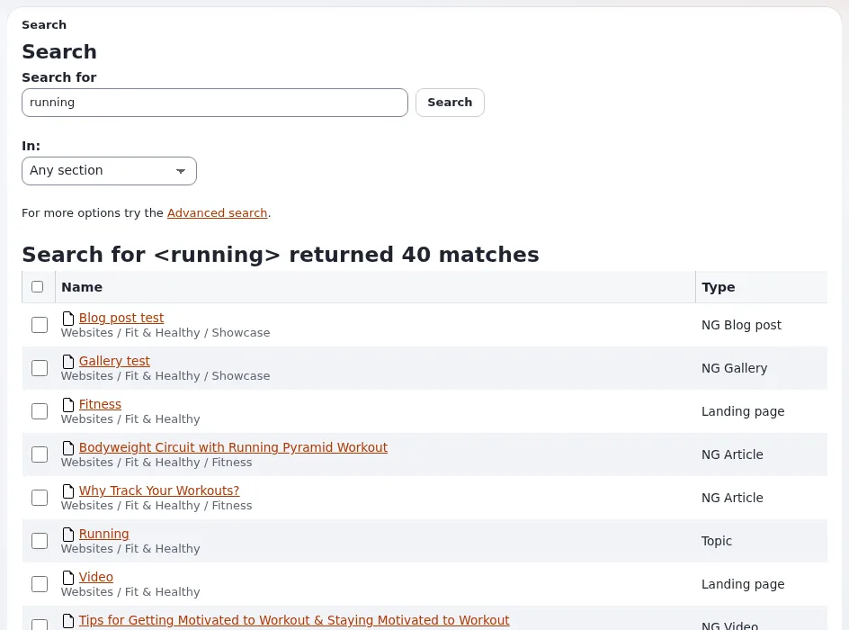
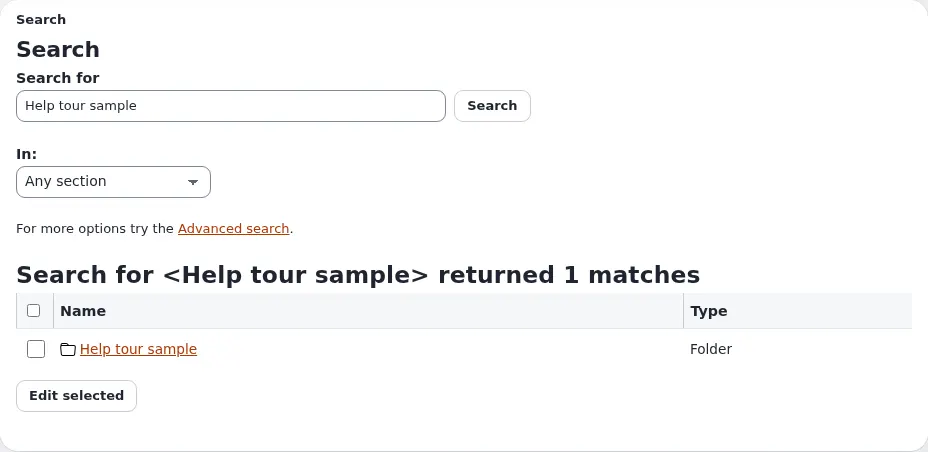
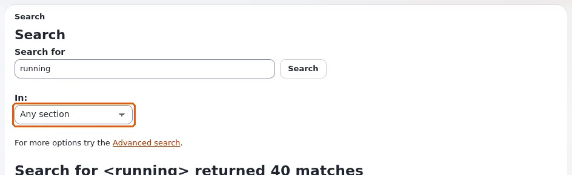
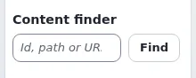
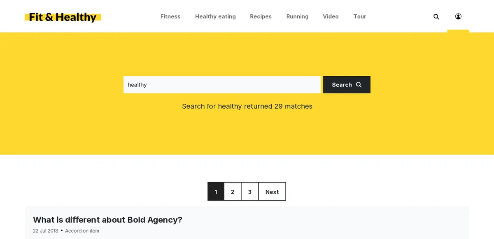
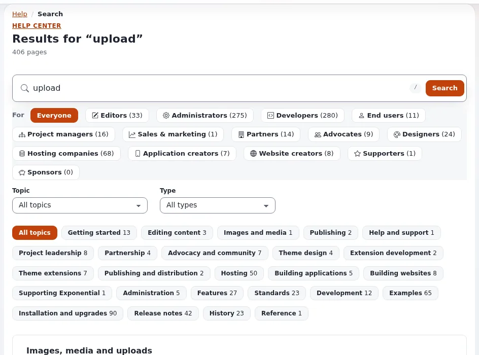

# Searching

This page is for editors who need to find an item quickly, and for visitors who search the site. The quick search, its
suggestions and the search page work alike in every administration design (Admin 4, Admin 3, AdminUI and Classic).

## The quick search

The **Search...** field in the header of the administration searches all content you may read.

1. Click the field, or press `/` anywhere on the page (not while typing in another field).
2. Type one or more words and press Enter.

The results page lists each match with its name, its path in the tree and its type. Click a name to open the item.
Tick results and press **Edit selected** to edit several of them in one form.

### Suggestions while typing

From the third character on, a list opens under the field while you type. It shows, in groups:

- **Content**: items whose text matches, each with its type and where it is in the tree.
- **Document pages**: the pages of a PDF file that hold the words, with a link that opens the document at that page
  (only on sites that index PDF pages; elsewhere a document is found as a whole, under **Content**).
- **Users**: user accounts by login, e-mail address or name.
- **Content classes**: classes by name or identifier, if you may open the class list.
- **Administration**: pages of the administration's menus, such as *Setup › Cache management*.

You only see what you may open. The words you typed are highlighted. **View all results** at the end opens the
full results page, with the number of matches.

- `↓` / `↑` move through the list, `Enter` opens the chosen entry (or searches when none is chosen).
- `Esc` or a click outside closes the list.
- `Ctrl` + `/` (`Cmd` + `/` on a Mac) jumps to the field from anywhere, also from inside another field.

For administrators: the groups, their order, how many entries each shows and the number of characters before the
list opens are set in `admininterface.ini` `[SearchSuggestSettings]`; `Enabled=false` switches the suggestions off.
The list is filled by the view `content/suggest`, which uses the search engine of the site (eZ Find when it is
installed and active, the built-in search otherwise). It needs the policy `content/read`: a role without it gets no
suggestions, not even the administration's pages. A word is found while it is still being typed ("Oste" finds
"Ostern") only with `site.ini` `[SearchSettings] EnableWildcard=true` (or `Wildcard=enabled` in
`[SearchSuggestSettings]`); otherwise the list matches whole words.

### Narrow the search

The funnel button in the search field opens **Search scope**:

- **Section**: search only in one section of the site, such as *Media* or *Users*.
- **Where**: search everywhere, or only below the place you are looking at (**Current location**).
- **Advanced search** opens the search page with its filters.

## The search page and its filters

The search page (**Search** in the header, or `content/search`) has the search field on top, the **Filters** beside
the results (above them on a narrow screen, folded under **Show filters**) and the results in a table. It also
takes in the former advanced search: an old link to `content/advancedsearch` opens this page. The address of a search
keeps every filter (`content/search/(text)/easter/(class)/2,16`), so you can bookmark it or send it to a colleague.

- **Words**: **All words** (the default), **Any word** or **Exact phrase**;
- **Content type**: one or more types, grouped by class group; the less used ones are under **Show more**. With
  exactly one type chosen, **Class attribute** searches only one field of that type;
- **Section**: one or more sections;
- **Modified** and **Published**: any time, the last day, 7 days, month or year, or a **Custom range** with a from
  and a to date;
- **Owner**: a user's ID, login or e-mail address;
- **Language**: only the translations in one language;
- **Location**: all content, or the place the search started from (the header's **Current location**);
- **Results per page**.

Choose filters and press **Apply** (it is active once something changed); **Reset** keeps the words and removes
every filter. The page works without JavaScript as well: then every field is sent with **Apply**.

Above the results:

- the header **Results for “words” (count)**;
- every active filter as a chip: click it to search again without that filter;
- **Sort by**: relevance, name A–Z or Z–A, modified or published, newest or oldest first. The pages keep the sort
  order and all filters;
- **Did you mean** with a spelling suggestion, when the search engine offers one.

Each result shows its type, its name with its place in the tree and the words found, when it was modified, its
content type, its translations (each a link to the item in that language) and **Edit**. Tick results and press
**Edit selected** to edit several of them in one form. A PDF lists the pages that hold the words, when the deep
search for documents is installed.

What the filters can do depends on the search engine. With eZ Find all of them are there, with counts next to the
content types, sections and languages. With the built-in search there is no **Any word**, no **Modified**, no
**Owner**, no **Language**, no counts and no sorting by relevance, and a search needs words.

## Open an item by its number or address

When you know an item's number or address, you do not need to search. The **Content finder** below the tree in the
left column takes:

- the **node** number (shown as *Node* on the item's page),
- a path such as `media/images`,
- or the full address of the page on the site.

Type it and press **Find**.

## Search within lists

- The **Sub items** list of a folder shows the items below it. Sort a column by clicking its heading.
- **My bookmarks** has its own **Find a bookmark** field.
- In the **Trash**, filters narrow the list by who removed the item, its type and the date.

## Searching the site

Visitors search the public site with its own search field, usually in the header. The results show the title, date,
type and the first lines of each match, a few per page with links to the next pages. Only published, visible items
that the visitor may read are found.

### Suggestions on the site

From the third character on, the site's search field opens a list of suggestions while the visitor types: the pages
that match, each with its name, its type and a small picture. Up and Down move through them, Enter opens the one
chosen (or searches when none is), Escape closes the list, and Ctrl+/ (Cmd+/ on a Mac) reaches the field from anywhere
on the page. The last entry, "View all results", opens the search page.

Only content is suggested, and only what the visitor may read: an anonymous visitor sees what is public. User
accounts, content classes, the administration's pages and settings are never suggested. On a site with its own part
of the tree (such as /bold) only the pages of that part are found.

### Searching on the site

The site's search page works as the administration's: the words and the filters travel in the address
(`/content/search/(text)/easter/(class)/16`), so a search can be bookmarked and shared, and a filter bar beside the
results narrows the search down by content type and changes the sort order. Each active filter is shown as a chip
above the results; a click on it removes that filter. When eZ Find is the search engine, "Did you mean" offers the
same search with corrected words. An old link of the form `/content/search?SearchText=...` opens the empty search
page.

### Settings for the site search (for administrators)

The suggestions are on for every siteaccess. They are set in `site.ini [SiteSearchSuggestSettings]`, per siteaccess
in its `site.ini.append.php`:

| Setting | Default | Meaning |
| --- | --- | --- |
| `Enabled` | `true` | `false`: a plain search field; `content/sitesuggest` answers 404 |
| `MinLength` | `3` | the fewest characters typed before suggestions are asked for |
| `Limit` | `6` | the most suggestions (0 to 20) |
| `ExcludeClasses[]` | `user`, `user_group` | classes never suggested (a class with a user account never is) |
| `ThumbnailAlias` | `small` | the image alias of the small picture; empty: the class icon |
| `PublicCacheTTL` | `60` | seconds an anonymous answer is kept (on the server and in shared caches) |
| `RateLimit`, `RateWindow` | `60`, `60` | requests of one address per window; more are answered 429 |

The visitor needs the policy `content/read`, as for the search itself. A signed-in user's suggestions are never
cached.

For a design: put `{include uri='design:parts/front_search_suggest.tpl'}` inside the header's search form (with
`method="post"` and a field named `SearchText`), and let the design's `content/search.tpl` hold
`{include uri='design:content/front_search_page.tpl'}`. Both are drawn by `stylesheets/front_search.css` with
`--exps-*` tokens that a design sets to its own colors, in light and dark.

## Tips

- Search finds whole words. Try a shorter or a different word if nothing is found.
- New and changed items are usually found within moments; on some sites the search index is updated in the
  background and takes a few minutes.
- If you cannot find an item you know exists, it may be hidden from you by your role, it may be in the trash, or it
  may be only a draft. Ask an administrator.

## The help pages

The help has a search of its own: on the help dashboard and on every help page, type in the help's search field
(or press `/`) and the matching pages appear as you type. Filters narrow them to an audience or a topic.
See [Keyboard shortcuts](keyboard-shortcuts.md#in-the-help-pages).

<!-- exp-partner-block:start -->
**Become an Exponential Partner.** Partners share their information, provide funding, contribute back and
develop the products with us, and that is how Exponential grows. A partner website and dashboard are planned for
mid-2027: please become a partner today to speed up our growth rate and land new features faster. Start with
[Partners: start here](partners/partners-start-here.md) and [How to apply](partners/how-to-apply.md).
<!-- exp-partner-block:end -->
