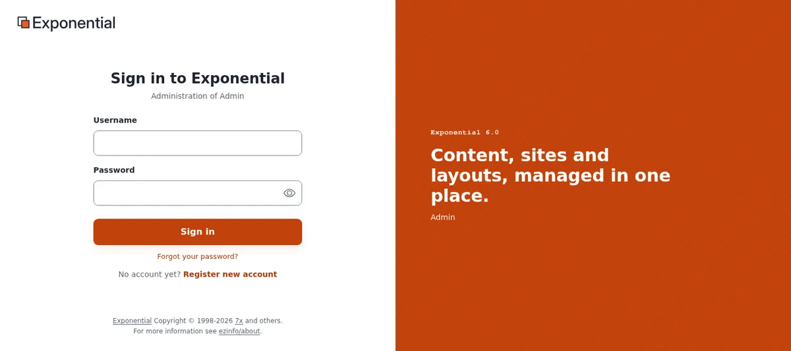
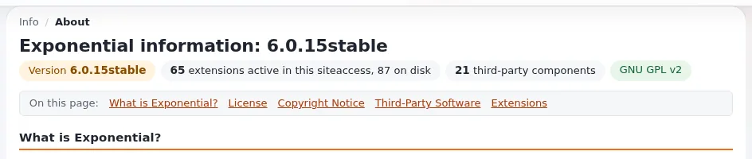
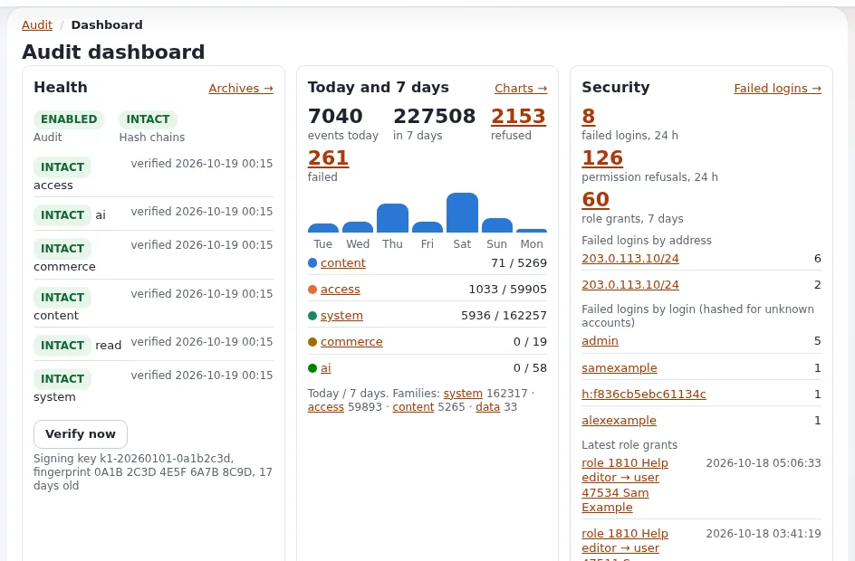

# Security hardening

This page is for administrators and developers who run an Exponential site that can be reached from the internet. It
looks at the site the way an attacker does: which doors exist, what is tried against them every day, and which of
them Exponential 6 already keeps shut. For each threat it names the defense that is built in and the settings or
commands that close what is left.

It complements, and does not repeat, [chapter 13 of the installation guide, Security hardening for
production](../install/13-security-hardening.md), which is the setting-by-setting reference and the go-live checklist.
Where both cover a topic, this page says why and links to the section of chapter 13 that says how.

> **Note:** This page describes defenses only. To report a vulnerability, write to **security@se7enx.com**, not to
> the public issue tracker ([Reporting a vulnerability](#reporting-a-vulnerability)).

## Contents

1. [Principles: secure by default](#principles-secure-by-default)
2. [Who attacks a CMS, and how](#who-attacks-a-cms-and-how)
3. [The threats, one by one](#the-threats-one-by-one)
4. [A shield in front: request-shield](#a-shield-in-front-request-shield)
5. [Watching: logs, the request classifier and the audit trail](#watching-logs-the-request-classifier-and-the-audit-trail)
6. [Checklist](#checklist)
7. [Reporting a vulnerability](#reporting-a-vulnerability)

## Principles: secure by default

The OpenBSD project's way of working is a good yardstick for any server software: a fresh installation is safe without
extra work, every part has only the rights it needs, and every change is audited. Exponential 6 follows the same
principles; your part is to keep them in force.

| Principle | What it means here | Built in | Your part |
|---|---|---|---|
| **Secure by default** | a new installation is safe before anyone tunes it | strict rewrite rules, security headers, `HttpOnly`/`SameSite` cookies, debug off, form tokens, bcrypt hashes, generated administrator passwords, the setup wizard closed on an installed site | do not loosen a default to "make something work"; find the cause |
| **Least privilege** | every account and process can do only its job | roles and policies, the Anonymous role without `user/login` to the administration, CLI scripts refuse to run as root without `--allow-root-user`, Velocity workers never root | editors get editor roles, one personal account per person, `admin` retired ([Account hygiene](change-the-admin-password.md#account-hygiene)) |
| **Privilege separation** | the parts that face the internet cannot change the parts that run code | PHP below the document root is never served, uploads are never executed, `ManagedByDeployment` keeps the administration from writing code and settings | code owned by another user than the web server, read-only to it; the administration on its own host |
| **Minimal attack surface** | what is not needed is not reachable | only a fixed list of asset paths is served as files, the admin modules need a sign-in, the shield and the request rules can refuse whole URL families | switch off extensions and siteaccesses you do not use; restrict the administration by network |
| **Audit** | every change can be traced, and tampering shows | the audit trail with hash chains, `security.log`, `auth.log`, the CSP report log, the log viewer | read them, alert on them, forward them off the machine |
| **Fix forward, publicly** | a published release is never changed; fixes come as the next release | releases are immutable tags; `share/filelist.md5` lets you check every file | follow the releases, update, check file consistency |

## Who attacks a CMS, and how

Almost all attacks on a site like yours are automated and not personal. The groups behind them reuse the same few
techniques on millions of sites:

- **Botnets and scanners** probe every address for known files and products (`/wp-login.php`, `/.env`, `/.git/config`,
  `/backup.zip`, `phpinfo.php`), injection strings in every parameter, and old vulnerabilities by version.
- **Credential attackers** try leaked username and password pairs from other breaches (credential stuffing), default
  passwords (`admin` / `publish` for this software), and slow password guessing spread over many addresses.
- **Access brokers** turn one working sign-in or one uploaded script into persistent access and sell it on;
  ransomware and data theft follow. A forgotten administrator account or an old extension is enough.
- **Scrapers and AI crawlers** count through every URL, `content/view/full/<number>` included, and fill caches.
- **Supply-chain attackers** aim at dependencies, build pipelines and update channels rather than at your site.

Defending well means making all of these cheap to refuse and expensive to succeed, and noticing when one gets through.

## The threats, one by one

### Brute force and credential stuffing on the sign-in

**The risk.** `/user/login` and `/admin/user/login` are the most attacked URLs of any site. Leaked passwords from other
services work wherever people reuse them.

**Built in.** Passwords are stored as bcrypt hashes (`HashType=php_default`). The sign-in costs the same for an unknown
login as for a wrong password, and **Forgot your password?** answers the same for every address, so neither reveals
which accounts exist. The audit trail's alert rules `brute_force` (20 failures from one network in 5 minutes) and
`brute_force_user` (10 for one account in 15 minutes) report attacks. Two-step sign-in (`sevenx_authentication_2fa`)
makes a stolen password useless on its own. Every form that sets a password refuses well-known and common ones
(`WeakPasswordCheck`, the list attackers try first), and a **Forgot your password?** link works once and for one hour
(`ForgotPasswordKeyLifetime`).

**Harden.**

- Turn on two-step sign-in and require it at least for administrators
  ([Two-step sign-in](../guides/two-factor-login.md), `[General] Enforce2FA=enabled`).
- A password policy: `MinPasswordLength=15`, `ForbidLogin`, `ForbidCurrentPassword`
  ([13.6](../install/13-security-hardening.md#136-passwords-and-sign-in)).
- Optionally lock accounts after failed attempts (`[UserSettings] MaxNumberOfFailedLogin=10`) with your own network in
  `TrustedIPList[]`; weigh that a lockout also lets anyone lock a known account.
- Restrict the administration to your network or a VPN, or put a browser check in front of its sign-in with
  [request-shield](#a-shield-in-front-request-shield). Behind a proxy, configure `TrustedProxies[]` first, or every
  visitor has the proxy's address ([13.10](../install/13-security-hardening.md#1310-behind-a-proxy-trusted-headers)).

### Default and shared credentials

**The risk.** The login `admin` exists on every installation, and `publish` is the default password printed in every
old guide. Shared accounts hide who did what.

**Built in.** No installer of Exponential 6 leaves `publish` in place: the kickstarter and `exp:install` replace an
empty, short or well-known password with a random one, and the setup wizard refuses a short or well-known one
([The default administrator password](default-administrator-password.md)).

**Harden.** Change the administrator password after installing, delete `var/log/initial-admin-password`, create a
personal administrator account per person, and retire `admin` as a sign-in
([Account hygiene](change-the-admin-password.md#account-hygiene)). Check for an old seed password on migrated sites:
`./console exp:resetuserpassword --allow-root-user -u admin -g -l 24` sets a new one.

**Demo mode.** A public demo that publishes its administrator password runs with the environment variable
`EXP_DEMO_MODE=1`: the installers accept the published password and nobody can change or reset an administrator
password. On a real site that would be a known password nobody can change. It cannot come from a setting or a
request, the administration shows a banner while it is on, and every process logs it; check that no process of a
production site has the variable ([Demo mode](demo-mode.md)).

### An exposed setup wizard or installer files

**The risk.** A setup wizard reachable on a live site lets anyone reinstall it with their own administrator. Installer
files (`kickstart.ini`, a generated password file) contain passwords.

**Built in.** On an installed site `setup/init` only shows "This site is already installed" and writes nothing
(`expSetupWizardGuard`; installed means `var/site_installed.json` exists, the site is served normally, or the database
holds content). `[SetupSettings] AllowWizardOnInstalledSite` (default `disabled`, development only) is the one way
around it, and even then a confirmation with a one-time token is required. The installer writes
`[SiteAccessSettings] CheckValidity=false`. With `[ConfigurationSettings] ManagedByDeployment=enabled` the
administration cannot run the wizard, edit settings or templates, activate extensions or install packages at all
([Configuration managed by the deployment](../features/6.0/managed-by-deployment.md)).

**Harden.** Keep `CheckValidity=false` and `AllowWizardOnInstalledSite=disabled`. Remove `kickstart.ini` and
`var/log/initial-admin-password` after installing. Turn on `ManagedByDeployment` on production administration
siteaccesses when settings and templates come from version control.

### File upload abuse

**The risk.** An uploaded file that the server later runs (a PHP script disguised as an image), a file that runs
script in the browser (SVG, HTML), or a huge or malformed file that exhausts the server.

**Built in.**

- Nothing below the document root is executed: the rewrite rules return 404 for every `.php`, `.phtml` and `.phar`
  below the root, and serve only image files from the storage directories; other uploads are delivered only through
  `content/download`, which checks the reader's permissions ([13.2](../install/13-security-hardening.md#132-what-the-web-server-must-never-hand-out)).
- Images are accepted by what the file contains, not by its name: `expImageUploadValidator` reads the type with
  PHP's fileinfo and compares it with `image.ini [ImageUploadSettings] AllowedMIMETypes[]`.
- SVG files are never stored as uploaded: `expSvgSanitizer` keeps only what is known to be safe, and the stored file
  is served with headers that stop it from running anything ([SVG images](../bc/6.0/svg-images.md)).
- Package uploads need the `package` policies, and `ManagedByDeployment` blocks them.

**Harden.** Keep the rewrite rules current after every upgrade (`.htaccess_root`, or the derived nginx block). Give
upload rights only to the roles that need them. Keep `TemporaryDir` private to the site
([13.11](../install/13-security-hardening.md#1311-file-permissions-and-ownership)).

### Path traversal and access to internal files

**The risk.** `../` sequences or encoded variants that make the application read a file outside its directory, and
direct requests for `.git`, `settings/`, `var/`, `vendor/`, `composer.json` or the SQLite database.

**Built in.** Only a fixed list of asset paths is served as files; everything else goes to `index.php`, so
`/settings/site.ini` is an Exponential page or a 404, never the file. Dot files and directories return 404.
Velocity refuses symbolic links that lead out of the document root (`FollowSymlinks=disabled`). The request
classifier writes every traversal attempt to `security.log` (rule set `traversal`).

**Harden.** Never serve the installation with a generic "serve the file if it exists" configuration. Run the check of
[13.2](../install/13-security-hardening.md#132-what-the-web-server-must-never-hand-out) from outside after every
change of the web server's configuration.

### Cross-site scripting (XSS) and the Content Security Policy

**The risk.** A value that reaches a page unescaped runs script in an editor's or administrator's browser, with their
session.

**Built in.** Templates escape with `|wash`; the rich text is stored as XML and rendered through templates; uploaded
SVG is sanitized. A Content Security Policy is sent from `site.ini [ContentSecurityPolicy]`: `script-src 'self'` with
a per-request nonce, no inline scripts. The Admin 4, Admin 4 L and AdminUI administrations are written to run under an
enforced policy. Violations are reported to `var/log/csp.log` and shown under **CSP reports** (`csp/report`).

**Harden.** As shipped, `Mode=auto` is report-only on administration siteaccesses and off on the sites. Read the
reports, then set `Mode=enforce` on the administration siteaccess; the classic design stays report-only through
`ReportOnlyDesigns[]`. Do the same for the public siteaccesses once your designs and extensions report nothing
([Content Security Policy](../features/6.0/content-security-policy.md)). Developers: escape every output, never build
HTML from request data in PHP, and put scripts in files.

### Cross-site request forgery (CSRF)

**The risk.** Another site makes a signed-in editor's browser send a form: publish, delete, change a role.

**Built in.** The `ezformtoken` extension adds a per-session token to every form and checks it on every POST; a
refused token gets the "form expired" page. Session cookies are `SameSite=Lax`.

**Harden.** Keep `ezformtoken` in `ActiveExtensions[]`; custom AJAX code sends the token too
([13.8](../install/13-security-hardening.md#138-form-tokens-against-cross-site-request-forgery)).

### SQL injection through custom code

**The risk.** The kernel's queries are parameterized or escaped; the risk is in extensions and site code that build SQL
from request data.

**Built in.** The kernel's own patterns were reviewed and fixed in the 6.0.13 hardening; extensions generated by the
RAD wizards produce safe code since their fix; the request classifier logs injection patterns in URLs (rule set
`injection`), and request-shield's `@attacks` rules can refuse them before PHP runs.

**Harden (developers).** Use `eZPersistentObject` and the content API; when SQL is unavoidable, `$db->escapeString()`
for every string and `(int)` for every number; never pass request data to a shell without `escapeshellarg()`.
Regenerate extensions made by the RAD wizards before their fix
([6.0.13 hardening notes](../bc/6.0/hardening.md), [RAD tools: security](../bc/6.0/rad-security.md),
[Datatype and input hardening](../specifications/6.0/datatype-input-hardening.md)).

### Session hijacking

**The risk.** A stolen session cookie is as good as the password, and survives a password change on many systems.

**Built in.** Cookies are `HttpOnly` and `SameSite=Lax`, and `Secure` over HTTPS. The session id changes at sign-in.
A password change signs out every other session of the user, through the password stamp
(`[PasswordSettings] EndOtherSessions=enabled`). A disabled account's sessions end at their next request.

**Harden.** `CookieSecure=true` on an HTTPS-only site, a shorter `SessionTimeout`, a separate session cookie per
siteaccess (`SessionNameHandler=custom`), PHP's `session.use_strict_mode=1`
([13.7](../install/13-security-hardening.md#137-sessions-and-cookies)). After a suspected compromise: change the
password, and remove all sessions (**Setup** > **Sessions**, with the database session handler).

### Open redirects and phishing through your domain

**Built in.** Every redirect target that comes from outside the code (a form field, the session, a URL parameter),
including those of the sign-in and of two-step sign-in, passes the [safe redirect rules](../features/6.0/safe-redirects.md)
(`eZRedirectManager`): a target on another host than the site's own, or `[SiteSettings] AllowedRedirectHosts`, is
refused, as are `javascript:` and `data:` targets and the usual encoding tricks.

**Harden.** Keep `AllowedRedirectHosts` to hosts you control.

### Outdated dependencies and the supply chain

**The risk.** A known vulnerability in an old release of the kernel, an extension, a Composer dependency, PHP or the
database; a tampered file on the server.

**Built in.** Releases are immutable tags on Packagist and GitHub, with changelogs. **Setup** > **Upgrade check**
compares every file with the release's `share/filelist.md5` ("Check file consistency") and the schema with the
release's ("Check database consistency").

**Harden.** Follow the releases of Exponential and of every extension; update a copy first; run `composer audit` to list
known vulnerabilities in the locked dependencies; keep `composer.lock` in version control; check file consistency after
every update; update PHP, the database server, the operating system and Velocity's engine as well
([13.15](../install/13-security-hardening.md#1315-keeping-up-to-date)). Review a third-party extension's code before
installing it.

### Debug output in production

**The risk.** Debug reports show SQL, file paths, template names and timings: a map for an attacker.

**Built in.** `[DebugSettings] DebugOutput=disabled`, template debug off, errors logged, not shown.

**Harden.** Keep it off; if you must debug live, limit it with `DebugByIP` to your own address and remove it again.
PHP itself: `display_errors=Off`, `expose_php=Off`
([13.4](../install/13-security-hardening.md#134-debug-output-and-error-display)).

### Cron and command-line scripts as root

**The risk.** A script run as root writes files the web server cannot change later, or that run with root's rights.

**Built in.** Exponential's command-line scripts refuse to run as the operating system's root user unless
`--allow-root-user` is given, and `resetuserpassword --allow-root-user` checks that you really are root.

**Harden.** Run `runcronjobs.php` and the console as the site's user from that user's crontab. Use root only for the
few documented tasks, and check afterwards that files in `var/` are still owned by the site's user and group.

### Velocity, PHP-FPM and user separation

**Built in.** Velocity's workers never run as root (`[ServerSettings] AllowRootWorkers=disabled`), its dashboard,
figures and `/Q/phpinfo` are local only unless you set a token, its control panel is local and password protected, and
its per-site configuration files are `0600`. PHP-FPM pools run as the site's user.

**Harden.** Bind Velocity to `127.0.0.1` when a proxy is in front; set `User` and `Group` to the site's user; keep the
code read-only for that user; list exactly your proxies in `Q.webserver.proxy.trusted`
([13.12](../install/13-security-hardening.md#1312-velocity-specific-hardening)).

### TLS and security headers

**Built in.** Five security headers on every page (`X-Content-Type-Options`, `X-Frame-Options`,
`Content-Security-Policy: frame-ancestors 'self'`, `Referrer-Policy`, `Permissions-Policy`); Velocity serves HTTPS with
automatic certificates and HSTS.

**Harden.** HTTPS on every name, HTTP redirected, HSTS raised once everything works, certificates watched
([13.9](../install/13-security-hardening.md#139-security-headers-and-https)).

### Backups and recovery

**The risk.** Ransomware, a failed update or a mistaken deletion; backups that hold secrets in clear text.

**Harden.** Back up the database, `var/storage` and `settings/override` (as secrets, encrypted), keep at least one copy
off the machine and offline, and restore one on a test machine regularly
([10.9 Backups and restore](../install/10-after-installing.md#109-backups-and-restore)). Keep the break-glass procedure
for the administrator next to the restore procedure.

## A shield in front: request-shield

[request-shield](https://request-shield.com) (source: [cjw-network/request-shield](https://github.com/cjw-network/request-shield),
MIT license) is a small web application firewall for PHP by the CJW Network. It looks at every request **before the
Exponential kernel starts**: real visitors pass in microseconds, scanners and broken requests are refused, floods are
slowed down, suspicious clients prove they are a browser with an invisible check, and the administration can be
limited to a network or put behind that check. Every decision names the rule that made it, and its rules are plain
text, one per line. It is recommended for every Exponential site that can be reached from the internet.

### How it complements the request classifier

| | Kernel request classifier | request-shield |
|---|---|---|
| What it does | **classifies** only: probes, traversal, injection, attack tools, bursts of 404s | **decides**: refuses, slows down, challenges, bans for a while, or only logs (monitor mode) |
| Where it runs | inside the kernel, after the request has started | before the kernel, so a refused request costs about 30 µs instead of a rendered page |
| Its log | `var/log/security.log` | its own log, and a live view under `/rs/` |
| Settings | `settings/requestclassifier.ini` | its rule files |

They use the same names where they overlap (the classifier's probe and injection rules follow request-shield's
`WP-*`, `SCAN-*` and `ATK-*` names in lower case), so a line in one can be found in the other. A request the shield
refuses never reaches the kernel, so it is not in `security.log`; in monitor mode the same probe can be in both logs.
Exponential's HTTP cache works with it: a request the shield marks `allow-uncached` (a made-up path or parameter) is
answered but never stored, so random addresses cannot fill the cache
([HTTP cache: With request-shield in front](../bc/6.0/httpcache.md#with-request-shield-in-front)).
Details: [Request logs: Request shield and the classifier](../features/6.0/request-logs.md#request-shield-and-the-classifier).

### Installing it

request-shield is **not** part of Exponential's `composer.json`; you add it to your installation. Two ways:

- **With Composer**: `composer require cjw-network/request-shield`.
- **Without Composer**: a checkout or release of the library in a directory **outside** the document root.

Then copy the Exponential example rules from the library's `examples/exponential/` directory to a directory the web
server never hands out (the library suggests `settings/request-shield/`), and choose the main file for your
administration:

| File | When |
|---|---|
| `exponential.rules` | the frontend rules; included by one of the two below, not loaded on its own |
| `exponential-admin-uri.rules` | the administration is the siteaccess `/admin` on the same host |
| `exponential-admin-host.rules` | the administration has a host of its own (`admin.example.org`) |

### Switching it on

The shield must run at the start of **every** request.

- **Apache or nginx with PHP-FPM**: `config.php` runs on every request, so the library's example, a
  `Shield::protectFile()` call at the top of `config.php`, works; so does PHP's `auto_prepend_file` pointing to the
  library's `bootstrap.php`.
- **Exponential Velocity**: `config.php` runs once per worker, not per request. Since 6.0.15, `index.php` runs the file
  that `config.php` names in the constant `EXP_REQUEST_PREPEND_FILE` at the start of every request; that file loads the
  library and calls `Shield::protectFile()`. `config.php-RECOMMENDED` shows the pattern (a guard that is true only
  inside a Velocity worker, and a file name that only `config.php` can set, never one the web server can write).
  Velocity answers pages from its own response cache before a worker starts, so the shield sees only what reaches a
  worker.

Then:

1. **Start in monitor mode.** The examples ship with `set mode monitor`: every decision is logged as it would be taken,
   and nobody is refused. Read the log (or the live view) for a few days while editors work.
2. Adapt the few site-specific lines: the URI siteaccesses that may come first (`EXP-MODULES`), the modules of your
   extensions that take forms (`EXP-POST`), the site's host names and load balancer (`host`, `trust`).
3. Check and test the rules after every change: `bin/request-shield check <main file>` names mistakes by file and
   line, `bin/request-shield test <main file>` runs the examples written next to every rule, and
   `bin/request-shield trace <main file> "GET https://www.example.org/..."` shows how one request would be decided.
4. Switch to `set mode enforce`. Keep `EXP-BAN` and `EXP-STRICT` watched (`monitor` in front) until their log lines are
   clean.
5. To switch it off, use `set mode off` rather than removing the include; under Velocity a persistent worker would
   otherwise keep the last request's marks.

### What the Exponential example rules do

- **System URLs in the frontend** (`EXP-SYSVIEW`): `/content/view/full/<node>` and similar numbered URLs answer 404 on
  the public site (the administration needs them); the sitemap and tag cloud stay reachable.
- **Admin modules in the frontend** (`EXP-MODULES`): `setup`, `class`, `role`, `workflow`, `package` and the other
  administration modules answer 404 on the public siteaccesses.
- **Internal files** (`EXP-INTERNAL`): `settings/`, `var/` and the like are refused, as a second line behind the web
  server's rules.
- **Forms, sign-in and search** (`EXP-POST`, `EXP-FORMS`, `EXP-LOGIN`): POST only where forms belong, the browser
  check before the sign-in, registration and password forms, a budget for searches.
- **The administration** (`EXP-ADMIN-*`): the browser check before the sign-in form, every parameter scanned for
  attacks, optionally only the office's network (`EXP-ADMIN-NET`).
- **The administration's background requests** (`EXP-ADMIN-BG`, on an admin host `EXP-AH-BG`): Admin 4 loads parts of
  its pages with a script, today the mega menu's panels (`/admin/user/megamenu/<tab>`). A background request cannot
  show the check page, so the shield answers it in a machine-readable way: with a valid pass it goes through; without
  one it gets the check as JSON (status 429, `Content-Type: application/json`), never an HTML page, and the page's
  script reloads the page to pass the check. The shield recognizes such requests by `Sec-Fetch-Dest: empty` or
  `X-Requested-With: XMLHttpRequest`, and the examples name the mega menu's path with `api-path` for clients that send
  neither. Add the paths of your own background calls to the same line.
- **Pace and bans** (`EXP-PACE`, `EXP-BAN`): past 120 pages a minute the browser check; ten refusals in ten minutes
  keep an address out for an hour. Verified search engines are never banned.

The shield does not see static files that the web server serves itself, and it cannot tell a right password from a
wrong one: locking accounts stays Exponential's job (`MaxNumberOfFailedLogin`, two-step sign-in). The full reasoning
for every rule is in the library's `docs/use-cases/exponential.md`.

## Watching: logs, the request classifier and the audit trail

Hardening without watching only delays the moment you learn of an attack.

| Source | What it records | Where to read it |
|---|---|---|
| `var/log/security.log` | the request classifier's verdicts: probes, traversal, injection, attack tools, 404 bursts | **Setup** > **Logs**, `./console exp:logs` |
| the audit trail | sign-ins and failures, password changes and resets, role and setting changes, content removed, commands run; hash-chained | **Audit**, `./console exp:audit tail`, `exp:audit verify` |
| `var/log/auth.log` | every step of two-step sign-in (never a code or a secret) | **Setup** > **Logs** |
| `var/log/csp.log` | Content Security Policy violations | **CSP reports** (`csp/report`) |
| `error.log`, the web server's logs | errors with a reference id | **Setup** > **Logs** ([Log viewer](../features/6.0/log-viewer.md)) |
| request-shield's log | its decisions | its live view under `/rs/` |

Do at least this:

1. Run the `frequent` cronjob group so the audit's alert rules run, and check who receives alert mail
   (`./console exp:audit alerts recipients`) ([13.14](../install/13-security-hardening.md#1314-the-audit-log)).
2. Forward the audit trail to a central log or SIEM with a sink (`[AuditSink_syslog]`, `[AuditSink_webhook]`), so a
   compromised machine cannot quietly rewrite its own history; run `exp:audit verify` regularly.
3. Look at the log viewer's error digest and `security.log` weekly; a sudden rise of one rule is worth a look.
4. Give `audit/read` and the log viewer only to administrators.

The request classifier only classifies: nothing is blocked because of a verdict. Blocking is the job of the shield in
front, of the web server, or of a listener you register in `requestclassifier.ini [ClassifierSettings] Listeners[]`
([Request logs](../features/6.0/request-logs.md)).

## Checklist

- [ ] Administrator password changed, `var/log/initial-admin-password` and `kickstart.ini` removed.
- [ ] A personal administrator account per person; `admin` retired as a sign-in; a tested break-glass procedure.
- [ ] Two-step sign-in required for administrators; password policy decided.
- [ ] Demo mode off: `EXP_DEMO_MODE` set for no process; no **Demo mode** banner in the administration.
- [ ] The administration on its own host, restricted by network, VPN or the shield's browser check.
- [ ] `CheckValidity=false`, `AllowWizardOnInstalledSite=disabled`; `ManagedByDeployment` where the configuration
      comes from version control.
- [ ] Rewrite rules current; the outside check of 13.2 returns no file.
- [ ] `ezformtoken` active; Content Security Policy enforced on the administration, then on the sites.
- [ ] Debug output off; PHP `display_errors=Off`.
- [ ] HTTPS everywhere, HSTS, `CookieSecure=true`.
- [ ] Code read-only for the site's user; workers and cronjobs never as root.
- [ ] request-shield in front, first in monitor mode, then enforced.
- [ ] Audit alerts going to a person, the trail forwarded off the machine; logs read weekly.
- [ ] Backups off the machine, restore tested; updates followed and tested; `composer audit` clean.

The setting-by-setting go-live checklist is [13.16](../install/13-security-hardening.md#1316-go-live-checklist).

## Reporting a vulnerability

Report security issues privately to **security@se7enx.com**, or as a private advisory on GitHub
(<https://github.com/se7enxweb/exponential/security/advisories/new>). Do not open a public issue. Include the version,
the PHP version, the engine that serves the site and the steps to reproduce; leave out passwords, secrets and personal
data. The policy and the supported versions are in
[SECURITY.md](https://github.com/se7enxweb/exponential/blob/main/SECURITY.md). The help's
[report page](when-something-goes-wrong.md) explains the other trackers.

## Related pages

- [Chapter 13: Security hardening for production](../install/13-security-hardening.md)
- [Security and audit: lock it down, see who did what](../guides/security-and-audit.md), the 30-minute walk-through
- [Change the administrator password](change-the-admin-password.md),
  [The default administrator password](default-administrator-password.md)
- [Security defaults of September 2026](../specifications/6.0/security-defaults-2026-09.md),
  [the August 2026 security patches](../specifications/6.0/security-hardening-2026-08.md)
- [Content Security Policy](../features/6.0/content-security-policy.md), [Request logs](../features/6.0/request-logs.md),
  [Log viewer](../features/6.0/log-viewer.md), [Audit](../bc/6.0/audit.md), [Maintenance mode](../guides/maintenance-mode.md)
- OWASP [Top Ten](https://owasp.org/projects/top-ten) and
  [Authentication Cheat Sheet](https://cheatsheetseries.owasp.org/cheatsheets/Authentication_Cheat_Sheet.html);
  NIST [SP 800-63B-4](https://pages.nist.gov/800-63-4/sp800-63b.html)

<!-- exp-partner-block:start -->
**Become an Exponential Partner.** Partners share their information, provide funding, contribute back and
develop the products with us, and that is how Exponential grows. A partner website and dashboard are planned for
mid-2027: please become a partner today to speed up our growth rate and land new features faster. Start with
[Partners: start here](partners/partners-start-here.md) and [How to apply](partners/how-to-apply.md).
<!-- exp-partner-block:end -->
