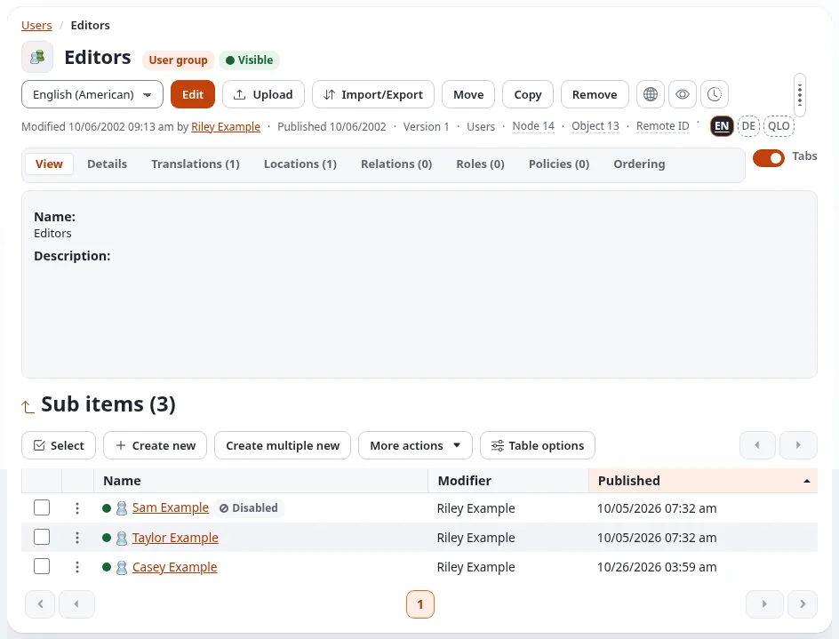
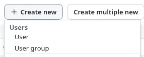
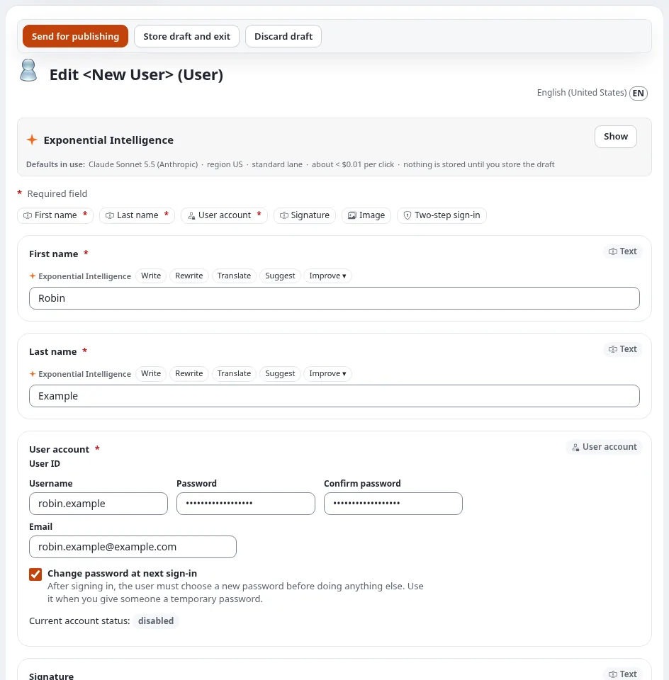
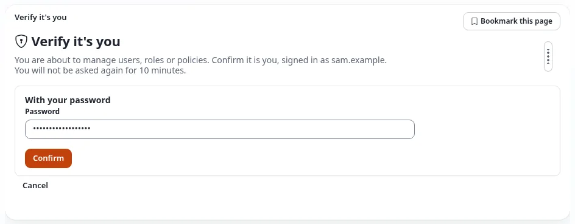
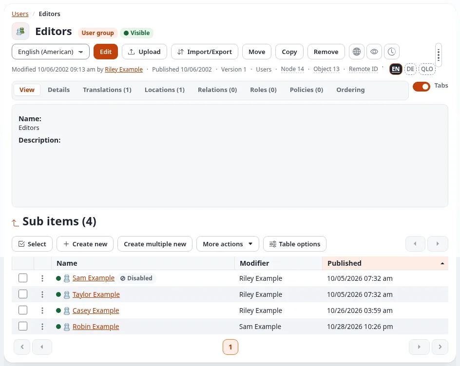
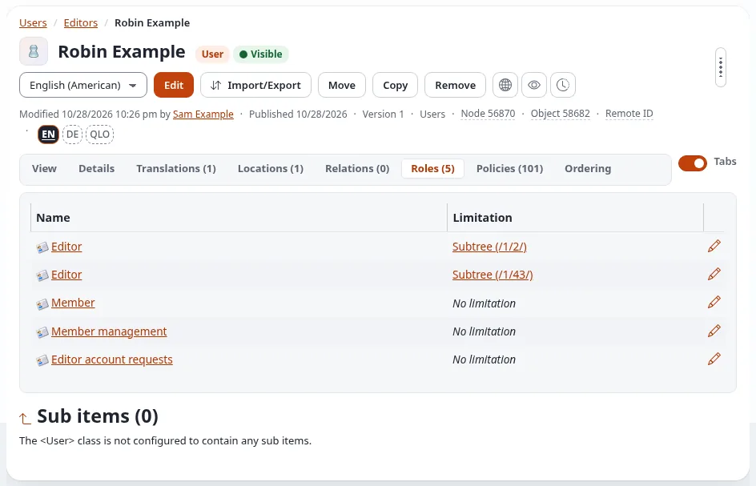
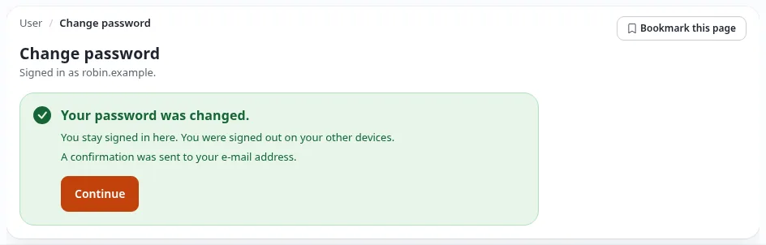
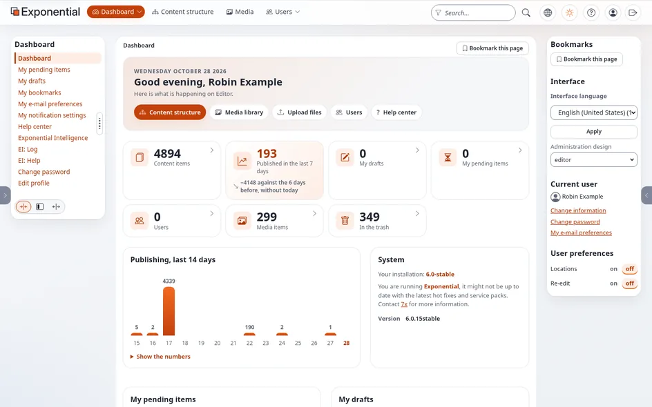
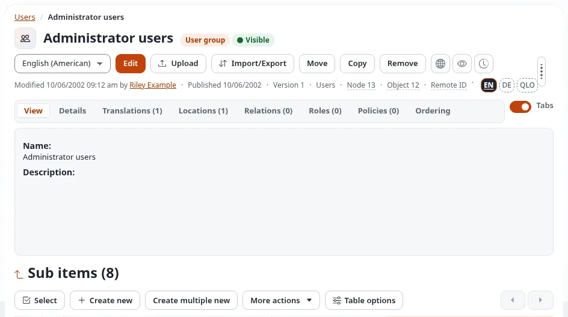

# Setting up accounts for editors and administrators

This page walks an administrator through giving a new person access: which kind of account they need, how to create
it, how to check that it works, and how to hand it over so that only the new person knows the password. Every step
has a screenshot of what you see.

The example uses the address `https://www.example.com/editor` for the Editor and `https://www.example.com/admin` for
the administration. Your installation may use other addresses, such as `https://edit.example.com`; see
[Logging into the Editor](logging-into-the-editor.md#the-address).

## Which account for whom

Where you create an account decides what the person may do: an account gets the roles of the user group it is in.

| Group (under **Users**) | For whom | What they get |
|---|---|---|
| **Editors** | People who write, edit and publish content | The roles of the Editors group: *Editor* (limited to the Content and Media trees), *Member*, *Member management* and *Editor account requests*. See [What the Editor role allows](what-the-editor-role-allows.md). |
| **Administrator users** | Only the system administrators, the developers and the owners of the site | The *Administrator* role: everything, including users, roles, settings and updates. |
| **Members** | The site's front-end members (people with an account on the public site) | The roles of the Members group. Editors manage these accounts; see [Managing members](managing-members.md). |

Give editors an account in **Editors**, never in Administrator users, even when they ask for "full access": an
administrator account can change every setting, every role and every other account, and the work of an editor needs
none of that. Create an administrator account only for a person who looks after the installation itself.

Every person gets their **own** account. Never share one account between several people: the version history, the
audit trail and the [user audit log](the-user-audit-log.md) can then tell who did what.

## Before you start

- You are an administrator and know your own password; you will be asked for it again (**Verify it's you**).
- You have the new person's first name, last name and e-mail address, and have agreed on a username (for example
  `robin.example`).
- You have a second way to reach the person other than e-mail: a phone call, a meeting, or a messenger. You use it to
  pass on the temporary password.

## 1. Sign in to the Editor

Open the address of the Editor, for example `https://www.example.com/editor`, and sign in with your administrator
account as described in [Logging into the Editor](logging-into-the-editor.md#sign-in). As an administrator you see
every tab there, including **Users**.

You can create the account in the administration (`https://www.example.com/admin`) in the same way; the Editor is
recommended because it is the interface the new editor will use, so you see what they will see.

## 2. Open the Editors group

1. Click **Users** in the top menu.
2. In the left column (**User accounts**), click **Editors**.

The group opens with its accounts under **Sub items**.

## 3. Create a new user

Under **Sub items**, press **Create new** and choose **User** in the group **Users**.

If the installation has more than one content language, a page **Language selection** asks first in which language
to create the object: choose the main language (usually English) and press **OK**.

## 4. Fill in the account

1. **First name** and **Last name**: the person's name, as it appears in the history and the lists.
2. Under **User account**:
   - **Username**: the name the person signs in with. It cannot be changed in the form later.
   - **Email**: the person's own work address. Each address can belong to one account only.
   - **Password** and **Confirm password**: a **temporary** password. It must meet the site's password rules (at
     least 10 characters, and not a well-known password). Use a password manager or a random generator, and use it
     for this account only.
   - **Change password at next sign-in**: leave it **ticked** (it is ticked for a new account). The person must then
     replace the temporary password with their own before they can do anything else.
3. Leave **Signature**, **Image** and **Two-step sign-in** as they are; the person can fill them in later.

*Current account status: disabled* under the account fields describes the draft: the account can sign in once it is
published.

## 5. Send for publishing, and verify it's you

Press **Send for publishing**. Because you are creating a user account, the site asks you to confirm that it is you:

Enter **your own** password (not the new person's) and press **Confirm**. The account is then published, and for the
next 10 minutes you are not asked again. With a passkey or an authenticator app, the page offers those instead. See
[Verify it's you](../guides/verify-its-you.md).

An administrator's new account in Editors is published at once. When an *editor* creates an account in Editors, it
waits for an administrator's approval first ([Approving new editor accounts](../guides/approving-new-editor-accounts.md)).

## 6. Check the account

Back in the Editors group, the new account is listed:

Click its name and open the **Roles** tab. An account in Editors has the roles of the group:

| Role | Limitation | What it is for |
|---|---|---|
| Editor | Subtree Content (`/1/2/`) | writing and publishing in the content tree |
| Editor | Subtree Media (`/1/43/`) | the media library |
| Member | none | the own account: password, profile, notifications |
| Member management | none (each policy is limited to Members) | managing the site's members |
| Editor account requests | none | asking for a new editor account, which an administrator approves |

If a role is missing, the account is in the wrong group; move it ([How do I move a user to another
group?](manual/how-do-i-move-a-user-to-another-group.md)). The **Policies** tab lists every single permission the
account has from all its roles.

## 7. Sign out, and sign in as the new user

Check that the username and the temporary password work before you pass them on:

1. Press the last button of the header, **Logout**.
2. On the sign-in page of the Editor, enter the new **Username** and the **temporary password** and press **Sign in**.

The site does not open the dashboard: because the account is marked, it shows **Change password** with the note that
an administrator asked for a new password.

This page proves that the account exists, is enabled and accepts the password. **Do not change the password here**:
that is for the new editor to do. Press **Logout** in the header (it works on this page too) and you are done
checking.

If the sign-in fails instead, see [When something goes wrong](#when-something-goes-wrong) below.

## 8. Hand over the sign-in

Send the new editor the **address** of the Editor and their **username**, for example by e-mail:

> Your account for the Editor of our website: https://www.example.com/editor, username `robin.example`. I will give
> you a temporary password by phone. At your first sign-in you choose your own password.

Pass on the **temporary password** by the second channel: a phone call, in person, or a messenger that is not your
e-mail. Never put the address, the username and the password into one message: whoever reads that message could
sign in.

Ask the person to sign in soon. Until they have, the temporary password is known to two people.

## 9. The editor's first sign-in

The new editor does the following (you can send them this section):

1. Open the address, enter the username and the temporary password, and press **Sign in**.
2. The page **Change password** opens (as in step 7). Enter the temporary password under **Current password**, then
   a new password under **New password** and again under **Confirm new password**. **Generate a strong password**
   makes one; **Show** shows what you typed. The checklist turns green when the password meets the rules.
3. Press **Change password**.
4. The site asks **Verify it's you** once more, "You are about to change how you sign in or the security of your
   account": enter the **temporary** password (the one you are replacing) and press **Confirm**.
5. The page confirms the change:

6. Press **Continue**. The dashboard of the Editor opens, greeting the editor by name:

From now on only the editor knows the password; the temporary one no longer works, and a mail confirms the change
to the account's address. Recommend that they turn on **two-step sign-in** right away
([Your account and signing in](accounts-and-sign-in.md#two-step-sign-in)).

## Creating further editors

Repeat steps 2 to 9 for each person. Some installations prefer that editors ask for a new colleague's account
themselves: an editor creates it in Editors, and it waits until an administrator approves it
([Approving new editor accounts](../guides/approving-new-editor-accounts.md)).

## Creating further administrators

Only the system administrators, the developers and the owners of the site get an administrator account. To create
one:

1. Sign in to the **administration** (`https://www.example.com/admin`), click **Users** and open
   **Administrator users**.

   

2. Continue as in steps 3 to 9: **Create new** > **User**, fill in the account with a temporary password and the
   box *Change password at next sign-in* ticked, **Send for publishing**, confirm with your own password, check the
   **Roles** tab (it shows *Administrator*), sign in once as the new user, and hand over the sign-in by two channels.

For administrators also:

- Ask them to turn on two-step sign-in at once. A site can require it for administrators
  ([Two-step sign-in](../guides/two-factor-login.md)).
- Keep the number of administrators small, and never make an editor an administrator to solve a missing permission:
  give their group the permission instead ([Roles and policies](../guides/roles-and-policies.md)).
- Granting the Administrator role is recorded in the audit trail
  ([Security and audit](../guides/security-and-audit.md)).

## When someone leaves

Disable the account the same day ([How do I disable or unlock a user account?](manual/how-do-i-disable-or-unlock-a-user-account.md)).
Disabling keeps the name in the history of everything the person did; remove the account only when nothing refers to
it any more. The [user audit log](the-user-audit-log.md) shows what happened to the account and what it did.

## When something goes wrong

| What you see | What to do |
|---|---|
| *The username already exists, please choose another one.* or *A user with this email already exists.* | Each username and each e-mail address belongs to one account. Choose another username; for the address, check whether the person has an account already (as a member, for example) and move that one instead. |
| The form shows an error under **Password** | The password does not meet the rules (too short, or a well-known password). Use a longer random one. |
| *Verify it's you* refuses your password | Enter **your own** password, not the new person's. After several wrong tries you are signed out. |
| The new user cannot sign in: *The system could not log you in.* | Check the username and the temporary password (letters are case-sensitive). Open the account: under **User account** the *Account status* must be *enabled*; **Configure user account settings** enables it. Too many wrong passwords lock an account; see [How do I disable or unlock a user account?](manual/how-do-i-disable-or-unlock-a-user-account.md). |
| The new user goes straight to the dashboard, without changing the password | The box *Change password at next sign-in* was not ticked. Edit the account, tick it, and publish; the next sign-in asks for a new password. |
| The new user sees *Access denied* or misses a tab | The account is in the wrong group, or the group lacks a role. Check the **Roles** tab (step 6). |
| You do not see **User** under **Create new** | Your account may not create users here: you are not an administrator. Ask one, or ask for the account as described in [Approving new editor accounts](../guides/approving-new-editor-accounts.md). |

**Data protection:** an account holds personal data (name, e-mail address). Store only what the work needs, keep the
temporary password out of e-mail, and disable the account when the person leaves.

## Related pages

- [What the Editor role allows](what-the-editor-role-allows.md)
- [Managing members](managing-members.md), for editors
- [The user audit log](the-user-audit-log.md)
- [Logging into the Editor](logging-into-the-editor.md) and [Logging into the admin](logging-into-the-admin.md)
- [Your account and signing in](accounts-and-sign-in.md)
- [How do I add a user or a user group?](manual/how-do-i-add-a-user-or-a-user-group.md)
- [Administrator accounts and access](customers/healthy/admin-accounts-and-access.md)
- [Change password at next sign-in](../features/6.0/password-change-at-next-sign-in.md), the technical description
- [Free documentation](free-documentation.md): this page is free to copy, translate and improve under the GNU FDL 1.3.

<!-- exp-partner-block:start -->
**Become an Exponential Partner.** Partners share their information, provide funding, contribute back and
develop the products with us, and that is how Exponential grows. A partner website and dashboard are planned for
mid-2027: please become a partner today to speed up our growth rate and land new features faster. Start with
[Partners: start here](partners/partners-start-here.md) and [How to apply](partners/how-to-apply.md).
<!-- exp-partner-block:end -->
