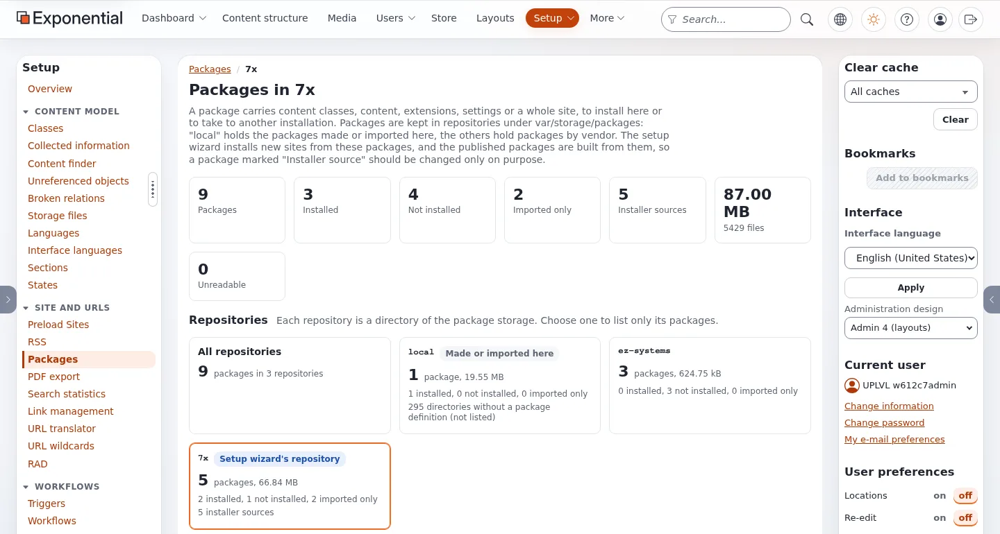

# The package list and package page

This page is for administrators who want to see which packages an installation holds and what they carry. After an
install, the site package and everything it required are here, in the repository of their vendor (`7x` for the 7x
packages). Looking changes nothing; only the buttons do.

## Contents

1. [Open the list](#open-the-list)
2. [The overview and the repositories](#the-overview-and-the-repositories)
3. [Find packages](#find-packages)
4. [The cards](#the-cards)
5. [Installer sources](#installer-sources)
6. [A package's page](#a-packages-page)
7. [Removing packages](#removing-packages)

## Open the list

**Setup > Packages** opens `/package/list`: every repository at once. `/package/list/<repository>` shows one, for
example `/package/list/7x`. You need `package/list`; the buttons need their own policies
([Permissions for packages](permissions-for-packages.md)).

## The overview and the repositories

The figures at the top count packages, installed, not installed, imported only, installer sources, size, files and
unreadable directories. Below them, one tile per repository (a directory of `var/storage/packages/`): `local` for
packages created or uploaded without a vendor, `7x` for the setup wizard's own repository
(`package.ini [RepositorySettings] Vendor`), and one per other vendor. The setup wizard's repository is marked.

A directory without `package.xml` is counted ("directories without a package definition (not listed)"), not listed: a
leftover of an export or a wizard that ended early. A directory whose `package.xml` cannot be read is named in a
warning with the reason, for example "package.xml names another package than its directory".

## Find packages

| Control | Searches or filters |
|---|---|
| Search | "Name, summary, type, vendor, version, maintainer or a required package." |
| Repository | one repository or all |
| Type | `site`, `contentclass`, `contentobject`, `sitestyle`, `extension`, ... as found |
| State | Installed, Not installed, Imported only, No install items, Installer sources |
| Sort | name, last change, size, version, type, repository, install state; **Reverse** |

**Apply** turns the choice into the address, for example `/package/list/7x/(search)/demo/(type)/contentobject`, so
it can be bookmarked. **Clear** resets it. The page size is chosen with **Per page**.

## The cards

Each package is a card: name and version, type, install state, summary, repository and vendor, maintainers, the
packages it **Requires** (a missing one is marked) and those it is **Required by**, size and files, last change and
when it was packaged. **View** opens its page, **Download** its `.ezpkg`, **JSON** the same package in the JSON format.

What the install state means for site packages:

| State | Means | Typical package |
|---|---|---|
| Imported only | `install_type="import"`: nothing to install from here | a site package such as `sevenx_multisite` (its work is done by the installer at setup time) |
| Installed | its install items ran on this site | `sevenx_classes`, `sevenx_multisite_democontent` after a setup |
| Not installed | it has install items that did not run here | a package you uploaded or fetched |
| No install items | `install_type="install"` but an empty `<install>` | |

The rules are in `eZPackageCatalog::card()` (`kernel/classes/ezpackagecatalog.php`).

## Installer sources

A package is marked **Installer source** when it is in the setup wizard's repository, when it is a site package ("A
site package the setup wizard offers"), or when another installer source requires it. The card has a marked edge and
the package's page says why. These are the packages new installations and published packages are built from, which is
why removing one needs an extra confirmation.

## A package's page

`/package/view/full/<name>` (add `/<repository>` outside `local`).

The page shows:

- **Actions**: Compare, Install or Reinstall, Download, Download as JSON, Uninstall, Remove, Validate; each only when
  your role allows it and the package can do it.
- **Details**: repository and vendor, state, license, maintainers, documents, released and packaged, the Exponential
  version it was made for, Requires and Required by, size, last change, description.
- **What it carries**: content classes, content (install items and object files), extensions, settings files (for a
  site package: its installer files), other install items, files by kind.
- **Changelog** and **Package contents**: every file, filterable, viewable ("Only the first megabyte is shown here;
  Download gives the whole file.") and downloadable.

**Compare** shows the package's content next to the site's ("Nothing here changes the site"); see
[Look inside a package, compare it with your site, import single items](../../../features/6.0/package-compare-and-import.md).
**Validate** checks "every document of the package and, in the JSON format, the schema and the checksums".

## Removing packages

1. Tick packages on the list and press **Remove selected** (or **Remove** on a package's page).
2. The confirmation lists **What goes**: per package its directory, size and files, whether it is installed, which
   packages require it, and whether it is an installer source.
3. With installer sources among them, tick "I understand that ... installer source(s) will be deleted, and that new
   installations and published packages depend on them."
4. Press **Remove n package(s)**.

The directory is deleted. An installed package's content stays: "the site will no longer know which package it came
from, and it cannot be uninstalled from here afterwards." Download a copy first if you may need it.

## Related pages

- [Packages in the administration](README.md)
- [Packages, sections 2 to 4 and 9](../../../guides/packages.md#2-the-package-list)
- [The local package repository](../basics/the-local-package-repository.md)
- [Import versus install](../basics/import-versus-install.md)
- [Installing and uninstalling](installing-and-uninstalling.md)
- [Site packages: start here](../README.md)
- [Free documentation](../../free-documentation.md): this page is free to copy, translate and improve under the GNU FDL 1.3.

<!-- exp-partner-block:start -->
**Become an Exponential Partner.** Partners share their information, provide funding, contribute back and
develop the products with us, and that is how Exponential grows. A partner website and dashboard are planned for
mid-2027: please become a partner today to speed up our growth rate and land new features faster. Start with
[Partners: start here](../../partners/partners-start-here.md) and [How to apply](../../partners/how-to-apply.md).
<!-- exp-partner-block:end -->
