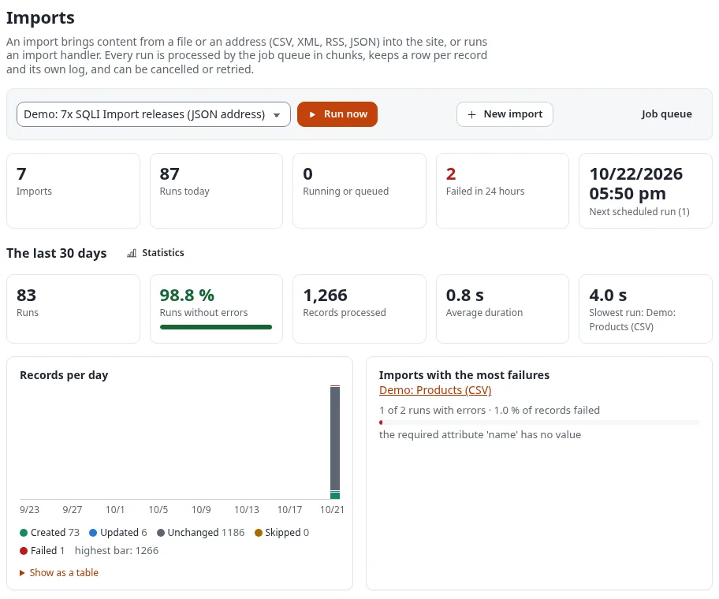

# 7x SQLI Import: start here

**7x SQLI Import** (the extension `se7enxweb/sqliimport`) brings data from outside into Exponential: a CSV export of
an ERP, a spreadsheet, an XML file, an RSS or Atom feed, a JSON answer of a REST API, a WordPress export, a table of
another database. Each record becomes a content item, or a row of a data table. An import runs once, for a
migration, or on a schedule, for a nightly sync. Release 2.0 is the successor of SQLI Import 1.x and keeps every 1.x
handler working.

## Contents

1. [Who it is for](#who-it-is-for)
2. [What it does](#what-it-does)
3. [What 2.0 contains](#what-20-contains)
4. [The pages of this section](#the-pages-of-this-section)
5. [The extension manual](#the-extension-manual)
6. [Related pages](#related-pages)

## Who it is for

- **Administrators** create imports in the import editor, try them with a dry run, start runs, follow them in the
  **Imports** tab and undo a run that went wrong.
- **Integrators** plan imports from other systems, let those systems start an import with a webhook, and choose
  between a no-code mapping and a handler.
- **Developers** write handlers, sources and transforms in PHP.

You do not need to program to use it: a typical import is a file, a mapping filled by **Auto-match by name**, a
dry run and **Save and run**.

## What it does

- **Reads many formats**, grouped in the **Catalogue**: Data (CSV, TSV, spreadsheets XLSX and ODS, JSON, NDJSON,
  XML, YAML, TOML, Avro, Arrow, Google Sheets, REST APIs with paging, sitemaps, web pages), NoSQL databases
  (MongoDB, Elasticsearch or OpenSearch, Redis, DuckDB and others), Content (RSS and Atom feeds, OPML, Markdown,
  iCalendar, vCard, WordPress exports), Platforms (SQL databases, another Exponential site, Drupal, Joomla,
  Airtable, Notion, Salesforce, HubSpot, files of Export and CIE), Commerce (Shopify, WooCommerce, Google Merchant)
  and Media (media files, YouTube). A source is an uploaded file, an `http(s)` address read at every run, a file in
  an allowed directory on the server, or a database connection.
- **Maps without code.** The **import editor** takes you through six steps: source, processing, mapping, preview,
  schedule and review. Source fields fill the attributes of a content class, with transforms such as `trim`,
  `date`, `number`, `richtext`, `image` and `lookup`.
- **Shows before it publishes.** The preview and a **Dry run** say for each record what would be created, updated,
  left unchanged or fail, with the old and the new value of every changed field.
- **Runs safely.** Every run goes to the job queue (expqueue) in chunks, and its page follows it live. A run can be
  cancelled, its failed records retried, and the whole run **undone** within 30 days. A **conflict rule** decides
  what happens to an item an editor changed since the last run. A new version is published only when a field
  changed.
- **Starts by itself** on a schedule, in a time zone, or when another system calls the import's **webhook** with a
  signature or an API key.
- **Tells you** with a notice on the dashboard, a bell in the header of the administration and, if you want, an
  e-mail.
- **Fills data tables**: an import can write rows of a module's table instead of content, and offers **New data
  table from its fields** to make such a table with the kernel's module table wizard.
- **Works with the other tools**: files of Export (xrowextract) and CIE import back with the columns mapped, and
  every run is listed in the run history of all import and export tools.

## What 2.0 contains

The engine, the command line `./console ext:sqliimport:*` and the **Imports** tab with:

- the dashboard (key figures, the last 30 days, the imports with **Run now**, **Dry run**, **Edit** and **More**,
  the runs) and a block **Imports** on the admin dashboard;
- the **import editor** (`sqliimport/edit`), six steps;
- a **live page per run** with **Cancel**, **Retry failed rows**, **Undo this run** and **Download results (CSV)**;
- the pages **Schedules**, **Statistics**, **Catalogue** (the formats by group, with an example file each, handlers,
  transforms, and the group **Data tables**) and **Settings** (export and import of import definitions as JSON).

Two policies control access: **Manage imports** (`sqliimport/manage`) and **Run imports** (`sqliimport/run`), both
with a handler limitation. Roles made for 1.x keep working.

Requirements: PHP 8.0 or later, Exponential 6.0.14 or later (6.0.15 for the bell, the data tables and the transfer
registry), and the extensions expqueue and expui. Spreadsheet sources need the PHP extension zip.

## The pages of this section

| Page | What it answers |
|---|---|
| [Getting started](getting-started.md) | Installing, the cron parts, the Imports tab, the two policies, a first import from a CSV file with a dry run |
| [The import editor](the-import-editor.md) | The six steps with a worked example, Auto-match, transforms, conflict rules, undo days, notifications |
| [Imports and runs](imports-and-runs.md) | The dashboard, the live run page, cancel, retry, undo, the results as CSV, the bell, statistics |
| [Schedules and cron](schedules-and-cron.md) | Schedule kinds, time zones, the Schedules page, the cron parts, starting an import from another system |
| [Upgrading from 1.x](upgrading-from-1x.md) | Installing 2.0 over 1.x and migrating handlers, schedules, history and roles |

Other help pages that use it: [Which import or export tool do I need?](../import-export-tools.md) and
[Data tables](../../features/6.0/data-tables.md#importing-rows-with-7x-sqli-import).

## The extension manual

These help pages cover the daily work. The extension's own manual has every detail and a worked example for each
format. It is shown in the help under **Extensions** when the extension is active; open a page by its help address:

| Topic | Help address |
|---|---|
| The manual's start page | `/exphelp/viewer/ext/sqliimport/index.md` |
| Getting started, step by step | `/exphelp/viewer/ext/sqliimport/getting-started.md` |
| The import editor | `/exphelp/viewer/ext/sqliimport/editor.md` |
| Mappings and transforms | `/exphelp/viewer/ext/sqliimport/mappings.md`, `/exphelp/viewer/ext/sqliimport/transforms.md` |
| Every source and its options | `/exphelp/viewer/ext/sqliimport/sources.md` |
| Worked examples by kind of source | `/exphelp/viewer/ext/sqliimport/source-examples-files.md`, `source-examples-feeds-web.md`, `source-examples-apis.md`, `source-examples-databases.md`, `source-examples-platforms.md` (same folder) |
| Runs, undo and notifications | `/exphelp/viewer/ext/sqliimport/runs.md` |
| Schedules | `/exphelp/viewer/ext/sqliimport/schedules.md` |
| Webhook and API trigger | `/exphelp/viewer/ext/sqliimport/triggers.md` |
| REST and fetch functions | `/exphelp/viewer/ext/sqliimport/rest-and-fetch.md` |
| Statistics | `/exphelp/viewer/ext/sqliimport/statistics.md` |
| Data tables | `/exphelp/viewer/ext/sqliimport/datatables.md` |
| The other import and export tools | `/exphelp/viewer/ext/sqliimport/transfer.md` |
| Handlers in PHP | `/exphelp/viewer/ext/sqliimport/handlers.md` |
| Upgrading from 1.x | `/exphelp/viewer/ext/sqliimport/migration-1x.md` |
| Troubleshooting | `/exphelp/viewer/ext/sqliimport/troubleshooting.md` |

The German manual has the same pages under `/exphelp/viewer/ext/sqliimport/ger-de/`.

## Related pages

- [Which import or export tool do I need?](../import-export-tools.md)
- [Idempotent imports keyed by remote_id](../integrators/idempotent-imports-keyed-by-remote-id.md)
- [Writing an import script](../integrators/writing-an-import-script.md)
- [Caching after imports](../integrators/caching-after-imports.md)
- [Cronjobs for integrations](../integrators/cronjobs-for-integrations.md)
