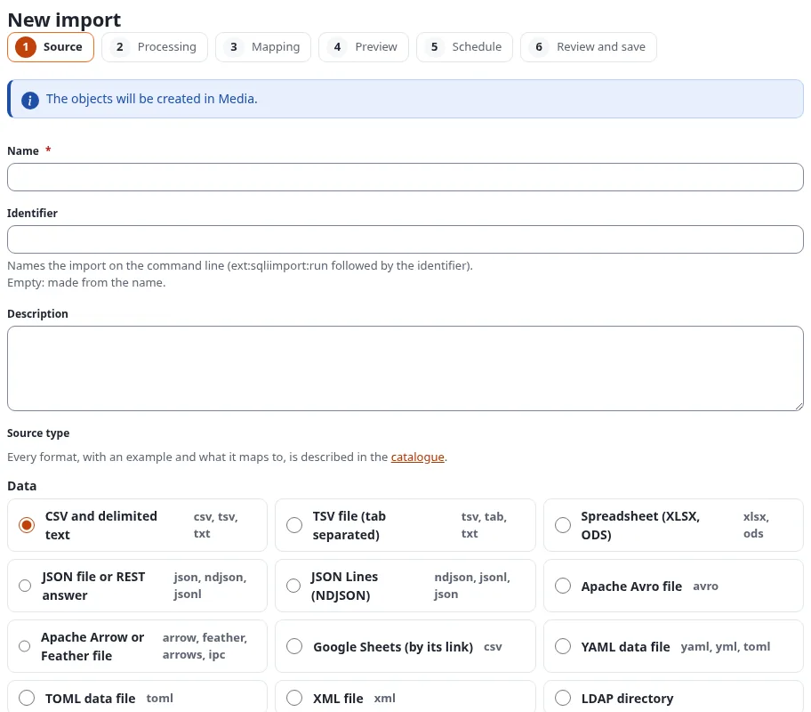
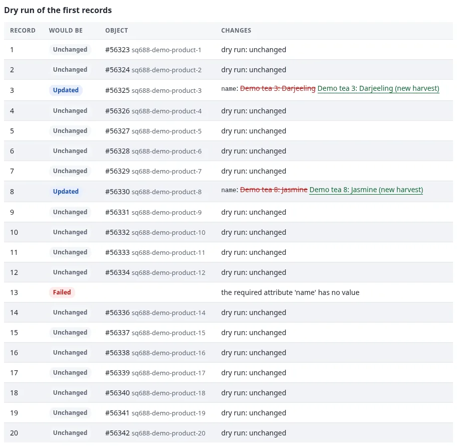

# Getting started with 7x SQLI Import

This page installs 7x SQLI Import 2.0, checks that it works, and walks through a first import of a CSV file.

## Contents

1. [Requirements](#requirements)
2. [Install](#install)
3. [The Imports tab](#the-imports-tab)
4. [A first import, step by step](#a-first-import-step-by-step)
5. [From the command line](#from-the-command-line)

## Requirements

- Exponential 6.0.14 or later, PHP 8.0 or later. Exponential 6.0.15 adds the bell in the header, the data tables
  and the **Looking for…?** boxes of the import and export tools.
- The extension **expqueue** (the job queue): its workers process every run.
- The extension **expui** (the shared components of the administration).
- Optional: the PHP extension **zip**, for spreadsheet sources (XLSX and ODS).

## Install

1. Require the package:

   ```bash
   composer require se7enxweb/sqliimport:^2.0@alpha
   ```

2. Activate `expqueue`, `expui` and `sqliimport` in `settings/override/site.ini.append.php`
   (`[ExtensionSettings] ActiveExtensions[]`), or for the administration only in `ActiveAccessExtensions[]`.
3. Regenerate the autoloads and create the tables. Both `install-schema` commands are idempotent; the second also
   upgrades the tables of 1.x:

   ```bash
   php bin/php/ezpgenerateautoloads.php -e
   ./console ext:expqueue:install-schema
   ./console ext:sqliimport:install-schema
   ```

4. Run both cron parts every minute:

   ```bash
   * * * * * cd /path/to/exponential && php runcronjobs.php -q expqueue
   * * * * * cd /path/to/exponential && php runcronjobs.php -q sqliimport
   ```

5. Clear the INI cache: `php bin/php/ezcache.php --clear-tag=ini`.

The extension manual has the same steps with every setting (`/exphelp/viewer/ext/sqliimport/getting-started.md`
and `/exphelp/viewer/ext/sqliimport/install.md`).

## The Imports tab

The extension adds the tab **Imports** to the administration. A siteaccess that resets `[TopAdminMenu] Tabs[]` in
its own `menu.ini.append.php` (a line `Tabs[]` without a value) must list `Tabs[]=sqliimport` there itself, or the
tab does not show in that siteaccess.

Two policies control the tab, both with a handler limitation (`SQLIImport_Type`):

| Policy | Allows |
|---|---|
| **Manage imports** (`sqliimport/manage`) | Everything: create, edit, copy, enable, disable and delete imports, schedules, triggers, the Settings page with the export and import of definitions, and running |
| **Run imports** (`sqliimport/run`) | Looking at the tab and running imports: Run now, Dry run, Cancel, Retry failed rows, Undo this run |

Roles made for 1.x keep working: `sqliimport/manageimports` counts as Manage imports, and
`sqliimport/listimports` lets a user look at the tab.

The left menu of the tab links the dashboard (**Overview**), **Statistics**, **New import**, **Schedules**,
**Catalogue**, **Settings**, **Running runs**, **Failed runs** and the **Job queue**, and below them the other
import and export tools of the site. A link is shown only to users who may open its page.

## A first import, step by step

The example imports a list of products from a CSV file into folders. It is the demo import "Demo: Products (CSV)"
of the test installation; any small CSV file works the same way.

The file, `products.csv` (the first lines of 50):

```text
id,name,code,description
1,Demo tea 1: Assam,T001,"A demo product of the CSV import, line 1."
2,Demo tea 2: Ceylon,T002,"A demo product of the CSV import, line 2."
3,Demo tea 3: Darjeeling,T003,"A demo product of the CSV import, line 3."
```

1. **Open the editor.** In **Imports**, press **New import**. To create the items below a particular folder, you can
   also open that folder and choose **Import/Export > Import into this folder…**: the editor then says where the
   items will be created.

   

2. **Step 1, Source.** Name: `Products (CSV)`. Leave the identifier empty (it becomes `products-csv`). Choose
   **CSV and delimited text**, then **An uploaded file** and pick `products.csv`. Set the option *Key field* to `id`.
   Press **Save and continue**. The import now exists, still disabled.
3. **Step 2, Processing.** Keep **Mapping to a content class (no code)**. Enter the node ID of the parent folder,
   keep **Create new, update existing**, and press **Save and continue**.
4. **Step 3, Mapping.** Choose the class **Folder** and save. Under *How a record finds its object*, choose a remote
   ID with the pattern `product-{id}`: the same line of the file always finds the same folder, so a second run
   updates instead of duplicating. Press **Auto-match by name**: `name` goes to *Name*. Put `code` in *Short name*
   and `description` with the transform `richtext` in *Summary*. Tick *Required* for *Name*. Save and continue.
5. **Step 4, Preview.** The first 20 lines of the file are shown as a table, and a dry run of them: on a first run
   every record says **Created**. Nothing is published yet.
6. **Step 5, Schedule.** Keep **Never** for now. Save and continue.
7. **Step 6, Review.** Tick **The import is enabled** and press **Save and run**. The run page opens and follows the
   run live; after a few seconds it ends with **50 created**.

The 50 folders now exist below the parent, each with the remote ID `product-1` to `product-50`. Run the import a
second time, unchanged: the run says **50 unchanged**, and no new version is published.

When the file changes later, press **Dry run** first. With two renamed products and one line without a name, the
dry run says what would happen, field by field, before anything is written:



What to do next: [The import editor](the-import-editor.md) explains each step in detail, and
[Imports and runs](imports-and-runs.md) what to do with the failed line and how to undo a run.

## From the command line

List the imports, and run one with a dry run first:

```bash
./console ext:sqliimport:list
./console ext:sqliimport:run products-csv --dry-run --wait
./console ext:sqliimport:run products-csv --wait
./console ext:sqliimport:status <run id>
```

If the dashboard warns that the tables or the job queue are missing, run the matching `install-schema` command. More
help when something does not work: `/exphelp/viewer/ext/sqliimport/troubleshooting.md`.

Next: [The import editor](the-import-editor.md).
