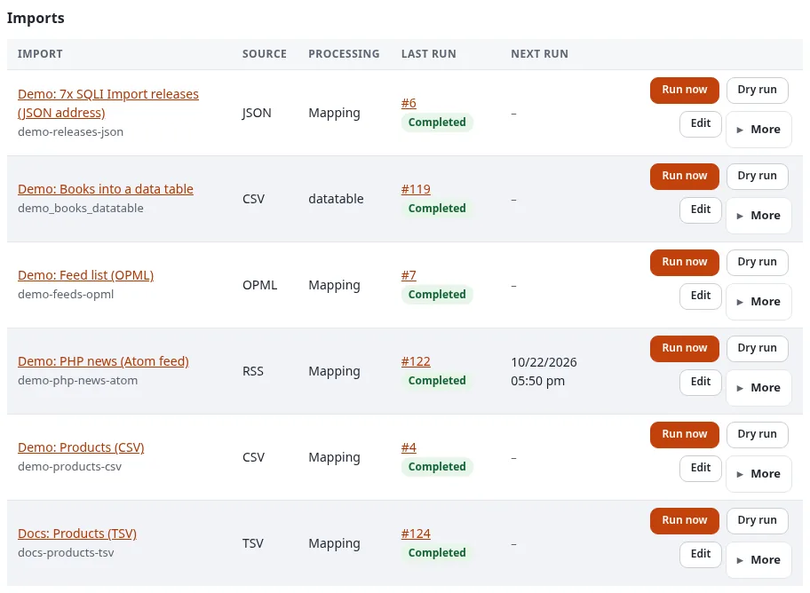
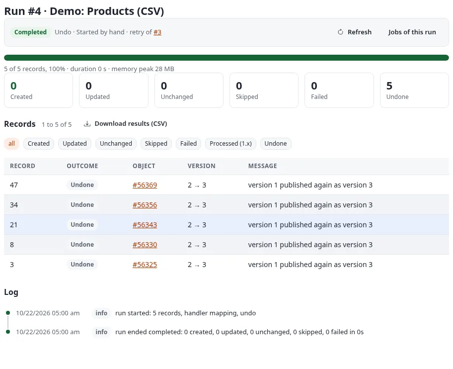
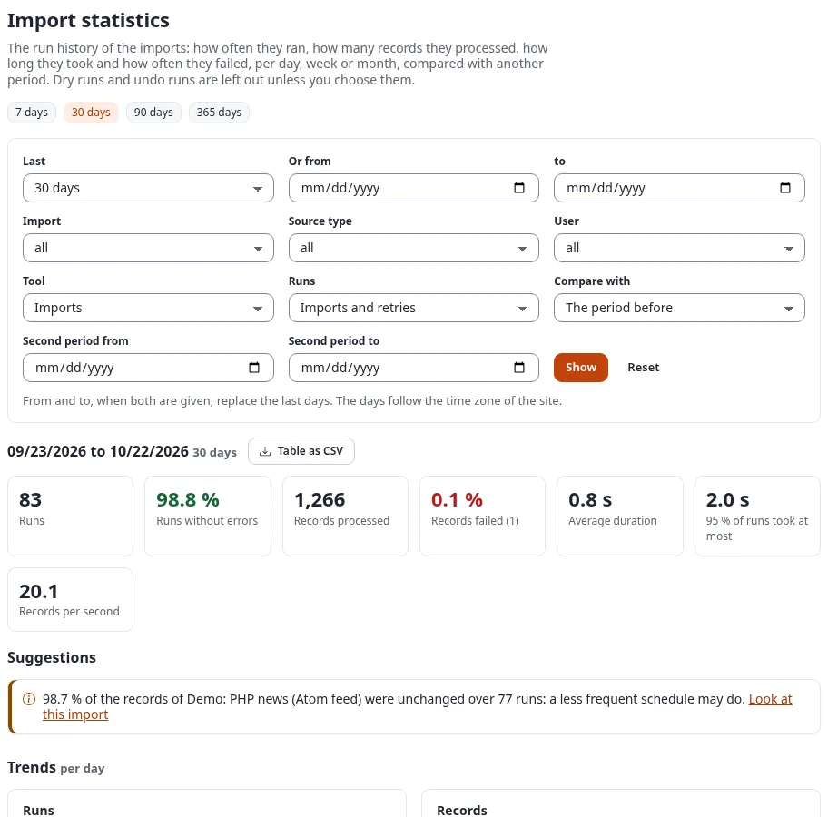
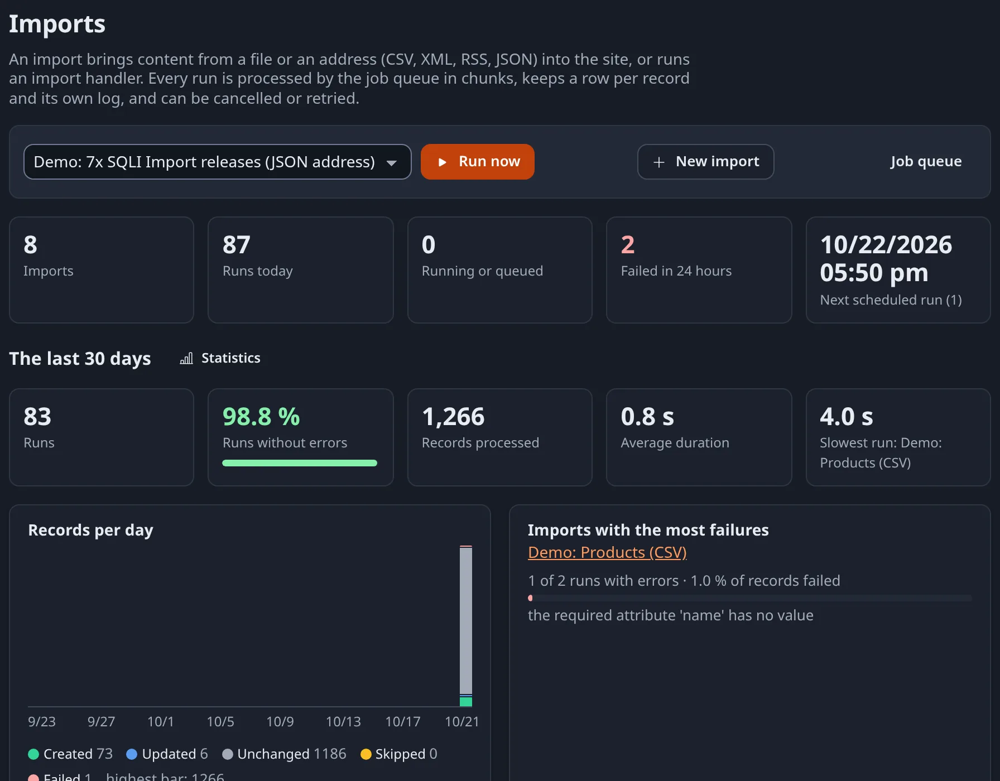

# Imports and runs in 7x SQLI Import

An **import** is the definition: where the data comes from, what is made of it and where it goes. A **run** is one
execution of an import. This page shows how to start runs, follow them, and fix or undo what they did.

## Contents

1. [The dashboard](#the-dashboard)
2. [How a run works](#how-a-run-works)
3. [The run page](#the-run-page)
4. [Example: a run with a failed line](#example-a-run-with-a-failed-line)
5. [Undo a run](#undo-a-run)
6. [Notifications and the bell](#notifications-and-the-bell)
7. [Statistics](#statistics)
8. [From the command line](#from-the-command-line)

## The dashboard

**Imports** (`sqliimport/list`) shows the key figures (imports, runs today, runs running or queued, runs failed in
the last 24 hours, the next scheduled run), the last 30 days, the imports and their runs. The **Run now** toolbar at
the top starts any import; **New import** opens the editor.



- **Run now** (for an enabled import) and **Dry run** are shown to users with Run imports or Manage imports.
- **Edit** and **More** (Duplicate, New data table from its fields, Enable or Disable, Delete) to users with Manage
  imports ([The import editor](the-import-editor.md#copying-disabling-and-deleting)).
- The runs below are filtered by status (all, running or queued, failed, completed, cancelled) and by tool: Imports,
  or any other import and export tool of the site, or all of them.

The admin dashboard has a block **Imports** with the latest runs and a warning when runs failed in the last 24 hours.

## How a run works

A run is processed by the job queue, not by the page that starts it: a start job reads the source and counts the
records, chunk jobs process 200 records each (`[RunSettings] ChunkSize`) in the order of the source, and a finish
job clears the caches of the changed items, indexes them and writes the summary. You can leave the page; the run goes
on.

- One import runs only once at a time; different imports run in parallel.
- A chunk saves a checkpoint every 20 records, so a worker that dies is followed by an attempt that continues there.
- A **Dry run** publishes nothing. It reads the first 20 records (`[RunSettings] DryRunRows`) and records what would
  happen, with the changed fields.

| Status | Meaning |
|---|---|
| Queued | Waiting for a worker of the job queue |
| Running | Being processed |
| Completed | Ended, no record failed |
| Completed with errors | Ended, some records failed |
| Failed | Stopped, for example because the source could not be read |
| Cancelled | Cancelled by a user |

Every record gets a row with its outcome: **Created**, **Updated** (a field changed, so a new version was published),
**Unchanged** (nothing to publish), **Skipped** (for example by the conflict rule), **Failed** (with the message),
**Undone** (by an undo run) or **Processed (1.x)** (a 1.x handler processed it).

## The run page

`sqliimport/run/<id>` shows the status, the progress bar with the duration and the memory peak, the outcomes as
figures (each one filters the records), the records with their object, version and message, and the run's log.

While a run is queued or running, the page follows it **live**: every two seconds it shows the new progress,
counters and log lines without loading the page again. The buttons:

- **Cancel** stops a run that has not ended. Records already processed stay as they are.
- **Retry failed rows** starts a new run that processes only the failed records of an ended run (not for 1.x
  handlers).
- **Undo this run** reverses what the run did ([below](#undo-a-run)).
- **Download results (CSV)**: one line per record with its outcome, object, remote ID, versions, changed fields and
  message, to check a run in a spreadsheet or hand it to someone.
- **Jobs of this run** opens its jobs in the job queue; **Refresh** loads the page by hand.

## Example: a run with a failed line

The products file of [Getting started](getting-started.md#a-first-import-step-by-step) comes back with five renamed
products, and line 13 has lost its name:

```text
13,,T013,"A demo product of the CSV import, line 13."
```

**Run now** gives this run page:


1. Press the figure **1 Failed** to see only the failed record and its message.
2. The data itself is wrong here, so fix line 13 in the file, upload it again in the source step of the editor, and
   press **Run now**. Line 13 is created; the other records are unchanged, so nothing else gets a new version.
3. **Retry failed rows** is for failures whose cause was outside the record, such as a parent folder that did not
   exist yet or a server that did not answer: fix the cause, then retry. The retry processes only the failed
   records, as the run stored them, and leaves the others alone.

## Undo a run

**Undo this run** reverses a run that created or updated items: what it **created** goes to the trash, what it
**updated** gets the version from before the run published again, as a new version. An item someone changed after
the run is left alone and listed. A run is undone once, within 30 days (`[RunSettings] UndoDays`, or the import's own
**Days a run can be undone**). The undo is a run of its own, with its own page:



The page of the undone run then says **This run was undone by run #4**. An undo cannot be undone; if you need the
newer values again, run the import again. Runs into a data table write rows, not content; see the manual for what an
undo does there (`/exphelp/viewer/ext/sqliimport/runs.md`).

## Notifications and the bell

Who hears of a run that ended is set per import in the step Processing, under **Notifications**. The user who started
the run sees a notice under **New since you last looked** on the dashboard until the run's page is opened or **Mark
all as read** is used. From Exponential 6.0.15 on, the header of the administration (admin4) also has a **bell** with
the number of unread notices; its panel lists the newest runs with their outcome, and **All imports** opens the
dashboard. E-mail addresses of the import get a mail with the counts, the first errors and the link to the run.

## Statistics

**Statistics** in the left menu (`sqliimport/statistics`) answers how often the imports ran, how many records they
processed, how long they took and how often they failed, per day, week or month, compared with another period.
Filter by import, source type, user and tool; **Table as CSV** downloads the figures. **Suggestions** point at what to
improve, such as an import whose records are nearly always unchanged and could run less often.



Dry runs and undo runs are left out unless you choose them under **Runs**. Details:
`/exphelp/viewer/ext/sqliimport/statistics.md`.

The pages follow the dark mode of the administration as well:



## From the command line

```bash
./console ext:sqliimport:run <identifier>            # queue a run
./console ext:sqliimport:run <identifier> --wait     # process it here and print the result
./console ext:sqliimport:run <identifier> --dry-run --wait
./console ext:sqliimport:status <run id>             # the run with its log
./console ext:sqliimport:cancel <run id>
./console ext:sqliimport:retry <run id>
./console ext:sqliimport:undo <run id> --wait
./console ext:sqliimport:report <run id> > run.csv   # the results as CSV
```

Ended runs older than 90 days (`[RunSettings] KeepDays`) are removed with their rows and log by the cron part.

Next: [Schedules and cron](schedules-and-cron.md).
